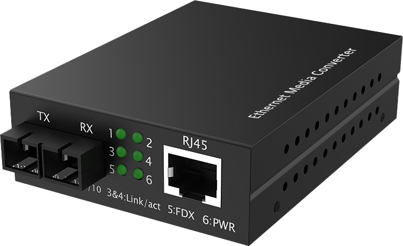
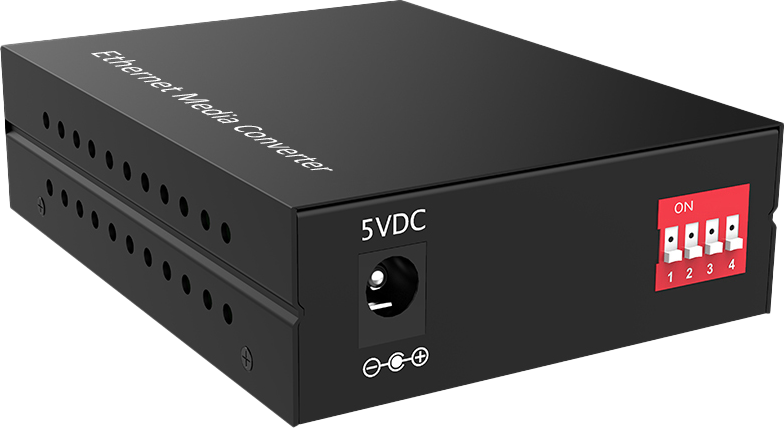

# LT-MC80F Series — 10/100M Media Converters Enhanced Function With Dip Switch

- 官网页面：https://www.smartbyte-switch.com/10-100M-Media-Converters-Enhanced-Function-With-Dip-Switch-PG12143544（抓取 2026-10-20，原始 HTML：`data/smartbyte_site_raw/html/10-100M-Media-Converters-Enhanced-Function-With-Dip-Switch-PG12143544.html`）
- 官网品类：Commercial Ethernet / Media converter
- 页面描述（meta）：10/100M Media Converters Enhanced Function With Dip Switch , LT-MC80F Series, SmartByte
- 规格书（Download Annex）：10/100M Media Converters Enhanced Function With Dip Switch — https://www.smartbyte-switch.com/index.php?c=Front%2FDownDetail&a=downloadFujian&name=10%2F100M+Media+Converters+Enhanced+Function+With+Dip+Switch+&path=L2NvbWRhdGEvNzA5MDEvcHJvZHVjdGZ1amlhbi8yMDI2MDcwMTE2MjUwMTZhNDRjZWRkMGE3YzgucGRm（已归档 PDF `data/smartbyte_site_raw/datasheets/10_100M Media Converters Enhanced Function With Dip Switch.pdf`，文本 `data/smartbyte_site_raw/datasheet_text/10_100M Media Converters Enhanced Function With Dip Switch.txt`）

## 价格主表对照（SmartByte 2026-09 价格表，有效期 2026-09-01～12-30；USD 按 6.69 @2026-10-17）
- 价格主表**未匹配**（未匹配）：该型号不在 2026-09 价格表的 135 个型号里 → 报价前向 SmartByte 询价；档案中只能写 SmartByte 型号并注明。

## Overview（原文）

LT-MC80F enhanced function series Ethernet media converter can interconvert electrical signals of 10Base-T and 100Base–TX twisted pairs with optical signals of 100Base-FX.
It extends
the network transmission distance from 100m via copper cables to 120 km via fiber optical cable. The key function of enhanced series are supporting LFP, network storm suppression, fixing the electrical port on 10M and full duplex operation state. It enables the data to transmit in two different mediums of electrical and optical networks either by the technology of data link L2 store-and-forward, or by the one of PHY L1 cut-through).
It supports transmission in Multi-mode dual fiber, single mode dual fiber, single mode single fiber

## Features（原文）

- 10/100Mbps auto-sensed, facilitating network upgrade
- Dip switch function: supporting LFP, network storm suppression, fixing the electrical port on 10M and full duplex operation state
- Built-in efficient switching core to implement flow control and reduce broadcast packets
- Full-duplex and half-duplex auto-sensed
- Supporting auto-sense of MDI/MDI-X, facilitating system commissioning and installation
- Supporting half /full-duplex of FX
- Supporting 10/100Mbps store-and-forward and 100Mbps cut-through transmission
- Supporting the transmission of 100Base-FX or STM-1, compatible with other devices
- Supporting low-time lag transmission
- Supporting watchdog function, which can restart the equipments automatically when it is Frozen
- Extremely low power consumption (≤0.8W), reliable and stable performance
- Options in Multi-mode dual fiber, single mode dual fiber, single mode single fiber
- Transmission distance 2KM～120KM optional
- 4KV surge protection, ESD: Air-15kV, Contact-8kV protection

## Technical specification（原文，表格逐行照录）

| 小节 | 项目 | 规格 |
|---|---|---|
| Port interface | Fixed port | 1*100 Base-X SC port(FC/ST optional) + 1*10/100 Base － T RJ45 port |
| Port interface | Power interface | DC jack |
| Port interface | Ethernet standard | IEEE802.3 10Base-T Ethernet, IEEE802.3u,100Base-TX/FX Fast Ethernet, IEEE802.3x Flow Control |
| LED indicators | PWR | Power supply indicator |
| LED indicators | FDX | Electrical port operation mode indicator |
| LED indicators | Link/Act | Link state indicator |
| LED indicators | Copper 100M Link | Electrical port speed rate indicator |
| LED indicators | Fiber 100M Link | Fiber port speed rate indicator |
| Dip switch function | 1 ： LFP | 2 ： Network storm suppression |
| Dip switch function | 3 ： Fixing the electrical port on 10M | 4 ： Electrical port full duplex |
| Cable type & transmission distance | Twisted-pair | 0-100m （ CAT5e,CAT6 ） |
| Cable type & transmission distance | Multimode optical fiber | 2KM |
| Cable type & transmission distance | Single mode dual fiber | 20/40/60/80/100/120KM |
| Cable type & transmission distance | Single mode single fiber | 20/40/60/80/100KM |
| Electrical specification | Input voltage | DC 5V |
| Electrical specification | Total Power consumption | ≤0.8W |
| Layer 2 switching | Switching capacity | 1G |
| Layer 2 switching | Packet forwarding rat ） | 0.744Mpps |
| Layer 2 switching | MAC address table | 2K |
| Layer 2 switching | Buffer | 2K |
| Layer 2 switching | Forwarding delay | <5us |
| Layer 2 switching | MDX/MIDX | Support |
| Layer 2 switching | Watchdog | Support |
| Layer 2 switching | LFP | Support |
| Environment | Operating temperature | -20 ℃ ~70 ℃ |
| Environment | Storage temperature | -40 ℃ ~85 ℃ |
| Environment | Relative humidity | 5%~95% （ non-condensing ） |
| Environment | Thermal methods | Fan-less, natural heat dissipation |
| Environment | MTBF | 100,000 hours |
| Protection & Certification | Power surge protection | IEC 61000-4-5 Level 4 （ 4KV ）（ 8/20us ） |
| Protection & Certification | Ethernet port surge protection | IEC 61000-4-5 Level 3 （ 2KV ）（ 10/700us ） |
| Protection & Certification | ESD | IEC 61000-4-2 Level 4 （ 8K/15K ） |
| Protection & Certification | Free fall | 0.5m |
| Protection & Certification | Certification | CE, FCC, RoHs |
| Structure | Dimension(mm) | 93*71*27mm |
| Structure | Installation method | Desktop, wall-mount |
| Structure | Weight | Net weight 0.2KG |

## Order information（原文）

| Model | Description |
|---|---|
| LT-MC80F-SC02 | 10/100Base-TX to 100Base-FX, 1*100M SC port + 1*10/100M RJ45 port ,multi-mode, 2km, SC, standalone, external power adaptor, enhanced function with Dip switch |
| LT-MC80F-SC20 | 10/100Base-TX to 100Base-FX, 1*100M SC port + 1*10/100M RJ45 port ,single mode dual fiber, 20km, SC, standalone, external power adaptor. 40/60/80/100/120KM optional, ST/FC optional, enhanced function with Dip switch |
| LT-MC80F-SC20A | 10/100Base-TX to 100Base-FX, 1*100M SC port + 1*10/100M RJ45 port, single mode single fiber, 20km, SC, TX1310nm, standalone, external power adaptor; 40/60/80/100KM optional, ST/FC optional, enhanced function with Dip switch |
| LT-MC80F-SC20B | 10/100Base-TX to 100Base-FX, 1*100M SC port + 1*10/100M RJ45 port, single mode single fiber, 20km, SC, TX1550nm, standalone, external power adaptor; 40/60/80/100KM optional, ST/FC optional, enhanced function with Dip switch |

## 图片（2/3 张已入库 `data/smartbyte_site_raw/images/`，其余仅 CDN 链接）

- https://gcdn.meidianbang.cn/comdata/70901/product/2026070116245819B8AC3848AC4DD6_b.png → `data/smartbyte_site_raw/images/comdata_70901_product_2026070116245819B8AC3848AC4DD6_b.png`

- https://gcdn.meidianbang.cn/comdata/70901/product/2026070116245952B20C9FC17AED28_b.png → `data/smartbyte_site_raw/images/comdata_70901_product_2026070116245952B20C9FC17AED28_b.png`
- （栏目内图）https://gcdn.meidianbang.cn/images/imgbg.png

---
来源：SmartByte 官网（T15 Actions 归档，原文照录，未做改写）；本文件由 `scripts/smartbyte_crawl/build.py` 生成，勿手改。
