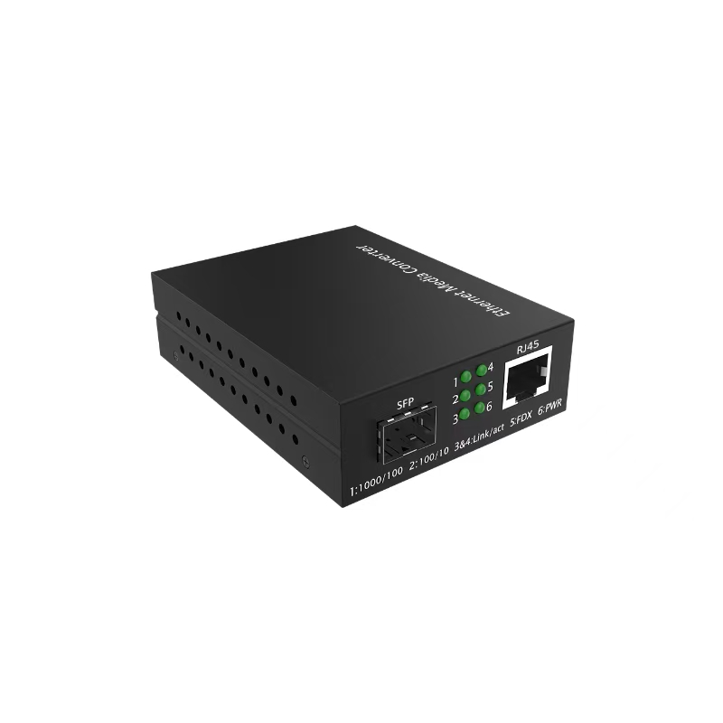
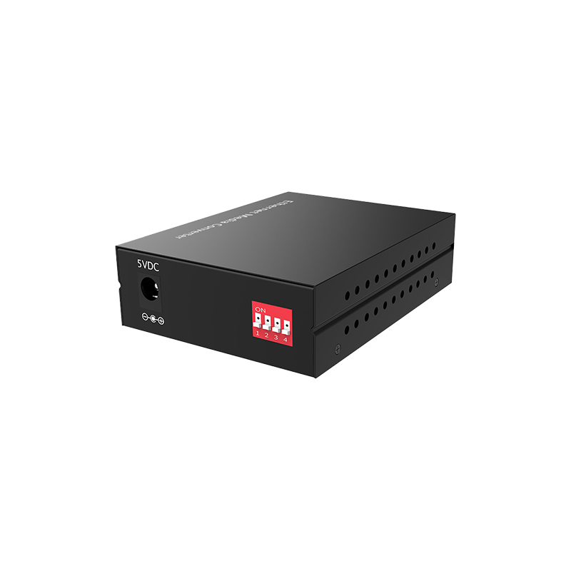

# LT-MC80G Series — 10/100/1000M Media Converters Enhanced Function with Dip switch

- 官网页面：https://www.smartbyte-switch.com/10-100-1000M-Media-Converters-Enhanced-Function-with-Dip-switch-PG12143554（抓取 2026-10-20，原始 HTML：`data/smartbyte_site_raw/html/10-100-1000M-Media-Converters-Enhanced-Function-with-Dip-switch-PG12143554.html`）
- 官网品类：Commercial Ethernet / Media converter
- 页面描述（meta）：10/100/1000M Media Converters Enhanced Function with Dip switch , LT-MC80G Series, SmartByte
- 规格书（Download Annex）：10/100/1000M Media Converters Enhanced Function with Dip switch — https://www.smartbyte-switch.com/index.php?c=Front%2FDownDetail&a=downloadFujian&name=10%2F100%2F1000M+Media+Converters+Enhanced+Function+with+Dip+switch+&path=L2NvbWRhdGEvNzA5MDEvcHJvZHVjdGZ1amlhbi8yMDI2MDcwMjA5MjcwMTZhNDViZTY1ZTM2NTUucGRm（已归档 PDF `data/smartbyte_site_raw/datasheets/10_100_1000M Media Converters Enhanced Function with Dip switch_23d4430d.pdf`，文本 `data/smartbyte_site_raw/datasheet_text/10_100_1000M Media Converters Enhanced Function with Dip switch_23d4430d.txt`）

## 价格主表对照（SmartByte 2026-09 价格表，有效期 2026-09-01～12-30；USD 按 6.69 @2026-10-17）
- 价格主表**未匹配**（未匹配）：该型号不在 2026-09 价格表的 135 个型号里 → 报价前向 SmartByte 询价；档案中只能写 SmartByte 型号并注明。

## Overview（原文）

LT-MC80G enhanced function series, featuring with 1*Gigabit SFP port + 1* 10/100/1000M RJ45 port, are the 10/100/1000Mbps adaptive Gigabit Ethernet media converter which adopt switching technology to fulfill media conversion. They complies with IEEE802.3, IEEE802.3u, IEEE802.3z and IEEE802.3ab standards and provide media conversion between 10/100/1000Base-T and 1000Base-SX/LX interface.
The key function of enhanced series are supporting LFP, network storm suppression, forcing the electrical port and fiber port on 100M
，
which can meet with the different application requirement

## Features（原文）

- 10/100/1000M media converter with SFP slot
- Complies with IEEE 802.3 10Base-T, IEEE 802.3u 100Base-TX, IEEE 802.3ab 1000Base-T, IEEE 802.3z 1000Base-SX
- Media conversion between 10/100/1000Base-T and 1000Base-SX
- Supporting auto-sensing full-duplex and half-duplex operation
- Supporting auto-sensation of MDI/MDI-X, facilitating system commissioning and installation
- Supporting watchdog function, which can restart the equipments automatically when it is Frozen
- Dip switch function: supporting LFP, network storm suppression, forcing the electrical port and fiber port on 100M
- Supporting 1M Large buffer
- Supporting Jumbo frame 10Kbytes
- Supporting Quality of Service (QoS) and ensuring the transmission of VoIP packets
- Store-and-Forward mechanism
- Flexible transmission distance based on different SFP module
- 4KV surge protection, ESD: Air-15kV, Contact-8kV protection

## Technical specification（原文，表格逐行照录）

| 小节 | 项目 | 规格 |
|---|---|---|
| Port interface | Fixed port | 1*1000 Base-X SFP port + 1*10/100/1000 Base － T RJ45 |
| Port interface | Power interface | DC jack |
| Port interface | Ethernet standard | IEEE802.3 10Base-T Ethernet, IEEE802.3u 100Base-TX Fast Ethernet, IEEE802.3ab 1000Base-T , IEEE802.3z 1000Base-SX Gigabit Ethernet |
| LED indicators | PWR | Power supply indicator |
| LED indicators | FDX | Electrical port operation mode indicator |
| LED indicators | Link/Act | Link state indicator |
| LED indicators | Copper 100M Link | Electrical port speed rate indicator |
| LED indicators | Copper 1000M Link | Electrical port speed rate indicator |
| LED indicators | Fiber Link/Act | Fiber port link state indicator |
| Dip switch function | 1. LFP | 2. Network storm suppression |
| Dip switch function | 3.Forcing fiber port on 100M | 4. Forcing electrical port on 100M |
| Cable type & transmission distance | Twisted-pair | 0-100m （ CAT5e,CAT6 ） |
| Cable type & transmission distance | Fiber port | Depending on the SFP module |
| Electrical Specifications | Input voltage | DC 5 V |
| Electrical Specifications | Total Power consumption | full load≤1.6W |
| Layer 2 Switching | Switching capacity | 14G |
| Layer 2 Switching | Packet forwarding rate | 10.416Mpps |
| Layer 2 Switching | MAC address table | 8K |
| Layer 2 Switching | Buffer | 1M |
| Layer 2 Switching | Forwarding delay | <5us |
| Layer 2 Switching | MDX/MIDX | Support |
| Layer 2 Switching | Jumbo Frame | Support 10Kbytes |
| Layer 2 Switching | Watchdog | Support |
| Layer 2 Switching | LFP | Support |
| Environment | Operating temperature | -20 ℃ ~70 ℃ |
| Environment | Storage temperature | -40 ℃ ~85 ℃ |
| Environment | Relative humidity | 5%~95% （ non-condensing ） |
| Environment | Thermal methods | Fan-less, natural heat dissipation |
| Environment | MTBF | 100,000 hours |
| Protection & Certification | Power surge protection | IEC 61000-4-5 Level 4 （ 4KV ）（ 8/20us ） |
| Protection & Certification | Ethernet port surge protection | IEC 61000-4-5 Level 3 （ 2KV ）（ 10/700us ） |
| Protection & Certification | ESD | IEC 61000-4-2 Level 4 （ 8K/15K ） |
| Protection & Certification | Free fall | 0.5m |
| Protection & Certification | Certification | CE, FCC, RoHs |
| Structure | Dimension | 93*71*27mm |
| Structure | Installation method | Desktop, wall-mount |
| Structure | Weight | Net weight 0.2KG |

## Order information（原文）

| Model | Description |
|---|---|
| LT-MC80G | 10/100/1000Base-T to 1000Base-F,1*Gigabit SFP port + 1*10/100/1000M RJ45 port, without SFP module, external power adaptor, enhanced function with Dip switch |

## 图片（2/3 张已入库 `data/smartbyte_site_raw/images/`，其余仅 CDN 链接）

- https://gcdn.meidianbang.cn/comdata/70901/product/202607020913589DC73473B4152C2E_b.jpg → `data/smartbyte_site_raw/images/comdata_70901_product_202607020913589DC73473B4152C2E_b.jpg`

- https://gcdn.meidianbang.cn/comdata/70901/product/202607020925422E3862AACA55FAD4_b.jpg → `data/smartbyte_site_raw/images/comdata_70901_product_202607020925422E3862AACA55FAD4_b.jpg`
- （栏目内图）https://gcdn.meidianbang.cn/images/imgbg.png

---
来源：SmartByte 官网（T15 Actions 归档，原文照录，未做改写）；本文件由 `scripts/smartbyte_crawl/build.py` 生成，勿手改。
