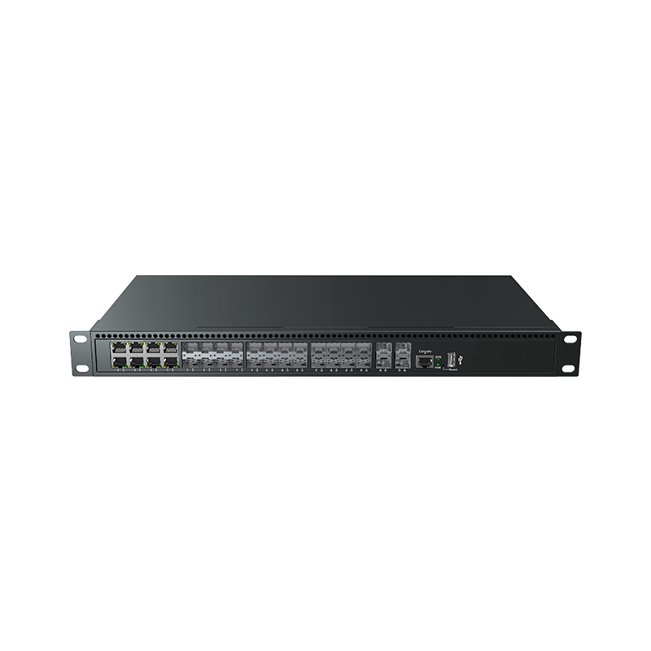
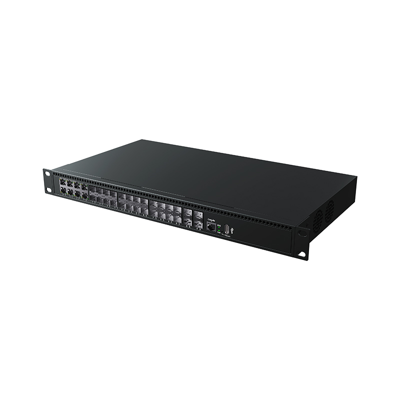
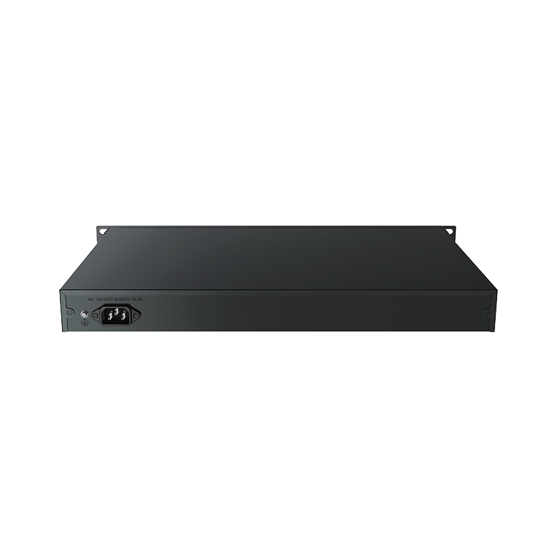

# LT-S8528XG-4XS16GX8GC — 16*100/1000M SFP + 8*1G SFP/RJ45 Combo + 4*1G/2.5G/10G SFP+ Layer 3 Managed Ethernet Switch

- 官网页面：https://www.smartbyte-switch.com/16-100-1000M-SFP-8-1G-SFP-RJ45-Combo-4-1G-2-5G-10G-SFP-Layer-3-Managed-Ethernet-Switch-PG12130164（抓取 2026-10-20，原始 HTML：`data/smartbyte_site_raw/html/16-100-1000M-SFP-8-1G-SFP-RJ45-Combo-4-1G-2-5G-10G-SFP-Layer-3-Managed-Ethernet-Switch-PG12130164.html`）
- 官网品类：Commercial Ethernet / Managed Ethernet Switch
- 页面描述（meta）：16*100/1000M SFP + 8*1G SFP/RJ45 Combo + 4*1G/2.5G/10G SFP+ Layer 3 Managed Ethernet Switch, LT-S8528XG-4XS16GX8GC, SmartByte
- 规格书（Download Annex）：16*100/1000M SFP 8*1G SFP/RJ45 Combo 4*1G/2.5G/10G SFP Layer 3 Managed Ethernet Switch — https://www.smartbyte-switch.com/index.php?c=Front%2FDownDetail&a=downloadFujian&name=16%2A100%2F1000M+SFP+++8%2A1G+SFP%2FRJ45+Combo+++4%2A1G%2F2.5G%2F10G+SFP++Layer+3+Managed+Ethernet+Switch&path=L2NvbWRhdGEvNzA5MDEvcHJvZHVjdGZ1amlhbi8yMDI2MDYyMzE1MTUxODZhM2EzMjg2OTI2MTAucGRm（已归档 PDF `data/smartbyte_site_raw/datasheets/16_100_1000M SFP   8_1G SFP_RJ45 Combo   4_1G_2.5G_10G SFP  Layer 3 Managed Ethernet Switch.pdf`，文本 `data/smartbyte_site_raw/datasheet_text/16_100_1000M SFP   8_1G SFP_RJ45 Combo   4_1G_2.5G_10G SFP  Layer 3 Managed Ethernet Switch.txt`）

## 价格主表对照（SmartByte 2026-09 价格表，有效期 2026-09-01～12-30；USD 按 6.69 @2026-10-17）
- 基型号：**LT-S8528XG-4XS16GX8GC**（匹配方式：精确）
- CNY 未税：2100；USD@+20% 376.7 / +25% 392.4 / +30% 408.1
- Saga 对应型号：**STC-4168XGGCM**；Saga 列表价 USD：413.0；档位/备注：L3；对照说明：16×1G SFP + 8×Combo + 4×10G，L3

## Overview（原文）

SmartByte
LT-S8528XG
-4XS16GX8GC is a Layer 3 Managed Gigabit Switch that provides high-density performance, Layer 3 static and dynamic routing, RIP (Routing Information Protocol) and OSPF (Open Shortest Path First). With 128 Gbps switching capacity and 4 *1G/2.5G/10Gbps flexible and higher performance uplink capability. The LT-S8528XG-4XS16GX8GC provides comprehensive end to end QoS as well as flexible and rich management, security settings, which can meet the high speed, secure and smart requirement for small and medium-size enterprise networks based on cost effective price. The powerful network security features also make the LT-S8528XG-4XS16GX8GC perform effective data traffic control for ISP and enterprise VoIP, video streaming, and multicast applications.

## Features（原文）

- 4*1G/2.5G/10G SFP+ slots uplink, 16*100/1000M SFP ports + 8*1G SFP/RJ45 COMBO ports downlink, 1*RJ45 console interface for switch basic management and setup.
- Hardware:
- Marvell AC5 series 1.2GHz CPU, Marvell AC5 series switch chipsets, 1GB RAM and 512MB flash
- Layer 3 features:
- IPv4/IPv6 static routing, DHCPv4/ DHCPv6 client, DHCPv4 relay, DHCP relay; Supports ECMP, VRRP, RIP, OSPF, BGP4, IS-IS; 13K routing entries
- Port features:
- Supports port aggregation, IEEE802.3x flow control, port isolation, port mirroring, loop detection and
- broadcast storm suppression
- VLAN:
- Supports IEEE802.1Q tagged VLAN, mac based VLAN, IP based VLAN, protocol based VLAN, voice VLAN and
- private VLAN.
- QinQ:
- Supports port-based, VLAN-based and flow-based QinQ
- Supports
- GVRP/LLDP/SPAN/RSPAN/DHCPv4 snooping
- Layer 2 ring network protocol:
- Supports STP, RSTP, MSTP, G.8032 ERPS protocol, single ring, sub ring
- Multicast:
- IGMP snooping, IGMP v1, v2, v3, PIM-SM
- QoS:
- QoS class, remarking, Supports SP, WRR queue scheduling, Ingress/Egress port-based rate-limit
- and policy-based QoS
- Security:
- Supports ACL, 802.1x
- ，
- port-security, IP source guard, ARP-check, DAI, anti-gateway ARP spoofing,
- Ddos attack protection, telnet/SSH/HTTP/HTTPS user access control and AAA.
- Reliability:
- Loop detect based on port or VLAN, the Ethernet in the first mile 802.3ah
- Management:
- Supports IPv4/IPv6 dual stack management, system log management, user management,
- login service management, firmware management, web management, CLI management, fault detection, DNS,
- NTP, sFlow, SNMP, MQTT, RMON and dual partition management.
- Application protocol:
- Supports telnet server, telnet client, SCP, SFTP, SSH server, TACACS and TFTP client

## Technical specification（原文，表格逐行照录）

| 小节 | 项目 | 规格 |
|---|---|---|
|  | Model No. | LT-S8528XG-4XS16GX8GC |
|  | Interface | 1G/2.5G/ 10G Fiber ports \| 100/1000 F iber ports \| Gigabit C ombo |
|  | Interface | 4 \| 16 \| 8 |
|  | Ethernet | 16*100/1000Base-X SFP 8 *COMBO SFP/RJ45 4*1G/2.5G/10GBase-X SFP+ |
|  | CPU | Marvell AC5 series 1.2GHz |
|  | Size of RAM | 1GB |
|  | Size of Flash | 512MB |
|  | Switch chip model | Marvell AC5 series |
|  | Management port | 1*RJ45 Console port (115200,8,N,1), 1*USB 2.0 |
|  | Standard | IEEE 802.3 10Base-T Ethernet IEEE 802.3u 100Base-TX Ethernet IEEE 802.3ab 1000Base-T Ethernet IEEE 802.3z 1000Base-X Ethernet IEEE 802.3ae 10Gigabit Ethernet IEEE802.3x Flow Control and Back Pressure IEEE 802.1D Spanning Tree Protocol IEEE 802.1w Rapid Spanning Tree Protocol IEEE 802.1Q VLAN ITU-T G.8032 ERPS IEEE 802.1X Port Authentication Network Control IEEE 802.1ab LLDP IEEE 802.3ad LACP |
| LED Indicators | P WR (Power indicator) | Off: the device is power off or failed \| On: the device power on is normal |
| LED Indicators | S YS ( System status indicator) | Blinking: device initialization \| O n: device on normal operation |
| LED Indicators | 1- 8 (Copper ports indicators) Green | Off: ports link down |
| LED Indicators | 1- 8 (Copper ports indicators) Green | On: ports link up |
| LED Indicators | 1- 8 (Copper ports indicators) Green | Blinking: data on TX/RX |
| LED Indicators | 1- 8 (Copper speed indicators) Yellow | Off: ports on 10/100M |
| LED Indicators | 1- 8 (Copper speed indicators) Yellow | On: ports on 1000M |
| LED Indicators | 1 - 8 (Fiber ports indicators) Green | Off: ports link down |
| LED Indicators | 1 - 8 (Fiber ports indicators) Green | On: ports link up |
| LED Indicators | 1 - 8 (Fiber ports indicators) Green | Blinking: data on TX/RX |
| LED Indicators | 9 - 28 (Fiber ports indicators) Green | Off: ports link down |
| LED Indicators | 9 - 28 (Fiber ports indicators) Green | On: ports link up |
| LED Indicators | 9 - 28 (Fiber ports indicators) Green | Blinking: data on TX/RX |
| Power parameter | Input voltage | 1* AC 100-240V input on default 1* DC 36-72V input optional 2* AC 100-240V input optional 1* AC 100-240V input + 1* DC 36-72V input optional |
| Power parameter | Total power consumption | Full loading ≤ 36W |
| Power parameter | Over-current protection | Support |
| Layer 2 switching | Port aggregation | Support GE port aggregation |
| Layer 2 switching | Port aggregation | Support 2.5GE aggregation |
| Layer 2 switching | Port aggregation | Support 10GE aggregation |
| Layer 2 switching | Port aggregation | Support static aggregation |
| Layer 2 switching | Port aggregation | Support LACP dynamic aggregation |
| Layer 2 switching | Port aggregation | Up to 64 aggregation groups and up to 8 ports per group |
| Layer 2 switching | Port features | Support IEEE802.3x flow control |
| Layer 2 switching | Port features | Support interface counters |
| Layer 2 switching | Port features | Support port isolation |
| Layer 2 switching | Port features | Port mirroring (One-to-One, Many - to -O ne ) |
| Layer 2 switching | Port features | Support loop detection (Port-based; VLAN-based) |
| Layer 2 switching | Port features | Support broadcast storm suppression (broadcast; unknown multicast; unknown unicast) |
| Layer 2 switching | VLAN | IEEE802.1Q tagged VLAN |
| Layer 2 switching | VLAN | Mac based VLAN |
| Layer 2 switching | VLAN | IP based VLAN |
| Layer 2 switching | VLAN | Protocol based VLAN |
| Layer 2 switching | VLAN | Voice VLAN, s pecially divide VLAN for user voice data flow |
| Layer 2 switching | VLAN | Private VLAN , d ivide a VLAN broadcast domain into multiple subdomains to form a double-layer VLAN structure |
| Layer 2 switching | VLAN | VLAN range: 1-4094 |
| Layer 2 switching | VLAN | Support access mode/trunk mode/hybrid mode |
| Layer 2 switching | Mac-address table management | Support static Mac-address management |
| Layer 2 switching | Mac-address table management | Support dynamic Mac-address Management |
| Layer 2 switching | Mac-address table management | Support filtering Mac-address |
| Layer 2 switching | Mac-address table management | Support MAC limit based on port and VLAN |
| Layer 2 switching | Mac-address table management | Support MAC flapping based on port and VLAN |
| Layer 2 switching | Mac-address table management | 16K Mac-address table size |
| Layer 2 switching | GVRP | Normal mode |
| Layer 2 switching | GVRP | Fixed mode |
| Layer 2 switching | GVRP | Forbidden mode |
| Layer 2 switching | QinQ | Port-based QinQ |
| Layer 2 switching | QinQ | VLAN-based QinQ |
| Layer 2 switching | QinQ | VLAN mapping |
| Layer 2 switching | QinQ | Flow-based QinQ |
| Layer 2 switching | LLDP | Link Layer Discovery Protocol |
| Layer 2 switching | LLDP | Med |
| Layer 2 switching | SPAN | Number of Sessions : 7 |
| Layer 2 switching | SPAN | Many-to-one |
| Layer 2 switching | RSPAN | Remote Switch Port Analyzer |
| Layer 2 switching | MSTP | 802.1D STP |
| Layer 2 switching | MSTP | 802.1W RSTP |
| Layer 2 switching | MSTP | 802.1S MSTP |
| Layer 2 switching | MSTP | BPDU Guard |
| Layer 2 switching | MSTP | Number of Single Ring Device Connections : 20 |
| Layer 2 switching | ERPS G.8032 | Major ring |
| Layer 2 switching | ERPS G.8032 | Sub ring |
| Layer 2 switching | ERPS G.8032 | Recovery time ≤20ms |
| Layer 2 switching | ERPS G.8032 | Number of Single Ring Device Connections : No limit |
| Layer 2 switching | QoS | QoS Class, Remarking |
| Layer 2 switching | QoS | Support SP, WRR Queue Scheduling |
| Layer 2 switching | QoS | Ingress Port-based Rate-limit |
| Layer 2 switching | QoS | Egress Port-based Rate-limit |
| Layer 2 switching | QoS | Egress port-queue shaper |
| Layer 2 switching | QoS | Policy-based QoS |
| Layer 2 switching | QoS | Port Queue Numbers : 8 |
| Layer 2 switching | DHCPv4 Snooping | DHCP s nooping t rust p ort |
| Layer 2 switching | DHCPv4 Snooping | DHCP s nooping o ption-82 |
| Layer 2 switching | DHCPv4 Snooping | DHCP s nooping c ircuit-id and r emote-id c ustomized |
| L2 Multicast | IGMP | IGMP v1, v2, v3 |
| L2 Multicast | IGMP Snooping | Internet Group Management Protocol Snooping |
| L2 Multicast | IGMP Snooping | Fast Leave |
| L2 Multicast | IGMP Snooping | Mu l ticast Table Size : 1K |
| L2 Multicast | PIM-SM | Protocol Independent Multicast-Sparse Mode |
| Security features | ACL | IP Standard ACL IP Extended ACL MAC extend ACL IPv6 ACL Time Range ACL apply on VLAN ACL entries , i nclude i nput and o utput |
| Security features | 802.1x | Port access control Mac-address access control RADIUS server |
| Security features | Port-security | Port-security |
| Security features | IP source guard | IP Source Guard, Port-based IP/Mac Binding Access |
| Security features | ARP-check | Support ARP-check and ARP packet filtering for illegal users |
| Security features | DAI | Dynamic ARP Inspection |
| Security features | Anti-gateway ARP Spoofing | Prevent Gateway ARP Spoofing |
| Security features | Ddos | Ddos a ttack protection |
| Security features | Access control | Support Telnet/SSH/HTTP/HTTPS user access control |
| Security features | AAA | RADIUS a uthentication a ccess s witch |
| Security features | AAA | TACACS a uthentication a ccess s witch |
| Security features | AAA | Authorization |
| Reliability | Loop Detect | Loop d etect, b ased on p ort or VLAN |
| Reliability | EFM | The Ethernet in the f irst m ile, 802.3ah |
| Management & M aintenance functions | Dual Stack | IPv4 and IPv6 Dual Stack Management |
| Management & M aintenance functions | System Log Management | Syslog Level 7 to 0 Corresponding Debug / Info / Notice / Warning / Err / Critical / Alert |
| Management & M aintenance functions | System Log Management | Support c onnecting up to 3 Servers |
| Management & M aintenance functions | System Log Management | For IPv4 and IPv6 |
| Management & M aintenance functions | User Management | Support p assword p rotection, support MD5/SHA256/SHA512 algorithm |
| Management & M aintenance functions | User Management | Local Management of User Privilege |
| Management & M aintenance functions | User Management | Remote a uthorization by R ADIUS or TARCAS |
| Management & M aintenance functions | User Management | Enable privilege protection |
| Management & M aintenance functions | User Management | User password complexity requirements |
| Management & M aintenance functions | User Management | User login fail protection |
| Management & M aintenance functions | User Management | User Privilege Level 0 to 15 |
| Management & M aintenance functions | Login Service Management | Up to 8 u sers o nline s imultaneously |
| Management & M aintenance functions | Login Service Management | Access c ontrol b ased on IPv4 or IPv6 ACL |
| Management & M aintenance functions | Firmware Management | Firmware u pgrade d by WEB |
| Management & M aintenance functions | Firmware Management | Firmware u pgrade d by CLI |
| Management & M aintenance functions | Firmware Management | Dual p artition |
| Management & M aintenance functions | Web Management | Web Management |
| Management & M aintenance functions | Web Management | Support HTTP V1.1 |
| Management & M aintenance functions | Web Management | Support HTTPS |
| Management & M aintenance functions | Web Management | For IPv4 and IPv6 |
| Management & M aintenance functions | CLI management | Console/Telnet command line management |
| Management & M aintenance functions | Fault Detection | Ping/Tracerout e , For IPv4 and IPv6 |
| Management & M aintenance functions | Fault Detection | Dying gasp optional |
| Management & M aintenance functions | Fault Detection | Optical t ransceiver DDM |
| Management & M aintenance functions | Fault Detection | One c lick f ault i nformation c ollection |
| Management & M aintenance functions | Fault Detection | Cable d etect ion |
| Management & M aintenance functions | DNS | Domain N ame S ystem |
| Management & M aintenance functions | NTP | Network T ime P rotocol, For IPv4 and IPv6 |
| Management & M aintenance functions | NTP | Support domain name configuration |
| Management & M aintenance functions | Configur ation Import /Export | FTP/TFTP b ased r emote c onfiguration i mport and e xport |
| Management & M aintenance functions | sFlow | Sampled f low |
| Management & M aintenance functions | SNMP | Version SNMPV2C/V3 |
| Management & M aintenance functions | MQTT | Message Queuing Telemetry Transport |
| Management & M aintenance functions | RMON | Support RMON (Remote Monitoring) alarm |
| Management & M aintenance functions | Dual partition management | Support dual partition switching |
| Application Protocol Functions | Telnet server | Support telnet server f or IPv4 and IPv6 |
| Application Protocol Functions | Telnet client | Support telnet client f or IPv4 and IPv6 |
| Application Protocol Functions | SCP (Secure Copy Protocol) | SCP client/server for IPv4 and IPv6 |
| Application Protocol Functions | SFTP | sftp client/server for IPv4 and IPv6 |
| Application Protocol Functions | SSH server | Support login based on user password-SSH2, support IPv4, IPv6 |
| Application Protocol Functions | SSH server | Support public key-based login |
| Application Protocol Functions | TACACS | Support TACACS (the terminal access controller accesses the control system) |
| Application Protocol Functions | TFTP | Support TFTP Client |
| Layer 3 features | Static Route | Support VLAN i nterface and r oute p ort |
| Layer 3 features | Static Route | IPv4 s tatic r outing t able e ntry c onfiguration |
| Layer 3 features | Static Route | ARP d ynamic l earning and s tatic c onfiguration |
| Layer 3 features | Static Route | IPv6 s tatic r outing t able e ntry c onfiguration |
| Layer 3 features | Static Route | Neighbor d iscovery and s tatic c onfiguration |
| Layer 3 features | Static Route | Routing p refix t able s ize 4k f or IPv4, for IPv6 d ivide by 4 |
| Layer 3 features | DHCPv4 Client | Dynamic h ost c onfiguration p rotocol f or IPv4 |
| Layer 3 features | DHCPv6 Client | Dynamic h ost c onfiguration p rotocol f or IPv6 |
| Layer 3 features | DHCPv4 Relay | DHCP Relay f or IPv4 |
| Layer 3 features | DHCPv4 Server | DHCP Server f or IPv4 |
| Layer 3 features | ECMP | Support ECMP (Equal-cost multi-path routing) |
| Layer 3 features | ECMP | Support the configuration of ECMP Max next-hop |
| Layer 3 features | ECMP | Support capacity balanced configuration |
| Layer 3 features | Route policy | IPv4 prefix-list |
| Layer 3 features | VRRP | Virtual Router Redundancy Protocol |
| Routing Protocol Specification | RIP | RIPv1/v2 |
| Routing Protocol Specification | OSPFv2 | OSPFv2 |
| Routing Protocol Specification | BGP4 | BGP4 |
| Routing Protocol Specification | BGP4 | BGP Support Routing Recursive ECMP |
| Routing Protocol Specification | BGP4 | Support to view the number of neighbors and up/down state |
| Routing Protocol Specification | IS-IS | IS-ISv4 |
| Routing Protocol Specification | Routing entries | 13K |
| Switching features | Switching capacity | 128Gbps |
| Switching features | Packet forwarding rate | 190.4Mpps |
| Switching features | MAC address table | 16K |
| Switching features | VLAN | 4K |
| Switching features | Buffer | 12Mbit |
| Switching features | Forwarding delay | <5us |
| Switching features | Jumbo Frame | Support 10Kbytes |
| Switching features | MD I /M DIX | Support |
| Switching features | Watchdog | Support |
| Mechanical structure | Installation method | Desktop; Rack-mount |
| Mechanical structure | Dimension(W*D*H)mm | 440*245*44mm |
| Mechanical structure | Weight | 3.65kg |
| Operating environment | Operating temperature | 0 ℃ ~ + 50 ℃ |
| Operating environment | Storage/transportation temperature | - 1 0 ℃ ~ + 70 ℃ |
| Operating environment | Relative humidity | Operation humidity: 10%-90%RH Storage humidity: 5%-95%RH |
| Operating environment | Protection | Surge protection of power: 4KV |
| Operating environment | Protection | Surge protection of Ethernet ports: 4KV |
| Operating environment | Protection | ESD: Contact 6kV, Air 8kV |
| Operating environment | Certification | CCC/CE/ UKCA /RoHS /REACH/FCC |
| Operating environment | MTBF | ＞ 100,000 hours |
| Operating environment | Warranty | 3 years |

## Order information（原文）

| Model | Description |
|---|---|
| Mod el | Description |
| LT-S8528XG-4XS16GX8GC | Layer 3 managed Ethernet switch with 4*1G/2.5G/10G SFP+ ports + 16*100/1000M SFP ports，8*1G SFP/RJ45 COMBO ports，AC 100-240V 50/60Hz |
| LT-S8528XG-4XS16GX8GC-2AC | Layer 3 managed Ethernet switch with 4*1G/2.5G/10G SFP+ ports + 16*100/1000M SFP ports，8*1G SFP/RJ45 COMBO ports，dual AC 100-240V 50/60Hz |
| LT-S8528XG-4XS16GX8GC-AC-DC | Layer 3 managed Ethernet switch with 4*1G/2.5G/10G SFP+ ports + 16*100/1000M SFP ports，8*1G SFP/RJ45 COMBO ports，one AC 100～240V 50/60Hz and one DC 36-72V input |

## 图片（4/5 张已入库 `data/smartbyte_site_raw/images/`，其余仅 CDN 链接）

- https://gcdn.meidianbang.cn/comdata/70901/product/2026062315093911E74D7589981F1F_b.jpg → `data/smartbyte_site_raw/images/comdata_70901_product_2026062315093911E74D7589981F1F_b.jpg`

- https://gcdn.meidianbang.cn/comdata/70901/product/20260623150939811DF94CB278E435_b.jpg → `data/smartbyte_site_raw/images/comdata_70901_product_20260623150939811DF94CB278E435_b.jpg`

- https://gcdn.meidianbang.cn/comdata/70901/product/202606231509396D1B42A4077B11F5_b.jpg → `data/smartbyte_site_raw/images/comdata_70901_product_202606231509396D1B42A4077B11F5_b.jpg`
- https://gcdn.meidianbang.cn/comdata/70901/product/202606231509392C0ED3B1DAA441DC_b.jpg → `data/smartbyte_site_raw/images/comdata_70901_product_202606231509392C0ED3B1DAA441DC_b.jpg`
- （栏目内图）https://gcdn.meidianbang.cn/images/imgbg.png

---
来源：SmartByte 官网（T15 Actions 归档，原文照录，未做改写）；本文件由 `scripts/smartbyte_crawl/build.py` 生成，勿手改。
