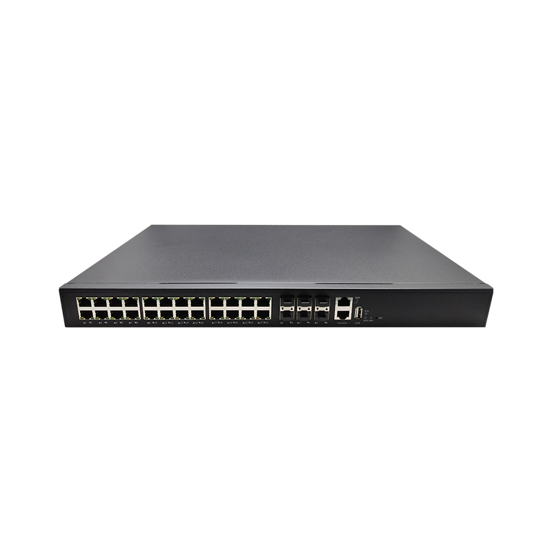
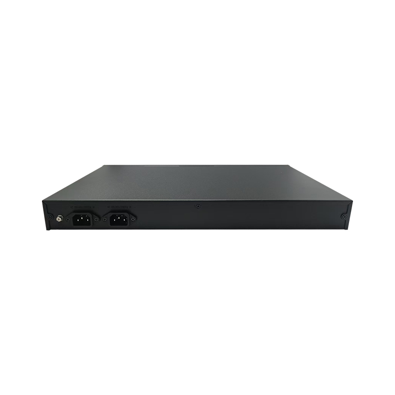
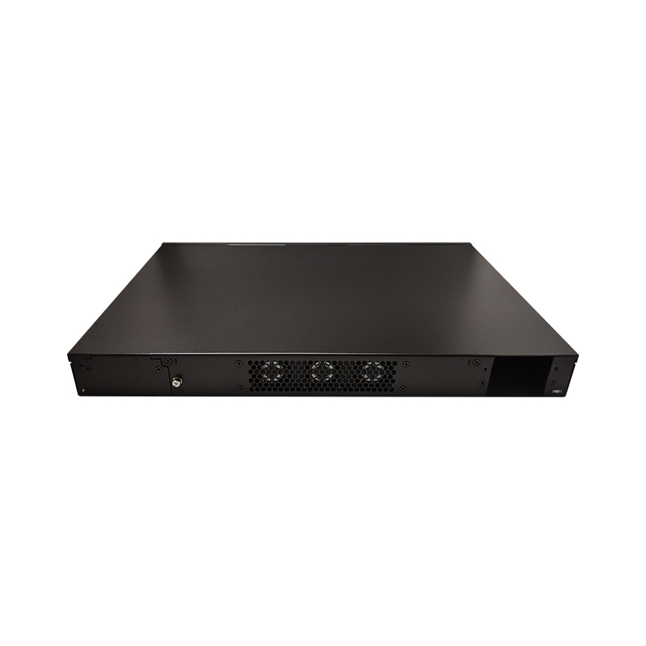

# LT-S8530CS-6CS24GT Series — 24 *10/100/1000BASE-T RJ45 Ports, 6* 25G SFP28 Ports

- 官网页面：https://www.smartbyte-switch.com/24-10-100-1000BASE-T-RJ45-Ports-6-25G-SFP28-Ports-PG12137221（抓取 2026-10-20，原始 HTML：`data/smartbyte_site_raw/html/24-10-100-1000BASE-T-RJ45-Ports-6-25G-SFP28-Ports-PG12137221.html`）
- 官网品类：White Box Hardware / 25G Uplink Series
- 页面描述（meta）：24 *10/100/1000BASE-T RJ45 Ports, 6* 25G SFP28 Ports, LT-S8530CS-6CS24GT Series , SmartByte
- 规格书：页面未提供下载

## 价格主表对照（SmartByte 2026-09 价格表，有效期 2026-09-01～12-30；USD 按 6.69 @2026-10-17）
- 价格主表**未匹配**（未匹配）：该型号不在 2026-09 价格表的 135 个型号里 → 报价前向 SmartByte 询价；档案中只能写 SmartByte 型号并注明。

## 图片（8/8 张已入库 `data/smartbyte_site_raw/images/`，其余仅 CDN 链接）

- https://gcdn.meidianbang.cn/comdata/70901/product/20260701142250DE5EC5477BC9C54E_b.jpg → `data/smartbyte_site_raw/images/comdata_70901_product_20260701142250DE5EC5477BC9C54E_b.jpg`

- https://gcdn.meidianbang.cn/comdata/70901/product/20260701142250B99ADA8752932CC6_b.jpg → `data/smartbyte_site_raw/images/comdata_70901_product_20260701142250B99ADA8752932CC6_b.jpg`

- https://gcdn.meidianbang.cn/comdata/70901/product/2026070707444417F08715C1ACB09D_b.jpg → `data/smartbyte_site_raw/images/comdata_70901_product_2026070707444417F08715C1ACB09D_b.jpg`
- https://gcdn.meidianbang.cn/comdata/70901/product/2026070718285409D1ADF99700F8F8_b.jpg → `data/smartbyte_site_raw/images/comdata_70901_product_2026070718285409D1ADF99700F8F8_b.jpg`
- https://gcdn.meidianbang.cn/comdata/70901/product/20260707074630481C5ACE76B2141A_b.jpg → `data/smartbyte_site_raw/images/comdata_70901_product_20260707074630481C5ACE76B2141A_b.jpg`
- https://gcdn.meidianbang.cn/comdata/70901/product/20260707074444A294C516FF034AFB_b.jpg → `data/smartbyte_site_raw/images/comdata_70901_product_20260707074444A294C516FF034AFB_b.jpg`
- https://gcdn.meidianbang.cn/comdata/70901/product/20260707074444C3E728D5E4EC9043_b.jpg → `data/smartbyte_site_raw/images/comdata_70901_product_20260707074444C3E728D5E4EC9043_b.jpg`
- https://gcdn.meidianbang.cn/comdata/70901/product/2026070718285471146221246A0D33_b.jpg → `data/smartbyte_site_raw/images/comdata_70901_product_2026070718285471146221246A0D33_b.jpg`

---
来源：SmartByte 官网（T15 Actions 归档，原文照录，未做改写）；本文件由 `scripts/smartbyte_crawl/build.py` 生成，勿手改。
