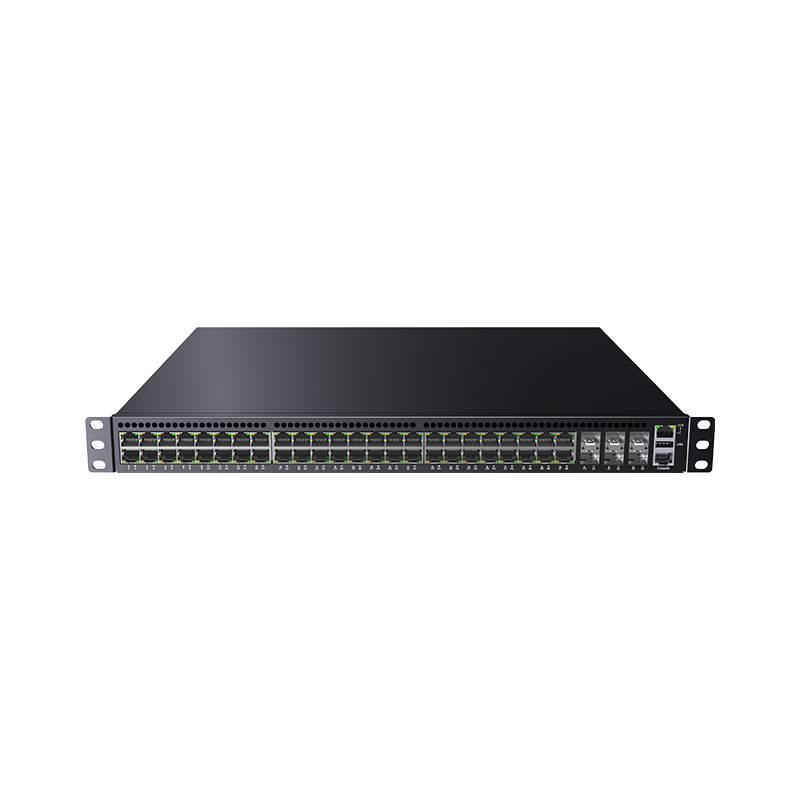
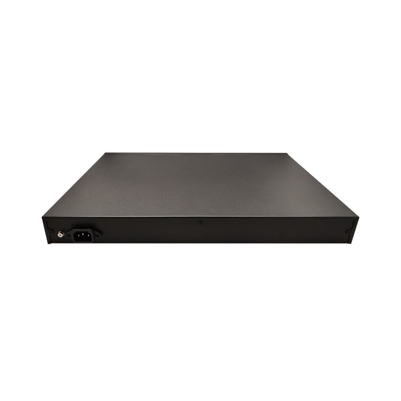
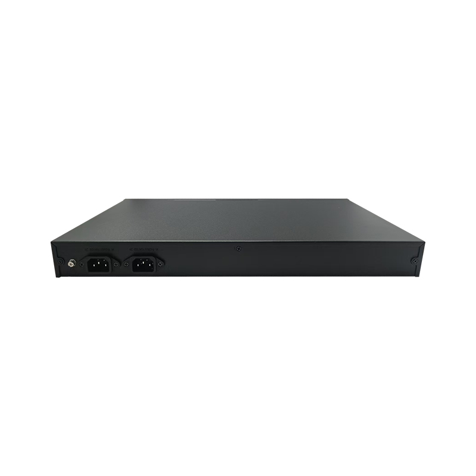

# LT-S8554CS-6CS48HT Series — 48 *10/100/1000/2500BASE-T Ports, 6* 25G SFP28 Ports

- 官网页面：https://www.smartbyte-switch.com/48-10-100-1000-2500BASE-T-Ports-6-25G-SFP28-Ports-PG12152308（抓取 2026-10-20，原始 HTML：`data/smartbyte_site_raw/html/48-10-100-1000-2500BASE-T-Ports-6-25G-SFP28-Ports-PG12152308.html`）
- 官网品类：White Box Hardware / 25G Uplink Series
- 页面描述（meta）：48 *10/100/1000/2500BASE-T Ports, 6* 25G SFP28 Ports, LT-S8554CS-6CS48HT Series, SmartByte
- 规格书：页面未提供下载

## 价格主表对照（SmartByte 2026-09 价格表，有效期 2026-09-01～12-30；USD 按 6.69 @2026-10-17）
- 价格主表**未匹配**（未匹配）：该型号不在 2026-09 价格表的 135 个型号里 → 报价前向 SmartByte 询价；档案中只能写 SmartByte 型号并注明。

## 图片（9/9 张已入库 `data/smartbyte_site_raw/images/`，其余仅 CDN 链接）

- https://gcdn.meidianbang.cn/comdata/70901/product/20260707183743230FEE5A8D9D452F_b.jpg → `data/smartbyte_site_raw/images/comdata_70901_product_20260707183743230FEE5A8D9D452F_b.jpg`

- https://gcdn.meidianbang.cn/comdata/70901/product/20260707183508D809FD587E31AF99_b.jpg → `data/smartbyte_site_raw/images/comdata_70901_product_20260707183508D809FD587E31AF99_b.jpg`

- https://gcdn.meidianbang.cn/comdata/70901/product/2026070718350843C9FD63D615F833_b.jpg → `data/smartbyte_site_raw/images/comdata_70901_product_2026070718350843C9FD63D615F833_b.jpg`
- https://gcdn.meidianbang.cn/comdata/70901/product/20260707183508881F68AAA63CDFA3_b.jpg → `data/smartbyte_site_raw/images/comdata_70901_product_20260707183508881F68AAA63CDFA3_b.jpg`
- https://gcdn.meidianbang.cn/comdata/70901/product/20260707183743CF940C2AFDC25B55_b.jpg → `data/smartbyte_site_raw/images/comdata_70901_product_20260707183743CF940C2AFDC25B55_b.jpg`
- https://gcdn.meidianbang.cn/comdata/70901/product/202607071835089F89458E2657EDCD_b.jpg → `data/smartbyte_site_raw/images/comdata_70901_product_202607071835089F89458E2657EDCD_b.jpg`
- https://gcdn.meidianbang.cn/comdata/70901/product/2026070718350803C39F93296517BD_b.jpg → `data/smartbyte_site_raw/images/comdata_70901_product_2026070718350803C39F93296517BD_b.jpg`
- https://gcdn.meidianbang.cn/comdata/70901/product/20260707183508C991EC5E2CB11790_b.jpg → `data/smartbyte_site_raw/images/comdata_70901_product_20260707183508C991EC5E2CB11790_b.jpg`
- https://gcdn.meidianbang.cn/comdata/70901/product/20260707183901E804E07B2CBE4B4D_b.jpg → `data/smartbyte_site_raw/images/comdata_70901_product_20260707183901E804E07B2CBE4B4D_b.jpg`

---
来源：SmartByte 官网（T15 Actions 归档，原文照录，未做改写）；本文件由 `scripts/smartbyte_crawl/build.py` 生成，勿手改。
