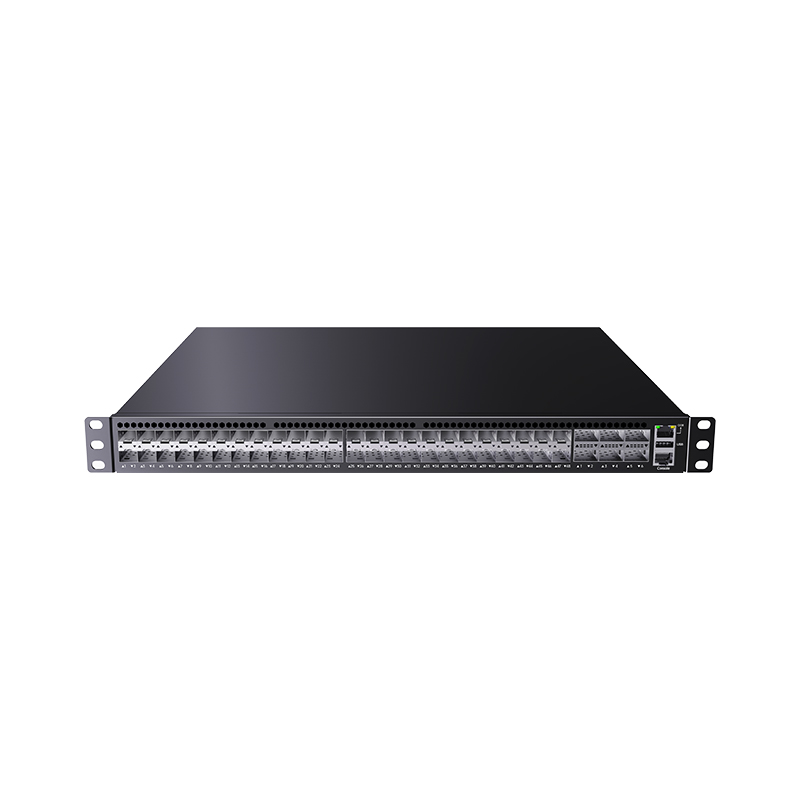

# S8554QC-6QC48XS-W — 48*1G/10GBase-X slots, 6*40G/50G/100GBase-X slots Marvell-based Data Center Switch

- 官网页面：https://www.smartbyte-switch.com/48-1G-10GBase-X-slots-6-40G-50G-100GBase-X-slots-Marvell-based-Data-Center-Switch-PG12152310（抓取 2026-10-20，原始 HTML：`data/smartbyte_site_raw/html/48-1G-10GBase-X-slots-6-40G-50G-100GBase-X-slots-Marvell-based-Data-Center-Switch-PG12152310.html`）
- 官网品类：White Box Hardware / 100G Uplink Series
- 页面描述（meta）：48*1G/10GBase-X slots, 6*40G/50G/100GBase-X slots Marvell-based Data Center Switch, S8554QC-6QC48XS-W, SmartByte
- 规格书：页面未提供下载

## 价格主表对照（SmartByte 2026-09 价格表，有效期 2026-09-01～12-30；USD 按 6.69 @2026-10-17）
- 价格主表**未匹配**（未匹配）：该型号不在 2026-09 价格表的 135 个型号里 → 报价前向 SmartByte 询价；档案中只能写 SmartByte 型号并注明。

## 图片（1/1 张已入库 `data/smartbyte_site_raw/images/`，其余仅 CDN 链接）

- https://gcdn.meidianbang.cn/comdata/70901/product/2026070718471586F01FFC16693378_b.jpg → `data/smartbyte_site_raw/images/comdata_70901_product_2026070718471586F01FFC16693378_b.jpg`

---
来源：SmartByte 官网（T15 Actions 归档，原文照录，未做改写）；本文件由 `scripts/smartbyte_crawl/build.py` 生成，勿手改。
