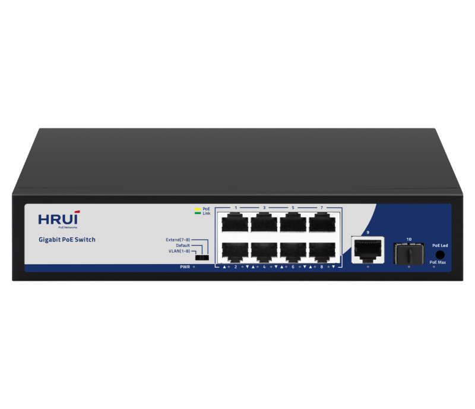
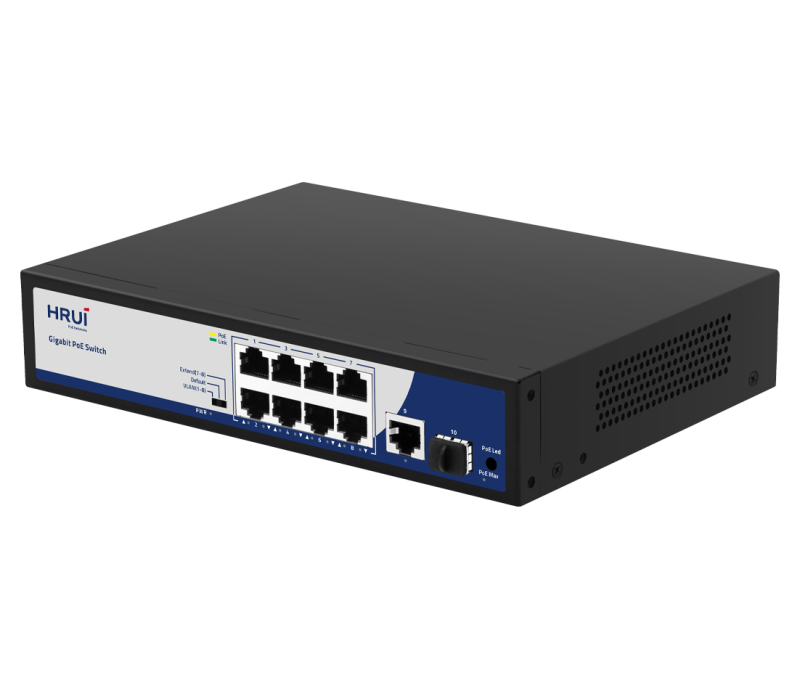
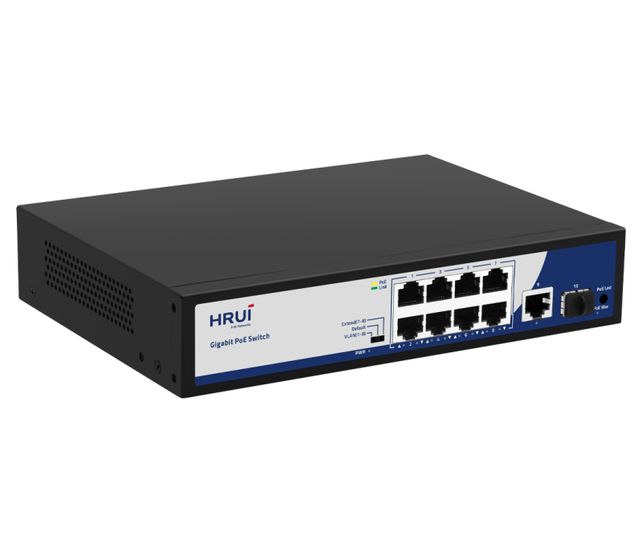
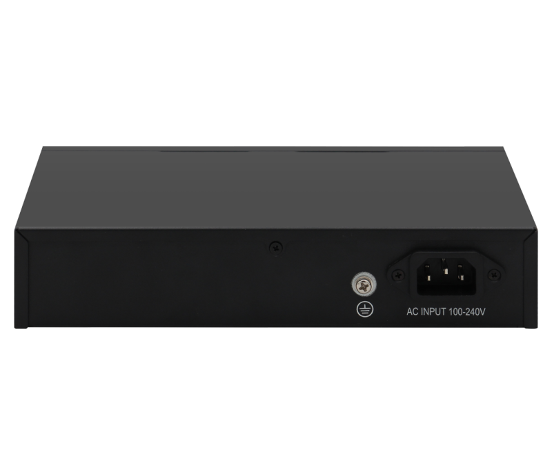

# HR-AFG-811NS

> 来源：<https://www.hruitech.com/poe-switch/85.html>（抓取 2026-10-21T03:46:09Z；英文原文照录，中文仅为栏目名）  
> 官网描述：8-Port 10/100/1000T 802.3af/at PoE + 1-Port 10/100/1000T + 1-Port Gigabit SFP Ethernet Switch (150 Watts)  
> 类目：PoE Switch（site id 85）  
> 接口：8* 1G PoE ports / 1* 1G uplink port / 2*1G SFP port；PoE 预算 140W；交换带宽 —；电源 AC 100-240V 50/60Hz / DC 52V 2.88A

**Brief:** 10 Port Full Gigabit Intelligent Standard PoE Switch, using high-quality high-speed network IC and the most stable POE chip, POE port meets 802.3af / 802.3at standard, this series of PoE Switch can be 10/100/1000M Ethernet. The network provides a seamless connection, and the PoE power port can automatically detect and power the powered devices that comply with the IEEE802.3af / IEEE802.3at standards. The non-POE device intelligently detects no power and only transmits data.

## 产品图





## Datasheet
- [20241023175815583.pdf](https://www.hruitech.com/web/userfiles/productfile/20241023175815583.pdf) （本地：`data/hrui_site_raw/datasheets/20241023175815583.pdf`；文本：`data/hrui_site_raw/datasheet_text/20241023175815583.txt`）

## Feature and Benefits（原文）
```
The HRUI AI PoE switches provide a range of models featuring both 100M/Gigabit PoE, RJ45, and SFP uplink ports. These switches meet the IEEE 802.3af/at standards for Power over Ethernet, with PoE ports capable of 30W. The devices offer three working modes: Default, VLAN (Port Isolation), and Extend. Additionally, the series supports PoE watchdog functionality in both VLAN and Extend modes, enabling the detection and automatic reboot of unresponsive or dropped PoE-powered devices.
With user-friendly installation and maintenance processes, these switches help establish a secure and high-performance network. HRUI AI PoE switches are ideal for various Ethernet access applications, including small to medium-sized enterprises, internet cafes, hotels, and schools.
FEATURES
• Power Over Ethernet
This series of switches provides PoE ports, compliant with IEEE 802.3af/at, enabling simultaneous data and power transmission to devices via a single, convenient Ethernet cable. By integrating power delivery into a single cable, these switches streamline cabling infrastructure and eliminate the need for separate power sources, thereby providing an efficient and cost-effective solution for powering network devices.
• Advanced Functions with DIP Switch
VLAN:
Downlink ports are isolated from each other, but can still communicate with uplink ports. This mode also enables PoE watchdog on ports.
Default:
All ports support communication with each other, with a transmission distance of up to 100 meters and an adaptive speed of 10/100/1000Mbps. This mode disables PoE watchdog on ports.
Extend:
The downlink PoE & data transmission distance of port 7-8 can reach up to 250 meters, with a speed of 10Mbps. This mode enables PoE watchdog on ports.
• AI PoE Watchdog
Detect and reboot dropped or unresponsive PoE-powered devices.
• Safe PoE Smart Boot-up
Support PoE Smart Boot-up that enables PoE on ports from the first to last in sequence to prevent damage to the power supply by sudden large currents. The function is enabled by default.
• Plug and Play, Easy to Use
All Ethernet ports on our switches support MDI/MDIX compatibility, allowing for easy setup with no software installation or configuration needed.
• 19 Inch Rack Mout
• High Reliable Design
Support installed in a standard rack environment, easy to integrate with other equipment and manage cabling.
Support 4KV surge and 8KV ESD protection.
```

## Parameter（规格表逐行）
| 项 | 值 |
|---|---|
|  | • Power Over Ethernet |
|  | This series of switches provides PoE ports, compliant with IEEE 802.3af/at, enabling simultaneous data and power transmission to devices via a single, convenient Ethernet cable. By integrating power delivery into a single cable, these switches streamline cabling infrastructure and eliminate the need for separate power sources, thereby providing an efficient and cost-effective solution for powering network devices. |
|  | • Advanced Functions with DIP Switch |
|  | VLAN: Downlink ports are isolated from each other, but can still communicate with uplink ports. This mode also enables PoE watchdog on ports. |
|  | Default: All ports support communication with each other, with a transmission distance of up to 100 meters and an adaptive speed of 10/100/1000Mbps. This mode disables PoE watchdog on ports. |
|  | Extend: The downlink PoE & data transmission distance of port 7-8 can reach up to 250 meters, with a speed of 10Mbps. This mode enables PoE watchdog on ports. |
|  | • AI PoE Watchdog |
|  | Detect and reboot dropped or unresponsive PoE-powered devices. |
|  | • Safe PoE Smart Boot-up |
|  | Support PoE Smart Boot-up that enables PoE on ports from the first to last in sequence to prevent damage to the power supply by sudden large currents. The function is enabled by default. |
|  | • Plug and Play, Easy to Use |
|  | All Ethernet ports on our switches support MDI/MDIX compatibility, allowing for easy setup with no software installation or configuration needed. |
| • 19 Inch Rack Mout | • High Reliable Design |
| Support installed in a standard rack environment, easy to integrate with other equipment and manage cabling. | Support 4KV surge and 8KV ESD protection. |
| Description | Specification |
| Model | HR-AFG-811NS |
| Interface | 8* 1G PoE ports |
| Interface | 1* 1G uplink port |
| Interface | 2*1G SFP port |
| Port Standard | IEEE802.3 (Ethernet) |
| Port Standard | IEEE802.3u (Fast Ethernet) |
| Port Standard | IEEE802.3ab (1000Mbps Ethernet) |
| Port Standard | IEEE802.3x (Flow Control) |
| Bandwidth | 20Gbps |
| Packet Forwarding Rate | 14.88Mpps |
| Packet Buffer | 4Mbit |
| MAC Address Table | 8K |
| Transmission Method | Store and Forward |
| PoE Standard | IEEE802.3af (15.4W) |
| PoE Standard | IEEE802.3at (30W) |
| PoE Port Output Voltage | DC 44-57V |
| PoE Ports | Port 1-8 PoE power output <30W |
| PoE Power Budget | 140W |
| Surge Protection | Surge protection: common mode 4KV |
| Operating Temperature | 0~40°C |
| Storage Temperature | -40 °C to 70 °C |
| Operation Humidity | 10%~90%,non condensing |
| Storage Humidity | 5%~95%,non condensing |
| Power Supply | AC 100-240V 50/60Hz |
| Power Supply | DC 52V 2.88A |
| Mainboard Power Consumption | 6.7W |
| Structure Information | Product Dimensions :220*161*44mm |
| Structure Information | Packaging Dimensions : 315*215*85mm |
| Structure Information | Product Net Weight: 1.03KG |
| Structure Information | Product Gross Weight:1.37KG |
| Packing Information | Carton Dimensions :445*445*335mm |
| Packing Information | Packing Quantity: 10PCS |
| Packing Information | Packing Weight: 14.7KG |
| Security certification | CE, RoHS |
| Package Contents | Switch 1pcs, power cord 1pcs, manual 1pcs,certificate of qualification 1pcs |
| Fan Quantity | 0 |
| Installation | Desktop |
| PWR LED | Green LED On: Powered on |
| PWR LED | Green LED Off: Powered off |
| 1-8 LED | Green LED On: 10M/100M/1G link connection is normal |
| 1-8 LED | Green LED Off: Link locked |
| 1-8 LED | Yellow LED On: PoE powered on |
| 1-8 LED | Yellow LED Off: PoE powered off |
| 1-8 LED | Flashing: Data transmission |
| 9 LED | Green LED On: 10M/100M/1G link connection is normal |
| 9 LED | Green LED Off: Link locked |
| 9 LED | Flashing: Data transmission |
| 10 SFP LED | Green LED On: 1G link is normal |
| 10 SFP LED | Green LED Off: Link locked: |
| 10 SFP LED | Flashing: Data transmission |
| PoE Max LED | Green LED On: indicates PoE power usage is less than 90% |
| PoE Max LED | Flashing: indicates PoE power usage of 90% ≤ P ≤ 95% |
| PoE Max LED | Green LED Off: indicates that PoE power is used at 95%<p<100%< span=""> |
| PoE LED Buttons | Dual color light selection: default green (link data), switch yellow light (PoE) |
| VLAN/Default/Extend Modes Buttons | VLAN: Isolation mode, 1-8 ports isolated from each other, communicating with 9-10 ports, port PoE watchdog mode enabled |
| VLAN/Default/Extend Modes Buttons | Default: Normal mode, all interfaces can communicate with each other, transmission distance is within 100 meters, transmission rate is 10/100/1000Mbps adaptive, port PoE watchdog mode is turned off |
| VLAN/Default/Extend Modes Buttons | Extend: Link extension mode,7-8port PoE power supply and data transmission distance can be extended to 250 meters, transmission speed is 10Mbps, port PoE watchdog mode is enabled |

## Product structure / Application topology（图）
- https://www.hruitech.com/web/userfiles/image/20241223/1734918092327457.png
