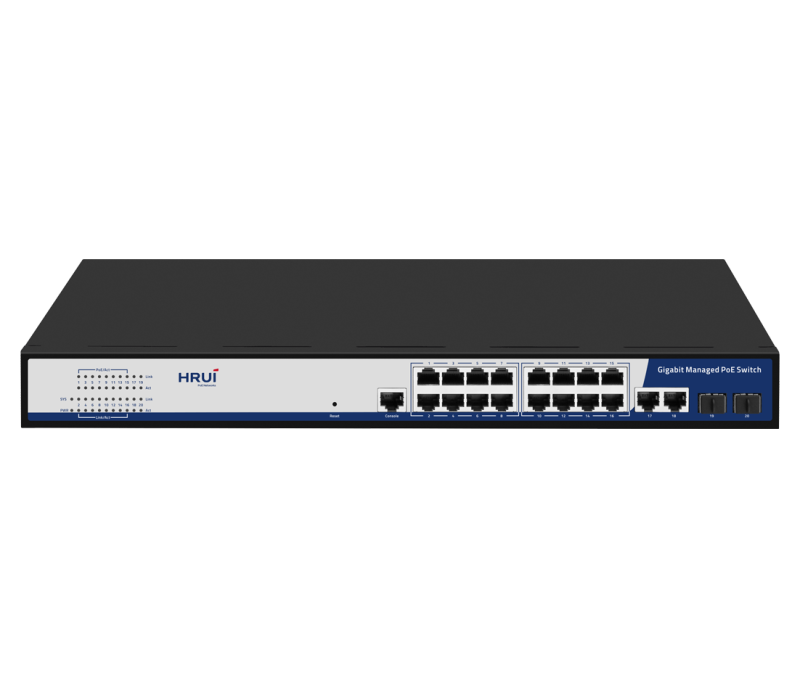
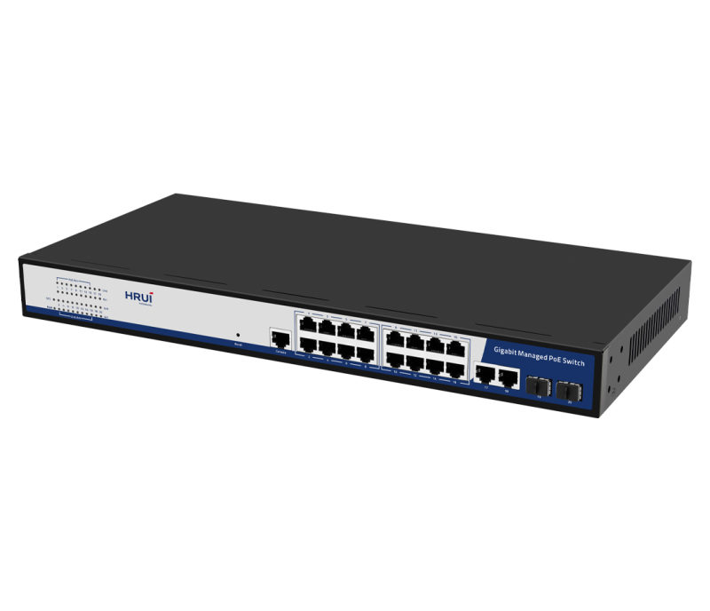
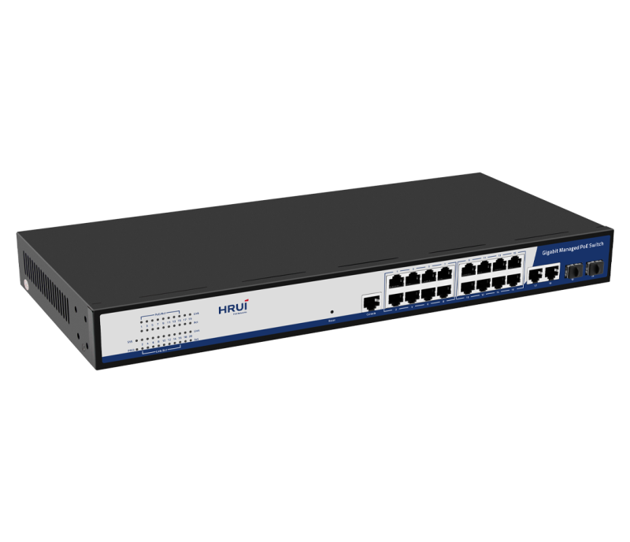
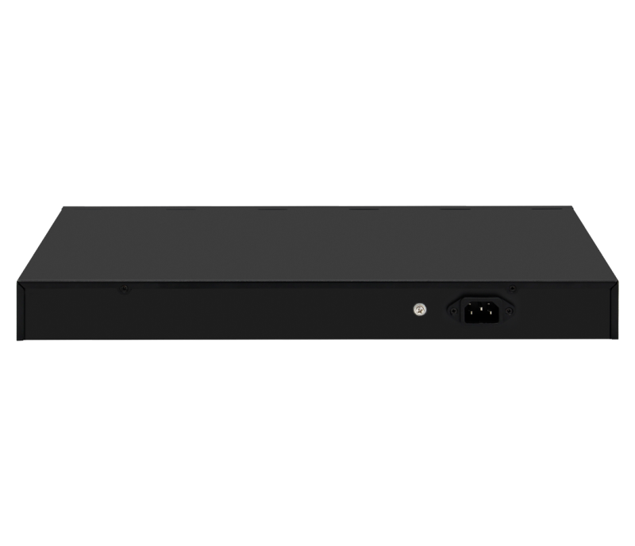

# HR-AFGM-1622S-300

> 来源：<https://www.hruitech.com/managed-switch/231.html>（抓取 2026-10-21T03:48:55Z；英文原文照录，中文仅为栏目名）  
> 官网描述：20-Port Gigabit L2 Managed Intelligent PoE Switch | HRUI  
> 类目：Managed Switch（site id 231）  
> 接口：16*1Gbps PoE ports / 2*1Gbps SFP ports / 2*1Gbps RJ45 ports / 1*Console port；PoE 预算 285W；交换带宽 40Gbps；电源 AC 100-240V 50/60Hz / DC 52V 5.76A

**Brief:** L2 managed PoE switch, with 16*Gigabit PoE ports + 2*Gigabit Ethernet ports + 2*Gigabit SFP ports, IEEE 802.3af/at PoE standard, total power 300W, bandwidth 40Gbps, surge 6KV, support ports isolation, 250 meters transmission, suitable for -10~50℃ wide temperature environment

## 产品图





## Datasheet
- [HR_AFGM_1622S_200.pdf](https://www.hruitech.com/web/userfiles/productfile/HR_AFGM_1622S_200.pdf) （本地：`data/hrui_site_raw/downloads/HR_AFGM_1622S_200.pdf`；文本：`data/hrui_site_raw/datasheet_text/HR_AFGM_1622S_200.txt`）

## Feature and Benefits（原文）
```
The HR-AFGM-1622S-300 is an advanced Layer 2 managed Power over Ethernet (PoE) switch designed to deliver robust connectivity and management capabilities for your network. Equipped with 16 Gigabit PoE ports, 2 Gigabit Ethernet ports, and 2 Gigabit SFP ports, this switch fully complies with IEEE 802.3af/at PoE standards, providing a total power budget of 300W. With a bandwidth capacity of 40Gbps and surge protection of up to 6KV, this switch ensures reliable operation even in demanding environments. It supports a generous transmission distance of up to 250 meters and operates efficiently in a wide temperature range of -10 to 50℃, making it an ideal solution for various applications.
Product Features:
Port Configuration:
16 * 1Gbps PoE ports, 2 * 1Gbps SFP ports, 2 * 1Gbps RJ45 ports, and 1 * Console port for versatile networking capabilities.
Standards Compliance:
Fully supports IEEE 802.3, IEEE 802.3x, IEEE 802.3u, IEEE 802.3ab, and IEEE 802.3z protocols for seamless integration and interoperability.
PoE Standards:
Complies with IEEE 802.3at (30W) and IEEE 802.3af (15.4W) power delivery specifications, ensuring optimal device support.
Adaptive Ethernet Ports:
Each port automatically adjusts for 10/100/1000Mbps speeds, providing flexibility and efficiency.
Comprehensive PoE Management:
Features PoE management tools and a PoE watchdog to monitor power status and device functionality.
Status Monitoring:
LED indicators offer real-time monitoring of device status and assist in troubleshooting.
Enhanced Security:
Supports 802.1x port authentication, with additional AAA and TACACS+ authentication for secure access control.
Flexible Management Interfaces:
Manage the switch through WEB, TELNET, CLI, SSH, SNMP, and RMON for versatile administrative options.
```

## Parameter（规格表逐行）
| 项 | 值 |
|---|---|
| Description | Specification |
| Model | HR-AFGM-1622S |
| Interface | 16*1Gbps PoE ports |
| Interface | 2*1Gbps SFP ports |
| Interface | 2*1Gbps RJ45 ports |
| Interface | 1*Console port |
| Port Standard | IEEE802.3 (Ethernet) |
| Port Standard | IEEE802.3u (Fast Ethernet) |
| Port Standard | IEEE 802.3ab (Gigabit Ethernet) |
| Port Standard | IEEE 802.3z (Gigabit Ethernet Fiber Standard) |
| Port Standard | IEEE802.3x (Flow Control) |
| Port Standard | IEEE 802.3az (Efficient and Energy saving Ethernet) |
| Port Standard | IEEE 802.3ad (Link Aggregation) |
| Port Standard | IEEE 802.1AB LLDP/LLDP MED (Link Layer Discovery Protocol) |
| Port Standard | IEEE 802.1D Spanning Tree Protocol |
| Port Standard | IEEE 802.1w Rapid Spanning Tree Protocol |
| Port Standard | IEEE 802.1s Multiple Spanning Tree Protocol (Fast Spanning Tree) |
| Port Standard | IEEE 802.1Q (Virtual Local Area Network) |
| Port Standard | IEEE 802.1p (VLAN Tag) |
| Port Standard | IEEE 802.1X (User Authentication) |
| Switching Bandwidth | 40Gbps |
| Packet Forwarding Rate | 29.76Mpps |
| Packet Buffer | 4.1Mbit |
| MAC Address Table | 8K |
| Jumbo Frame | Support |
| VLAN | VLAN range 1-4094, maximum active VLAN is 256 |
| Transmission Method | Store and Forward |
| PoE Standard | IEEE802.3af (15.4W) |
| PoE Standard | IEEE802.3at (30W) |
| PoE Port Output Voltage | DC 44-57V |
| PoE Ports | Ports 1-16 PoE power output <30W |
| PoE Power Budget | 285W |
| Power Supply | AC 100-240V 50/60Hz |
| Power Supply | DC 52V 5.76A |
| Mainboard Power Consumption | 13.8W |
| Structure Information | Product Dimensions: 440*204*44mm |
| Structure Information | Packaging Dimensions: 500*290*85mm |
| Structure Information | Product Net Weight: 2.78KG |
| Structure Information | Product Gross Weight: 3.44KG |
| Packing Information | Carton Dimensions: 520*445*310mm |
| Packing Information | Packing Quantity: 5PCS |
| Packing Information | Packing Weight: 18.2KG |
| Package Contents | Switch 1pcs, Power Cord 1pcs, Manual 1pcs, Certificate of Inspection 1pcs |
| Fan Quantity | 0 |
| Installation | Desktop, Rack-mounting |
| Surge Protection | Port Surge: Common mode 6KV, Differential mode 2KV |
| Surge Protection | Electrostatic ESD: Air 4KV, Contact 2KV |
| Operating Temperature | 0~40°C |
| Storage Temperature | -40~70°C |
| Operation Humidity | 10%~90%, non condensing |
| Storage Humidity | 5%~95%, non condensing |
| PWR Red LED | On: Powered on |
| PWR Red LED | Off: Powered off |
| Ports 1-20 Green LED | On: 10/100/1000Mbps Link normal |
| Ports 1-20 Green LED | Off: Link blocked |
| Ports 1-20 Green LED | Flashing: Data transmitting |
| SYS Green LED | Flashing: System startup in progress |
| SYS Green LED | On: The system is running normally |
| PoE Green LED | On: PoE powered on |
| PoE Green LED | Off: PoE powered off |
| Reset | Long press for 6 seconds to restore factory settings |
| **Software Features** | |
| **L2+ Function** | |
| IPv4 | IPv4 VLAN Interface |
| IPv4 | IPv4 Static Routes |
| IPv4 | ARP |
| IPv6 | IPv6 VLAN Interface |
| IPv6 | IPv6 Static Routes |
| IPv6 | IPv6 ND |
| **L2 Function** | |
| Port | Port Switch configuration |
| Port | Port Description configuration |
| Port | Port Speed configuration |
| Port | Port Duplex configuration |
| Port | Port Flow Control configuration |
| Port | Jumbo Frame |
| Port | EEE |
| Port | Fiber Module(DDM) |
| Link Aggregation | Support load balance policy; Base on MAC and IP-MAC |
| Storm Control | Boardcast suppression |
| Storm Control | Unknown Multicast |
| Storm Control | Unknown Unicast |
| Port Mirroring | One to one monitor |
| Port Mirroring | Many to one monitor |
| Port Mirroring | Ingress/Egress/Both |
| Port Mirroring | Up to 4 session groups |
| Port Security | MAC Address Constraints |
| Port Security | Port Security MAC Address |
| Port Security | Protect/Restrict/Shutdown |
| Port Isolation | Support |
| Port Rate-limit | Support |
| Loopback Detection | Support |
| VLAN | Access/Trunk/Hybrid |
| VLAN | VLAN Tunnel (Q-in-Q Tunnel) |
| VLAN | VLAN range 1-4094, maximum active VLAN is 256 |
| VLAN | Voice VLAN |
| VLAN | MAC VLAN |
| VLAN | Surveillance VLAN |
| VLAN | Protocol VLAN |
| VLAN | GVRP |
| MAC Address | Dynamic MAC address |
| MAC Address | Static MAC address |
| MAC Address | Filtering MAC Address |
| Spanning Tree Protocol | STP/RSTP/MSTP |
| Spanning Tree Protocol | BPDU Filter |
| Spanning Tree Protocol | BPDU Guard |
| Spanning Tree Protocol | Edge Port |
| LLDP | LLDP |
| LLDP | LLDP MED |
| Multicast | IGMP Snooping |
| Multicast | IGMP V1/V2/V3 |
| Multicast | Router Port |
| Multicast | Static IGMP group address |
| Multicast | IGMP groups filtering |
| Multicast | Querier |
| Multicast | MLD Snooping |
| Multicast | MVR |
| QoS | Traffic classification based, Strict priority and WRR |
| QoS | Port Priority |
| QoS | 802.1P Priority |
| QoS | IP TOS Priority |
| QoS | IP DSCP Priority |
| VLAN | Access/Trunk/Hybrid |
| VLAN | VLAN Tunnel (Q-in-Q Tunnel) |
| VLAN | VLAN range 1-4094, maximum active VLAN is 256 |
| VLAN | Voice VLAN |
| VLAN | MAC VLAN |
| VLAN | Surveillance VLAN |
| VLAN | Protocol VLAN |
| VLAN | GVRP |
| MAC Address | Dynamic MAC address |
| MAC Address | Static MAC address |
| MAC Address | Filtering MAC Address |
| Spanning Tree Protocol | STP/RSTP/MSTP |
| Spanning Tree Protocol | BPDU Filter |
| Spanning Tree Protocol | BPDU Guard |
| Spanning Tree Protocol | Edge Port |
| LLDP | LLDP |
| LLDP | LLDP MED |
| Multicast | IGMP Snooping |
| Multicast | IGMP V1/V2/V3 |
| Multicast | Router Port |
| Multicast | Static IGMP group address |
| Multicast | IGMP groups filtering |
| Multicast | Querier |
| Multicast | MLD Snooping |
| Multicast | MVR |
| QoS | Traffic classification based, Strict priority and WRR |
| QoS | Port Priority |
| QoS | 802.1P Priority |
| QoS | IP TOS Priority |
| QoS | IP DSCP Priority |
| IP Source Guard | Support |
| Dynamic ARP Inspection | Support |
| DoS | Support |
| ACL | MAC ACL |
| ACL | IPv4 ACL |
| ACL | IPv6 ACL |
| **Diagnostics** | |
| Syslog | Logging Message |
| Syslog | Remote Server |
| Ping | Support |
| Traceroute | Support |
| Copper Test | Support |
| UDLD | Support |
| Port Statistics | Support |
| **Equipment Management** | |
| Manager Access | Console |
| Manager Access | HTTP/HTTPS |
| Manager Access | Telnet |
| Manager Access | SSH |
| Manager Access | SNMP |
| Manager IP | Static Address |
| Manager IP | DHCP Client |
| Manager IP | Support IPv4 and IPv6 address |
| Manager IP | Manager VLAN |
| Manager IP | DNS |
| Time Synchronization | SNTP |
| Time Synchronization | Manual Time |
| SNMP | V1/V2C/V3 |
| SNMP | Community |
| SNMP | V3 User |
| SNMP | Group |
| SNMP | Trap Host |
| SNMP MIB | RFC 1213 MIB-II |
| SNMP MIB | RFC 1493 Bridge MIB |
| SNMP MIB | RFC 1643 Ethernet MIB |
| SNMP MIB | RFC 2819 RMON MIB (Groups 1, 2, 3 and 9) |
| SNMP MIB | RFC 2863 Interface MIB |
| SNMP MIB | LLDP |
| SNMP MIB | Private MIB |
| RMON | Statistics |
| RMON | History Configuration |
| RMON | Event Configuration |
| RMON | Alarm Configuration |
| User Management | Support |
| Firmware Management | Firmware upgrade |
| Configuration Management | Upload and download |
| Save | Support |
| Restart | Support |
| Factory Defaults | Support |
| **Standard Compliance** | |
| **IEEE 802.3x flow control and back pressure** | |
| **IEEE 802.3ad port trunk with LACP** | |
| **IEEE 802.1D Spanning Tree Protocol** | |
| **IEEE 802.1w Rapid Spanning Tree Protocol** | |
| **IEEE 802.1s Multiple Spanning Tree Protocol** | |
| **IEEE 802.1p Class of Service** | |
| **IEEE 802.1Q VLAN tagging** | |
| **IEEE 802.1x Port Authentication Network Control** | |
| **IEEE 802.1ab LLDP** | |
| **IEEE 802.3af Power over Ethernet** | |
| **IEEE 802.3at Power over Ethernet Plus** | |
| **RFC 768 UDP** | |
| **RFC 793 TFTP** | |
| **RFC 791 IP** | |
| **RFC 792 ICMP** | |
| **RFC 2068 HTTP** | |
| **RFC 1112 IGMP v1** | |
| **RFC 2236 IGMP v2** | |
| **RFC 3376 IGMP v3** | |
| **RFC 2710 MLD v1** | |
| **FRC 3810 MLD v2** | |

## Product structure / Application topology（图）
- https://www.hruitech.com/web/userfiles/image/20241231/1735616351352829.png
