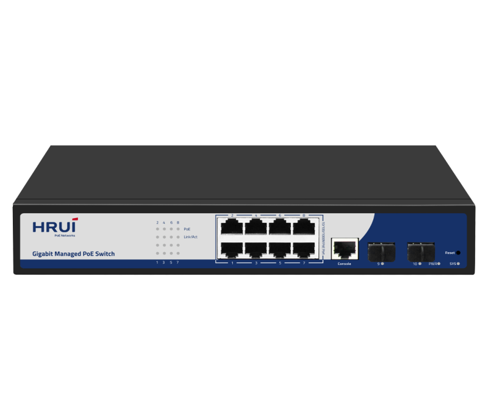
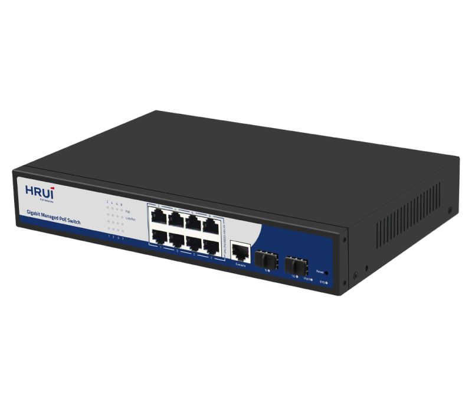
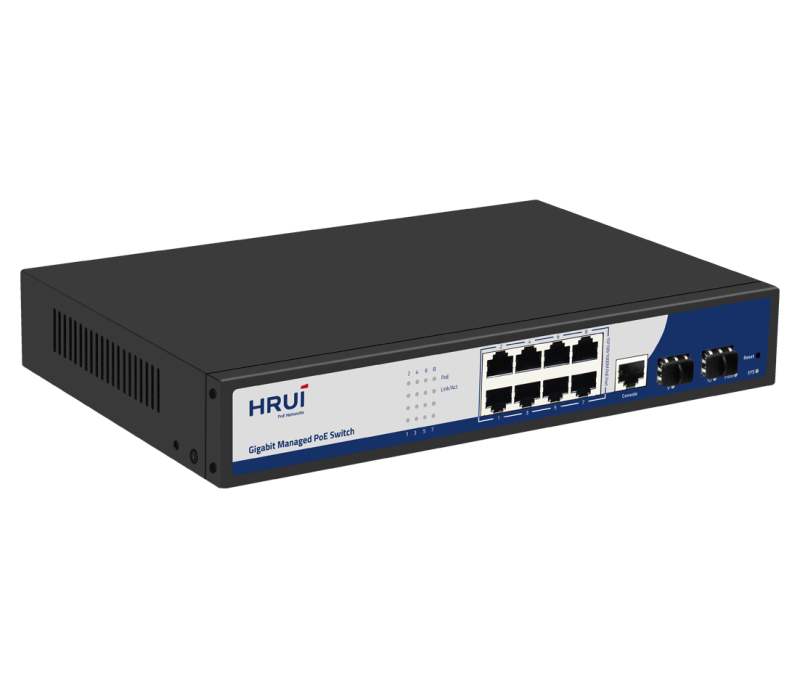
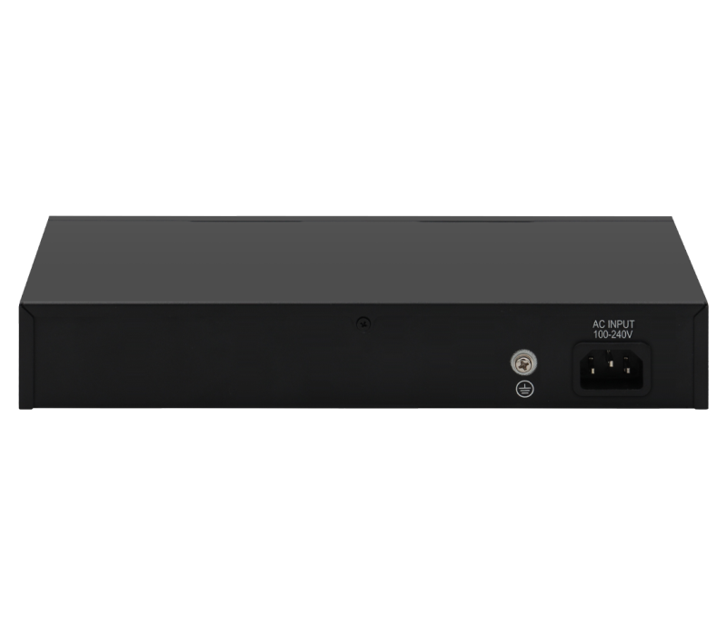

# HR-AFGM-82NS

> 来源：<https://www.hruitech.com/managed-switch/226.html>（抓取 2026-10-21T03:48:53Z；英文原文照录，中文仅为栏目名）  
> 官网描述：8-Port 10/100/1000T 802.3af/at PoE + 2-Port 1G SFP Managed Switch  
> 类目：Managed Switch（site id 226）  
> 接口：8*1Gbps PoE ports / 2*1Gbps SFP ports / 1*Console port；PoE 预算 100W；交换带宽 20Gbps；电源 AC 100-240V 50/60Hz / DC 52V 2.3A

**Brief:** L2 managed PoE switch, with 8*Gigabit PoE ports + 2*Gigabit SFP ports + 1* Console port, IEEE 802.3af/at PoE standard, total power 120W, bandwidth 20Gbps, surge 6KV, support ports isolation, 250 meters transmission, suitable for -10~50℃ wide temperature environment

## 产品图





## Datasheet
- [HR_AFGM_82NS.pdf](https://www.hruitech.com/web/userfiles/productfile/HR_AFGM_82NS.pdf) （本地：`data/hrui_site_raw/datasheets/HR_AFGM_82NS.pdf`；文本：`data/hrui_site_raw/datasheet_text/HR_AFGM_82NS.txt`）

## Feature and Benefits（原文）
```
HR-AFGM-82NS, a robust and advanced managed PoE switch designed to meet the demands of modern networking environments. This switch offers 8 Gigabit PoE ports, 2 Gigabit SFP ports, and 1 console port, making it an ideal choice for powering and connecting multiple devices. With support for IEEE 802.3af/at PoE standards and a total power output of 120W, this switch enables efficient power delivery for your devices. It delivers a high bandwidth of 20Gbps and is built with a surge protection rating of 6KV, ensuring reliable performance even in challenging conditions. With a wide operating temperature range of -10 to 50°C, this switch is suitable for a variety of environments and applications, enabling 250-meter transmission distances and reliable port isolation.
Product Features:
Port Configuration:
8 x 1Gbps PoE ports, 2 x 1Gbps SFP ports, and 1 console port for flexible networking setups.
Standards Compliance:
Compatible with IEEE 802.3, 802.3x, 802.3u, 802.3ab, and 802.3z protocols to ensure comprehensive support for your network needs.
PoE Standards:
Complies with IEEE 802.3at (30W) and IEEE 802.3af (15.4W), delivering reliable power to PoE devices.
Self-Adaptive Ethernet Ports:
Supports 10/100/1000Mbps self-adaptive Ethernet ports for seamless connectivity.
Intelligent PoE Management:
Features PoE management and watchdog functionality to monitor and maintain device performance.
Real-Time Monitoring:
Panel indicator LEDs provide insight into working status and can assist with fault analysis.
Robust Security Features:
Supports 802.1x port authentication, AAA authentication, and TACACS+ for enhanced network security.
Comprehensive Management Options:
Management capabilities via WEB, TELNET, CLI, SSH, SNMP, and RMON protocols for user-friendly operations.
```

## Parameter（规格表逐行）
| 项 | 值 |
|---|---|
| Description | Specification |
| Model | HR-AFGM-82NS |
| Interface | 8*1Gbps PoE ports |
| Interface | 2*1Gbps SFP ports |
| Interface | 1*Console port |
| Port Standard | IEEE802.3 (Ethernet) |
| Port Standard | IEEE802.3u (Fast Ethernet) |
| Port Standard | IEEE 802.3ab (Gigabit Ethernet) |
| Port Standard | IEEE 802.3z (Gigabit Ethernet Fiber Standard) |
| Port Standard | IEEE802.3x (Flow Control) |
| Port Standard | IEEE 802.3az (Efficient and Energy saving Ethernet) |
| Port Standard | IEEE 802.3ad (Link Aggregation) |
| Port Standard | IEEE 802.1AB LLDP/LLDP MED (Link Layer Discovery Protocol) |
| Port Standard | IEEE 802.1D Spanning Tree Protocol |
| Port Standard | IEEE 802.1w Rapid Spanning Tree Protocol |
| Port Standard | IEEE 802.1s Multiple Spanning Tree Protocol (Fast Spanning Tree) |
| Port Standard | IEEE 802.1Q (Virtual Local Area Network) |
| Port Standard | IEEE 802.1p (VLAN Tag) |
| Port Standard | IEEE 802.1X (User Authentication) |
| Switching Bandwidth | 20Gbps |
| Packet Forwarding Rate | 14.88Mpps |
| Packet Buffer | 4.1Mbit |
| MAC Address Table | 8K |
| Jumbo Frame | Support |
| VLAN | VLAN range 1-4094, maximum active VLAN is 256 |
| Transmission Method | Store and Forward |
| PoE Standard | IEEE802.3af (15.4W) |
| PoE Standard | IEEE802.3at (30W) |
| PoE Port Output Voltage | DC 44-57V |
| PoE Ports | Ports 1-8 PoE power output <30W |
| PoE Power Budget | 100W |
| Power Supply | AC 100-240V 50/60Hz |
| Power Supply | DC 52V 2.3A |
| Mainboard Power Consumption | 12.03W |
| Structure Information | Product Dimensions: 268*181*44mm |
| Structure Information | Packaging Dimensions: 312*262*84mm |
| Structure Information | Product Net Weight: 1.2KG |
| Structure Information | Product Gross Weight: 1.7KG |
| Packing Information | Carton Dimensions: 540*435*332mm |
| Packing Information | Packing Quantity: 10PCS |
| Packing Information | Packing Weight: 18KG |
| Package Contents | Switch 1pcs, Power Cord 1pcs, Manual 1pcs, Certificate of Inspection 1pcs |
| Fan Quantity | 0 |
| Installation | Desktop |
| Surge Protection | Port Surge: Common mode 6KV, Differential mode 2KV |
| Surge Protection | Electrostatic ESD: Air 8KV, Contact 6KV (Class C) |
| Operating Temperature | 0~40°C |
| Storage Temperature | -40~70°C |
| Operation Humidity | 10%~90%, non condensing |
| Storage Humidity | 5%~95%, non condensing |
| PWR | On: Powered on |
| PWR | Off: Powered off |
| Ports 1-10 Green LED | On: 10/100/1000Mbps Link normal |
| Ports 1-10 Green LED | Off: Link blocked |
| Ports 1-10 Green LED | Flashing: Data transmitting |
| SYS Green LED | Flashing: System startup in progress |
| SYS Green LED | On: The system is running normally |
| PoE Green LED | On: PoE powered on |
| PoE Green LED | Off: PoE powered off |
| Reset | Long press for 6 seconds to restore factory settings |
| **Software Features** | |
| **L2+ Function** | |
| IPv4 | IPv4 VLAN Interface |
| IPv4 | IPv4 Static Routes |
| IPv4 | ARP |
| IPv6 | IPv6 VLAN Interface |
| IPv6 | IPv6 Static Routes |
| IPv6 | IPv6 ND |
| **L2 Function** | |
| Port | Port Switch configuration |
| Port | Port Description configuration |
| Port | Port Speed configuration |
| Port | Port Duplex configuration |
| Port | Port Flow Control configuration |
| Port | Jumbo Frame |
| Port | EEE |
| Port | Fiber Module(DDM) |
| Link Aggregation | Support load balance policy; Base on MAC and IP-MAC |
| Storm Control | Boardcast suppression |
| Storm Control | Unknown Multicast |
| Storm Control | Unknown Unicast |
| Port Mirroring | One to one monitor |
| Port Mirroring | Many to one monitor |
| Port Mirroring | Ingress/Egress/Both |
| Port Mirroring | Up to 4 session groups |
| Port Security | MAC Address Constraints |
| Port Security | Port Security MAC Address |
| Port Security | Protect/Restrict/Shutdown |
| Port Isolation | Support |
| Port Rate-limit | Support |
| Loopback Detection | Support |
| VLAN | Access/Trunk/Hybrid |
| VLAN | VLAN Tunnel （Q-in-Q Tunnel） |
| VLAN | VLAN range 1-4094, maximum active VLAN is 256 |
| VLAN | Voice VLAN |
| VLAN | MAC VLAN |
| VLAN | Surveillance VLAN |
| VLAN | Protocol VLAN |
| VLAN | GVRP |
| MAC Address | Dynamic MAC address |
| MAC Address | Static MAC address |
| MAC Address | Filtering MAC Address |
| Spanning Tree Protocol | STP/RSTP/MSTP |
| Spanning Tree Protocol | BPDU Filter |
| Spanning Tree Protocol | BPDU Guard |
| Spanning Tree Protocol | Edge Port |
| LLDP | LLDP |
| LLDP | LLDP MED |
| Multicast | IGMP Snooping |
| Multicast | IGMP V1/V2/V3 |
| Multicast | Router Port |
| Multicast | Static IGMP group address |
| Multicast | IGMP groups filtering |
| Multicast | Querier |
| Multicast | MLD Snooping |
| Multicast | MVR |
| QoS | Traffic classification based, Strict priority and WRR |
| QoS | Port Priority |
| QoS | 802.1P Priority |
| QoS | IP TOS Priority |
| QoS | IP DSCP Priority |
| ERPS | Only SFP port |
| **PoE** | |
| PoE Configuration | PoE Temperature |
| PoE Configuration | PoE Type/Level/Power/Voltage/Current query |
| PoE Configuration | PoE Switch Configuration |
| PoE Configuration | PoE Watchdog Configuration |
| PoE Configuration | PoE power AF/AT adaptation |
| PoE Schedule | Support |
| PoE Port Timer Reboot | Support |
| **Services** | |
| DHCP | DHCP Server |
| DHCP | IP Pool |
| DHCP | Static Binding |
| DHCP | Port Static Binding |
| DHCP | DHCP Relay |
| Access Protocol | HTTP |
| Access Protocol | HTTPS |
| Access Protocol | Telnet |
| Access Protocol | SSHv2 |
| Access Protocol | Manager ACL |
| Access Protocol | Session Timeout |
| Access Protocol | Password Retry Count |
| Access Protocol | Silent Time |
| **Security** | |
| AAA | RADIUS |
| AAA | TACACS+ |
| AAA | 802.1X |
| AAA | Base on port/MAC/local/WEB |
| DHCP Snooping | Global/VLAN |
| DHCP Snooping | Option 82 |
| DHCP Snooping | Circuit ID |
| IP Source Guard | Support |
| Dynamic ARP Inspection | Support |
| DoS | Support |
| ACL | MAC ACL |
| ACL | IPv4 ACL |
| ACL | IPv6 ACL |
| **Diagnostics** | |
| Syslog | Logging Message |
| Syslog | Remote Server |
| Ping | Support |
| Traceroute | Support |
| Copper Test | Support |
| UDLD | Support |
| Port Statistics | Support |
| **Equipment Management** | |
| Manager Access | Console |
| Manager Access | HTTP/HTTPS |
| Manager Access | Telnet |
| Manager Access | SSH |
| Manager Access | SNMP |
| Manager IP | Static Address |
| Manager IP | DHCP Client |
| Manager IP | Support IPv4 and IPv6 address |
| Manager IP | Manager VLAN |
| Manager IP | DNS |
| Time Synchronization | SNTP |
| Time Synchronization | Manual Time |
| SNMP | V1/V2C/V3 |
| SNMP | Community |
| SNMP | V3 User |
| SNMP | Group |
| SNMP | Trap Host |
| SNMP MIB | RFC 1213 MIB-II |
| SNMP MIB | RFC 1493 Bridge MIB |
| SNMP MIB | RFC 1643 Ethernet MIB |
| SNMP MIB | RFC 2819 RMON MIB (Groups 1, 2, 3 and 9) |
| SNMP MIB | RFC 2863 Interface MIB |
| SNMP MIB | LLDP |
| SNMP MIB | Private MIB |
| RMON | Statistics |
| RMON | History Configuration |
| RMON | Event Configuration |
| RMON | Alarm Configuration |
| User Management | Support |
| Firmware Management | Firmware upgrade |
| Configuration Management | Upload and download |
| Save | Support |
| Restart | Support |
| Factory Defaults | Support |
| **Standard Compliance** | |
| **IEEE 802.3x flow control and back pressure** | |
| **IEEE 802.3ad port trunk with LACP** | |
| **IEEE 802.1D Spanning Tree Protocol** | |
| **IEEE 802.1w Rapid Spanning Tree Protocol** | |
| **IEEE 802.1s Multiple Spanning Tree Protocol** | |
| **IEEE 802.1p Class of Service** | |
| **IEEE 802.1Q VLAN tagging** | |
| **IEEE 802.1x Port Authentication Network Control** | |
| **IEEE 802.1ab LLDP** | |
| **IEEE 802.3af Power over Ethernet** | |
| **IEEE 802.3at Power over Ethernet Plus** | |
| **RFC 768 UDP** | |
| **RFC 793 TFTP** | |
| **RFC 791 IP** | |
| **RFC 792 ICMP** | |
| **RFC 2068 HTTP** | |
| **RFC 1112 IGMP v1** | |
| **RFC 2236 IGMP v2** | |
| **RFC 3376 IGMP v3** | |
| **RFC 2710 MLD v1** | |
| **FRC 3810 MLD v2** | |

## Product structure / Application topology（图）
- https://www.hruitech.com/web/userfiles/image/20250102/1735780856213993.png
