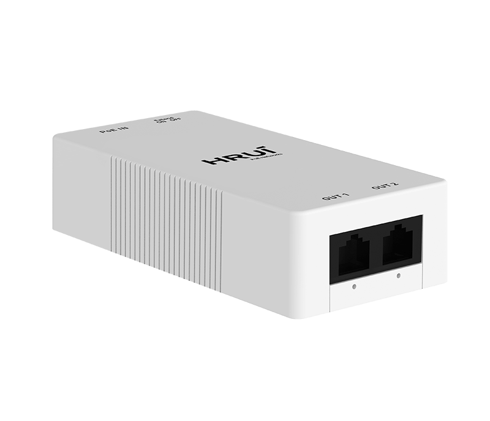
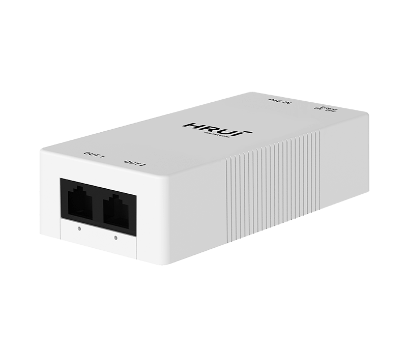
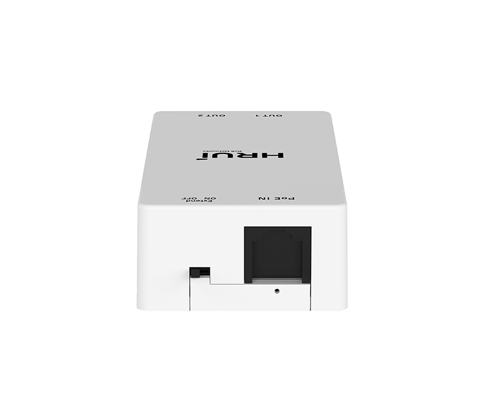
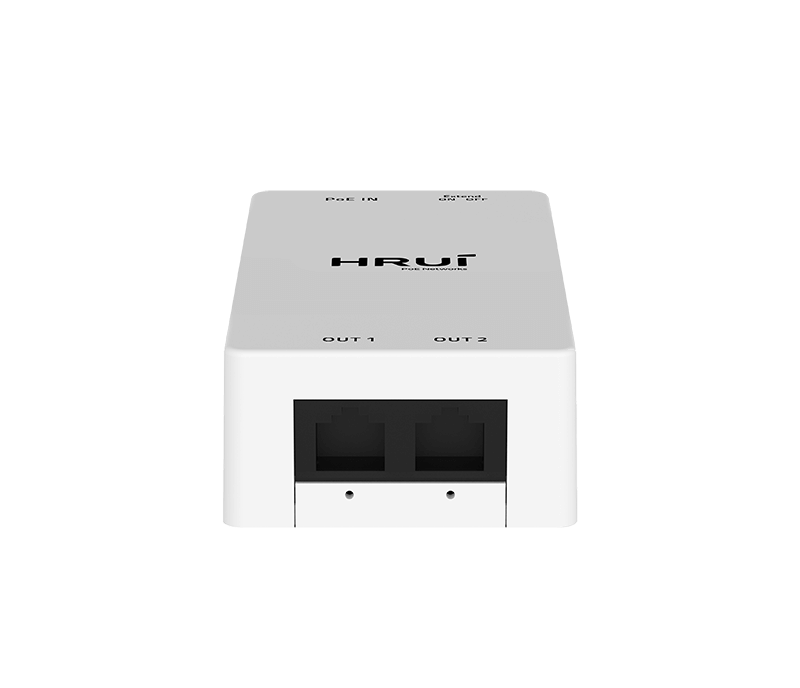

# HR-AFGR-21+

> 来源：<https://www.hruitech.com/poe-accessory/157.html>（抓取 2026-10-21T03:46:08Z；英文原文照录，中文仅为栏目名）  
> 官网描述： 1000Mbps Ethernet PoE Extender  
> 类目：PoE Accessory（site id 157）  
> 接口：1* 1000Mbps PoE in RJ45 port / 2 *1000Mbps PoE out ports；PoE 预算 25W；交换带宽 —；电源 PoE powered

**Brief:** The HRUI 2-Port PoE Extender utilizes cutting-edge network cable technology and power supply innovations to extend the standard Ethernet transmission distance beyond 100 meters, reaching up to 250 meters. Compatible with PoE switches and PoE injectors that adhere to the IEEE802.3af/at standards, this product is ideal for applications in security PoE network monitoring and PoE network installations. Featuring high-quality, high-speed network ICs and the most reliable PoE chips, it guarantees the safe and stable operation of your network.

## 产品图





## Datasheet
- [HR_AFGR_21.pdf](https://www.hruitech.com/web/userfiles/productfile/HR_AFGR_21.pdf) （本地：`data/hrui_site_raw/datasheets/HR_AFGR_21.pdf`；文本：`data/hrui_site_raw/datasheet_text/HR_AFGR_21.txt`）

## Feature and Benefits（原文）
```
The HRUI 2-Port PoE Extender utilizes cutting-edge network cable technology and power supply innovations to extend the standard Ethernet transmission distance beyond 100 meters, reaching up to 250 meters. Compatible with PoE switches and PoE injectors that adhere to the IEEE802.3af/at standards, this product is ideal for applications in security PoE network monitoring and PoE network installations. Featuring high-quality, high-speed network ICs and the most reliable PoE chips, it guarantees the safe and stable operation of your network.
HR-AFGR-21+:
1*1000Mbps PoE input RJ45 port + 2*1000Mbps PoE output ports
HR-AFR-21+:
1*100Mbps PoE input RJ45 port + 2*100Mbps PoE output ports
PRODUCT FEATURES
• Divided into Two Ports: Cost-Effective and Highly Efficient
The HRUI 2-port PoE extender features one PoE input port and two PoE output ports. This allows you to connect a single PoE PSE device to the extender while simultaneously powering two PD devices.
• IEEE 802.3af/at
The extender is compatible with IEEE802.af/at PoE devices, making it a versatile solution for PoE cameras, PoE switches, wireless access points, and more.
• 350 Meters Long Distance Transmission
The HRUI 2-port PoE extender features a simple one-key activation for extend mode, which allows for an increased distance limit from 100 meters to 250 meters, offering a total PoE+ network extension of 350 meters.
• 4KV Surge Protection
• Flexible and Convenient Installation
Support 4KV surge protection to ensure long-lasting performance.
Supports desktop/wall mounting
• Compact Size
• Plug and Play
The PoE extender features a compact design, saving installation space.
The PoE extender is designed for easy installation with a plug-and-play design, which requires no software or configuration.
SPECIFICATION
HR-AFR-21+
HR-AFGR-21+
Port Rate: 1*FE PoE Input + 2*FE PoE Output
Extend Mode: 250 Meters
Surge Protection: 4KV
Plastic Case
Working Temperature: 0~40℃
Port Rate: 1*GE PoE Input + 2*GE PoE Output
Extend Mode: 250 Meters
Surge Protection: 4KV
Plastic Case
Working Temperature: 0~40℃
```

## Parameter（规格表逐行）
| 项 | 值 |
|---|---|
|  | • Divided into Two Ports: Cost-Effective and Highly Efficient |
|  | The HRUI 2-port PoE extender features one PoE input port and two PoE output ports. This allows you to connect a single PoE PSE device to the extender while simultaneously powering two PD devices. |
|  | • IEEE 802.3af/at |
|  | The extender is compatible with IEEE802.af/at PoE devices, making it a versatile solution for PoE cameras, PoE switches, wireless access points, and more. |
|  | • 350 Meters Long Distance Transmission |
|  | The HRUI 2-port PoE extender features a simple one-key activation for extend mode, which allows for an increased distance limit from 100 meters to 250 meters, offering a total PoE+ network extension of 350 meters. |
| • 4KV Surge Protection | • Flexible and Convenient Installation |
| Support 4KV surge protection to ensure long-lasting performance. | Supports desktop/wall mounting |
| • Compact Size | • Plug and Play |
| The PoE extender features a compact design, saving installation space. | The PoE extender is designed for easy installation with a plug-and-play design, which requires no software or configuration. |
| HR-AFR-21+ | HR-AFGR-21+ |
| Port Rate: 1*FE PoE Input + 2*FE PoE Output Extend Mode: 250 Meters Surge Protection: 4KV Plastic Case Working Temperature: 0~40℃ | Port Rate: 1*GE PoE Input + 2*GE PoE Output Extend Mode: 250 Meters Surge Protection: 4KV Plastic Case Working Temperature: 0~40℃ |
| Description | Specification |
| Model | HR-AFGR-21+ |
| Interface | 1* 1000Mbps PoE in RJ45 port |
| Interface | 2 *1000Mbps PoE out ports |
| Port Standard | IEEE802.3 (Ethernet) |
| Port Standard | IEEE802.3u (Fast Ethernet) |
| Port Standard | IEEE802.3ab (1000Mbps Ethernet) |
| Port Standard | IEEE802.3x (Flow Control) |
| Switching Capacity | 6Gbps |
| Packet Forwarding Rate | 4.46Mpps |
| MAC Address Table | 2K |
| Transmission Method | Store and Forward |
| PoE Standard | IEEE802.3af （15.4W） |
| PoE Standard | IEEE802.3at （30W） |
| PoE Port Output Voltage | DC 44-57V |
| PoE Ports | Port PoE out <30W |
| PoE Power Budget | 25W |
| Power Supply | PoE powered |
| Mainboard Power Consumption | 1.89W |
| Structure Information | Product Dimensions :100*49*25mm |
| Structure Information | Packaging Dimensions : 102*50*27mm |
| Structure Information | Product Net Weight:0.060KG |
| Structure Information | Product Gross Weight:0.065KG |
| Packing Information | Carton Dimensions :425*295*275mm |
| Packing Information | Packing Quantity: 200PCS |
| Packing Information | Packing Weight: 14KG |
| Package Contents | PoE Extender 1pcs, manual 1pcs，certificate of qualification 1pcs |
| Fan Quantity | 0 |
| Installation | Desktop |
| Surge Protection | Surge protection: common mode 4KV |
| Operating Temperature | 0~40°C |
| Storage Temperature | -40 °C to 70 °C |
| Operation Humidity | 10%~90%，non condensing |
| Storage Humidity | 5%~95%，non condensing |
| Port Light | On: Link normal |
| Port Light | Off: Link blocked |
| Port Light | Blinking: Data transmitting |
| OFF/ON Modes Buttons | OFF: Link extension mode OFF |
| OFF/ON Modes Buttons | ON: Link extension mode, port PoE out and data transmission distance can be extended to 250 meters, transmission speed is 10Mbps |

## Product structure / Application topology（图）
- https://www.hruitech.com/web/userfiles/image/20241223/1734946815933022.png
- https://www.hruitech.com/web/userfiles/product/productdetail/HR_AFGR_21/top9.jpg
