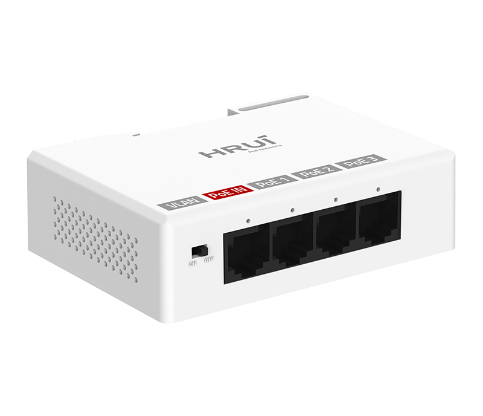
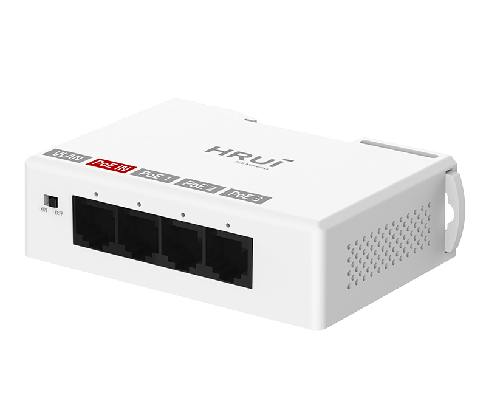
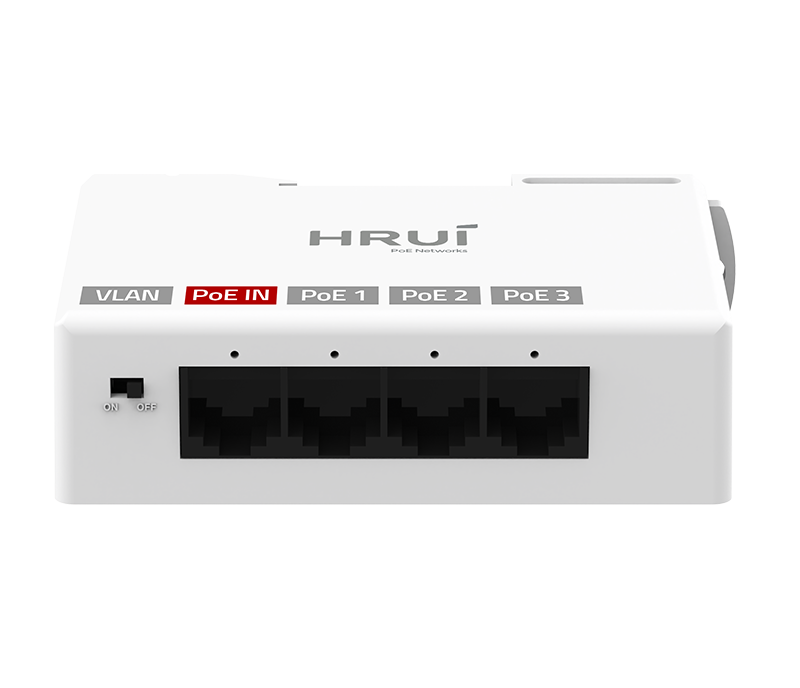
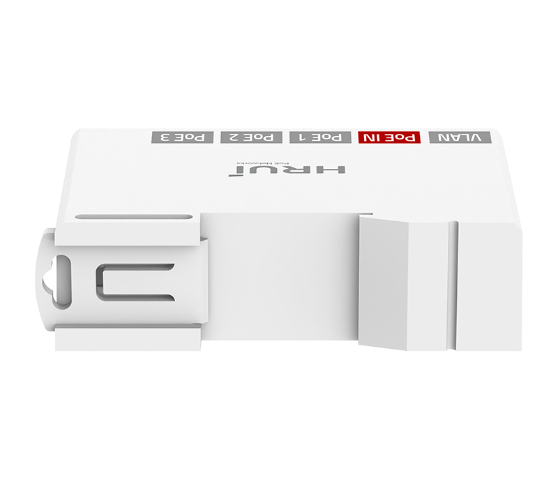

# HR-AFGR-31+

> 来源：<https://www.hruitech.com/poe-accessory/328.html>（抓取 2026-10-21T04:36:56Z；英文原文照录，中文仅为栏目名）  
> 官网描述：1000Mpbs Ethernet PoE Extender  
> 类目：PoE Accessory（site id 328）  
> 接口：1*1Gbps PoE in port / 3*1Gbps PoE out ports；PoE 预算 25W；交换带宽 8Gbps；电源 IEEE802.3af/at

**Brief:** 3*GE PoE Out + 1*GE PoE In | IEEE 802.3af/at | 4KV Port Surge protection | VLAN Port Isolation | PoE Watchdog | Rail Installation

## 产品图





## Datasheet
- [HR-AFGR-31-2B-EF-BC-88EN-EF-BC-89_1aGju.pdf](https://www.hruitech.com/web/userfiles/productfile/HR-AFGR-31-2B-EF-BC-88EN-EF-BC-89_1aGju.pdf) （本地：`data/hrui_site_raw/datasheets/HR-AFGR-31-2B-EF-BC-88EN-EF-BC-89_1aGju.pdf`；文本：`data/hrui_site_raw/datasheet_text/HR-AFGR-31-2B-EF-BC-88EN-EF-BC-89_1aGju.txt`）

## Feature and Benefits（原文）
```
Powerful. Easy-to-Use. Cost-Effective.
HR-AFGR-31+ is a new member of HRUI's latest PoE extender series, delivering robust performance with exceptional value. Designed for efficient network and IP surveillance deployment, the HR-AFGR-31+ features 1× Gigabit PoE IN port and 3× Gigabit PoE OUT ports, extending both power and data over a single Ethernet cable — reducing cabling costs while simplifying installation. Supporting IEEE 802.3af/at PoE standards, it provides stable power and Gigabit connectivity for IP cameras, access points, and other PoE-powered devices.
Compliant with IEEE 802.3/802.3u/802.3ab/802.3x standards, the extender supports 10/100/1000Mbps auto-negotiation, Auto MDI/MDIX, and VLAN mode for traffic isolation and enhanced security. Real-time LED status indicators enable quick fault analysis. With flexible desktop or wall-mount installation, the HR-AFGR-31+ is ideal for hotels, campuses, warehouses, and large-scale surveillance deployments.
Product Highlights
• 1*1000Mbps PoE in port+3*1000Mbps PoE out ports.
• Comply with IEEE 802.3, IEEE 802.3ab, IEEE 802.3u, and IEEE 802.3x standards.
• Support IEEE802.3af/at power supply standard.
• Ethernet Ports support 10/100/1000Mbps self-adaptive.
• The panel indicator LEDs will monitor the working status and assist in fault analysis.
• Support automatic port flipping (Auto MDI/MDIX).
• Support VLAN mode.
• Having network and PoE relay extension roles.
• Flow control method, full duplex adopts IEEE 802.3x standard, and half duplex adopts Back pressure standard.
```

## Parameter（规格表逐行）
| 项 | 值 |
|---|---|
| Description | Specification |
| Model | HR-AFGR-31+ |
| Interface | 1*1Gbps PoE in port |
| Interface | 3*1Gbps PoE out ports |
| Port Standard | IEEE802.3 (Ethernet) |
| Port Standard | IEEE802.3u (Fast Ethernet) |
| Port Standard | IEEE802.3ab (Gigabit Ethernet) |
| Port Standard | IEEE802.3x (Flow Control) |
| Switching Bandwidth | 8Gbps |
| Packet Forwarding Rate | 5.952Mpps |
| MAC Address Table | 2K |
| Transmission Method | Store and Forward |
| PoE Standard | IEEE802.3af (15.4W) |
| PoE Standard | IEEE802.3at (30W) |
| PoE Port Output Voltage | DC 44-57V |
| PoE Ports | Port PoE out <30W |
| PoE Power Budget | 25W |
| Power Supply | IEEE802.3af/at |
| Mainboard Power Consumption | 1.59W |
| Structure Information | Product Dimensions: 96*66.5*28mm |
| Structure Information | Packaging Dimensions: 100*72*31mm |
| Structure Information | Product Net Weight: 0.078KG |
| Structure Information | Product Gross Weight: 0.091KG |
| Packing Information | Carton Dimensions: 375*335*220mm |
| Packing Information | Packing Quantity: 100PCS |
| Packing Information | Packing Weight: 10.1KG |
| Package Contents | PoE Extender 1pcs, Certificate of Inspection 1pcs |
| Fan Quantity | 0 |
| Installation | Desktop, Wall mounting installation, Rail installation |
| Surge Protection | Port Surge: Differential mode 4KV (Class C) |
| Operating Temperature | 0~40°C |
| Storage Temperature | -40~70°C |
| Operation Humidity | 10%~90%, non condensing |
| Storage Humidity | 5%~95%, non condensing |
| Port Green LED | On: Link normal |
| Port Green LED | Off: Link blocked |
| Port Green LED | Flashing: Data transmitting |
| OFF/ON Modes Buttons | OFF: Normal mode, all ports can communicate with each other, transmission distance is within 100 meters, transmission rate is 10/100//1000Mbps adaptive(PoE Watchdog off) |
| OFF/ON Modes Buttons | ON: VLAN mode, PoE ports are isolated from each other, communicating with uplink port, and automatically activate the PoE watchdog mode |

## Product structure / Application topology（图）
- https://www.hruitech.com/web/userfiles/image/20260515/1778836660476526.png
