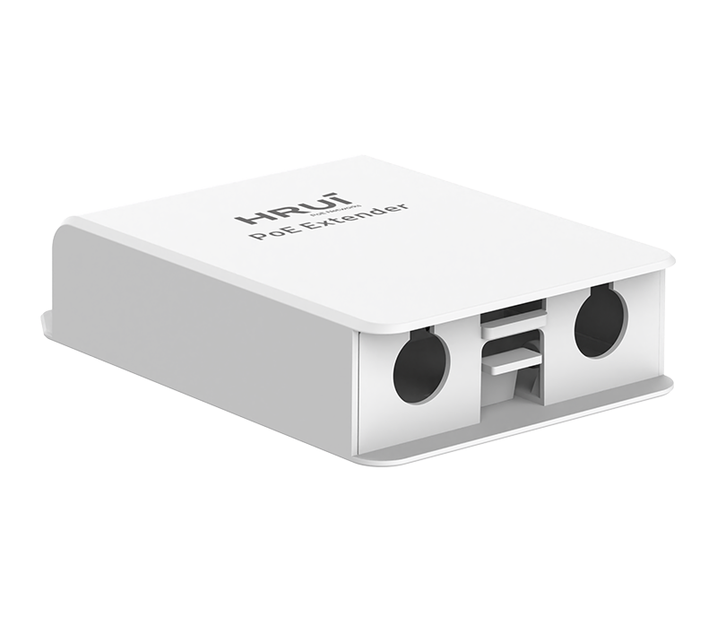
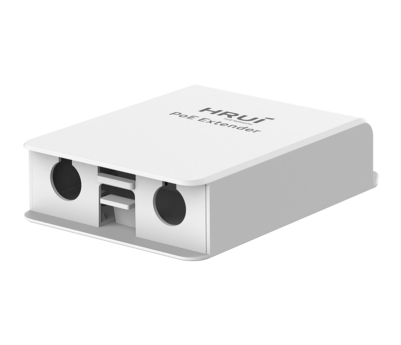
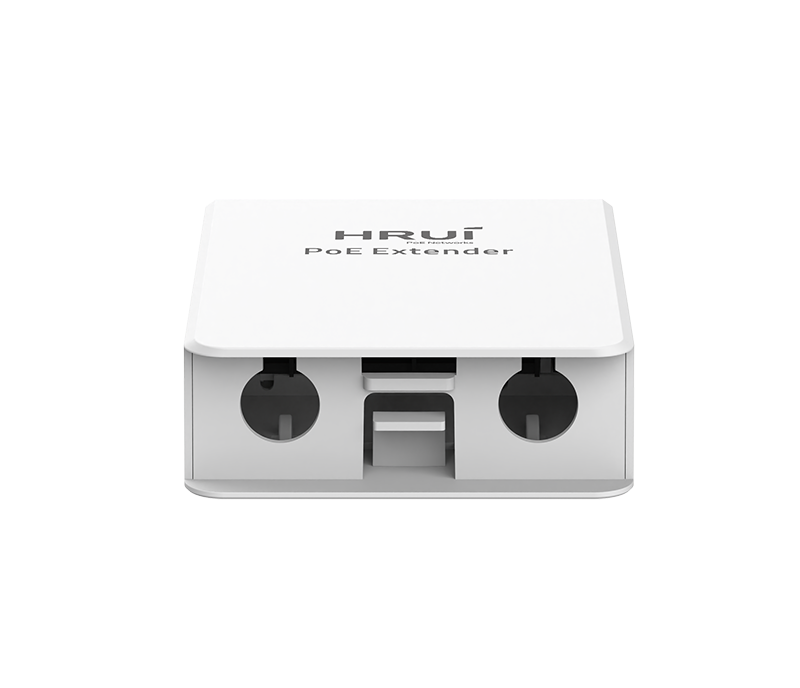
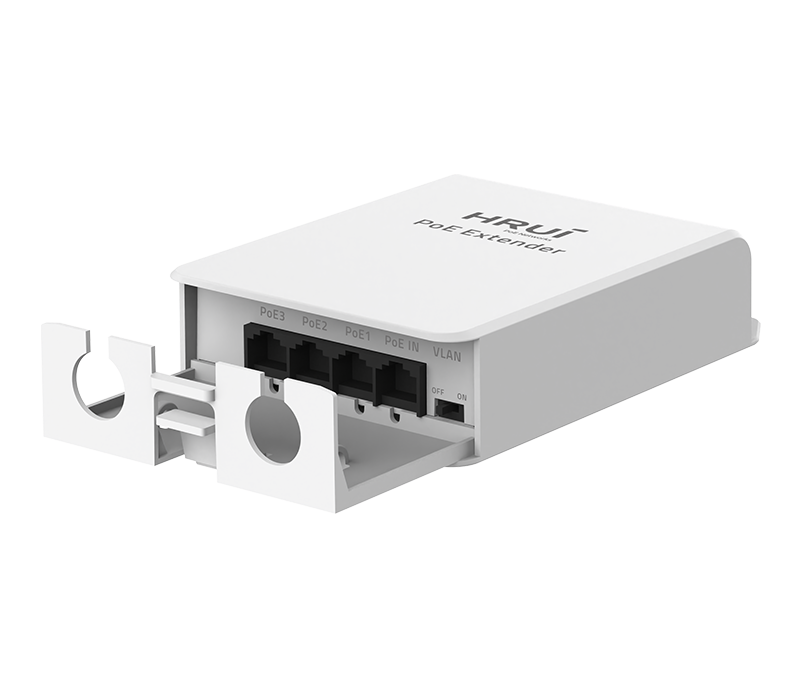
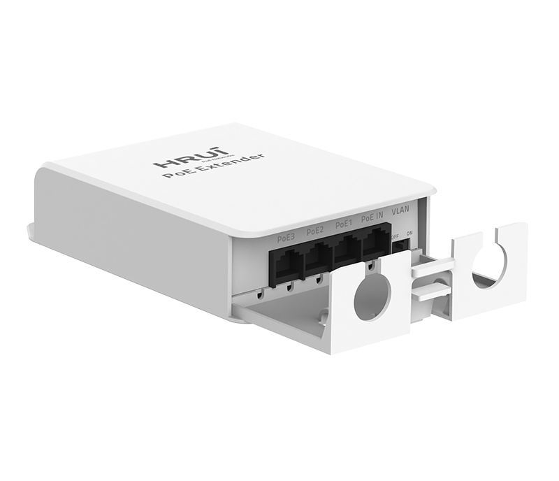
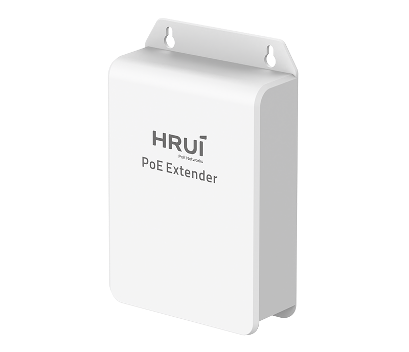

# HR-AFGRW-31+

> 来源：<https://www.hruitech.com/poe-accessory/324.html>（抓取 2026-10-21T04:36:58Z；英文原文照录，中文仅为栏目名）  
> 官网描述：Weatherproof 1000Mbps Ethernet PoE Extender  
> 类目：PoE Accessory（site id 324）  
> 接口：1*1Gbps PoE in port / 3*1Gbps PoE out ports；PoE 预算 25W；交换带宽 8Gbps；电源 IEEE802.3af/at

**Brief:** 1*GE PoE In +3*GE PoE Out | IEEE802.3af/at | 4KV Port Surge protection | VLAN Port Isolation | PoE Watchdog | Multiple Cascades | Wall-mounted Installation

## 产品图







## Datasheet
- [HR-AFGRW-31-2B-EF-BC-88EN-EF-BC-89.pdf](https://www.hruitech.com/web/userfiles/productfile/HR-AFGRW-31-2B-EF-BC-88EN-EF-BC-89.pdf) （本地：`data/hrui_site_raw/datasheets/HR-AFGRW-31-2B-EF-BC-88EN-EF-BC-89.pdf`；文本：`data/hrui_site_raw/datasheet_text/HR-AFGRW-31-2B-EF-BC-88EN-EF-BC-89.txt`）

## Feature and Benefits（原文）
```
Effortless PoE Extension, No Power Required.
HR-AFGRW-31+ is a Weatherproof Gigabit PoE extender that requires no AC power or rewiring. Simply plug and play to extend both network and PoE coverage instantly. Featuring 1 x PoE input and 3 x PoE output ports, it supports IEEE802.3af/at standards (44-57V input, max 30W input) and delivers up to 100m transmission distance per hop. Ideal for warehouses, outdoor surveillance, or remote buildings—no complex setup needed.
Compliant with IEEE 802.3/802.3ab/802.3u/802.3x standards, the extender supports Auto MDI/MDIX, VLAN mode for secure network segmentation, and three-level cascade for extended reach up to 400m. Housed in a rugged, unibody enclosure, it withstands harsh outdoor environments. LED indicators provide real-time status monitoring. Perfect for IP cameras, access points, and IoT devices—wall-mountable for flexible deployment.
Product Highlights
1*1Gbps PoE in port+3*1Gbps PoE out ports
Comply with IEEE 802.3, IEEE 802.3ab, IEEE 802.3u, and IEEE 802.3x standards.
Support IEEE802.3af/at power supply standard.
Ethernet Ports support 10/100/1000Mbps self-adaptive.
The panel indicator LEDs will monitor the working status and assist in fault analysis.
Support automatic port flipping (Auto MDI/MDIX).
Support VLAN mode.
Having network and PoE relay extension roles.
Flow control method, full duplex adopts IEEE 802.3x standard, and half duplex adopts Back pressure standard.
```

## Parameter（规格表逐行）
| 项 | 值 |
|---|---|
| Description | Specification |
| Model | HR-AFGRW-31+ |
| Interface | 1*1Gbps PoE in port |
| Interface | 3*1Gbps PoE out ports |
| Port Standard | IEEE802.3 (Ethernet) |
| Port Standard | IEEE802.3u (Fast Ethernet) |
| Port Standard | IEEE802.3ab (Gigabit Ethernet) |
| Port Standard | IEEE802.3x (Flow Control) |
| Switching Bandwidth | 8Gbps |
| Packet Forwarding Rate | 5.952Mpps |
| MAC Address Table | 2K |
| Transmission Method | Store and Forward |
| PoE Standard | IEEE802.3af (15.4W) |
| PoE Standard | IEEE802.3at (30W) |
| PoE Port Output Voltage | DC 44-57V |
| PoE Ports | Port PoE out <30W |
| PoE Power Budget | 25W |
| Power Supply | IEEE802.3af/at |
| Mainboard Power Consumption | 1.59W |
| Structure Information | Product Dimensions: 146.6*97*34.5mm |
| Structure Information | Packaging Dimensions: 102*152*36mm |
| Structure Information | Product Net Weight: 0.15KG |
| Structure Information | Product Gross Weight: 0.17KG |
| Packing Information | Carton Dimensions: 375*335*220mm |
| Packing Information | Packing Quantity: 40PCS |
| Packing Information | Packing Weight: 8.04KG |
| Package Contents | PoE Extender 1pcs, Certificate of Inspection 1pcs |
| Fan Quantity | 0 |
| Installation | Desktop, Wall mounting installation |
| Surge Protection | Port Surge: Differential mode 4KV (Class C) |
| Operating Temperature | 0~40°C |
| Storage Temperature | -40~70°C |
| Operation Humidity | 10%~90%, non condensing |
| Storage Humidity | 5%~95%, non condensing |
| Port Green LED | On: Link normal |
| Port Green LED | Off: Link blocked |
| Port Green LED | Flashing: Data transmitting |
| OFF/ON Modes Buttons | OFF: Normal mode, all ports can communicate with each other, transmission distance is within 100 meters, transmission rate is 10/100//1000Mbps adaptive(PoE Watchdog off) |
| OFF/ON Modes Buttons | ON: VLAN mode, PoE ports are isolated from each other, communicating with uplink port, and automatically activate the PoE watchdog mode |

## Product structure / Application topology（图）
- https://www.hruitech.com/web/userfiles/image/20251126/1764145593789916.jpg
