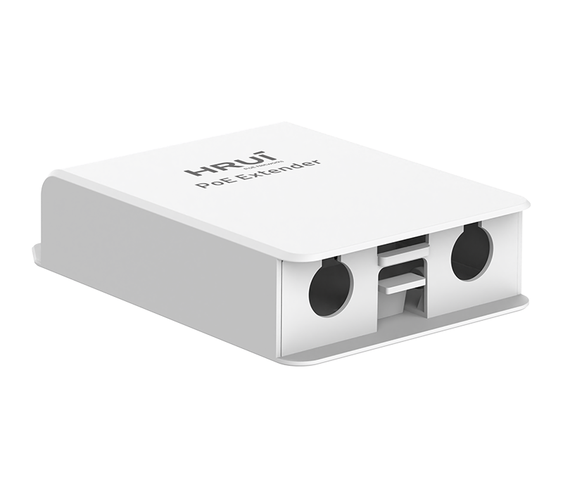
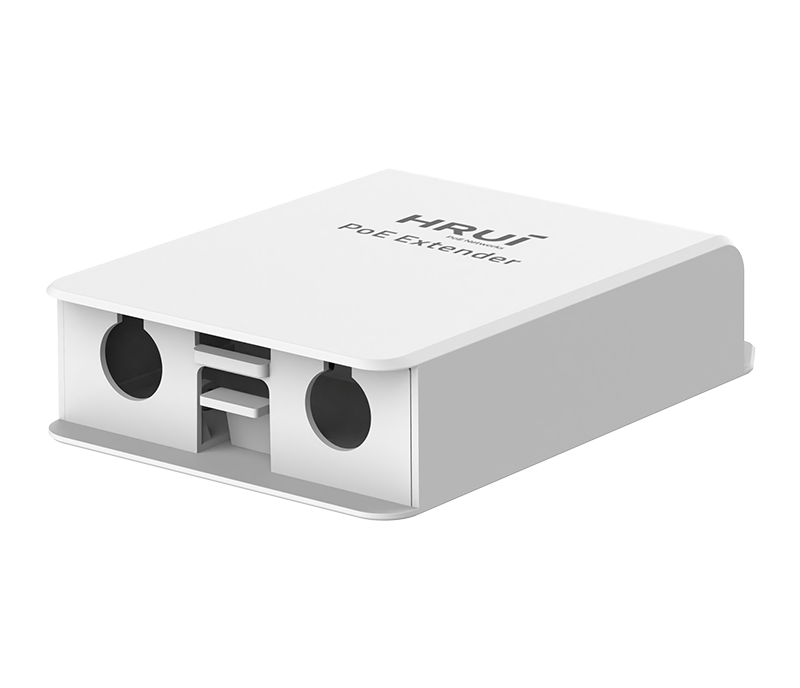
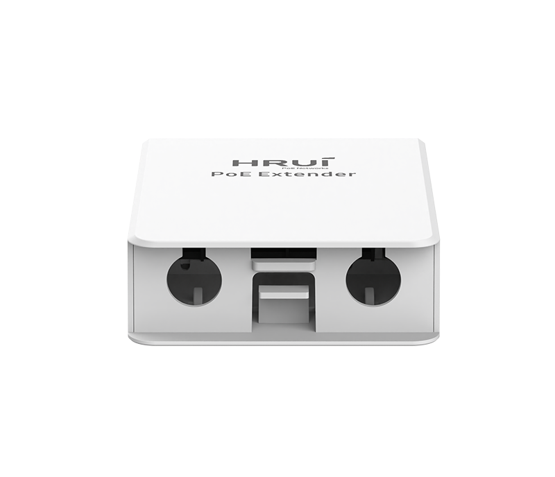
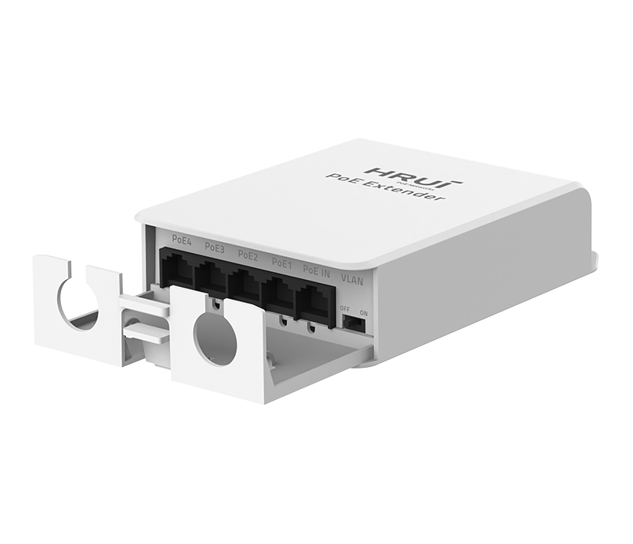
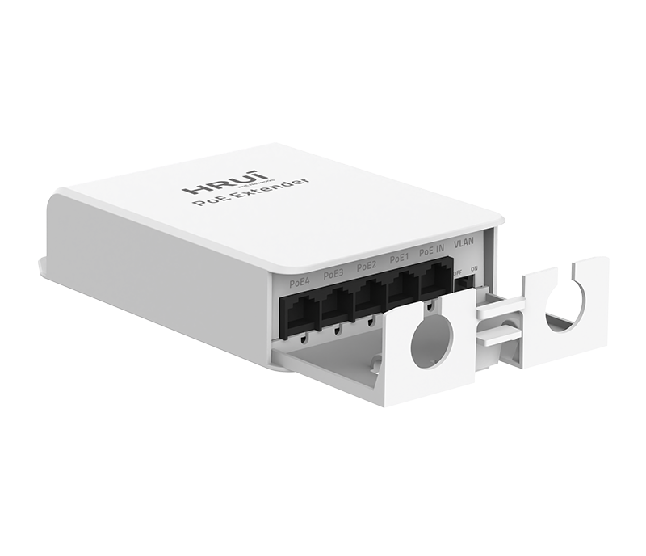
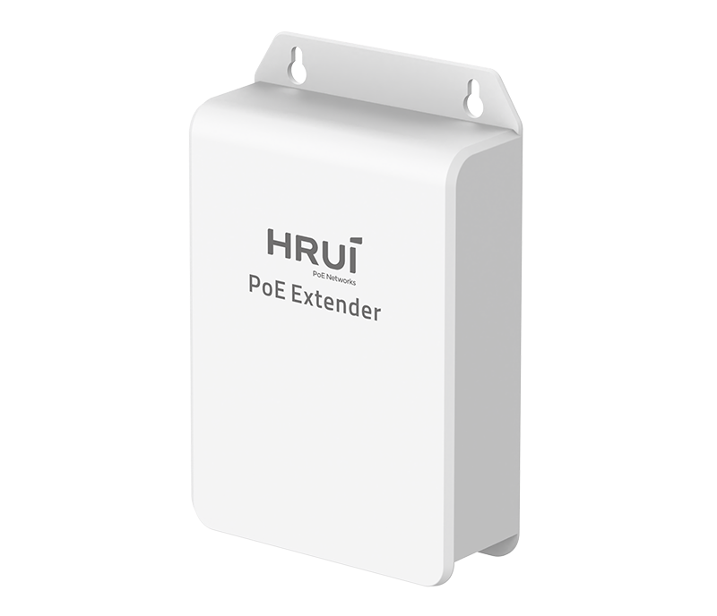

# HR-AFGRW-41+

> 来源：<https://www.hruitech.com/poe-accessory/312.html>（抓取 2026-10-21T03:46:05Z；英文原文照录，中文仅为栏目名）  
> 官网描述：HR-AFGRW-41+ - Weatherproof 1000Mbps Ethernet PoE Extender  
> 类目：PoE Accessory（site id 312）  
> 接口：1*1Gbps PoE in port / 4*1Gbps PoE out ports；PoE 预算 44W；交换带宽 10Gbps；电源 IEEE802.3af/at/HiPoE

**Brief:** 4KV Port Surge protection | Supports Hi-PoE Input | 4*1Gbps 802.3af/at PoE Output | VLAN Port Isolation | Multiple Cascades | Wall-mounted Installation

## 产品图







## Datasheet
- [HR-AFGRW-41-2B-EF-BC-88EN-EF-BC-89.pdf](https://www.hruitech.com/web/userfiles/productfile/HR-AFGRW-41-2B-EF-BC-88EN-EF-BC-89.pdf) （本地：`data/hrui_site_raw/downloads/HR-AFGRW-41-2B-EF-BC-88EN-EF-BC-89.pdf`；文本：`data/hrui_site_raw/datasheet_text/HR-AFGRW-41-2B-EF-BC-88EN-EF-BC-89.txt`）

## Feature and Benefits（原文）
```
HR-AFGRW-41+ Waterproof Gigabit PoE Extender enhances outdoor network deployment by extending both data and power transmission beyond the standard 100 meters. Equipped with 1×1Gbps Hi-PoE (60W) input and 4×1Gbps IEEE802.3af/at PoE output, it ensures stable power distribution and reliable Gigabit performance for long-distance installations.
Compliant with IEEE 802.3/802.3u/802.3ab/802.3x standards, the extender supports 10/100/1000Mbps auto-adaptive ports, VLAN
mode, Auto MDI/MDIX, and LED status monitoring for simplified deployment and maintenance. Its weatherproof enclosure and PoE relay extension capability make it ideal for outdoor cameras, security monitoring, and wide-area PoE network extension.
Product Features:
High-Power Input:
1×1Gbps Hi-PoE input port supporting 60W total power.
Multiple Output Ports:
4×1Gbps PoE output ports compliant with IEEE 802.3af/at, providing a 45W total power budget.
Standards Compliance:
Fully complies with IEEE 802.3, 802.3u, 802.3ab, and 802.3x standards for reliable Gigabit performance.
Auto-MDI/MDIX:
Simplifies installation with automatic port configuration.
VLAN Mode Support:
Enhances network segmentation and transmission stability.
LED Status Indicators:
Enables quick monitoring and troubleshooting.
Durable Protection:
Offers 4KV surge protection for stable outdoor operation.
Waterproof Enclosure:
Designed for durable, long-term outdoor deployment.
```

## Parameter（规格表逐行）
| 项 | 值 |
|---|---|
| Description | Specification |
| Model | HR-AFGRW-41+ |
| Interface | 1*1Gbps PoE in port |
| Interface | 4*1Gbps PoE out ports |
| Port Standard | IEEE802.3 (Ethernet) |
| Port Standard | IEEE802.3u (Fas t Ethernet) |
| Port Standard | IEEE802.3ab (Gigabit Ethernet) |
| Port Standard | IEEE802.3x (Flow Control) |
| Switching Bandwidth | 10Gbps |
| Packet Forwarding Rate | 7.44Mpps |
| MAC Address Table | 2K |
| Transmission Method | Store and Forward |
| PoE Standard | IEEE802.3af (15.4W) |
| PoE Standard | IEEE802.3at (30W) |
| PoE Port Output Voltage | DC 44-57V |
| PoE Ports | Port PoE out <30W |
| PoE Power Budget | 44W |
| Power Supply | IEEE802.3af/at/HiPoE |
| Mainboard Power Consumption | 1.59W |
| Structure Information | Product Dimensions: 146.6*97*34.5mm |
| Structure Information | Packaging Dimensions: 102*152*36mm |
| Structure Information | Product Net Weight: 0.15KG |
| Structure Information | Product Gross Weight: 0.17KG |
| Packing Information | Carton Dimensions: 375*335*220mm |
| Packing Information | Packing Quantity: 40PCS |
| Packing Information | Packing Weight: 8.04KG |
| Package Contents | PoE Extender 1pcs, Certificate of Inspection 1pcs |
| Fan Quantity | 0 |
| Installation | Desktop, Wall mounting installation |
| Surge Protection | Port Surge: Differential mode 4KV (Class C) |
| Operating Temperature | 0~40°C |
| Storage Temperature | -40~70°C |
| Operation Humidity | 10%~90%, non condensing |
| Storage Humidity | 5%~95%, non condensing |
| Port Green LED | On: Link normal |
| Port Green LED | Off: Link blocked |
| Port Green LED | Flashing: Data transmitting |
| OFF/ON Modes Buttons | OFF: Normal mode, all ports can communicate with each other, transmission distance is within 100 meters, transmission rate is 10/100//1000Mbps adaptive(PoE Watchdog off) |
| OFF/ON Modes Buttons | ON: VLAN mode, PoE ports are isolated from each other, communicating with uplink port, and automatically activate the PoE watchdog mode |

## Product structure / Application topology（图）
- https://www.hruitech.com/web/userfiles/image/20251126/1764145593789916.jpg
