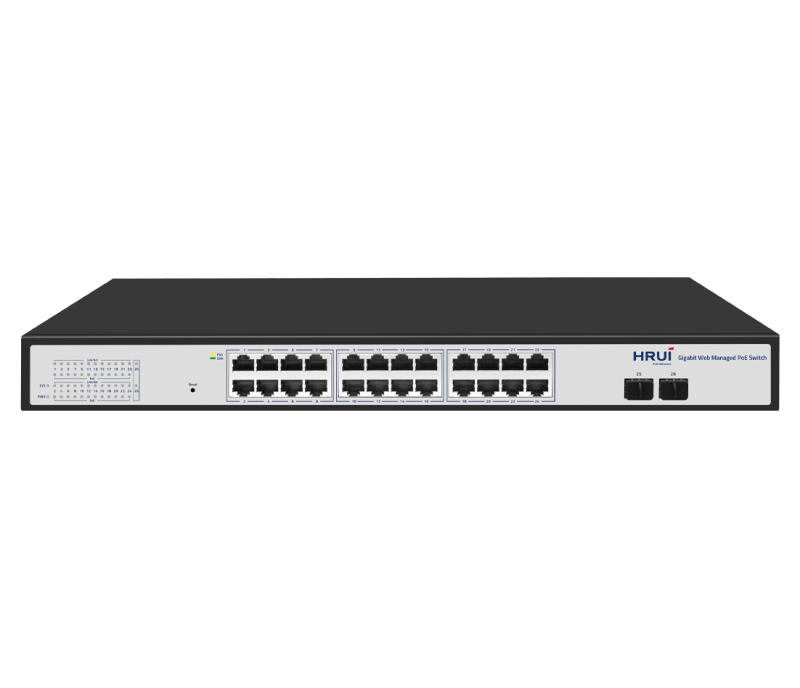
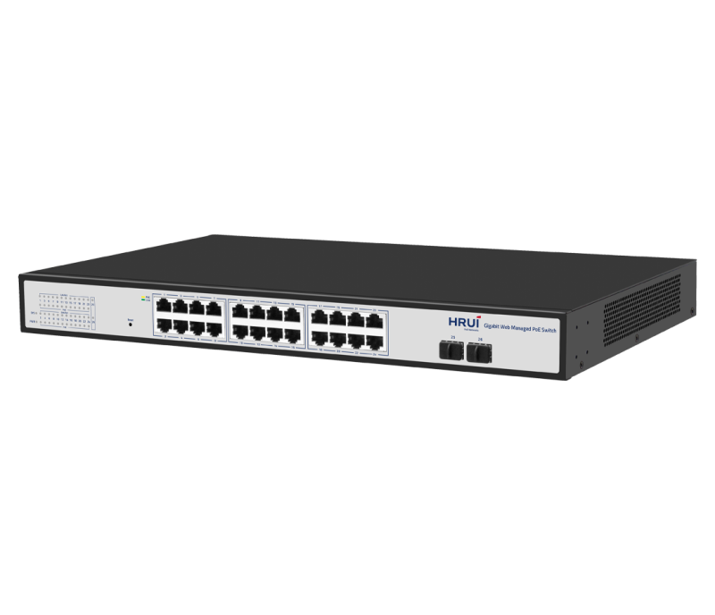
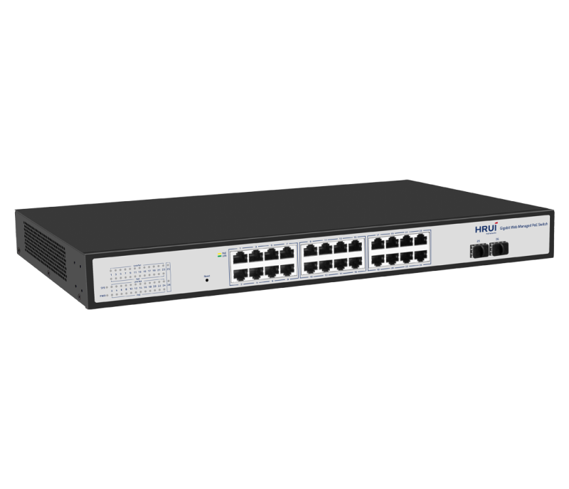
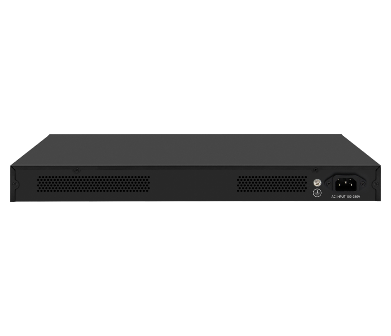

# HR-AFGW-242S-400

> 来源：<https://www.hruitech.com/managed-switch/233.html>（抓取 2026-10-21T04:36:22Z；英文原文照录，中文仅为栏目名）  
> 官网描述：24-Port 10/100/1000T 802.3af/at PoE + 2-Port 1G SFP Managed Switch  
> 类目：Managed Switch（site id 233）  
> 接口：24*1Gbps PoE ports / 2 *1Gbps SFP ports；PoE 预算 380W；交换带宽 52 Gbps；电源 AC 100-240V 50/60Hz / DC 52V 7.69A

**Brief:** The 26 Port Gigabit Web Managed Ethernet PoE Switch adopts high-quality and high-speed network IC. WIth the fan-less and silent design, this model completely solves the problem of high noise when the switches are deployed in an office environment. This switch has 24* Gigabit PoE RJ45 ports+ 2* Gigabit SFP ports, which can provide seamless connection for 10/100/1000M Ethernet, supports WEB management, and is easy to manage and maintain. This product can be widely used in security network video surveillance, hotels, campuses, and small and medium-sized enterprises, network engineering and other occasions.

## 产品图





## Datasheet
- [HR_AFGW_242S_400.pdf](https://www.hruitech.com/web/userfiles/productfile/HR_AFGW_242S_400.pdf) （本地：`data/hrui_site_raw/datasheets/HR_AFGW_242S_400.pdf`；文本：`data/hrui_site_raw/datasheet_text/HR_AFGW_242S_400.txt`）

## Feature and Benefits（原文）
```
HR-AFGW-242S-400, a state-of-the-art 26-port Gigabit Web-Managed Ethernet PoE Switch that delivers superior performance and reliability. Engineered with high-quality, high-speed network ICs, this switch effectively addresses the noise concerns commonly associated with smaller switches found in office environments, thanks to its innovative fanless design that ensures silent operation.
Equipped with 24 Gigabit RJ45 ports and 2 SFP ports, it provides seamless connectivity for 10/100/1000 Mbps Ethernet. The switch supports three operational modes, including a one-key smart switching function for effortless management and maintenance. This versatile device is ideal for a wide range of applications, including security network video surveillance, hotels, campuses, and network deployments in small to medium-sized enterprises.
Product Features:
Port Configuration:
24 x 1Gbps PoE ports and 2 x 1Gbps SFP ports.
Standards Compliance:
Fully compliant with IEEE802.3, IEEE802.3u, IEEE802.3x, IEEE802.3ab, and IEEE802.3z standards.
Adaptive Port Support:
10/100/1000Mbps self-adaptive ports for optimal performance.
Auto MDI/MDIX Functionality:
Support for Auto MDI/MDIX ensures hassle-free connections.
Advanced Switching Technology:
Utilizes a store-and-forward switch mechanism for enhanced data management.
Non-Blocking Architecture:
All ports facilitate line-speed switching for maximum throughput.
User-Friendly Monitoring:
Indicator LEDs provide real-time status updates and aid in fault diagnosis.
Quality of Service (QoS):
Prioritizes data packets to enhance performance for critical applications.
```

## Parameter（规格表逐行）
| 项 | 值 |
|---|---|
| Description | Specification |
| Model | HR-AFGW-242S-400 |
| Interface | 24*1Gbps PoE ports |
| Interface | 2 *1Gbps SFP ports |
| Port Standard | IEEE 802.3: Ethernet Media Access Control (MAC) Protocol |
| Port Standard | IEEE 802.3i: 10BASE-T Ethernet |
| Port Standard | IEEE 802.3u: 100BASE-TX Fast Ethernet |
| Port Standard | IEEE 802.3ab: 1000BASE-T GigabitEthernet |
| Port Standard | IEEE 802.3z: 1000BASE-X Gigabit Ethernet (Fiber optic) |
| Port Standard | IEEE 802.3x: Flow Control |
| Switching Bandwidth | 52 Gbps |
| Packet Forwarding Rate | 38.68Mpps |
| Packet Buffer | 4.1Mbit |
| MAC Address Table | 8K |
| Jumbo Frame | 9216bytes |
| VLAN | VLAN range 1-4094, maximum active VLAN is 31 |
| Transmission Method | Store and Forward |
| PoE Standard | IEEE802.3af (15.4W) |
| PoE Standard | IEEE802.3at (30W) |
| PoE Port Output Voltage | DC 44-57V |
| PoE Ports | Ports 1-24 PoE power output <30W |
| PoE Power Budget | 380W |
| Power Supply | AC 100-240V 50/60Hz |
| Power Supply | DC 52V 7.69A |
| Mainboard Power Consumption | 15.75W |
| Structure Information | Product Dimensions: 440*280*44mm |
| Structure Information | Packaging Dimensions: 500*365*85mm |
| Structure Information | Product Net Weight: 3.55KG |
| Structure Information | Product Gross Weight: 4.22KG |
| Package Information | Carton Dimensions: 520*445*385mm |
| Package Information | Packing Quantity: 5PCS |
| Package Information | Packing Weight: 22.1KG |
| Package Contents | Switch 1pcs, Power Cord 1pcs, Manual 1pcs, Certificate of Inspection 1pcs |
| Fan Quantity | 0 |
| Installation | Desktop, Rack-mounting |
| Surge Protection | Port Surge: Common mode 4KV, Differential mode 2KV (Class B) |
| Surge Protection | Electrostatic ESD: Air 8KV, Contact 6KV (Class C) |
| Operating Temperature | 0~40°C |
| Storage Temperature | -40~70°C |
| Operation Humidity | 10%~90%, non condensing |
| Storage Humidity | 5%~95%, non condensing |
| PWR Green LED | On: Powered on |
| PWR Green LED | Off: Powered off |
| SYS Green LED | Flashing: System startup in progress |
| SYS Green LED | On: The system is running normally |
| Ports 1-26 Green LED | On: 10/100/1000Mbps Link normal |
| Ports 1-26 Green LED | Off: Link blocked |
| Ports 1-26 Green LED | Flashing: Data transmitting |
| PoE Yellow LED | On: PoE powered on |
| PoE Yellow LED | Off: PoE powered off |
| Reset | Long press for 6 seconds to restore factory settings |
| **Software Features** | |
| **L2 Function** | |
| Port | Port Switch configuration |
| Port | Port Description configuration |
| Port | Port Speed configuration |
| Port | Port Duplex configuration |
| Port | Port Flow Control configuration |
| Port | Jumbo Frame |
| Port | EEE |
| Link Aggregation | Static Group |
| Link Aggregation | Maximum of 4 aggregation groups |
| Link Aggregation | Up to 8 members per aggregation group |
| Storm Control | Boardcast suppression |
| Storm Control | Unknown Multicast |
| Storm Control | Unknown Unicast |
| Port Mirroring | Support |
| Port Security | MAC Address Constraints |
| Port Isolation | Support |
| Port Rate-limit | Support |
| Loopback Detection | Support |
| VLAN | Access/Trunk/Hybrid |
| VLAN | VLAN range 1-4094, maximum active VLAN is 31 |
| VLAN | Port VLAN |
| MAC Address | Dynamic MAC address |
| MAC Address | Static MAC address |
| Spanning Tree Protocol | STP/RSTP/MSTP |
| Spanning Tree Protocol | Edge Port |
| Multicast | IGMP Snooping |
| Multicast | IGMP V1/V2/V3 |
| Multicast | Router Port |
| Multicast | Static IGMP group address |
| QoS | Traffic classification, supporting SP and WRR scheduling |
| QoS | Port Priority |
| QoS | Support up to 8 queues per port |
| **PoE** | |
| PoE Configuration | PoE used power |
| PoE Configuration | PoE Type/Level/Power/Voltage/Current query |
| PoE Configuration | PoE Switch Configuration |
| PoE Configuration | PoE power AF/AT adaptation |
| **Services** | |
| Access Protocol | HTTP |
| **Diagnostics** | |
| Port Statistics | Support |
| **Equipment Management** | |
| Manager Access | HTTP |
| Manager IP | Static Address |
| Manager IP | DHCP Client |
| Time Synchronization | SNTP |
| Time Synchronization | Manual Time |
| SNMP | V2C |
| SNMP | Community |
| SNMP | Trap Host |
| Port Statistics | Support |
| SNMP MIB | RFC 1213 MIB-II |
| User Management | Support |
| Firmware Management | Firmware upgrade |
| Configuration Management | Upload/Backup Configuration |
| Save | Support |
| Restart | Support |
| Factory Defaults | Support |
| **Standard Compliance** | |
| **IEEE 802.3x flow control and back pressure** | |
| **IEEE 802.3ad port trunk with LACP** | |
| **IEEE 802.1D Spanning Tree Protocol** | |
| **IEEE 802.1w Rapid Spanning Tree Protocol** | |
| **IEEE 802.1s Multiple Spanning Tree Protocol** | |
| **IEEE 802.1p Class of Service** | |
| **IEEE 802.1Q VLAN tagging** | |
| **IEEE 802.3af Power over Ethernet** | |
| **IEEE 802.3at Power over Ethernet Plus** | |
| **RFC 768 UDP** | |
| **RFC 791 IP** | |
| **RFC 792 ICMP** | |
| **RFC 2068 HTTP** | |
| **RFC 1112 IGMP v1** | |
| **RFC 2236 IGMP v2** | |

## Product structure / Application topology（图）
- https://www.hruitech.com/web/userfiles/image/20241231/1735614324514034.png
