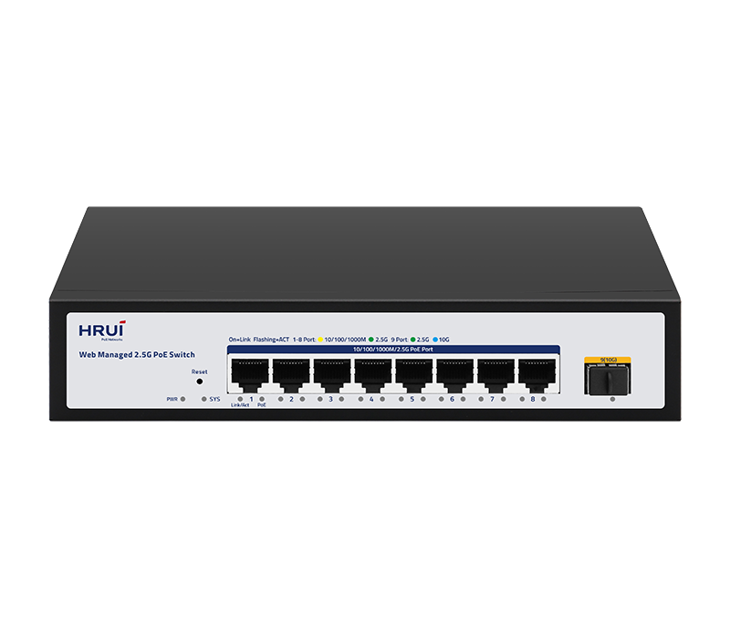
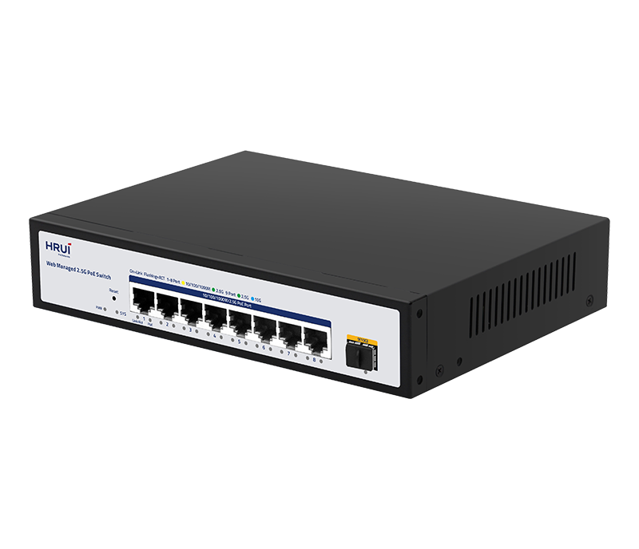
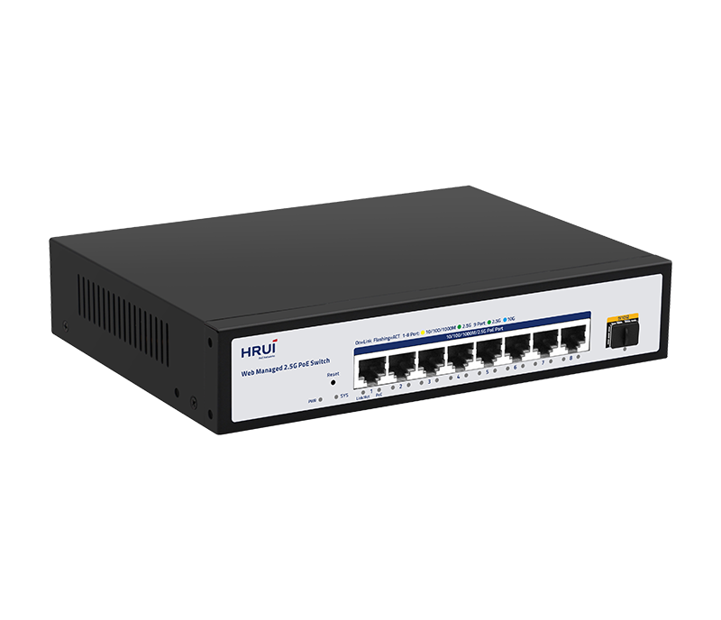
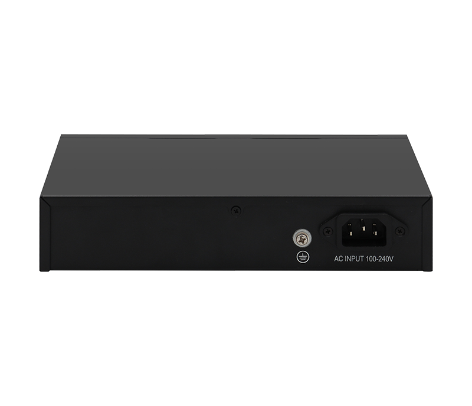

# HR-AFGW-SWTGW018ANS-100

> 来源：<https://www.hruitech.com/managed-switch/218.html>（抓取 2026-10-21T04:36:15Z；英文原文照录，中文仅为栏目名）  
> 官网描述：8-Port 10/100/1000/2500T 802.3af/at PoE + 1-Port 10G SFP+ Web Managed Switch  
> 类目：Managed Switch（site id 218）  
> 接口：Port Switch configuration / Port Speed configuration / Port Duplex configuration / Port Flow Control configuration / EEE / Jumbo Frame；PoE 预算 —；交换带宽 —；电源 —

**Brief:** HRUI 9-Port 10 Gigabit Uplink 2.5G Web Managed PoE Switch is designed to provide 2.5Gbps RJ-45 ports and 10Gbps SFP+ ports to create lightning-fast and reliable connections. With this switch, you can effortlessly bridge the gap between WiFi 6 access points, storage servers, and other devices to receive both data and power over a single Ethernet cable simultaneously.

## 产品图





## Datasheet
- [HR_AFGW_SWTG218ANS_100.pdf](https://www.hruitech.com/web/userfiles/productfile/HR_AFGW_SWTG218ANS_100.pdf) （本地：`data/hrui_site_raw/datasheets/HR_AFGW_SWTG218ANS_100.pdf`；文本：`data/hrui_site_raw/datasheet_text/HR_AFGW_SWTG218ANS_100.txt`）

## Feature and Benefits（原文）
```
HRUI 9-Port 10 Gigabit Uplink 2.5G Web Managed PoE Switch is designed to provide 2.5Gbps RJ-45 ports and 10Gbps SFP+ ports to create lightning-fast and reliable connections. With this switch, you can effortlessly bridge the gap between WiFi 6 access points, storage servers, and other devices to receive both data and power over a single Ethernet cable simultaneously.
With the HRUI cloud remote management platform, the product provides a significant improvement over traditional Gigabit Ethernet and is ideal for environments where faster network speeds are required, but upgrading to 10Gbps is not cost-effective or necessary for access.
Why 2.5G PoE Switch？
Faster Ethernet
10G Uplink
Future Scalability
Budget-friendly
Provides faster 2.5G network transfer speeds to connect more devices such as WiFi 6 APs, 8K PoE cameras, etc. Ideal for applications that require ultra-high-speed data transfer in today's fast-paced world.
Provide highly reliable and stable transmission to meet high traffic demands such as high-definition video transmission and large data processing.
Allow for future growth and expansion, reducing the need for costly infrastructure upgrades down the line.
A 2.5G network offers cost benefits over a 10Gb network, offering speed gains while using existing Cat.5e cables, and reducing deployment costs by avoiding costly new wiring infrastructure.
• PoE Technology
HR-AFGW-SWTGW018ANS offers 8*2.5G Ethernet ports with 802.3at PoE+ (30W) capabilities. And it can supply both data and power over a single Ethernet cable simultaneously, without the need for additional power cables.
• 2.5G Ports
The product provides comprehensive software capabilities, including VLAN, port mirroring, flow control, etc. You can easily control the network, either from your local location or remotely through the Cloud, giving you complete flexibility and access to your network from anywhere, at any time.
• HRUI Cloud APP & WEB-based Management
The product provides comprehensive software capabilities, including VLAN, port mirroring, flow control, etc. You can easily control the network, either from your local location or remotely through the Cloud, giving you complete flexibility and access to your network from anywhere, at any time.
• Jumbo Frames (up to 9KB)
Jumbo Frames can reduce bandwidth usage by carrying more data in each Ethernet frame, resulting in fewer transactions on the network. This reduction in traffic also reduces stress on networking equipment.
• Plug and Play
• Rock-solid Reliability
No configuration is required. Simply plug a device into the network. It automation begins.
Support 4KV surge protection against harsh environments.
```

## Parameter（规格表逐行）
| 项 | 值 |
|---|---|
| Faster Ethernet | 10G Uplink / Future Scalability / Budget-friendly |
| Provides faster 2.5G network transfer speeds to connect more devices such as WiFi 6 APs, 8K PoE cameras, etc. Ideal for applications that require ultra-high-speed data transfer in today's fast-paced world. | Provide highly reliable and stable transmission to meet high traffic demands such as high-definition video transmission and large data processing. / Allow for future growth and expansion, reducing the need for costly infrastructure upgrades down the line. / A 2.5G network offers cost benefits over a 10Gb network, offering speed gains while using existing Cat.5e cables, and reducing deployment costs by avoiding costly new wiring infrastructure. |
|  | • PoE Technology |
|  | HR-AFGW-SWTGW018ANS offers 8*2.5G Ethernet ports with 802.3at PoE+ (30W) capabilities. And it can supply both data and power over a single Ethernet cable simultaneously, without the need for additional power cables. |
|  | • 2.5G Ports |
|  | The product provides comprehensive software capabilities, including VLAN, port mirroring, flow control, etc. You can easily control the network, either from your local location or remotely through the Cloud, giving you complete flexibility and access to your network from anywhere, at any time. |
|  | • HRUI Cloud APP & WEB-based Management |
|  | The product provides comprehensive software capabilities, including VLAN, port mirroring, flow control, etc. You can easily control the network, either from your local location or remotely through the Cloud, giving you complete flexibility and access to your network from anywhere, at any time. |
|  | • Jumbo Frames (up to 9KB) |
|  | Jumbo Frames can reduce bandwidth usage by carrying more data in each Ethernet frame, resulting in fewer transactions on the network. This reduction in traffic also reduces stress on networking equipment. |
| • Plug and Play | • Rock-solid Reliability |
| No configuration is required. Simply plug a device into the network. It automation begins. | Support 4KV surge protection against harsh environments. |
| Description | Specification |
| Packing Information | Carton Dimensions: 445*445*335mm |
| Packing Information | Packing Quantity: 10PCS |
| Packing Information | Packing Weight: 13.3KG |
| Package Contents | Switch 1pcs, Power Cord 1pcs, Manual 1pcs, Certificate of Inspection 1pcs |
| Fan Quantity | 0 |
| Installation | Desktop |
| Surge Protection | Port Surge: Common mode 4KV, Differential mode 2KV (Class B) |
| Surge Protection | Electrostatic ESD: Air 8KV, Contact 6KV (Class C) |
| Operating Temperature | 0~40°C |
| Storage Temperature | -40~70°C |
| Operation Humidity | 10%~90%, non condensing |
| Storage Humidity | 5%~95%, non condensing |
| PWR Green LED | On: Powered on |
| PWR Green LED | Off: Powered off |
| SYS Green LED | On: The system is normal |
| SYS Green LED | Flashing: System startup in progress |
| Ports 1-8 | Green LED on: 2.5Gbps Link normal |
| Ports 1-8 | Yellow LED on: 1Gbps Link normal |
| Ports 1-8 | Off: Link blocked |
| Ports 1-8 | Flashing: Data transmitting |
| PoE Yellow LED | On: PoE powered on |
| PoE Yellow LED | Off: PoE powered off |
| Port 9 | Blue LED on: 10Gbps Link normal |
| Port 9 | Green LED on: 1G/2.5Gbps Link normal |
| Port 9 | Off: Link blocked |
| Port 9 | Flashing: Data transmitting |
| Reset | Long press for 6 seconds to restore factory settings |
| Packing Information | Carton Dimensions: 445*445*335mm |
| Packing Information | Packing Quantity: 10PCS |
| Packing Information | Packing Weight: 13.3KG |
| Package Contents | Switch 1pcs, Power Cord 1pcs, Manual 1pcs, Certificate of Inspection 1pcs |
| Fan Quantity | 0 |
| Installation | Desktop |
| Surge Protection | Port Surge: Common mode 4KV, Differential mode 2KV (Class B) |
| Surge Protection | Electrostatic ESD: Air 8KV, Contact 6KV (Class C) |
| Operating Temperature | 0~40°C |
| Storage Temperature | -40~70°C |
| Operation Humidity | 10%~90%, non condensing |
| Storage Humidity | 5%~95%, non condensing |
| PWR Green LED | On: Powered on |
| PWR Green LED | Off: Powered off |
| SYS Green LED | On: The system is normal |
| SYS Green LED | Flashing: System startup in progress |
| Ports 1-8 | Green LED on: 2.5Gbps Link normal |
| Ports 1-8 | Yellow LED on: 1Gbps Link normal |
| Ports 1-8 | Off: Link blocked |
| Ports 1-8 | Flashing: Data transmitting |
| PoE Yellow LED | On: PoE powered on |
| PoE Yellow LED | Off: PoE powered off |
| Port 9 | Blue LED on: 10Gbps Link normal |
| Port 9 | Green LED on: 1G/2.5Gbps Link normal |
| Port 9 | Off: Link blocked |
| Port 9 | Flashing: Data transmitting |
| Reset | Long press for 6 seconds to restore factory settings |
| **Software Features** | |
| **L2 Function** | |
| Port | Port Switch configuration |
| Port | Port Speed configuration |
| Port | Port Duplex configuration |
| Port | Port Flow Control configuration |
| Port | EEE |
| Port | Jumbo Frame |
| Link Aggregation | Max. 4 members per group |
| Link Aggregation | Static Group |
| Link Aggregation | LACP |
| Link Aggregation | Up to 2 groups |
| Storm Control | Boardcast suppression |
| Storm Control | Unknown Multicast |
| Storm Control | Unknown Unicast |
| Port Mirroring | Support |
| Port Security | MAC Address Constraints |
| Port Isolation | Support |
| Port Rate-limit | Support |
| VLAN | Access/Trunk/Hybrid |
| VLAN | Congurable VID from 1 - 4094;Max. 31 static VLAN groups |
| MAC Address | Dynamic MAC Address |
| MAC Address | Static MAC address |
| Spanning Tree Protocol | STP/RSTP |
| Spanning Tree Protocol | Edge Port |
| Multicast | IGMP Snooping |
| Multicast | Router Port |
| Multicast | Static IGMP Join |
| Multicast | IGMP V1/V2 |
| QoS | Traffic classification, Supporting SP and WRR scheduling |
| QoS | Port Priority |
| QoS | Supports up to 8 queues per port |
| PoE Configuration | PoE used power |
| PoE Configuration | PoE Type/Level/Power/Voltage/Current |
| PoE Configuration | PoE Switch |
| PoE Configuration | PoE power AF/AT adaptation |
| **Services** | |
| Access Protocol | HTTP |
| **Diagnostics** | |
| Port Statistics | Support |
| **Equipment Management** | |
| Manager Access | HTTP |
| Manager IP | Static Address |
| Manager IP | DHCP Client |
| User Management | Support |
| Firmware Management | Firmware upgrade |
| Configuration Management | Upload/Backup Configuration |
| Save | Support |
| Restart | Support |
| Factory Defaults | Support |
| **Standard Compliance** | |
| **IEEE 802.3x flow control and back pressure** | |
| **IEEE 802.1D Spanning Tree Protocol** | |
| **IEEE 802.1w Rapid Spanning Tree Protocol** | |
| **IEEE 802.1Q VLAN tagging** | |
| **IEEE 802.3af Power over Ethernet** | |
| **IEEE 802.3at Power over Ethernet Plus** | |
| **RFC 768 UDP** | |
| **RFC 791 IP** | |
| **RFC 792 ICMP** | |
| **RFC 2068 HTTP** | |
| **RFC 1112 IGMP v1** | |
| **RFC 2236 IGMP v2** | |

## Product structure / Application topology（图）
- https://www.hruitech.com/web/userfiles/product/productdetail/HR_AFGW_SWTGW018ANS_100/HR-AFGW-SWTGW018ANS-top10.png
