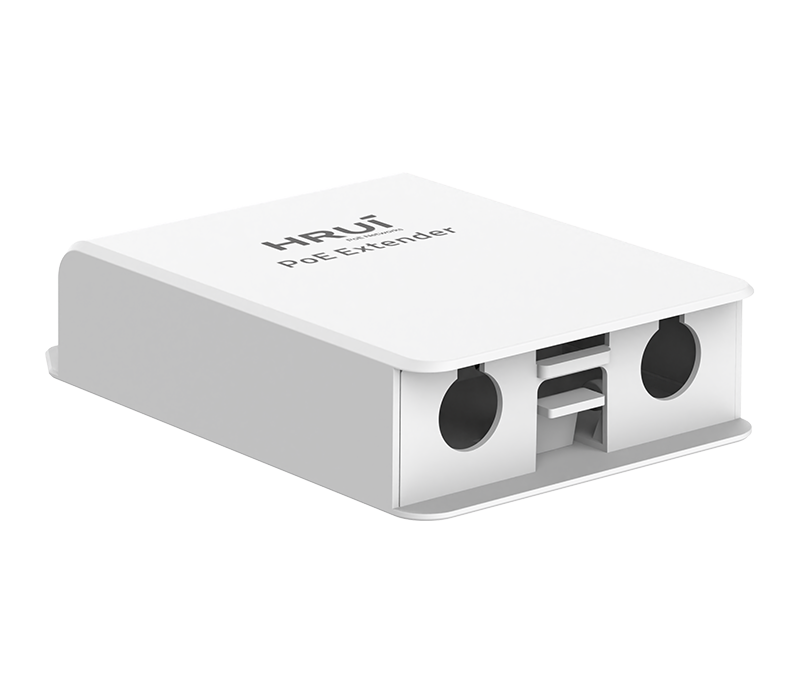
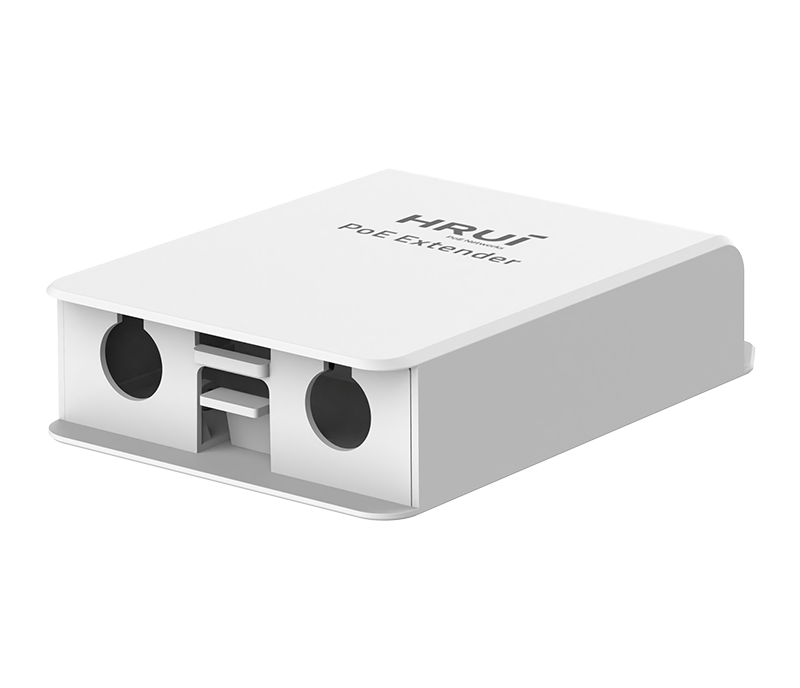
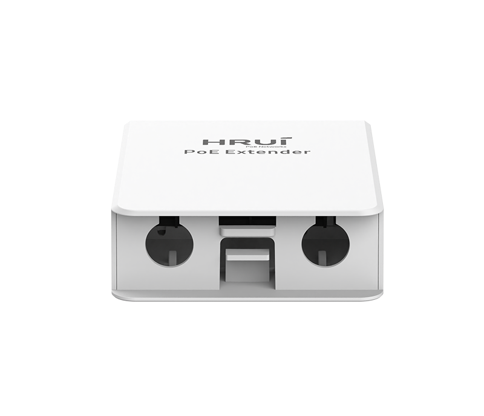
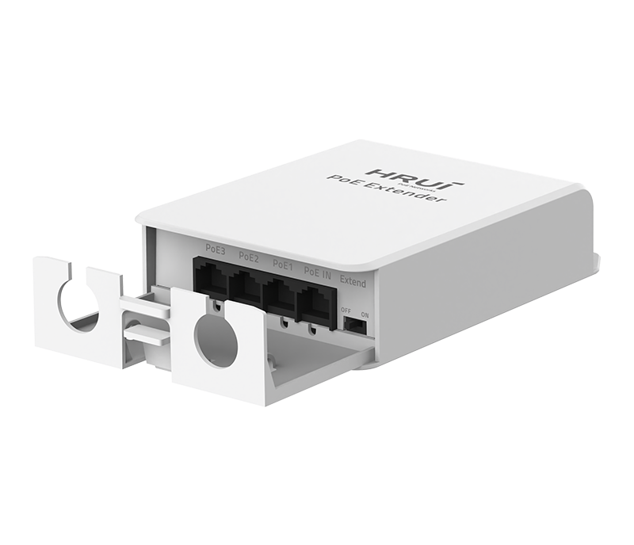
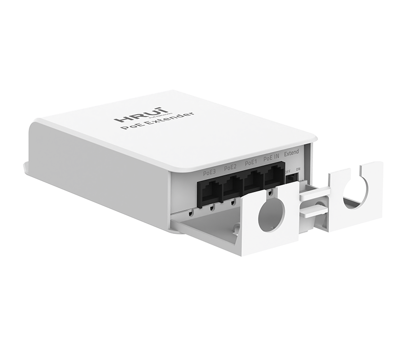
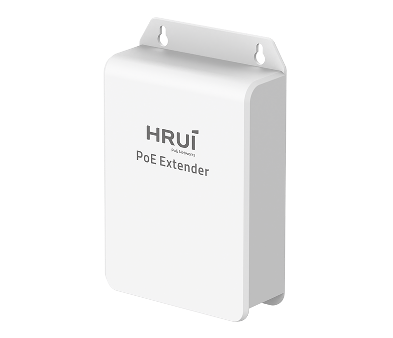

# HR-AFRW-31+

> 来源：<https://www.hruitech.com/poe-accessory/326.html>（抓取 2026-10-21T04:36:57Z；英文原文照录，中文仅为栏目名）  
> 官网描述：Weatherproof 100Mbps Ethernet PoE Extender  
> 类目：PoE Accessory（site id 326）  
> 接口：1*100Mbps PoE in port / 3*100Mbps PoE out ports；PoE 预算 25W；交换带宽 0.8Gbps；电源 IEEE802.3af/at

**Brief:** 3*FE PoE Out + 1*FE PoE In | IEEE 802.3af/at | 4KV Port Surge protection | 250M Extend | Wall-mounted Installation

## 产品图







## Datasheet
- [HR-AFGR-31-2B-EF-BC-88EN-EF-BC-89.pdf](https://www.hruitech.com/web/userfiles/productfile/HR-AFGR-31-2B-EF-BC-88EN-EF-BC-89.pdf) （本地：`data/hrui_site_raw/datasheets/HR-AFGR-31-2B-EF-BC-88EN-EF-BC-89.pdf`；文本：`data/hrui_site_raw/datasheet_text/HR-AFGR-31-2B-EF-BC-88EN-EF-BC-89.txt`）

## Feature and Benefits（原文）
```
Simple PoE Coverage Extension, No AC Power Needed
HR-AFRW-31+ is a cost effective, rugged, and reliable weatherproof 100Mbps PoE extender. It features 1 PoE input and 3 PoE output ports, supports IEEE802.3af/at, and complies with IEEE 802.3/802.3u/802.3x standards. With Extend mode enabled, transmission distance reaches 250 meters (10Mbps).
The extender supports Auto MDI/MDIX, full/half duplex flow control, and PoE relay extension roles. LED indicators facilitate fault analysis. Encased in a waterproof enclosure, it withstands harsh environments. Ideal for IP cameras, access points, and IoT devices, it is wall mountable for flexible installation.
Product Highlights
• 1*100Mbps PoE in port+3*100Mbps PoE out ports.
• Comply with IEEE 802.3, IEEE 802.3u, and IEEE 802.3x standards.
• Support IEEE802.3af/at power supply standard.
• Ethernet Ports support 10/100Mbps self-adaptive.
• The panel indicator LEDs will monitor the working status and assist in fault analysis.
• Support automatic port flipping (Auto MDI/MDIX).
• Support Extend mode.
• Having network and PoE relay extension roles.
• Flow control method, full duplex adopts IEEE 802.3x standard, and half duplex adopts Back pressure standard.
```

## Parameter（规格表逐行）
| 项 | 值 |
|---|---|
| Description | Specification |
| Model | HR-AFRW-31+ |
| Interface | 1*100Mbps PoE in port |
| Interface | 3*100Mbps PoE out ports |
| Port Standard | IEEE802.3 (Ethernet) |
| Port Standard | IEEE802.3u (Fast Ethernet) |
| Port Standard | IEEE802.3x (Flow Control) |
| Switching Bandwidth | 0.8Gbps |
| Packet Forwarding Rate | 0.595Mpps |
| MAC Address Table | 2K |
| Transmission Method | Store and Forward |
| PoE Standard | IEEE802.3af (15.4W) |
| PoE Standard | IEEE802.3at (30W) |
| PoE Port Output Voltage | DC 44-57V |
| PoE Ports | Port PoE out <30W |
| PoE Power Budget | 25W |
| Power Supply | IEEE802.3af/at |
| Mainboard Power Consumption | 0.97W |
| Structure Information | Product Dimensions: 146.6*97*34.5mm |
| Structure Information | Packaging Dimensions: 102*152*36mm |
| Structure Information | Product Net Weight: 0.15KG |
| Structure Information | Product Gross Weight: 0.17KG |
| Packing Information | Carton Dimensions: 375*335*220mm |
| Packing Information | Packing Quantity: 40PCS |
| Packing Information | Packing Weight: 8.04KG |
| Package Contents | PoE Extender 1pcs, Certificate of Inspection 1pcs |
| Fan Quantity | 0 |
| Installation | Desktop, Wall mounting installation |
| Surge Protection | Port Surge: Differential mode 4KV (Class B) |
| Operating Temperature | 0~40°C |
| Storage Temperature | -40~70°C |
| Operation Humidity | 10%~90%, non condensing |
| Storage Humidity | 5%~95%, non condensing |
| Port Green LED | On: Link normal |
| Port Green LED | Off: Link blocked |
| Port Green LED | Flashing: Data transmitting |
| OFF/ON Modes Buttons | OFF: Extend mode off |
| OFF/ON Modes Buttons | ON: Extend mode, port PoE out and data transmission distance can be extended to 250 meters, transmission rate is 10Mbps |

## Product structure / Application topology（图）
- https://www.hruitech.com/web/userfiles/image/20260515/1778830252891252.jpg
