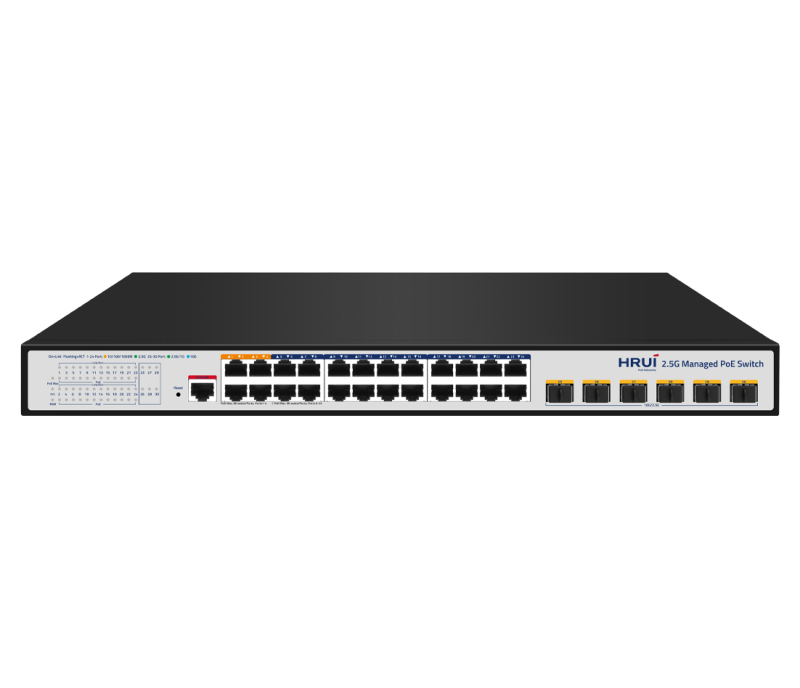
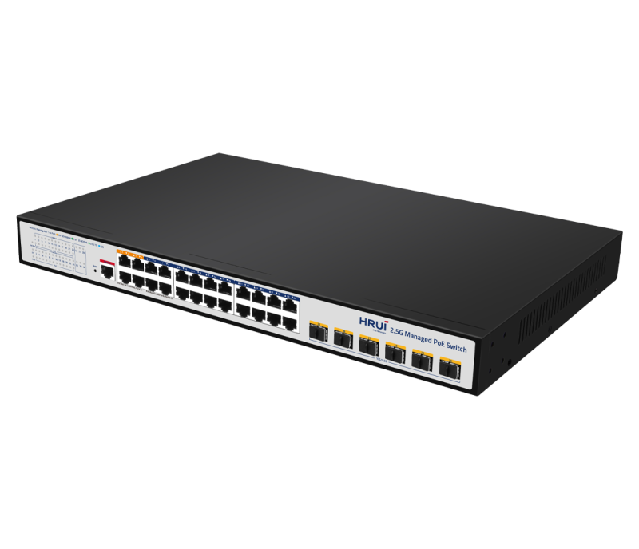
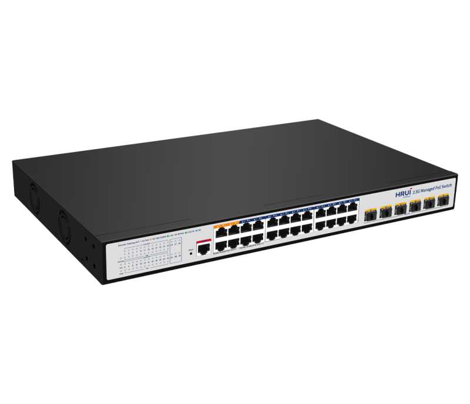
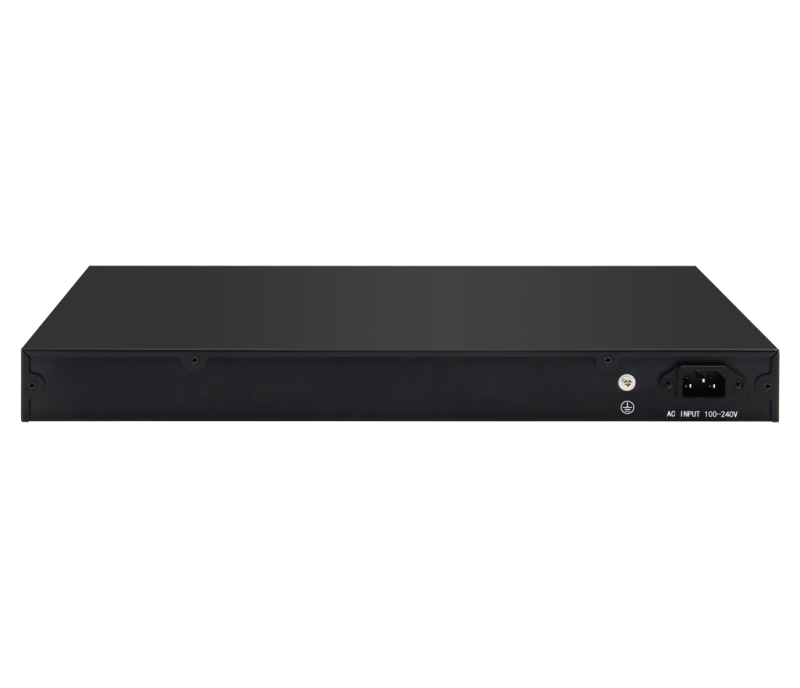

# HR-AXGM-SWTG3624AS

> 来源：<https://www.hruitech.com/managed-switch/245.html>（抓取 2026-10-21T04:36:13Z；英文原文照录，中文仅为栏目名）  
> 官网描述：Layer3 24-Port 10/100/1000/2500T 802.3af/at/bt PoE + 6-Port 10G SFP+ Managed Switch  
> 类目：Managed Switch（site id 245）  
> 接口：24*2.5Gbps PoE ports / 6*10Gbps SFP+ ports / 1*Console port；PoE 预算 400W；交换带宽 240Gbps；电源 AC 100-240V 50/60Hz / DC 56V7.15A&12V5A

**Brief:** 30 Port L3 Managed 10G Uplink 2.5G PoE Switch, provides 24*100/1000/2500M PoE Ethernet Ports+6*10Gb SFP+ Ports+1*RJ45 console Port. With perfect security control policy and CPU Protect Policy, it can improve fault tolerance and ensure the stable operation of the network and load balance of links. The switch supports automatic DoS attack defense, SNMP, IEEE 802.1, STP, RSTP, and link aggregation. With advanced security features and advanced quality of Service (QoS), it can be used as a core, distribution or access layer switch with high-end port density, ease of management, it is an ideal choice for a variety of business networking applications.

## 产品图





## Datasheet
- [HR_AXGM_SWTG3624AS.pdf](https://www.hruitech.com/web/userfiles/productfile/HR_AXGM_SWTG3624AS.pdf) （本地：`data/hrui_site_raw/datasheets/HR_AXGM_SWTG3624AS.pdf`；文本：`data/hrui_site_raw/datasheet_text/HR_AXGM_SWTG3624AS.txt`）

## Feature and Benefits（原文）
```
The HR-AXGM-SWTG3624AS is a robust 30-Port L3 Managed Switch designed for high-performance networking environments. Equipped with 24 PoE Ethernet ports (supporting 100/1000/2500 Mbps) and 6 10Gb SFP+ ports, along with an RJ45 console port, this switch delivers exceptional versatility for any business network.
This switch features advanced security protocols, including well-defined security control policies and a CPU Protect Policy, enhancing fault tolerance and ensuring stable network operations. With automatic DoS attack defense, link aggregation, and support for various protocols such as SNMP, IEEE 802.1, STP, and RSTP, the HR-AXGM-SWTG3624AS is designed for optimal performance and resilience.
Ideal for core, distribution, or access layer deployments, this switch boasts high port density, making it suitable for demanding networking applications. Its user-friendly management interface and advanced Quality of Service (QoS) capabilities make it a top choice for businesses looking to enhance their networking infrastructure.
Product Features:
Power Over Ethernet (PoE) Compliance:
Supports IEEE802.3af (15.4W), IEEE802.3at (30W), and IEEE802.3bt (90W) standards, allowing for flexible power management.
PoE Management Features:
Equipped with PoE watchdog, power supply configuration, and power time management for optimized redundancy and reliability.
Standards Compliance:
Adheres to IEEE standards including 802.1d, 802.1w, 802.1s, 802.1p, and more for reliable performance.
Layer 3 Management:
Offers comprehensive management capabilities including DHCP Server, Quality of Service (QoS), Access Control Lists (ACL), and compatibility with SNMP Versions 1, 2, and 3.
Enhanced Network Stability:
Includes STP, RSTP, MSTP (ERPS) along with loop detection, self-healing capabilities, and remote loop monitoring.
Flexible VLAN Partitioning:
Facilitates multiple VLAN partitions, including MAC VLAN and protocol VLAN for improved network segmentation.
Robust Security Features:
Offers features like IP address + MAC address + VLAN + port binding, DHCP Snooping, and IP Source Guard (DAI) protection to optimize security.
Routing Protocols:
Full support for IPv4 and IPv6 protocols, incorporating RIP v1/v2 and OSPFv2 for efficient routing.
Diverse Management Interfaces:
User-friendly management options through WEB, TELNET, CLI, SSH, SNMP, and RMON interfaces for streamlined network administration.
```

## Parameter（规格表逐行）
| 项 | 值 |
|---|---|
| Description | Specification |
| Model | HR-AXGM-SWTG3624AS |
| Interface | 24*2.5Gbps PoE ports |
| Interface | 6*10Gbps SFP+ ports |
| Interface | 1*Console port |
| Port Standard | IEEE802.3 (Ethernet) |
| Port Standard | IEEE802.3u (Fast Ethernet) |
| Port Standard | IEEE 802.3ab (Gigabit Ethernet) |
| Port Standard | IEEE 802.3z (Gigabit Ethernet Fiber Standard) |
| Port Standard | IEEE 802.3ae (10G Ethernet) |
| Port Standard | IEEE802.3x (Flow Control) |
| Port Standard | IEEE 802.3az (Efficient and Energy saving Ethernet) |
| Port Standard | IEEE 802.3ad (Link Aggregation) |
| Port Standard | IEEE 802.1AB LLDP/LLDP MED (Link Layer Discovery Protocol) |
| Port Standard | IEEE 802.1D Spanning Tree Protocol |
| Port Standard | IEEE 802.1w Rapid Spanning Tree Protocol |
| Port Standard | IEEE 802.1s Multiple Spanning Tree Protocol (Fast Spanning Tree) |
| Port Standard | IEEE 802.1Q (Virtual Local Area Network) |
| Port Standard | IEEE 802.1p (VLAN Tag) |
| Port Standard | IEEE 802.1X (User Authentication) |
| Switching Bandwidth | 240Gbps |
| Packet Forwarding Rate | 178.56Mpps |
| Packet Buffer | 16Mbit |
| MAC Address Table | 32K |
| Jumbo Frame | 10Kbytes |
| VLAN | VLAN range 1-4094, maximum active VLAN is 4K |
| Transmission Method | Store and Forward |
| PoE Standard | IEEE802.3af (15.4W) |
| PoE Standard | IEEE802.3at (30W) |
| PoE Standard | IEEE802.3bt (90W) |
| PoE Port Output Voltage | DC 44-57V |
| PoE Ports | Ports 1-4 support BT90W power supply |
| PoE Ports | Ports 5-24 PoE power output <30W |
| PoE Power Budget | 400W |
| Power Supply | AC 100-240V 50/60Hz |
| Power Supply | DC 56V7.15A&12V5A |
| Mainboard Power Consumption | 52.13W |
| Structure Information | Product Dimensions: 440*281*44mm |
| Structure Information | Packaging Dimensions: 500*365*85mm |
| Structure Information | Product Net Weight: 4.37KG |
| Structure Information | Product Gross Weight: 5.14KG |
| Packing Information | Carton Dimensions: 520*445*385mm |
| Packing Information | Packing Quantity: 5PCS |
| Packing Information | Packing Weight: 26.7KG |
| Package Contents | Switch 1pcs, Power Cord 1pcs, Manual 1pcs, Certificate of Inspection 1pcs, Rack-mounted kit 1 pair |
| Fan Quantity | 2 |
| Installation | Desktop, Rack-mounting |
| Surge Protection | Port Surge: Common mode 6KV, Differential mode 2KV (Class B) |
| Surge Protection | Surge Protection |
| Surge Protection | Electrostatic ESD: Air 8KV, Contact 6KV (Class B) |
| Operating Temperature | 0~40°C |
| Storage Temperature | -40~70°C |
| Operation Humidity | 10%~90%, non condensing |
| Storage Humidity | 5%~95%, non condensing |
| PWR Green LED | On: Powered on |
| PWR Green LED | Off: Powered off |
| Ports 1-24 | Green LED on: 2.5Gbps Link normal |
| Ports 1-24 | Yellow LED on: 10/100/1000Mbps Link normal |
| Ports 1-24 | Off: Link blocked |
| Ports 1-24 | Flashing: Data transmitting |
| SYS Green LED | Flashing: System startup in progress |
| SYS Green LED | On: The system is running normally |
| PoE Yellow LED | On: PoE powered on |
| PoE Yellow LED | Off: PoE powered off |
| Ports 25-30 | Blue LED on: 10Gbps Link normal |
| Ports 25-30 | Green LED on: 1G/2.5Gbps Link normal |
| Ports 25-30 | Off: Link blocked |
| Ports 25-30 | Flashing: Data transmitting |
| PoE Max Green LED | Off: Indicate that the PoE power usage is less than 80% |
| PoE Max Green LED | On: Indicate that the PoE power is used at P>80% |
| Reset | Long press for 6 seconds to restore factory settings |
| **Software Features** | |
| **L3 Function** | |
| IPv4 | IPv4 VLAN Interface |
| IPv4 | IPv4 Static Routes |
| IPv4 | ARP |
| IPv6 | IPv6 VLAN Interface |
| IPv6 | IPv6 Static Routes |
| IPv6 | IPv6 ND |
| RIP | V1/V2 |
| OSPF | Router-ID |
| OSPF | Authentication |
| OSPF | V2 |
| **L2 Function** | |
| Port | Port Switch configuration |
| Port | Port Description configuration |
| Port | Port Speed configuration |
| Port | Port Duplex configuration |
| Port | Port Flow Control configuration |
| Port | Support 10G/2.5G |
| Port | Jumbo Frame, Up to 10K |
| Port | EEE |
| Port | Fiber Module(DDM) |
| Link Aggregation | Support load balance policy; Base on MAC and IP-MAC |
| Link Aggregation | Static and Dynamic Group |
| Link Aggregation | Support LACP |
| Link Aggregation | Up to 8 groups |
| Storm Control | Boardcast suppression |
| Storm Control | Unknown Multicast |
| Storm Control | Unknown Unicast |
| Port Mirroring | One to one monitor |
| Port Mirroring | Many to one monitor |
| Port Mirroring | Ingress/Egress/Both |
| Port Mirroring | Up to 4 session groups |
| Port Security | MAC Address Constraints |
| Port Security | Port Security MAC Address |
| Port Security | Protect/Restrict/Shutdown |
| Port Isolation | Support |
| Port Rate-limit | Support |
| Loopback Detection | Support |
| VLAN | Access/Trunk/Hybrid |
| VLAN | VLAN Tunnel (Q-in-Q Tunnel) |
| VLAN | VLAN range 1-4094, maximum active VLAN is 4K |
| VLAN | Voice VLAN |
| VLAN | MAC VLAN |
| VLAN | Surveillance VLAN |
| VLAN | Protocol VLAN |
| VLAN | GVRP |
| MAC Address | Dynamic MAC address |
| MAC Address | Static MAC address |
| MAC Address | Filtering MAC Address |
| Spanning Tree Protocol | STP/RSTP/MSTP |
| Spanning Tree Protocol | BPDU Filter |
| Spanning Tree Protocol | BPDU Guard |
| Spanning Tree Protocol | Edge Port |
| LLDP | LLDP |
| LLDP | LLDP MED |
| Multicast | IGMP Snooping |
| Multicast | IGMP V1/V2/V3 |
| Multicast | Router Port |
| Multicast | Static IGMP group address |
| Multicast | IGMP groups filtering |
| Multicast | Querier |
| Multicast | MLD Snooping |
| Multicast | MVR |
| QoS | Traffic classification based, Strict priority and WRR |
| QoS | Port Priority |
| QoS | 802.1P Priority |
| QoS | IP TOS Priority |
| QoS | IP DSCP Priority |
| QoS | Support up to 8 queues per port |
| QoS | Priority Remarking |
| ERPS | Only SFP port |
| **Services** | |
| DHCP | DHCP Server |
| DHCP | IP Pool |
| DHCP | Static Binding |
| DHCP | Option 43 |
| DHCP | DHCP Relay |
| Access Protocol | HTTP |
| Access Protocol | HTTPS |
| Access Protocol | Telnet |
| Access Protocol | SSHv2 |
| Access Protocol | Manager ACL |
| Access Protocol | Session Timeout |
| Access Protocol | Password Retry Count |
| Access Protocol | Silent Time |
| **Security** | |
| AAA | RADIUS |
| AAA | TACACS+ |
| AAA | 802.1X |
| AAA | Base on port/MAC/local/WEB |
| DHCP Snooping | Global/VLAN |
| DHCP Snooping | Option 82 |
| DHCP Snooping | Circuit ID |
| IP Source Guard | Support |
| Dynamic ARP Inspection | Support |
| DoS | Support |
| ACL | MAC ACL |
| ACL | IPv4 ACL |
| ACL | IPv6 ACL |
| **Diagnostics** | |
| Syslog | Logging Message |
| Syslog | Remote Server |
| Ping | Support |
| Traceroute | Support |
| Copper Test | Support |
| UDLD | Support |
| **Equipment Management** | |
| Manager Access | Console |
| Manager Access | HTTP/HTTPS |
| Manager Access | Telnet |
| Manager Access | SSH |
| Manager Access | SNMP |
| Manager IP | Static Address |
| Manager IP | DHCP Client |
| Manager IP | Support IPv4 and IPv6 address |
| Manager IP | Manager VLAN |
| Manager IP | DNS |
| Time Synchronization | SNTP |
| Time Synchronization | Manual Time |
| SNMP | V1/V2C/V3 |
| SNMP | Community |
| SNMP | V3 User |
| SNMP | Group |
| SNMP | Trap Host |
| SNMP MIB | RFC 1213 MIB-II |
| SNMP MIB | RFC 1493 Bridge MIB |
| SNMP MIB | RFC 1643 Ethernet MIB |
| SNMP MIB | RFC 2819 RMON MIB (Groups 1, 2, 3 and 9) |
| SNMP MIB | RFC 2863 Interface MIB |
| SNMP MIB | LLDP |
| SNMP MIB | Private MIB |
| RMON | Statistics |
| RMON | History Configuration |
| RMON | Event Configuration |
| RMON | Alarm Configuration |
| User Management | Support |
| Firmware Management | Firmware upgrade |
| Firmware Management | Double Image; Swap between Active and Alternate firmware image |
| Configuration Management | Upload and download |
| Configuration Management | Upload and download via USB interface |
| Save | Support |
| Restart | Support |
| Factory Defaults | Support |
| **Standard Compliance** | |
| **IEEE 802.3x flow control and back pressure** | |
| **IEEE 802.3ad port trunk with LACP** | |
| **IEEE 802.1D Spanning Tree Protocol** | |
| **IEEE 802.1w Rapid Spanning Tree Protocol** | |
| **IEEE 802.1s Multiple Spanning Tree Protocol** | |
| **IEEE 802.1p Class of Service** | |
| **IEEE 802.1Q VLAN tagging** | |
| **IEEE 802.1x Port Authentication Network Control** | |
| **IEEE 802.1ab LLDP** | |
| **RFC 768 UDP** | |
| **RFC 793 TFTP** | |
| **RFC 791 IP** | |
| **RFC 792 ICMP** | |
| **RFC 2068 HTTP** | |
| **RFC 1112 IGMP v1** | |
| **RFC 2236 IGMP v2** | |
| **RFC 3376 IGMP v3** | |
| **RFC 2710 MLD v1** | |
| **FRC 3810 MLD v2** | |
| **RFC 2328 OSPF v2** | |

## Product structure / Application topology（图）
- https://www.hruitech.com/web/userfiles/image/20241230/1735540141330767.png
