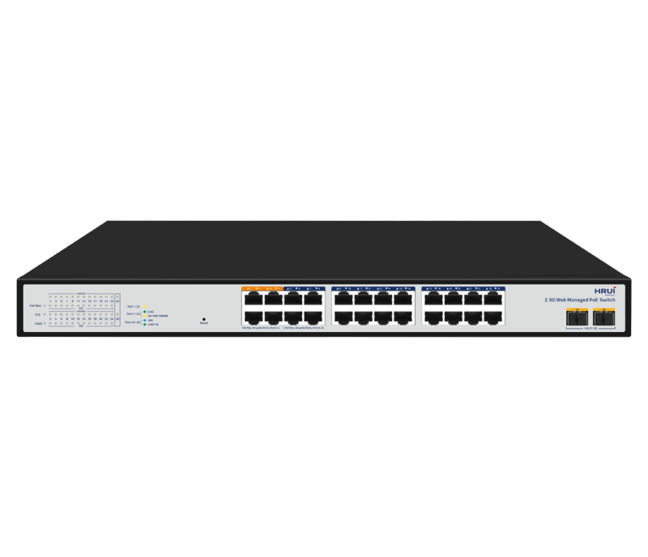
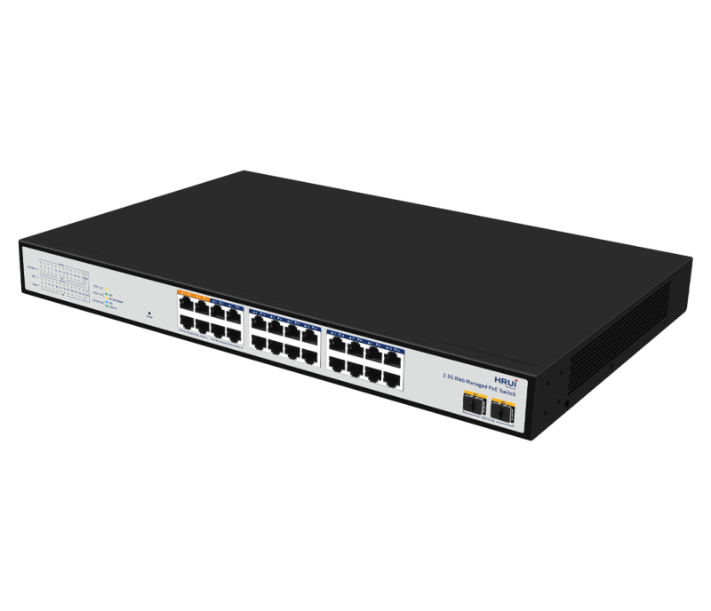
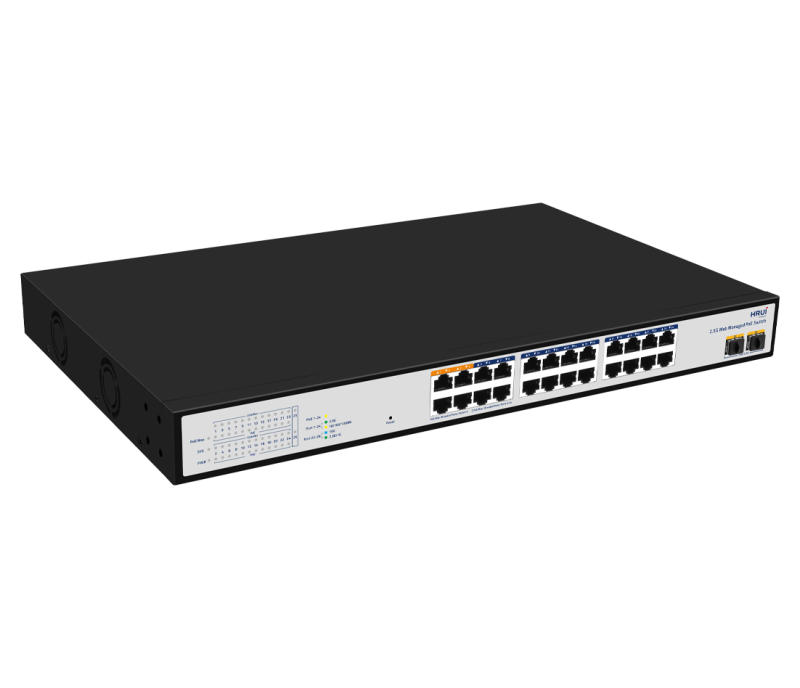
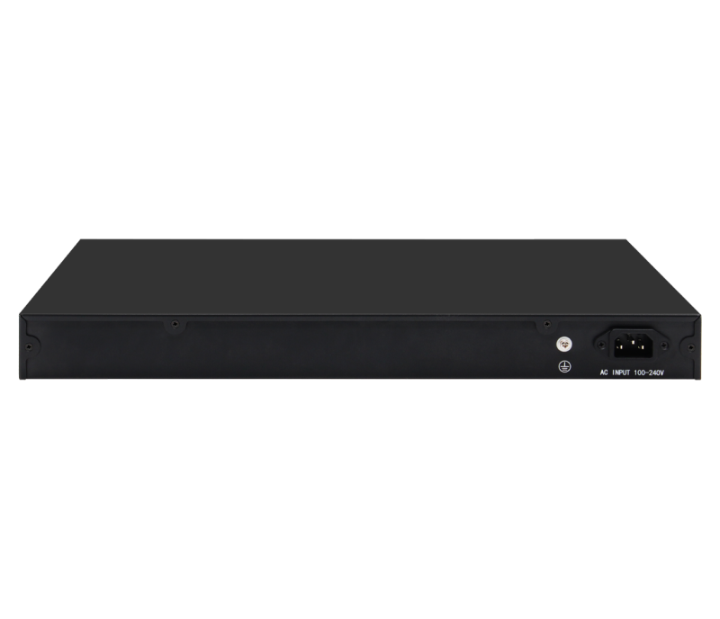

# HR-AXGW-SWTG2224AS

> 来源：<https://www.hruitech.com/managed-switch/232.html>（抓取 2026-10-21T04:36:13Z；英文原文照录，中文仅为栏目名）  
> 官网描述：Layer3 24-Port 10/100/1000/2500T 802.3af/at/bt PoE + 2-Port 10G SFP+ Managed Switch  
> 类目：Managed Switch（site id 232）  
> 接口：24*2.5Gbps PoE ports / 2*10Gbps SFP+ ports；PoE 预算 513W；交换带宽 160Gbps；电源 AC 100-240V 50/60Hz / DC 54V 9.5A&12V 4A

**Brief:** HR-AXGW-SWTG2224AS, a high-performance 24-Port web-managed PoE switch designed for modern data-driven environments. With 24 2.5G RJ45 ports and 2 10G SFP+ ports, this switch provides unmatched flexibility and scalability to meet the demands of your growing network. Whether you are deploying a small business network or enhancing your existing infrastructure, this switch is equipped to handle high-speed data transfer while ensuring power delivery to connected devices.

## 产品图





## Datasheet
- [HR_AXGW_SWTG2224AS.pdf](https://www.hruitech.com/web/userfiles/productfile/HR_AXGW_SWTG2224AS.pdf) （本地：`data/hrui_site_raw/datasheets/HR_AXGW_SWTG2224AS.pdf`；文本：`data/hrui_site_raw/datasheet_text/HR_AXGW_SWTG2224AS.txt`）

## Feature and Benefits（原文）
```
HR-AXGW-SWTG2224AS, a high-performance 24-Port web-managed PoE switch designed for modern data-driven environments. With 24 2.5G RJ45 ports and 2 10G SFP+ ports, this switch provides unmatched flexibility and scalability to meet the demands of your growing network. Whether you are deploying a small business network or enhancing your existing infrastructure, this switch is equipped to handle high-speed data transfer while ensuring power delivery to connected devices.
Product Features:
Versatile Port:
24 x 2.5G RJ45 ports for flexible connectivity.
2 x 10G SFP+ ports for high-speed uplinks or fiber connections.
Comprehensive Standards Support:
Compatible with IEEE802.3, IEEE802.3u, IEEE802.3x, IEEE802.3ab, and IEEE802.3z for reliable performance and interoperability.
Adaptive Speed Functionality:
RJ45 ports automatically adapt to 100M, 1G, and 2.5G speeds, optimizing your network environment.
Automatic MDI/MDIX:
Simplifies installation and connectivity with automatic port flipping (Auto MDI/MDIX), eliminating the need for crossover cables.
Efficient Data Processing:
Utilizes a store-and-forward switching mechanism to reduce packet loss and enhance overall performance.
Non-blocking Architecture:
All ports support line-speed switching, ensuring seamless data flow without bottlenecks.
Real-time Monitoring:
Panel indicator LEDs provide immediate feedback on port status and assist in quick fault diagnosis.
Quality of Service (QoS):
Prioritizes traffic to ensure optimal performance for critical applications and services.
Web Management Interface:
Intuitive web-based management allows for easy configuration, monitoring, and administration from any device.
Power over Ethernet (PoE):
Ports 1-4 support a total power budget of 90W, enabling seamless power delivery to compatible devices like IP cameras and access points.
HRUI Smart Web Management 24-Port 2.5G PoE Switch is designed to provide 2.5Gbps RJ-45 ports and 10Gbps SFP+ ports to create lightning-fast and reliable connections. With this switch, you can effortlessly bridge the gap between WiFi 6 access points, storage servers, and other devices to receive both data and power over a single Ethernet cable simultaneously.
The product is easy to use, plug-and-play with no configuration needed, making it ideal for high-speed network scenarios.
Fast Transfer
10G Uplink
Future Scalability
Budget-friendly
Delivers rapid 2.5G network transfer speeds, enabling connections for numerous devices, including WiFi 6 access points and 8K PoE cameras. Perfect for applications demanding ultra-high-speed data transfers in today’s fast-moving environment.
Provide highly reliable and stable transmission to meet high traffic demands such as high-definition video transmission and large data processing.
Allow for future growth and expansion, reducing the need for costly infrastructure upgrades down the line.
A 2.5G network offers cost benefits over a 10Gb network, offering speed gains while using existing Cat.5e cables, and reducing deployment costs by avoiding costly new wiring infrastructure.
• PoE Technology
The product offers 24 PoE ports compliant with IEEE 802.3af/at/bt standards, with ports 1-4 providing 90W PoE output and the remaining ports providing 30W. It can deliver both power and data to terminal devices over a single cable, eliminating the need for additional power lines.
• 2.5G Ports
Featuring 2.5GBASE-T RJ-45 ports, which enable faster gigabit speeds of up to 2.5Gbps over standard Cat5e or higher cabling infrastructure. Perfect for connecting high-bandwidth devices, such as WiFi 6 routers, APs, NAS units, and gaming equipment, ensuring seamless and efficient data transfer.
• WEB-based Management
The product offers advanced software features, including VLAN, port mirroring, flow control, LACP, QoS, and DHCP Snooping, to cater to diverse network demands and enhance network security, reliability, and scalability.
• Isolated Dual Outputs Power Supply
Adopting isolated dual outputs power supply design (DC 54V/9.5A & 12V/4A), the motherboard and PoE power supply module are powered separately and independently, eliminating interference and ensuring stability and safety. Ensure the PoE power output of the whole machine is maximized and can power up to multiple PoE+ IP devices simultaneously.
• Jumbo Frames (up to 10KB)
Jumbo Frames can reduce bandwidth usage by carrying more data in each Ethernet frame, resulting in fewer transactions on the network. This reduction in traffic also reduces stress on networking equipment.
• Plug and Play
• Rock-solid Reliability
No configuration is required. Simply plug a device into the network. It automation begins.
Support 4KV surge protection against harsh environments.
```

## Parameter（规格表逐行）
| 项 | 值 |
|---|---|
| Fast Transfer | 10G Uplink / Future Scalability / Budget-friendly |
| Delivers rapid 2.5G network transfer speeds, enabling connections for numerous devices, including WiFi 6 access points and 8K PoE cameras. Perfect for applications demanding ultra-high-speed data transfers in today’s fast-moving environment. | Provide highly reliable and stable transmission to meet high traffic demands such as high-definition video transmission and large data processing. / Allow for future growth and expansion, reducing the need for costly infrastructure upgrades down the line. / A 2.5G network offers cost benefits over a 10Gb network, offering speed gains while using existing Cat.5e cables, and reducing deployment costs by avoiding costly new wiring infrastructure. |
|  | • PoE Technology |
|  | The product offers 24 PoE ports compliant with IEEE 802.3af/at/bt standards, with ports 1-4 providing 90W PoE output and the remaining ports providing 30W. It can deliver both power and data to terminal devices over a single cable, eliminating the need for additional power lines. |
|  | • 2.5G Ports |
|  | Featuring 2.5GBASE-T RJ-45 ports, which enable faster gigabit speeds of up to 2.5Gbps over standard Cat5e or higher cabling infrastructure. Perfect for connecting high-bandwidth devices, such as WiFi 6 routers, APs, NAS units, and gaming equipment, ensuring seamless and efficient data transfer. |
|  | • WEB-based Management |
|  | The product offers advanced software features, including VLAN, port mirroring, flow control, LACP, QoS, and DHCP Snooping, to cater to diverse network demands and enhance network security, reliability, and scalability. |
|  | • Isolated Dual Outputs Power Supply |
|  | Adopting isolated dual outputs power supply design (DC 54V/9.5A & 12V/4A), the motherboard and PoE power supply module are powered separately and independently, eliminating interference and ensuring stability and safety. Ensure the PoE power output of the whole machine is maximized and can power up to multiple PoE+ IP devices simultaneously. |
|  | • Jumbo Frames (up to 10KB) |
|  | Jumbo Frames can reduce bandwidth usage by carrying more data in each Ethernet frame, resulting in fewer transactions on the network. This reduction in traffic also reduces stress on networking equipment. |
| • Plug and Play | • Rock-solid Reliability |
| No configuration is required. Simply plug a device into the network. It automation begins. | Support 4KV surge protection against harsh environments. |
| Description | Specification |
| Model | HR-AXGW-SWTG2224AS |
| Interface | 24*2.5Gbps PoE ports |
| Interface | 2*10Gbps SFP+ ports |
| Port Standard | IEEE 802.3: Ethernet Media Access Control (MAC) Protocol |
| Port Standard | IEEE 802.3i: 10BASE-T Ethernet |
| Port Standard | IEEE 802.3u: 100BASE-TX Fast Ethernet |
| Port Standard | IEEE 802.3ab: 1000BASE-T Gigabit Ethernet |
| Port Standard | IEEE 802.3z: 1000BASE-X Gigabit Ethernet (Fiber optic) |
| Port Standard | IEEE 802.3x: Flow Control |
| Port Standard | IEEE 802.3az (Efficient and Energy saving Ethernet) |
| Port Standard | IEEE 802.3ae (10G Ethernet) |
| Port Standard | IEEE802.3x (Flow Control) |
| Port Standard | IEEE802.3 bz (2.5G Ethernet standard) |
| Switching Bandwidth | 160Gbps |
| Packet Forwarding Rate | 119.04Mpps |
| Packet Buffer | 12Mbit |
| MAC Address Table | 16K |
| Jumbo Frame | Support |
| VLAN | VLAN range 1-4094 maximum active VLAN is 4K |
| Transmission Method | Store and Forward |
| PoE Standard | IEEE802.3af (15.4W) |
| PoE Standard | IEEE802.3at (30W) |
| PoE Standard | IEEE802.3bt (90W) |
| PoE Port Output Voltage | DC 44-57V |
| PoE Ports | Ports 1-4 support BT90W power supply |
| PoE Ports | PoE Ports |
| PoE Ports | Ports 5-24 PoE power output <30W |
| PoE Power Budget | 513W |
| Power Supply | AC 100-240V 50/60Hz |
| Power Supply | DC 54V 9.5A&12V 4A |
| Mainboard Power Consumption | 35.2W |
| Structure Information | Product Dimensions: 440*280*44mm |
| Structure Information | Packaging Dimensions: 500*365*85mm |
| Structure Information | Product Net Weight: 4.21KG |
| Structure Information | Product Gross Weight: 5.35KG |
| Package Information | Carton Dimensions: 520*445*385mm |
| Package Information | Packing Quantity: 5PCS |
| Package Information | Packing Weight: 27.75KG |
| Package Contents | Switch 1pcs, Power Cord 1pcs, Manual 1pcs, Certificate of Inspection 1pcs |
| Fan Quantity | 2 |
| Installation | Rack-mounting |
| Surge Protection | Port Surge: Common mode 4KV, Differential mode 2KV (Class B) |
| Surge Protection | Electrostatic ESD: Air 8KV, Contact 6KV (Class B) |
| Operating Temperature | 0~40°C |
| Storage Temperature | -40~70°C |
| Operation Humidity | 10%~90%, non condensing |
| Storage Humidity | 5%~95%, non condensing |
| PWR Green LED | On: Powered on |
| PWR Green LED | Off: Powered off |
| SYS Green LED | Flashing: System startup in progress |
| SYS Green LED | On: The system is running normally |
| Ports 1-24 Link/Act | Green LED on: 2.5Gbps Link normal |
| Ports 1-24 Link/Act | Yellow LED on: 1Gbps Link normal |
| Ports 1-24 Link/Act | Off: Link blocked |
| Ports 1-24 Link/Act | Flashing: Data transmitting |
| PoE Yellow LED | On: PoE powered off |
| PoE Yellow LED | Off: PoE powered off |
| Reset | Long press for 6 seconds to restore factory settings |
| Ports 25-26 | Blue LED on: 10Gbps Link normal |
| Ports 25-26 | Green LED on: 1G/2.5Gbps Link normal |
| Ports 25-26 | Off: Link blocked |
| Ports 25-26 | Flashing: Data transmitting |
| PoE Max Green LED | Off: Indicate that the PoE power usage is less than 90% |
| PoE Max Green LED | Flashing(Once per second): Indicate that the PoE power usage of 90% ≤ P ≤ 95% |
| PoE Max Green LED | On: Indicate that the PoE power is used at 95%<P<100% |
| **Software Features** | |
| **L2 Function** | |
| Port | Port Switch configuration |
| Port | Port Speed configuration |
| Port | Port Duplex configuration |
| Port | Port Flow Control configuration |
| Port | EEE |
| Port | Jumbo Frame |
| Link Aggregation | Supports load balance policy; Base on MAC and IP-MAC |
| Link Aggregation | Static and Dynamic Group |
| Link Aggregation | LACP |
| Link Aggregation | Up to 8 groups |
| Storm Control | Boardcast suppression |
| Storm Control | Unknown Multicast |
| Storm Control | Unknown Unicast |
| Port Mirroring | One to one monitor |
| Port Mirroring | Many to one monitor |
| Port Mirroring | Ingress/Egress/Both |
| Port Mirroring | Up to 4 session groups |
| Port Security | MAC Address Constraints |
| Port Security | Protect/Restrict/Shutdown |
| Port Isolation | Support |
| Port Rate-limit | Support |
| VLAN | Access/Trunk/Hybrid |
| VLAN | VLAN Tunnel (Q-in-Q Tunnel) |
| VLAN | VLAN range 1-4094, maximum active VLAN is 4K |
| MAC Address | Filtering MAC Address |
| MAC Address | Static MAC address |
| Spanning Tree Protocol | STP/RSTP |
| Spanning Tree Protocol | BPDU Filter |
| Spanning Tree Protocol | BPDU Guard |
| Spanning Tree Protocol | Edge Port |
| LLDP | LLDP |
| LLDP | LLDP MED |
| Multicast | IGMP Snooping |
| Multicast | Router Port |
| Multicast | Static IGMP Join |
| Multicast | IGMP V1/V2 |
| QoS | Traffic classification, Supporting SP and WRR scheduling |
| QoS | Port Priority |
| QoS | 802.1P Priority |
| QoS | IP DSCP Priority |
| QoS | Priority Remarking |
| QoS | Supports up to 8 queues per port |
| ERPS | Main Ring |
| **PoE** | |
| PoE Configuration | PoE used power |
| PoE Configuration | PoE Type/Level/Power/Voltage/Current |
| PoE Configuration | PoE Switch |
| PoE Configuration | PoE power AF/AT adaptation |
| PoE Configuration | IEEE 802.3bt,compatible with IEEE 802.3af/802.3at PoE |
| **Services** | |
| Access Protocol | HTTP |
| Access Protocol | Session Timeout |
| Security | DHCP Snooping |
| **Diagnostics** | |
| Copper Test | Support |
| Ping | Support |
| **Equipment Management** | |
| Manager Access | HTTP |
| Manager Access | SNMP |
| Time Synchronization | SNTP |
| Time Synchronization | Manual Time |
| Manager IP | Static Address |
| Manager IP | Manager VLAN |
| Manager IP | DNS |
| Manager IP | DHCP Client |
| SNMP | V1/V2C/V3 |
| SNMP | V3 User |
| SNMP | Group |
| SNMP | Community |
| SNMP | Trap Host |
| SNMP MIB | RFC 1213 MIB-II |
| SNMP MIB | RFC 1643 Ethernet MIB |
| SNMP MIB | RFC 2863 Interface MIB |
| User Management | Support |
| Firmware Management | Firmware upgrade |
| Configuration Management | Upload/Backup Configuration |
| Save | Support |
| Restart | Support |
| Factory Defaults | Support |
| **Standard Compliance** | |
| **IEEE 802.3x flow control and back pressure** | |
| **IEEE 802.3ad port trunk with LACP** | |
| **IEEE 802.1D Spanning Tree Protocol** | |
| **IEEE 802.1w Rapid Spanning Tree Protocol** | |
| **IEEE 802.1p Class of Service** | |
| **IEEE 802.1Q VLAN tagging** | |
| **RFC 768 UDP** | |
| **RFC 793 TFTP** | |
| **RFC 791 IP** | |
| **RFC 792 ICMP** | |
| **RFC 2068 HTTP** | |
| **RFC 1112 IGMP v1** | |
| **RFC 2236 IGMP v2** | |
| **RFC 3376 IGMP v3** | |

## Product structure / Application topology（图）
- https://www.hruitech.com/web/userfiles/image/20241231/1735615043897793.png
