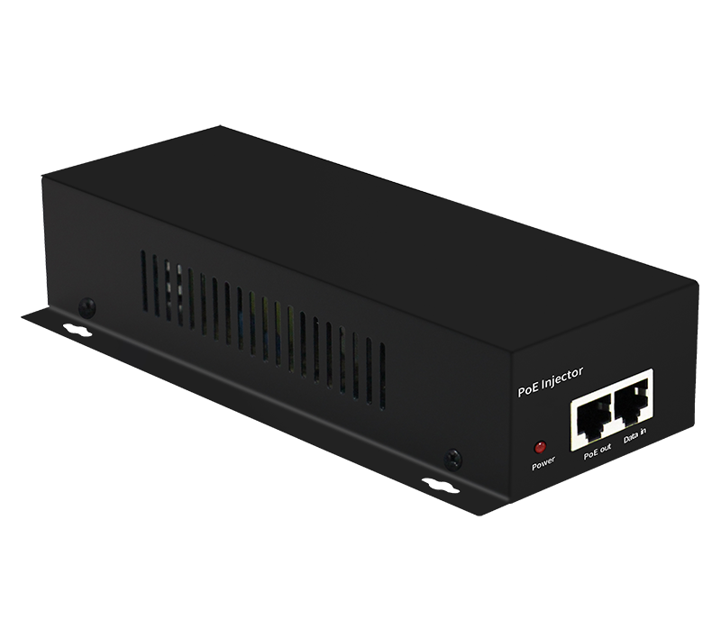
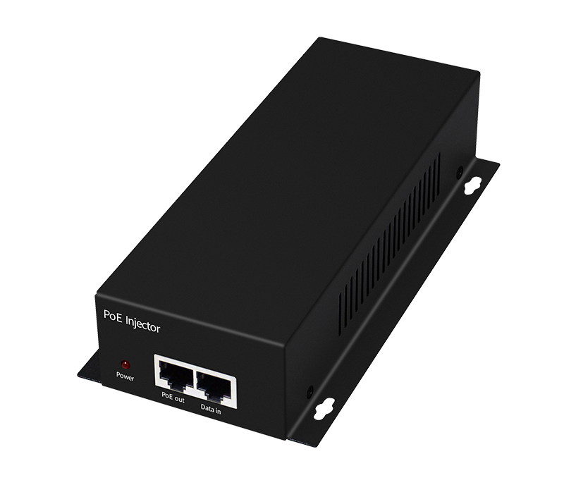
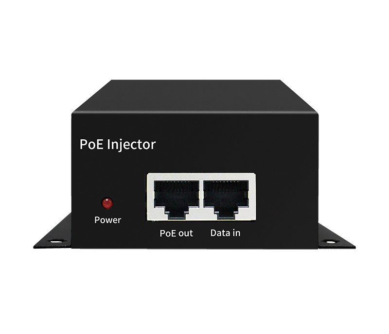
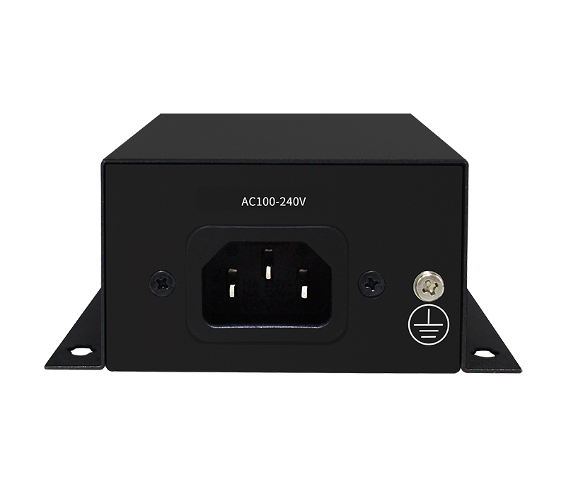

# HR-BTG-N601

> 来源：<https://www.hruitech.com/poe-accessory/162.html>（抓取 2026-10-21T04:37:01Z；英文原文照录，中文仅为栏目名）  
> 官网描述：Gigabit BT60W PoE Injector  
> 类目：PoE Accessory（site id 162）  
> 接口：1* 1000Mbps PoE Port / 1* 1000Mbps RJ45 Po rt；PoE 预算 —；交换带宽 —；电源 AC 100-240V 50/60Hz / DC 52V/1.25A

**Brief:** Gigabit BT60W PoE injector, 1*AC power port + 1*Gigabit Ethernet Port + 1*Gigabit PoE port, 60W maximum PoE power output, support 10/100/1000M self-adaption, metal shell, Surge 6KV, ESD 15KV, working temperature range -10°C~+50°C

## 产品图





## Datasheet
- [HR-BTG-N601.pdf](https://www.hruitech.com/web/userfiles/productfile/HR-BTG-N601.pdf) （本地：`data/hrui_site_raw/datasheets/HR-BTG-N601.pdf`；文本：`data/hrui_site_raw/datasheet_text/HR-BTG-N601.txt`）

## Feature and Benefits（原文）
```
HR-BTG-N601 Gigabit BT90W PoE Injector, designed for power and efficiency. This advanced injector features one AC power port, one Gigabit Ethernet port, and one Gigabit PoE port, delivering a maximum PoE power output of 60W. It supports seamless 10/100/1000 Mbps auto-negotiation and is housed in a robust metal shell, ensuring durability and reliability. With impressive surge protection (6KV) and electrostatic discharge (15KV), it operates flawlessly in a wide temperature range of -10°C to +50°C.
Product Features:
High-Speed Connectivity:
Equipped with one 1000 Mbps PoE power supply port and one 1000 Mbps RJ45 port for enhanced data transmission.
PoE Standard:
Fully compliant with IEEE802.3af (15.4W), IEEE802.3at (30W), and IEEE802.3bt (60W) standards, ensuring versatility in a variety of applications.
Wide Input Voltage Range:
Supports AC power supply voltage of 100-240V for global compatibility.
Rugged Construction:
Made with a durable metal housing and rated at IP20 for dust protection, ensuring reliability in various settings.
Operating Temperatures:
Performs optimally in environments ranging from -20°C to +50°C.
Enhanced Surge Protection:
Features differential mode surge protection of 2KV and common mode protection of 6KV, along with ESD protection of 6KV (contact) and 8KV (air) to safeguard connected devices.
```

## Parameter（规格表逐行）
| 项 | 值 |
|---|---|
| Description | Specification |
| Model | HR-BTG-N601 |
| Interface | 1* 1000Mbps PoE Port |
| Interface | 1* 1000Mbps RJ45 Po rt |
| Port Standard | IEEE 802.3af /IEEE 802.3at/IEEE 802.3bt |
| Single Port Max | 15.4W (IEEE 802.3af) |
| Single Port Max | 30W (IEEE 802.3at) |
| Single Port Max | 60W (IEEE 802.3bt) |
| Industry Standard | EN61000-4-2 (ESD) |
| Industry Standard | IEN61000-4-5 (Surge) |
| Industry Standard | EN61000-4-3 (RS) |
| Industry Standard | EN61000-4-6 (CS) |
| Industry Standard | EN61000-4-4 （EFT） |
| Protection Grade | IP20 |
| PoE Port Output Voltage | DC 52V |
| Power Supply | AC 100-240V 50/60Hz |
| Power Supply | DC 52V/1.25A |
| PoE Standard | IEEE 802.3af (15.4W) |
| PoE Standard | IEEE 802.3at (30W) |
| PoE Standard | IEEE 802.3bt (60W) |
| Structure Information | Product Dimensions: 187mm* 95mm*40 mm |
| Structure Information | Packaging Dimensions: 245mm*190mm*60mm |
| Structure Information | Product Net Weight: 0.486KG |
| Structure Information | Product Gross Weight: 0.712KG |
| Packing Information | Carton Dimensions: 520mm*320mm*400mm |
| Packing Information | Packing Quantity: 20PCS |
| Packing Information | Packing Weight: 15.24KG |
| Package Content | Injector 1pcs, manual 1pcs，certificate of qualification 1pcs |
| Certification | CE, FCC, RoHS |
| Installation | Wall Mounting |
| Operating Temperature | -20～50℃ |
| Storage Temperature | -40～85℃ |
| Operation Humidity | 5%~90%，non condensing |
| Storage Humidity | 5%~95%，non condensing |
| PWR | On: Powered on |
| PWR | Off: Powered off |
