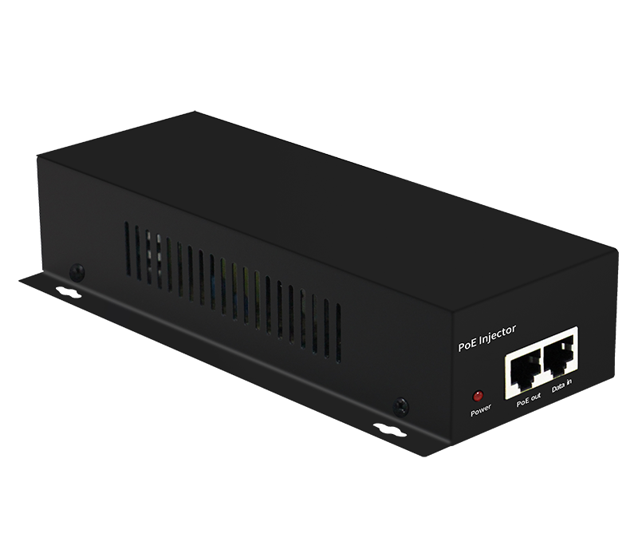
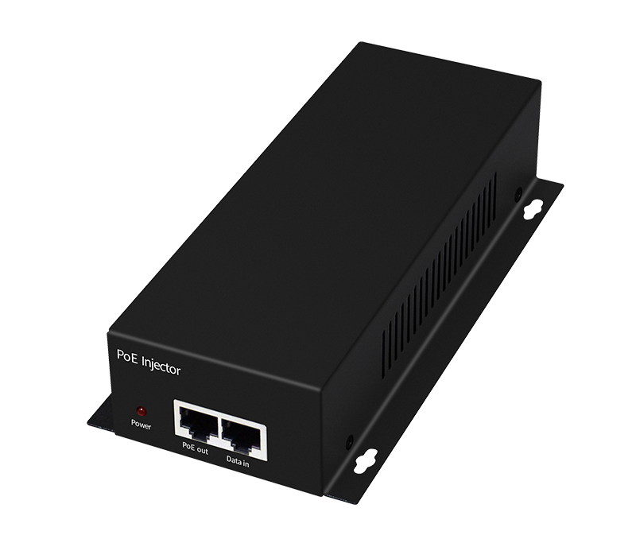
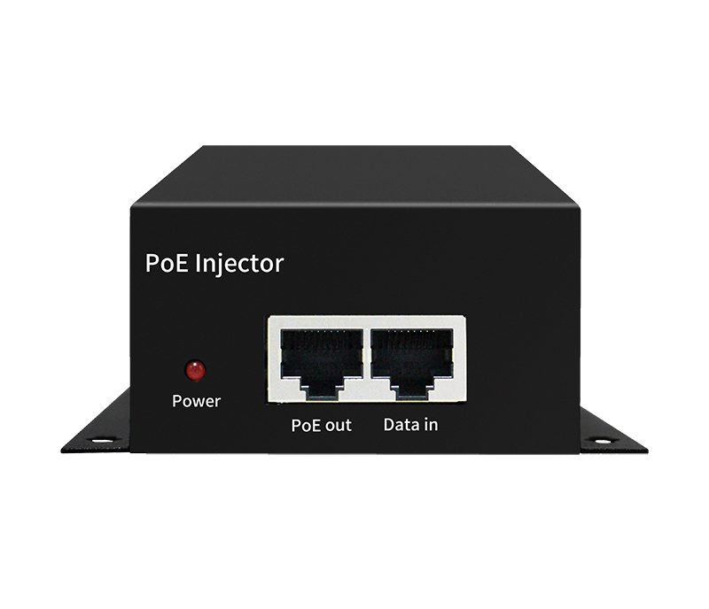
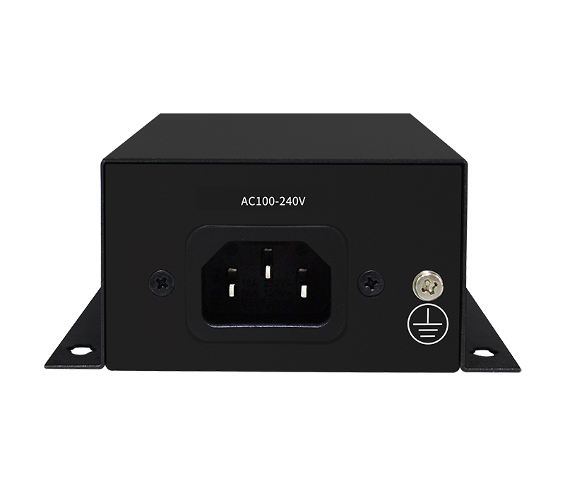

# HR-BTG-N901

> 来源：<https://www.hruitech.com/poe-accessory/161.html>（抓取 2026-10-21T04:37:02Z；英文原文照录，中文仅为栏目名）  
> 官网描述： Gigabit BT90W PoE Injector  
> 类目：PoE Accessory（site id 161）  
> 接口：1* Gigabit POE Port+1* Gi gabit Ethernet Port；PoE 预算 —；交换带宽 —；电源 —

**Brief:** Gigabit BT90W PoE injector, 1*AC power port + 1*Gigabit Ethernet Port + 1*Gigabit PoE port, 90W maximum PoE power output, support 10/100/1000M self-adaption, metal shell, Surge 6KV, ESD 15KV, working temperature range -10°C~+50°C

## 产品图





## Datasheet
- [HR-BTG-N901.pdf](https://www.hruitech.com/web/userfiles/productfile/HR-BTG-N901.pdf) （本地：`data/hrui_site_raw/datasheets/HR-BTG-N901.pdf`；文本：`data/hrui_site_raw/datasheet_text/HR-BTG-N901.txt`）

## Feature and Benefits（原文）
```
Experience seamless connectivity with the HR-BTG-N901 Gigabit BT90W PoE Injector. This powerful device features one AC power port, one Gigabit Ethernet port, and one Gigabit PoE port, delivering a maximum PoE power output of 90W. Engineered for versatility, it supports self-adaptation for 10/100/1000M speeds. Its robust metal housing ensures durability, while built-in protection features such as a 6KV surge rating and 15KV ESD protection safeguard your network. With a wide operating temperature range of -10°C to +50°C, this injector is designed to perform in various environments.
Product Features:
Multiple Ports:
Equipped with 1 Gigabit PoE port and 1 Gigabit Ethernet port for efficient network connectivity.
PoE Standard:
Compatible with IEEE802.3af (15.4W), IEEE802.3at (30W), and IEEE802.3bt (90W) standards, providing versatile power options for your devices.
Wide Input Voltage Range:
Accepts an AC power supply of 100-240V, making it suitable for global use.
Rugged Construction:
Made with a durable metal housing and rated at IP20 for dust protection, ensuring reliability in various settings.
Operating Temperatures:
Performs optimally in environments ranging from -20°C to +50°C.
Enhanced Surge Protection:
Features differential mode surge protection of 2KV and common mode protection of 6KV, along with ESD protection of 6KV (contact) and 8KV (air) to safeguard connected devices.
```

## Parameter（规格表逐行）
| 项 | 值 |
|---|---|
| **Specification** | |
| **General Parameter** | |
| Product Name | 90W Gigabit POE Injector |
| Port | 1* Gigabit POE Port+1* Gi gabit Ethernet Port |
| POE Specification | PoE Standard: Support IEEE802.3af/ IEEE802.3at/ IEEE802.3bt |
| POE Specification | Single Port Max: 15.4W (IEEE 802.3af) Single Port Max: 30W (IEEE 802.3at) Single Port Max: 90W (IEEE 802.3bt) |
| POE Specification | POE Port Output Voltage: DC 52V |
| POE Specification | POE Power supply wire core: 1/2-; 3/6+ Or 4/5+; 7/8- |
| Network Medium | 10Base-T: Cat3, 4, 5 or above UTP(≤100m) 100Base-TX: Cat5 or above UTP(≤200m) 1000Base-TX: Cat5 or above UTP(≤200m) |
| Indicator | PWR / On: Powered on |
| Indicator | PWR / Off: Powered off |
| Power | Input Voltage: AC 100-240V Working Frequency: 50/60 Hz Supply Power: 52V/1.73A |
| Working Environment | Working Temperature: -20～50℃ |
| Working Environment | Storage Temperature: -40～85℃ Humidity: 5%~95 % (non-condensing) |
| Industry Standard | EN61000-4-2 （ESD） |
| Industry Standard | IEN61000-4-5 （Surge） EN61000-4-3 （RS） EN61000-4-6 （CS） EN61000-4-4 （EFT） |
| Industry Standard | FCC Part 15/ CISPR32 /EN55032： CLASS A IEC 60068-2-27 Impact test |
| Industry Standard | IEC 60068-2-32 Free fall test |
| Industry Standard | IEC 60068-2-6 Vibration test |
| Physical Structure | Protection Grade: IP20 Install: Wall Mounting |
| Physical Structure | Product N.W: 0.486KG |
| Physical Structure | Product G.W: 0.712KG |
| Physical Structure | Product Size (L*W*H): 187mm* 95mm*40 mm Package Size (L*W*H): 245mm*190mm*60mm |
| Physical Structure | Carton size (L*W*H): 520mm*320mm*400mm |
| Physical Structure | Packing Qty: 20 units |
| Physical Structure | Packing weight: 15.24KG |
| Package List | 90W Gigabit POE Injector: 1 PCS |
| Package List | Manual: 1PCS |
| Package List | Certificate, warranty card：1PCS |
| Safety Certification | CE, FCC, RoHS |
| MTBF | 100,000 Hours |
| **Order Info** | |
| Model | Description |
| HR-BTG-N901 | 1* Gigabit PoE Port+ 1* Gigabit Ethernet Port |
