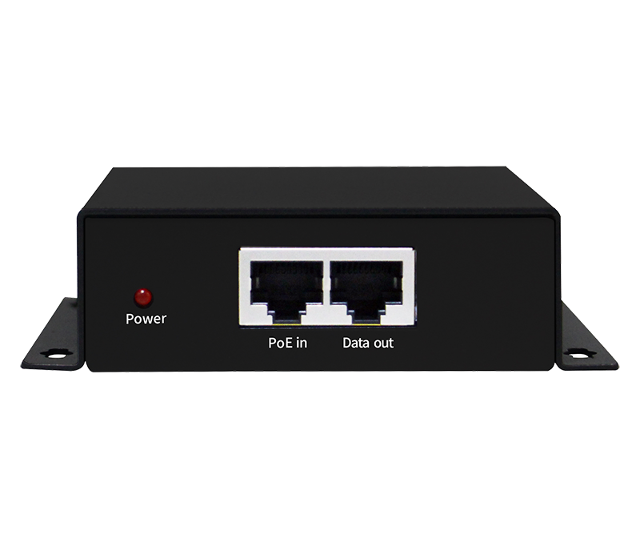
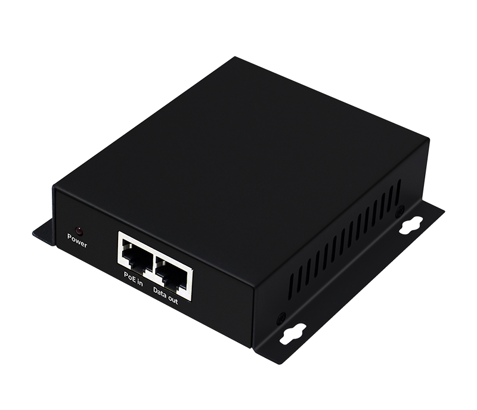
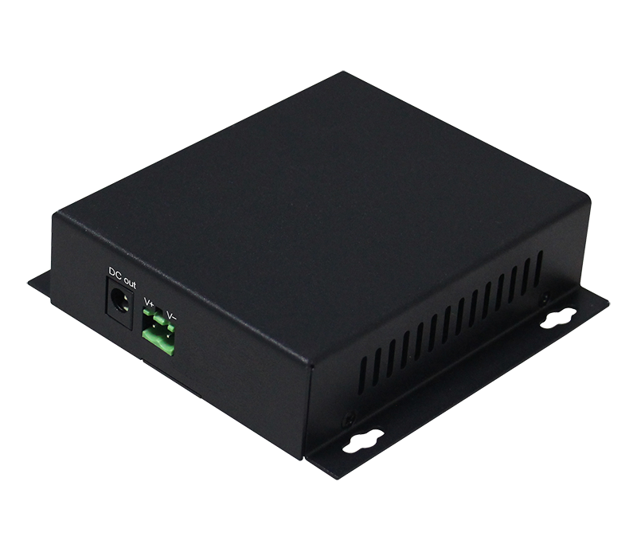

# HR-BTG-PD12F

> 来源：<https://www.hruitech.com/poe-accessory/168.html>（抓取 2026-10-21T04:36:59Z；英文原文照录，中文仅为栏目名）  
> 官网描述：Gigabit BT PoE Splitter  
> 类目：PoE Accessory（site id 168）  
> 接口：1*1000M PoE-in Port + 1*1000M Data-out Port；PoE 预算 —；交换带宽 —；电源 —

**Brief:** Gigabit BT PoE Splitter, complied with IEEE802.3af/at/bt standard, can separates the power and data signals that transmitted through the network cable. Equipped with two output connection modes: DC plug and industrial Phoenix terminal, the default output voltage is 12V, and the maximum output power can reach 72W. The device adopts metal shell design, better protection, side ventilation and heat dissipation, longer life, and the working temperature range is -10℃~+50℃

## 产品图




## Datasheet
- [HR-BTG-PD12F.pdf](https://www.hruitech.com/web/userfiles/productfile/HR-BTG-PD12F.pdf) （本地：`data/hrui_site_raw/datasheets/HR-BTG-PD12F.pdf`；文本：`data/hrui_site_raw/datasheet_text/HR-BTG-PD12F.txt`）

## Feature and Benefits（原文）
```
The HR-BTG-PD12F is a cutting-edge standard Power over Ethernet (PoE) splitter designed to comply with IEEE 802.3af, IEEE 802.3at, and IEEE 802.3bt power supply standards. It efficiently separates power and data signals transmitted over network cables, making it an ideal solution for various applications. This versatile device features dual output connection modes—DC plug and industrial Phoenix terminal—ensuring compatibility with a wide range of devices. With a default output voltage of 12V and a maximum output power of 72W, you can rely on this splitter for robust performance. The HR-BTG-PD12F is housed in a durable metal shell that enhances protection against external damage, while its side ventilation design allows for optimal heat dissipation, ensuring longevity. It operates effectively within a temperature range of -10℃ to +50℃, making it suitable for both indoor and outdoor environments.
Product Features:
Multiple Port:
Equipped with 1*1000M PoE-in Port + 1*1000M Data-out Port
Standard Compliance:
Fully compliant with IEEE 802.3, IEEE 802.3u, and IEEE 802.3af/at standards for reliable performance.
Flexible Output Options:
DC power output options include a DC plug and a 2-pin industrial Phoenix terminal connection for enhanced usability.
High Power Output:
Delivers a maximum output power of 72W, accommodating power-hungry devices with ease.
Robust Metal Housing:
Constructed with a metal shell for improved durability and protection against environmental factors.
Wide Operating Temperature Range:
Designed to function effectively in diverse environments, with a temperature range of -10℃ to +50℃, ensuring performance stability in various conditions.
```

## Parameter（规格表逐行）
| 项 | 值 |
|---|---|
| **Specifications** | |
| **General Parameter** | |
| Product Name | 1000M Standard PoE Splitter |
| Product Model | HR-BTG-PD1 2F |
| Port Definition | 1*1000M PoE-in Port + 1*1000M Data-out Port |
| PoE Features | IEEE802.3af /IEEE802.3at/IEEE802.3bt |
| PoE Features | PoE Input: 48V~55V |
| PoE Features | PoE power supply line sequence: 1/2+；3/6- or 4/5+；7/8- or 1/2-; 3/6+ |
| PoE Features | Interface Type: DC 2.5/ Industrial Phoenix 2PIN terminal |
| Output | Voltage: 12V; Power: 72W |
| Network Media | 10BASE-T: Cat 3,4,5 UTP(≤100 meter) |
| Network Media | 10BASE-T: Cat 6 UTP(≤100 meter) |
| Network Media | 100BASE-TX: Cat5 or more UTP (≤100 meter) |
| Indicator | PWR / Light on: PoE normal |
| Indicator | PWR / Light off: Non- PoE |
| Working Environment | Temperature: -10~50℃ |
| Working Environment | Storage Temperature: -40~85℃ |
| Working Environment | Humidity: 5%~95 % ( RH) |
| Testing Standard | EN61000-4-2 （ESD）touch 6KV，air 8KV |
| Testing Standard | IEN61000-4-5 （Surge）common mode 4KV, differential mode 2KV |
| Testing Standard | EN61000-4-3 （RS） |
| Testing Standard | EN61000-4-6 （CS） |
| Testing Standard | EN61000-4-4 （EFT） |
| Testing Standard | FCC Part 15/ CISPR32 /EN55032： CLASS A |
| Testing Standard | IEC 60068-2-27 shock testing |
| Testing Standard | IEC 60068-2-32 free fall testing |
| Testing Standard | IEC 60068-2-6 vibration testing |
| Physical Structure | Housing protection: IP20 |
| Physical Structure | Installation: Wall-mounted |
| Physical Structure | Product Weight:： 0.3KG with package :0.4KG（not includes adapter） |
| Physical Structure | Product Size (L×W×H): 105*107*33mm |
| Physical Structure | Package Size (L×W×H): 175*130*55mm |
| Package List | 1) PoE Splitter 1pc; |
| Package List | 2) User Manual 1pc; |
| Package List | 3) Certificate 1pc |
| Safety Certificate | CE, FCC, RoHS |
| MTBF | 100,000hours |
| **Ordering Info** | |
| HR-BTG-PD12F | 1*1000M PoE-in Port + 1*1000M Data-out Port |
