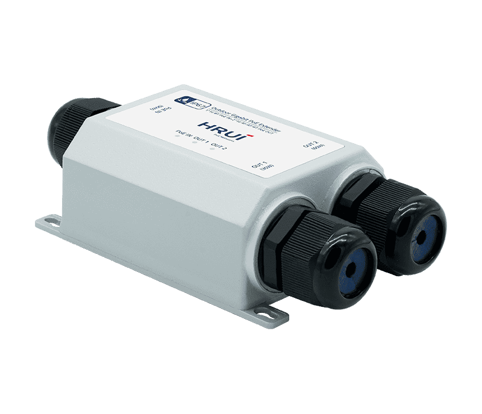
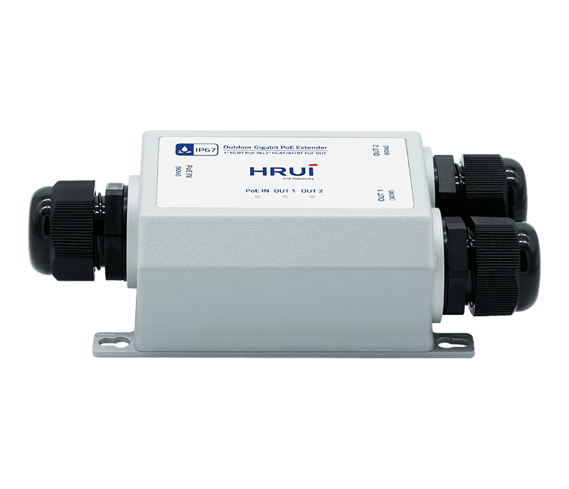
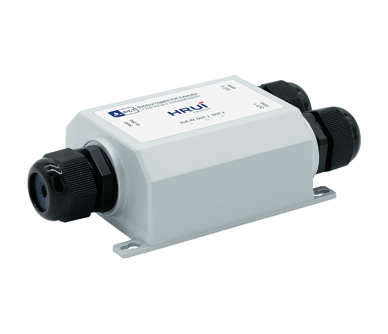
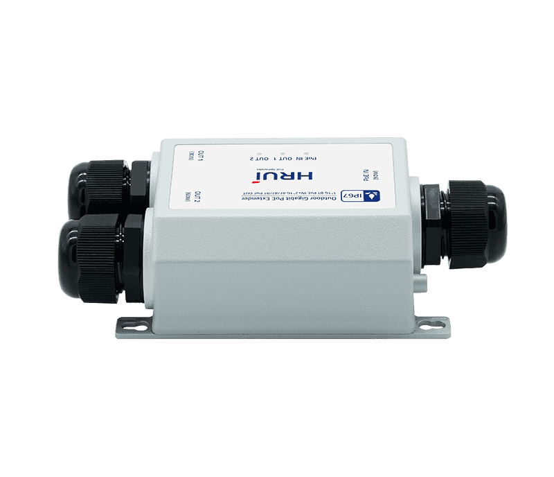

# HR-BTGRW-21

> 来源：<https://www.hruitech.com/poe-accessory/295.html>（抓取 2026-10-21T03:46:06Z；英文原文照录，中文仅为栏目名）  
> 官网描述：HR-BTGRW-21 Gigabit Outdoor IP67 PoE Extender  
> 类目：PoE Accessory（site id 295）  
> 接口：1*1Gbps PoE in port 2*1Gbps PoE out ports；PoE 预算 —；交换带宽 6Gbps；电源 PoE powered

**Brief:** Outdoor Industrial-grade PoE extender with 1Gbps ports, IP67 rugged casing, 100m range, 60W HiPoE, and plug-and-play setup.

## 产品图





## Datasheet
- [HR-BTGRW-21-28EN-29.pdf](https://www.hruitech.com/web/userfiles/productfile/HR-BTGRW-21-28EN-29.pdf) （本地：`data/hrui_site_raw/downloads/HR-BTGRW-21-28EN-29.pdf`；文本：`data/hrui_site_raw/datasheet_text/HR-BTGRW-21-28EN-29.txt`）

## Feature and Benefits（原文）
```
The HR-BTGRW-21 outdoor PoE Extender delivers robust performance with its 1×Gbps PoE input and 2×Gbps PoE output ports (supporting IEEE 802.3af/at/HiPoE up to 60W), featuring an IP67-rated die-cast aluminum casing for extreme environments (-40°C to 75°C operation). It extends PoE and Ethernet transmission up to 100 meters with 6Gbps switching bandwidth while automatically protecting connected devices. Designed for plug-and-play deployment with wall-mount flexibility, it's ideal for outdoor surveillance, industrial IoT, and harsh-condition applications.
Product Highlights
1、1*1Gbps PoE in port+2*1Gbps PoE out ports
2、Comply with IEEE802.3af (15.4W), IEEE802.3at (30W), HiPoE (60W)
3、Die cast aluminum casing, IP67 protection level, operating temperature range of -40~75°C
4、Support PoE and Ethernet transmission distance extension of 100 meters
5、Automatically detect and protect PoE devices from damage caused by incorrect installation.
6、Support wall mounted installation
7、Plug and play, easy to install
```

## Parameter（规格表逐行）
| 项 | 值 |
|---|---|
| Description | Specification |
| Model | HR-BTGRW-21 |
| Interface | 1*1Gbps PoE in port 2*1Gbps PoE out ports |
| Port Standard | IEEE802.3 (Ethernet) IEEE802.3u (Fast Ethernet) IEEE802.3ab (Gigabit Ethernet) IEEE802.3x (Flow Control) |
| Switching Bandwidth | 6Gbps |
| Packet Forwarding Rate | 4.46Mpps |
| MAC Address Table | 2K |
| Transmission Method | Store and Forward |
| PoE Standard | IEEE802.3af (15.4W) IEEE802.3at (30W) HiPoE (60W) |
| PoE Port Output Voltage | DC 44-57V |
| PoE Ports | Port 1 supports PoE out <30W Port 2 supports HiPoE 60W |
| PoE IN | IEEE802.3af/at/bt90W |
| Power Supply | PoE powered |
| Mainboard Power Consumption | 2.32W |
| Structure Information | Product Dimensions: 111.9*72.9*41.5mm Packaging Dimensions: 210*160*67mm Product Net Weight: 0.2KG Product Gross Weight: 0.36KG |
| Packing Information | Carton Dimensions: 447*360*340mm Packing Quantity: 20PCS Packing Weight: 8.2KG |
| Package Contents | PoE Extender 1pcs, Waterproof joint 3pcs, Waterproof cover 1pcs, thin open-end wrench 1pcs, Grounding wire 1pcs, Expansion screw 1pcs |
| Fan Quantity | 0 |
| Installation | Desktop |
| Surge Protection | Port Surge: Common mode 6KV, Differential mode 4KV(Class B) Electrostatic ESD: Air 8KV, Contact 6KV(Class B) |
| Operating Temperature | -40~75°C |
| Storage Temperature | -40~85°C |
| Operation Humidity | 10%~90%, non condensing |
| Storage Humidity | 5%~95%, non condensing |
| PoE in Green LED | On: Link normal Off: Link blocked Flashing: Data transmitting |
| PoE out Green LED | On: Link normal Off: Link blocked Flashing: Data transmitting |

## Product structure / Application topology（图）
- https://www.hruitech.com/web/userfiles/image/20250711/1752215415301161.png
