# HR-CPE300

> 来源：<https://www.hruitech.com/wireless-bridge/301.html>（抓取 2026-10-21T04:37:03Z；英文原文照录，中文仅为栏目名）  
> 官网描述：4G Full Netcom 300M WiFi Wireless Router  
> 类目：Wireless Solutions（site id 301）  
> 接口：WAN*1/LAN*2 10/100Mbps auto-negotiation Standard SIM card (Mini-SIM) DC power supply interface, suitable for power plug with outer diameter of 5.5mm, inner diameter of 2.1mm, and length of over 9.5mm；PoE 预算 —；交换带宽 —；电源 —

**Brief:** Dual-chip design, 300Mbps WiFi+4G LTE, multi-carrier support, 30m coverage, 16-user capacity, WPA2 security, TR069 management, plug-and-play setup.

## 产品图





## Datasheet
- [HR-CPE300-28EN-29.pdf](https://www.hruitech.com/web/userfiles/productfile/HR-CPE300-28EN-29.pdf) （本地：`data/hrui_site_raw/datasheets/HR-CPE300-28EN-29.pdf`；文本：`data/hrui_site_raw/datasheet_text/HR-CPE300-28EN-29.txt`）

## Feature and Benefits（原文）
```
The HR-CPE300 4G WiFi Router delivers high-speed 300Mbps wireless connectivity with dual-chip architecture for stable performance, supporting multi-carrier 4G LTE networks (FDD/TDD). Featuring versatile operation modes (Router/AP/4G), high-gain antennas for 30m coverage, and advanced security protocols, it's ideal for flexible networking in various environments with easy setup and TR069 remote management.
Product Highlights：
1、Independent wireless routing processing chip and 4G processing chip module, each performing its own function, dual-path concurrency, ensuring the stability and usability of the entire system.
2、Supports 4G access to Telecom, China Unicom, Mobile, and Broadcasting networks, supports APN/VPDN connections.
3、Supports routing mode, AP mode, and 4G LTE wireless access, flexible networking, suitable for various complex scenarios.
4、Provides 802.11b/g/n WiFi 300M wireless access, equipped with high-gain antennas, achieving a range of up to 30 meters in open and unobstructed environments. It also provides 10/100Mbps wired access, supporting up to 16 devices in standby mode.
5、Supports WPA/WPA2, SSID hiding, and blacklist, effectively ensuring the security of user data.
6、Built-in quick setup wizard, no professional knowledge required, easy to use 4G LTE access for WiFi internet.
```

## Parameter（规格表逐行）
| 项 | 值 |
|---|---|
| Description | Specification |
| Model | HR-CPE300 |
| Clock Frequency | 575MHz |
| Memory | 8MB |
| Flash | 2MB |
| Wireless Technology | 802.11b/g/n 300Mbps MIMO |
| Device interface | WAN*1/LAN*2 10/100Mbps auto-negotiation Standard SIM card (Mini-SIM) DC power supply interface, suitable for power plug with outer diameter of 5.5mm, inner diameter of 2.1mm, and length of over 9.5mm |
| Button | RESET, press and hold for 5 seconds to restore factory settings |
| Indicator | POWER, WiFi, 4G, WAN, LAN1, LAN2 |
| Antenna | External 2.4G 5dBi rubber rod antennas*2 External 4G LTE 5dBi rubber rod antennas*2 |
| Power | DC 12V/1A, positive on the outer side and negative on the inner side. |
| Structure Information | Product Dimensions: 143*95*27mm Packaging Dimensions: 282*278*50mm Product Net Weight: 0.35KG Product Gross Weight: 0.6KG |
| Packing Information | Carton Dimensions: 542*298*578mm Packing Quantity: 20PCS Packing Weight: 12.6KG |
| Package Contents | Router 1pcs, AC Adapter 1pcs, Manual 1pcs, Ethernet Cable 1pcs |
| Installation | Desktop |
| Operating Temperature | -10~45°C |
| Storage Temperature | -20~70°C |
| Operation Humidity | 5%~90%, non condensing |
| Storage Humidity | 5%~95%, non condensing |
| Frequency Range | 802.11b/g/n:2.4~2.4835GHz |
| Channel | 1, 2, 3, 4, 5, 6, 7, 8, 9, 10, 11, 12, 13 |
| Modulation | 802.11b: DSSS (DQPSK, DBPSK, CCK) 802.11g: OFDM (BPSK, QPSK,16-QAM) 802.11n: OFDM (BPSK, QPSK,16-QAM, 64-QAM) |
| Transmission Rate | 11b up 11Mbps,11g up 54Mbps,11n up 300Mbps |
| Receiver Sensitivity | 11b：≤-90±1.5dBm 1Mbps， ≤-84±1.5dBm 11Mbps 11g：≤-86±1.5dBm 6Mbps， ≤-69±1.5dBm 54Mbps 11n 20MHz：≤-85±1.5dBm MCS0， ≤-67±1.5dBm MCS7 11n 40MHz：≤-82±1.5dBm MCS0， ≤-64±1.5dBm MCS7 |
| Transmit Power | 11b: ≥20±1.5dBm11Mbps 11g: ≥20dBm±1.5dBm54Mbps 11n: ≥20dBm±1.5dBmMCS7 |
| Network Standard | LTE FDD/TDD |
| LTE-FDD | B1/B3/B5/B8(supporting hierarchical reception) |
| LTE-TDD | B34/B38/B39/B40/B41 (supporting hierarchical reception) |
| Transmission Rate | LTE FDD: Up 150Mbps(DL)/Up 50Mbps(UL) LTE TDD: Up 130Mbps(DL)/Up 30Mbps(UL) |
| Transmit Power | Class 3 (23dBm±2dB) LTE FDD Bands Class 3 (23dBm±2dB) LTE TDD Bands |
| Receiver Sensitivity | FDD B1: -99dBm (10M) FDD B3: -99dBm (10M) FDD B5: -100dBm (10M) FDD B8: -100dBm (10M) TDD B34: -98dBm (10M) TDD B38: -100dBm (10M) TDD B39: -98dBm (10M) TDD B40: -99dBm (10M) TDD B41: -99dBm (10M) |
| Working Mode | 4G/Router/AP |
| Number of connected users | 16 Peoples |
| Management | The English web remote management/ Batch management based on the TR069 centralized management platform." |
| Status | -System Status/4G Status/Interface Status -User List -Black List |
| Network Configuration | -Network Configuration: Operating Mode (4G/Router/AP)/LAN/WAN -APN Settings |
| WiFi Settings | WiFi Switch/WiFi name/Encryption/WiFi password/ Hide WiFi/Wireless protocol/Wireless bandwidth/ Wireless channel/WiFi signal strength |
| Flow Assistant | Used/Remaining/This month has been used/Today Has been used/The end of the month/Monthly Package flow/Monthly settlement date/Flow control switch |
| System Management | Managed Password -Local Time -Upgrade/Reset: Reset to defaults/Download backup configuration/Restore backup/Local Upgrade -System Log -Network Detection -Reboot: Reboot immediately/ |
| Setup Wizard | System mode-WiFi |

## Product structure / Application topology（图）
- https://www.hruitech.com/web/userfiles/image/20250723/1753252008396612.png
