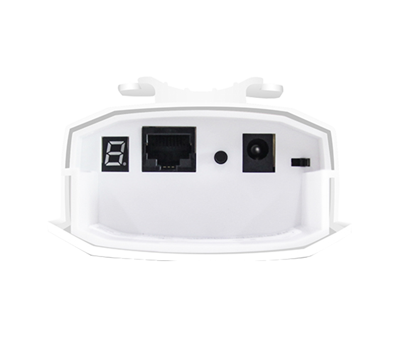

# HR-CPE30A-1

> 来源：<https://www.hruitech.com/wireless-bridge/108.html>（抓取 2026-10-21T03:48:58Z；英文原文照录，中文仅为栏目名）  
> 官网描述：300Mbps Outdoor Wireless Digital Bridge  
> 类目：Wireless Solutions（site id 108）  
> 接口：LAN 1* 10/100Mbps adaptive RJ45 port / DC power interface, suitable for connecting power plugs with an outer diameter of 5.5mm and an inner diameter of 2.1mm and a length of 9.5mm or more；PoE 预算 —；交换带宽 —；电源 —

**Brief:** Elevate your network performance with the HR-CPE30A-1 Wireless Digital Bridge, a robust solution designed for seamless connectivity in even the most challenging outdoor environments. With its IP65-rated protection level, this wireless bridge is built to withstand the elements, ensuring reliable operation in rain, dust, and extreme temperatures.

## 产品图





## Datasheet
- [HR-CPE30A-1-28EN-29_UFEwR.pdf](https://www.hruitech.com/web/userfiles/productfile/HR-CPE30A-1-28EN-29_UFEwR.pdf) （本地：`data/hrui_site_raw/datasheets/HR-CPE30A-1-28EN-29_UFEwR.pdf`；文本：`data/hrui_site_raw/datasheet_text/HR-CPE30A-1-28EN-29_UFEwR.txt`）

## Feature and Benefits（原文）
```
Elevate your network performance with the HR-CPE30A-1 Wireless Digital Bridge, a robust solution designed for seamless connectivity in even the most challenging outdoor environments. With its IP65-rated protection level, this wireless bridge is built to withstand the elements, ensuring reliable operation in rain, dust, and extreme temperatures.
Key Features:
Power Over Ethernet (PoE) Support:
Equipped with a 10/100Mbps PoE port, the HR-CPE30A-1 simplifies installation by allowing for remote power supply over Ethernet. The device supports 24V PoE for remote setups, as well as a 12V DC local power supply option for flexible connectivity.
High-Speed Wireless Transmission:
Experience impressive wireless speeds with support for 802.11b/g/n WiFi protocols, delivering up to 300Mbps transmission. Ideal for streaming, online gaming, and more.
Extended Transmission Range:
Paired with high-gain antennas, the HR-CPE30A-1 transmits data over distances of up to 500m in open environments, ensuring strong connectivity across larger areas.
Versatile Installation Options:
Designed for easy installation, this wireless bridge supports both wall-mounted and pole-mounted setups, accommodating various deployment scenarios with minimal effort.
Whether you’re enhancing connectivity for a bustling outdoor event or extending network reach across a remote site, the HR-CPE30A-1 Wireless Digital Bridge stands ready to deliver exceptional performance and reliability. Upgrade your network infrastructure today with this versatile and durable solution!
The HRUI Wireless Outdoor Digital Bridge is a cutting-edge networking solution engineered to deliver dependable, high-speed connectivity across long distances. These bridges are crucial for organizations needing reliable outdoor connections, making them ideal for diverse applications in multiple sectors.
Thanks to their durable design and extensive range, HRUI digital bridges improve communication networks for various uses, including smart city projects, agricultural efforts, and remote monitoring and surveillance. Their adaptability enables them to effectively address contemporary connectivity challenges, ensuring that organizations remain connected and efficient in any environment.
PRODUCT FEATURES
• Advanced Solutions for Long-Distance Transmission
HRUI wireless bridges adopt high gain directional antenna to provide an efficient way to pick up and maintain a stable signal for a wireless network up to 1km/5km.
• Smart Pairing
By simply pressing the physical button, you can easily set the same channel for pairing multiple wireless bridges, eliminating the need for complex web configurations.
• User-friendly Design for Visual Experiences
You can learn the signal strength status, Ethernet status, and power status of the devices through the indicator lights.
• Support DC/24V PoE Powered
Support both DC and 24V PoE power sources, offering greater convenience and flexibility for installation.
• Industrial-Grade Design for Long-Lasting Stability
Support IP65 protection, dust-proof and water-proof, allowing for stable operation in harsh environments. It can work reliably in temperatures ranging from -30°C to 55°C (-22°F to 122°F) and is suitable for various environmental conditions. The product is made of high-quality ABS materials with excellent durability. Additionally, the device supports two installation methods: wall-mounted and pole-mounted, allowing users to choose the installation method that best suits their needs.
HRUI WIRELESS BRIDGES
2.4GHz
300Mbps
1Km
5GHz
450Mbps
1Km
5GHz
900Mbps
5Km
```

## Parameter（规格表逐行）
| 项 | 值 |
|---|---|
| 2.4GHz 300Mbps 1Km | 5GHz 450Mbps 1Km / 5GHz 900Mbps 5Km |
| **Hardware Features & Performance** | |
| Model | HR-CPE30A-1 |
| Wireless Technology | 802.11b/g/n 300Mbps MIMO technology |
| Interface | LAN 1* 10/100Mbps adaptive RJ45 port |
| Interface | DC power interface, suitable for connecting power plugs with an outer diameter of 5.5mm and an inner diameter of 2.1mm and a length of 9.5mm or more |
| Button | Reset to factory/digital composite button, short press to adjust digital tube value, long press for 5 seconds to restore factory settings |
| Indicator Light | PWR power indicator light, LAN port status indicator light |
| Indicator Light | SIG1/SIG2/SIG3 signal strength indicator light, digital tube |
| Antenna | Built in dual polarized 8dBi directional plate antenna (horizontal lobe angle 90 °, vertical lobe angle 90 °) |
| Power supply | 24V/0.5A PoE remote power supply |
| Power supply | DC 12V/1A, external positive and internal negative |
| Structure Information | Product Dimensions :140*75*34mm |
| Structure Information | Packaging Dimensions :145*196*90mm |
| Structure Information | Product Net Weight:0.15kg |
| Structure Information | Product Gross Weight:0.65kg |
| Packing Information | Carton Dimensions :465*310*425mm |
| Packing Information | Packing Quantity: 20pair |
| Packing Information | Packing Weight: 14.06kg |
| Package Contents | Wireless Digital Bridge*1，24V PoE power adapter * 1, plastic clamp * 2,Ethernet cable * 1, manual (including warranty card)*1 |
| Installation | Pole mounted installation |
| Operating Temperature | -30℃～55℃ |
| Storage Temperature | -40 °C to 70 °C |
| Operation Humidity | 10%~90%，non condensing |
| Storage Humidity | 5%~95%，non condensing |
| **Hardware Features & Performance** | |
| Frequency Range | 802.11b/g/n:2.4~2.4835GHz |
| Channel Distribution | 1、2、3、4、5、6、7、8、9、10、11、12、13 |
| Modulation Mode | 802.11b: DSSS (DQPSK, DBPSK, CCK) |
| Modulation Mode | 802.11g: OFDM (BPSK, QPSK,16-QAM) |
| Modulation Mode | 802.11n: OFDM (BPSK, QPSK,16-QAM, 64-QAM) |
| Transmission Speed | 11b maximum 11Mbps, 11g maximum 54Mbps, 11n maximum 300Mbps |
| Receiving Sensitivity | 11b：≤-90±1.5dBm / 1Mbps，≤-84±1.5dBm / 11Mbps |
| Receiving Sensitivity | 11g：≤-86±1.5dBm / 6Mbps，≤-69±1.5dBm / 54Mbps |
| Receiving Sensitivity | 11n 20MHz：≤-85±1.5dBm / MCS0，≤-67±1.5dBm / MCS7 |
| Receiving Sensitivity | 11n 40MHz：≤-82±1.5dBm / MCS0，≤-64±1.5dBm / MCS7 |
| Transmission Power | 11b: ≥17±1.5dBm / 11Mbps |
| Transmission Power | 11g: ≥15dBm±1.5dBm / 54Mbps |
| Transmission Power | 11n: ≥14dBm±1.5dBm / MCS7 |
| Transmission Distance | 500m / 50Mbps |
| **S oftware Features & Performance** | |
| Working Mode | Bridge access point, bridge client |
| Networking Method | Point to point |
| Management Style | Chinese and English WEB management |
| State | System status, bridge status, interface status |
| Bridge Configuration | Wireless mode: Bridge access point/Bridge client |
| Bridge Configuration | Bridge access point: bridging SSID, bridging password, wireless protocol, wireless bandwidth, wireless channel, wireless power |
| Bridge Configuration | Bridge client: bridging SSID, encryption method, bridging password, peer MAC address, wireless channel, wireless power |
| Network Settings | Address acquisition method: automatic acquisition/static IP |
| Network Settings | IP address, subnet mask, gateway, DNS1, DNS2 |
| System Management | System debugging, password modification, restart/reset/upgrade |

## Product structure / Application topology（图）
- https://www.hruitech.com/web/userfiles/image/20241218/1734486881160386.png
- https://www.hruitech.com/web/userfiles/image/20260805/1785900148420283.png
