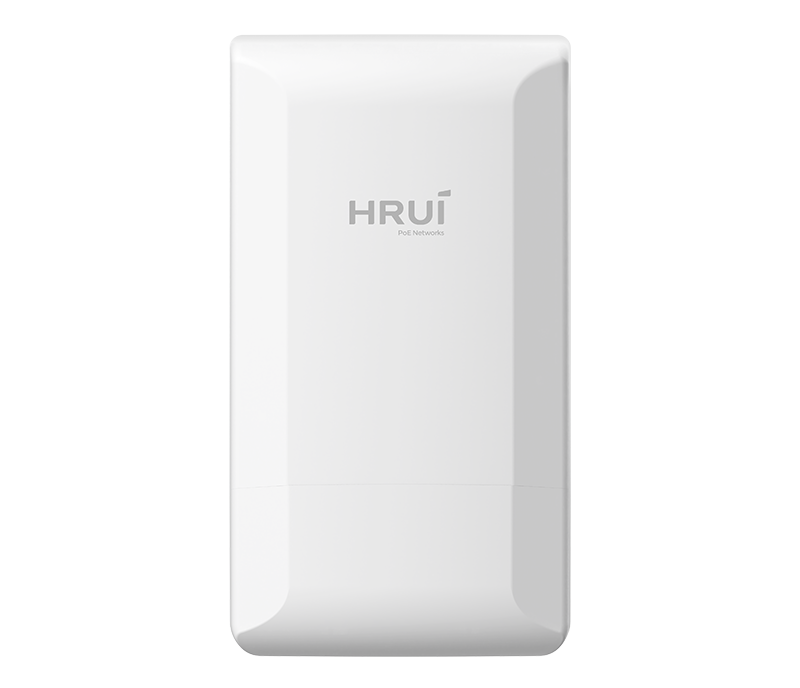
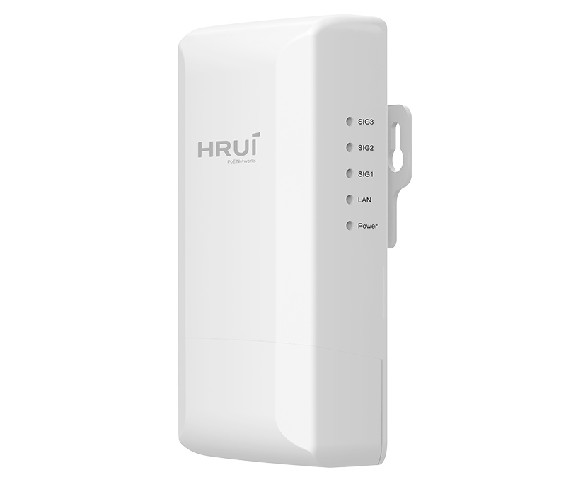
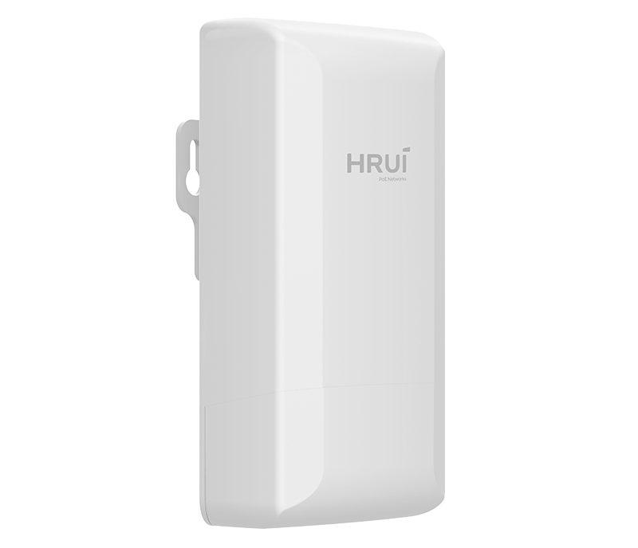
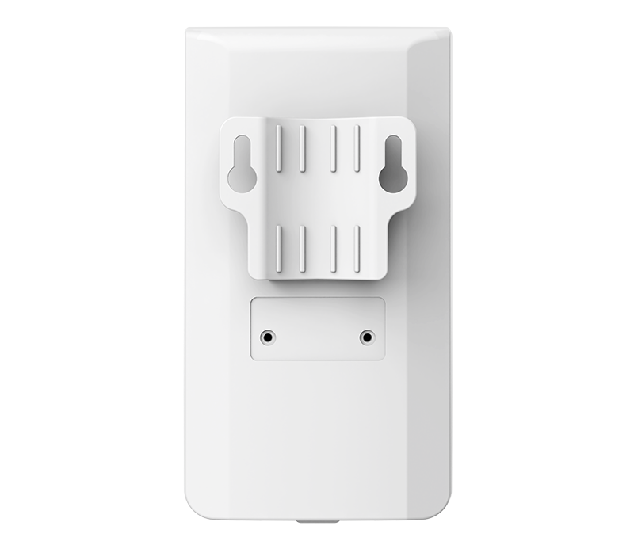

# HR-CPE30B-05P

> 来源：<https://www.hruitech.com/wireless-bridge/322.html>（抓取 2026-10-21T03:46:04Z；英文原文照录，中文仅为栏目名）  
> 官网描述：2.4G Outdoor 300M Wireless Bridge  
> 类目：Wireless Solutions（site id 322）  
> 接口：1*10/100Mbps PoE port；PoE 预算 —；交换带宽 —；电源 Supports Standard and DC 12V power supply

**Brief:** IP65 | 802.3af/at PoE Power | Zero-Config Setup | Channel Optimization | PtP&PtMP | QoS Control | Mgmt SSID | Router Mode

## 产品图





## Datasheet
- [HR-CPE30B-05P-EF-BC-88EN-EF-BC-89.pdf](https://www.hruitech.com/web/userfiles/productfile/HR-CPE30B-05P-EF-BC-88EN-EF-BC-89.pdf) （本地：`data/hrui_site_raw/datasheets/HR-CPE30B-05P-EF-BC-88EN-EF-BC-89.pdf`；文本：`data/hrui_site_raw/datasheet_text/HR-CPE30B-05P-EF-BC-88EN-EF-BC-89.txt`）

## Feature and Benefits（原文）
```
HR-CPE30B-05P is a 2.4GHz wireless bridge featuring 802.3af/at PoE and DC 12V power input for flexible outdoor deployment. Supporting 802.11n 300Mbps wireless transmission with a range of up to 500m, it provides a stable and cost-effective solution for CCTV backhaul, industrial monitoring, building-to-building connectivity, elevator surveillance, and other outdoor networking applications.
Equipped with a built-in 6dBi directional antenna, the device supports PtP, PtMP, and Router modes to meet different networking needs. Features including One-Click Channel Optimization, Hardware Master/Slave switching, Independent Management SSID, and QoS traffic control help improve deployment efficiency and wireless stability. Combined with an IP65-rated enclosure and plug-and-play design, the HR-CPE30B-05P ensures reliable performance in various outdoor environments.
Product Highlights：
1、1*10/100Mbps port.
2、Supporting IP65 protection level shell design, easily adapting to various harsh outdoor environments.
3、Support Standard PoE remote power supply and DC 12V local power supply.
4、Support 802.11n WiFi 300M wireless transmission.
5、Paired with high gain antennas, the transmission distance can reach 500m in an open and unobstructed environment.
6、Support wall mounted and pole mounted installation methods, with simple construction.
7、Automatically selects channels to ensure stable signal.
8、Compatible with mainstream cameras on the market.
9、No configuration required, easy to use.
```

## Parameter（规格表逐行）
| 项 | 值 |
|---|---|
| **Hardware Features & Performance** | |
| Description | Specification |
| Model | HR-CPE30B-05P |
| Interface | 1*10/100Mbps PoE port |
| Port Standard | IEEE802.3 (Ethernet), IEEE802.3u (Fast Ethernet) |
| Reset | Long press for 10 seconds to restore factory settings |
| DIP Switch | Master/Slave mode switch (Left: Master, Right: Slave) |
| Power Specification | DC 12V 0.5A |
| Power Interface | DC jack, 5.5mm outer diameter, 2.1mm inner diameter |
| Power Supply | Supports Standard and DC 12V power supply |
| Antenna | Built-in dual-polarized 6dBi directional panel antenna (Horizontal angle 70°, vertical angle 60°) |
| MIMO | 2x2 MIMO |
| Maximum Transmit Power | 20dBm |
| Maximum Power | 3W |
| Frequency Range | 2.4~2.4835GHz |
| Supported Channels | China: 1, 2, 3, 4, 5, 6, 7, 8, 9, 10, 11, 12, 13 USA: 1, 2, 3, 4, 5, 6, 7, 8, 9, 10, 11 |
| Modulation Modes | IEEE802.11b: DSSS (DQPSK, DBPSK, CCK) IEEE802.11g: OFDM (BPSK, QPSK, 16-QAM) IEEE802.11n: OFDM (BPSK, QPSK, 16-QAM, 64-QAM) |
| Transmission Speed | 11b max 11Mbps, 11g max 54Mbps, 11n max 300Mbps |
| Receive Sensitivity | 11b: ≤-97±1.5dBm / 1Mbps, ≤-87±1.5dBm / 11Mbps 11g: ≤-92±1.5dBm / 6Mbps, ≤-75±1.5dBm / 54Mbps 11n 20MHz: ≤-91±1.5dBm / MCS0, ≤-72±1.5dBm / MCS7 11n 40MHz: ≤-88±1.5dBm / MCS0, ≤-69±1.5dBm / MCS7 |
| Transmit Power | 11b: ≥18±1.5dBm / 11Mbps 11g: ≥17dBm ±1.5dBm / 54Mbps 11n: ≥15dBm ±1.5dBm / MCS7 |
| **Hardware Features & Performance** | |
| Transmission Distance | 500 meters |
| Certification | FCC、CE、RoHS |
| Enclosure Material | ABS |
| IP Rating | IP65 |
| Pole Mount Diameter | 14~60mm |
| Installation | Pole-mount, wall-mount |
| Electrostatic Protection | Contact ±6KV; Air ±10KV |
| Operating Temperature | -30~55°C |
| Storage Temperature | -40~70°C |
| Operating Humidity | 10%~90%, non condensing |
| Storage Humidity | 5%~95%, non condensing |
| Structure Information | Product Dimensions: 140.52*77.39*53.23mm |
| Structure Information | Packaging Dimensions: 145*196*90mm |
| Structure Information | Product Net Weight: 0.13KG*2 |
| Structure Information | Product Gross Weight: 0.56KG |
| Packing Information | Carton Dimensions: 465*310*425mm |
| Packing Information | Packing Quantity: 20PCS |
| Packing Information | Packing Weight: 12.2KG |
| Package Contents | Device ×2, Manual ×1, Certificate of Inspection ×1, Cable ties ×2, Power adapter ×2, Passive PoE injector ×1 |
| **Software Features & Performance** | |
| Operating Mode | Bridge Access Point, Bridge Client |
| Forwarding Mode | Bridge / Routing (NAT) |
| Networking Mode | Point-to-Point, Point-to-Multipoint |
| Wireless Settings | 802.11b/g/n mode, Auto channel selection, On-site channel analysis, Transmit power adjustment Wireless security: WPA/WPA2, WPA-PSK/WPA2-PSK (AES/TKIP) encryption SSID broadcast/hide, Channel bandwidth selection, AP isolation, WMM Wireless MAC address filtering |
| Country code | China, USA |
| LAN Settings | IP address, Subnet mask, Gateway, DNS |
| WiFi Bridging | Custom bridge SSID, Interference signal viewer, One-click channel optimization |
| WiFi Management | Enable/disable, Configure independent management SSID, Hide SSID, Management policy (manage master device or device group) |
| RF Settings | Bandwidth switching, Channel switching, 3-level power adjustment |
| Packet Control | Multicast packet flow control, Broadcast packet flow control |
| Multi-language | Chinese / English |
| Status Monitoring | System status, Bridge status, Interface status |
| Access Control | MAC-based access control (effective on management WiFi) |
| Tools & Management | Ping test, Tracert, Domain name query |
| System Management | Reboot, Restore factory settings, Change password, Backup/restore, Firmware upgrade, Time settings, Management IP settings |

## Product structure / Application topology（图）
- https://www.hruitech.com/web/userfiles/image/20260513/1778641248697688.png
