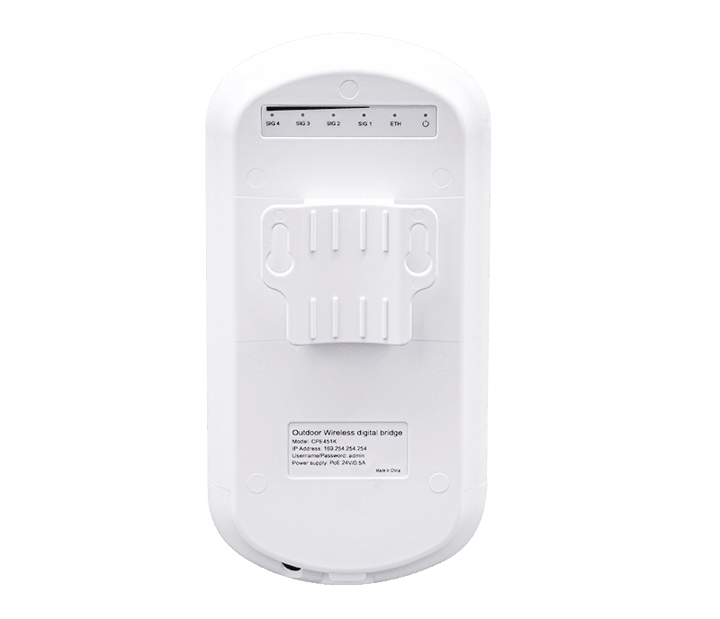
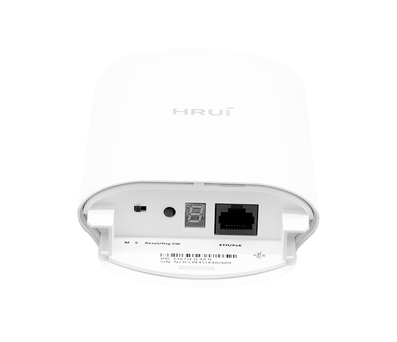

# HR-CPE45A-1

> 来源：<https://www.hruitech.com/wireless-bridge/107.html>（抓取 2026-10-21T03:48:59Z；英文原文照录，中文仅为栏目名）  
> 官网描述：450Mbps Outdoor Wireless Digital Bridge  
> 类目：Wireless Solutions（site id 107）  
> 接口：LAN 1* 10/100Mbps adaptive RJ45 port；PoE 预算 —；交换带宽 —；电源 —

**Brief:** Elevate your outdoor connectivity experience with the HR-CPE45A-1 Wireless Digital Bridge, designed to provide robust and reliable wireless transmission even in the most demanding environments. This state-of-the-art device features a high-speed 10/100Mbps PoE port, allowing for seamless integration into your existing network infrastructure.

## 产品图





## Datasheet
- [HR-CPE45A-1-28EN-29.pdf](https://www.hruitech.com/web/userfiles/productfile/HR-CPE45A-1-28EN-29.pdf) （本地：`data/hrui_site_raw/datasheets/HR-CPE45A-1-28EN-29.pdf`；文本：`data/hrui_site_raw/datasheet_text/HR-CPE45A-1-28EN-29.txt`）

## Feature and Benefits（原文）
```
Elevate your outdoor connectivity experience with the HR-CPE45A-1 Wireless Digital Bridge, designed to provide robust and reliable wireless transmission even in the most demanding environments. This state-of-the-art device features a high-speed 10/100Mbps PoE port, allowing for seamless integration into your existing network infrastructure.
Built to withstand the elements, the HR-CPE45A-1 boasts an IP65 protection level shell, ensuring durability against dust and water, making it perfect for outdoor installations. This bridge supports both 24V PoE remote power supply and DC 12V local power supply, offering flexible installation options to suit your needs.
With support for the latest 802.11a/n/ac WiFi standards, enjoy a lightning-fast wireless transmission speed of up to 450Mbps. When paired with high-gain antennas, the HR-CPE45A-1 can achieve impressive transmission distances of up to 1km in open, unobstructed environments, ensuring that you remain connected even over long distances.
The HR-CPE45A-1 is easy to install. It supports both wall-mounted and pole-mounted configurations, facilitating quick setup and minimal construction requirements. Additionally, this powerful bridge can connect up to eight points, creating a robust interconnection system that enhances your network's reach and performance.
Whether you’re setting up a wireless network for a remote business site, a smart city project, or simply expanding your home network outdoors, the HR-CPE45A-1 Wireless Digital Bridge is your ultimate solution for superior wireless performance and reliability. Experience seamless connectivity today!
The HRUI Wireless Outdoor Digital Bridge is a cutting-edge networking solution engineered to deliver dependable, high-speed connectivity across long distances. These bridges are crucial for organizations needing reliable outdoor connections, making them ideal for diverse applications in multiple sectors.
Thanks to their durable design and extensive range, HRUI digital bridges improve communication networks for various uses, including smart city projects, agricultural efforts, and remote monitoring and surveillance. Their adaptability enables them to effectively address contemporary connectivity challenges, ensuring that organizations remain connected and efficient in any environment.
PRODUCT FEATURES
• Advanced Solutions for Long-Distance Transmission
HRUI wireless bridges adopt high gain directional antenna to provide an efficient way to pick up and maintain a stable signal for a wireless network up to 1km/5km.
• Smart Pairing
By simply pressing the physical button, you can easily set the same channel for pairing multiple wireless bridges, eliminating the need for complex web configurations.
• User-friendly Design for Visual Experiences
You can learn the signal strength status, Ethernet status, and power status of the devices through the indicator lights.
• Support DC/24V PoE Powered
Support both DC and 24V PoE power sources, offering greater convenience and flexibility for installation.
• Industrial-Grade Design for Long-Lasting Stability
Support IP65 protection, dust-proof and water-proof, allowing for stable operation in harsh environments. It can work reliably in temperatures ranging from -30°C to 55°C (-22°F to 122°F) and is suitable for various environmental conditions. The product is made of high-quality ABS materials with excellent durability. Additionally, the device supports two installation methods: wall-mounted and pole-mounted, allowing users to choose the installation method that best suits their needs.
HRUI WIRELESS BRIDGES
2.4GHz
300Mbps
1Km
5GHz
450Mbps
1Km
5GHz
900Mbps
5Km
```

## Parameter（规格表逐行）
| 项 | 值 |
|---|---|
| 2.4GHz 300Mbps 1Km | 5GHz 450Mbps 1Km / 5GHz 900Mbps 5Km |
| **Hardware Features & Performance** | |
| Model | HR-CPE45A-1 |
| Wireless Technology | 802.11a/n/ac 450Mbps 1T1R technology |
| Interface | LAN 1* 10/100Mbps adaptive RJ45 port |
| Button | Reset to factory/digital composite button, short press to adjust digital tube value, long press for 5 seconds to restore factory settings |
| Indicator Light | PWR power indicator light, ETH RJ45 port status indicator light |
| Indicator Light | SIG1/SIG2/SIG3/SIG4 signal strength indicator light, digital tube |
| Antenna | Built in dual polarized 8dBi directional plate antenna (horizontal lobe angle 65 °, vertical lobe angle 30 °) |
| Power supply | 24V/0.5A PoE remote power supply |
| Structure Information | Product Dimensions :180*90*40mm |
| Structure Information | Packaging Dimensions :210*183*70mm |
| Structure Information | Product Net Weight:0.15kg |
| Structure Information | Product Gross Weight:0.65kg |
| Packing Information | Carton Dimensions :432*390.5*380mm |
| Packing Information | Packing Quantity: 20pair |
| Packing Information | Packing Weight: 14.06kg |
| Package Contents | Wireless Digital Bridge*1，24V PoE power adapter * 1, plastic clamp * 2,Ethernet cable * 1, manual (including warranty card)*1 |
| Installation | Pole mounted installation |
| Operating Temperature | -30℃～55℃ |
| Storage Temperature | -40 °C to 70 °C |
| Operation Humidity | 10%~90%，non condensing |
| Storage Humidity | 5%~95%，non condensing |
| **Hardware Features & Performance** | |
| Frequency Range | 5G: UNII-1: 5.15~5.35GHz |
| Frequency Range | UNII-2: 5.47~5.725GHz |
| Frequency Range | UNII-3: 5.725~5.825GHz |
| Channel Distribution | 36、40、44、48、52、60、64、149、153、157、161、165 |
| Modulation Mode | 802.11a: OFDM (BPSK, QPSK,16-QAM) |
| Modulation Mode | 802.11n: OFDM (BPSK, QPSK,16-QAM, 64-QAM) |
| Modulation Mode | 802.11ac: OFDM (BPSK, QPSK,64-QAM, 256-QAM) |
| Transmission Speed | 11a maximum 54Mbps, 11n maximum 144Mbps, 11ac maximum 450Mbps |
| Receiving Sensitivity | 11a：≤-86±1.5dBm / 6Mbps，≤-69±1.5dBm / 54Mbps |
| Receiving Sensitivity | 11n 20MHz：≤-85±1.5dBm / MCS0，≤-67±1.5dBm / MCS7 |
| Receiving Sensitivity | 11n 40MHz：≤-82±1.5dBm / MCS0，≤-64±1.5dBm / MCS7 |
| Receiving Sensitivity | 11ac 20MHz：≤-84±1.5dBm / MCS0，≤-59±1.5dBm / MCS8 |
| Receiving Sensitivity | 11ac 40MHz：≤-82±1.5dBm / MCS0，≤-56±1.5dBm / MCS9 |
| Receiving Sensitivity | 11ac 80MHz：≤-78±1.5dBm / MCS0，≤-52±1.5dBm / MCS9 |
| Transmission Power | 11a: 17dBm±1.5dBm / 54Mbps |
| Transmission Power | 11n(20/40MHz): 15dBm±1.5dBm / MCS7 |
| Transmission Power | 11ac(40/80MHz): 14dBm±1.5dBm / MCS9 |
| Transmission Distance | 1km |
| **Software Features & Performance** | |
| Working Mode | Bridge access point, bridge client |
| Networking Method | Point to point, point to many points (within eight points) |
| Management Style | Chinese and English WEB management |
| State | System status, bridge status, interface status |
| Bridge Configuration | Wireless mode: Bridge access point/Bridge client |
| Bridge Configuration | Bridge access point: bridging SSID, bridging password, wireless protocol, wireless bandwidth, wireless channel, wireless power |
| Bridge Configuration | Bridge client: bridging SSID, encryption method, bridging password, peer MAC address, wireless channel, wireless power |
| Network Settings | Address acquisition method: automatic acquisition/static IP |
| Network Settings | IP address, subnet mask, gateway, DNS1, DNS2 |
| System Management | System debugging, password modification, restart/reset/upgrade |

## Product structure / Application topology（图）
- https://www.hruitech.com/web/userfiles/image/20241218/1734487092275289.png
- https://www.hruitech.com/web/userfiles/product/EDM/HRUI-Wireless-Bridge-Application.jpg
