# HR-CPE90B-5

> 来源：<https://www.hruitech.com/wireless-bridge/106.html>（抓取 2026-10-21T03:49:00Z；英文原文照录，中文仅为栏目名）  
> 官网描述：HR-CPE90B-5 - 900Mbps Outdoor Wireless Digital Bridge  
> 类目：Wireless Solutions（site id 106）  
> 接口：WAN/LAN * 1 10/100/1000Mbps adaptive network port / DC power interface, suitable for connecting power plugs with an outer diameter of 5.5mm and an inner diameter of 2.1mm and a length of 9.5mm or more；PoE 预算 —；交换带宽 —；电源 —

**Brief:** Elevate your wireless connectivity with the HR-CPE90B-5 Wireless Digital Bridge, a powerful solution designed for seamless communication in a variety of outdoor environments. This state-of-the-art bridge features a robust design, equipped with a 100/1000Mbps PoE port that ensures high-speed data transmission and reliable network performance.

## 产品图







## Datasheet
- [HR-CPE90B-5-28EN-29.pdf](https://www.hruitech.com/web/userfiles/productfile/HR-CPE90B-5-28EN-29.pdf) （本地：`data/hrui_site_raw/downloads/HR-CPE90B-5-28EN-29.pdf`；文本：`data/hrui_site_raw/datasheet_text/HR-CPE90B-5-28EN-29.txt`）

## Feature and Benefits（原文）
```
Elevate your wireless connectivity with the HR-CPE90B-5 Wireless Digital Bridge, a powerful solution designed for seamless communication in a variety of outdoor environments. This state-of-the-art bridge features a robust design, equipped with a 100/1000Mbps PoE port that ensures high-speed data transmission and reliable network performance.
Key Features:
Durable & Weatherproof:
Constructed with an IP65 protection level shell, the HR-CPE90B-2 easily withstands harsh outdoor conditions, ensuring longevity and reliability in any climate.
Flexible Power Options:
Enjoy versatile power solutions with support for 24V PoE remote power supply and DC 12V local power supply, allowing for convenient installation without compromising performance.
Blistering Speeds:
Experience lightning-fast wireless transmission speeds of up to 900Mbps, thanks to advanced support for 802.11a/n/ac protocols. Stream, download, and connect with unmatched efficiency.
Long-Distance Connectivity:
Paired with high-gain antennas, this bridge can achieve impressive transmission distances of up to 5 kilometers in open and unobstructed environments, making it perfect for expansive outdoor setups.
Easy Installation:
The HR-CPE90B-2 supports both wall-mounted and pole-mounted installation methods, ensuring a straightforward setup process that minimizes disruption to your environment.
Scalable Networking Solutions:
With the capability to support point-to-point interconnections of up to eight devices, scaling your network has never been easier.
Whether you’re setting up a remote gaming area, enhancing surveillance systems, or connecting multiple outdoor access points, the HR-CPE90B-5 Wireless Digital Bridge is your go-to solution for robust and reliable wireless connectivity. Unlock the potential of your outdoor space with this exceptional wireless bridge!
The HRUI Wireless Outdoor Digital Bridge is a cutting-edge networking solution engineered to deliver dependable, high-speed connectivity across long distances. These bridges are crucial for organizations needing reliable outdoor connections, making them ideal for diverse applications in multiple sectors.
Thanks to their durable design and extensive range, HRUI digital bridges improve communication networks for various uses, including smart city projects, agricultural efforts, and remote monitoring and surveillance. Their adaptability enables them to effectively address contemporary connectivity challenges, ensuring that organizations remain connected and efficient in any environment.
PRODUCT FEATURES
• Advanced Solutions for Long-Distance Transmission
HRUI wireless bridges adopt high gain directional antenna to provide an efficient way to pick up and maintain a stable signal for a wireless network up to 1km/5km.
• Smart Pairing
By simply pressing the physical button, you can easily set the same channel for pairing multiple wireless bridges, eliminating the need for complex web configurations.
• User-friendly Design for Visual Experiences
You can learn the signal strength status, Ethernet status, and power status of the devices through the indicator lights.
• Support DC/24V PoE Powered
Support both DC and 24V PoE power sources, offering greater convenience and flexibility for installation.
• Industrial-Grade Design for Long-Lasting Stability
Support IP65 protection, dust-proof and water-proof, allowing for stable operation in harsh environments. It can work reliably in temperatures ranging from -30°C to 55°C (-22°F to 122°F) and is suitable for various environmental conditions. The product is made of high-quality ABS materials with excellent durability. Additionally, the device supports two installation methods: wall-mounted and pole-mounted, allowing users to choose the installation method that best suits their needs.
HRUI WIRELESS BRIDGES
2.4GHz
300Mbps
1Km
5GHz
450Mbps
1Km
5GHz
900Mbps
5Km
```

## Parameter（规格表逐行）
| 项 | 值 |
|---|---|
| 2.4GHz 300Mbps 1Km | 5GHz 450Mbps 1Km / 5GHz 900Mbps 5Km |
| **Hardware Features & Performance** | |
| Model | HR-CPE90B-5 |
| Wireless Technology | 802.11a/n/ac 900Mbps 2T2R technology |
| Interface | WAN/LAN * 1 10/100/1000Mbps adaptive network port |
| Interface | DC power interface, suitable for connecting power plugs with an outer diameter of 5.5mm and an inner diameter of 2.1mm and a length of 9.5mm or more |
| Button | Reset to factory/digital composite button, short press to adjust digital tube value, long press for 6 seconds to restore factory settings |
| Indicator Light | PWR power indicator light, ETH network port status indicator light |
| Indicator Light | SIG1/SIG2/SIG3/SIG4 signal strength indicator light, digital tube |
| Antenna | Built in dual polarization 14dBi directional plate antenna (horizontal lobe angle 60 °, vertical lobe angle 60 °) |
| Power supply | 24V/1A PoE remote power supply |
| Power supply | DC 12V/1A, external positive and internal negative |
| Structure Information | Product Dimensions :258*90*56.4mm |
| Structure Information | Packaging Dimensions :280*96*96mm |
| Structure Information | Product Net Weight:0.35kg |
| Structure Information | Product Gross Weight:0.7kg |
| Packing Information | Carton Dimensions :522*298*410mm |
| Packing Information | Packing Quantity: 20PCS |
| Packing Information | Packing Weight: 15kg |
| Package Contents | Wireless Digital Bridge * 1, 24V PoE power adapter * 1, plastic clamp * 2, Ethernet cable * 1, manual (including warranty card)*1 |
| Installation | Pole mounted installation |
| Operating Temperature | -30℃～55℃ |
| Storage Temperature | -40 °C to 70 °C |
| Operation Humidity | 10%~90%，non condensing |
| Storage Humidity | 5%~95%，non condensing |
| **Hardware Features & Performance** | |
| Frequency Range | 5G: UNII-1: 5.15~5.35GHz |
| Frequency Range | UNII-2: 5.47~5.725GHz |
| Frequency Range | UNII-3: 5.725~5.825GHz |
| Channel Distribution | 36、40、44、48、52、60、64、149、153、157、161、165 |
| Modulation Mode | 802.11a: OFDM (BPSK, QPSK,16-QAM) |
| Modulation Mode | 802.11n: OFDM (BPSK, QPSK,16-QAM, 64-QAM) |
| Modulation Mode | 802.11ac: OFDM (BPSK, QPSK,64-QAM, 256-QAM) |
| Transmission Speed | 11a maximum 54Mbps, 11n maximum 300Mbps,11ac maximum 900Mbps |
| Receiving Sensitivity | 11a：≤-86±1.5dBm / 6Mbps，≤-69±1.5dBm / 54Mbps |
| Receiving Sensitivity | 11n 20MHz：≤-85±1.5dBm / MCS0，≤-67±1.5dBm / MCS7 |
| Receiving Sensitivity | 11n 40MHz：≤-82±1.5dBm / MCS0，≤-64±1.5dBm / MCS7 |
| Receiving Sensitivity | 11ac 20MHz：≤-84±1.5dBm / MCS0，≤-59±1.5dBm / MCS8 |
| Receiving Sensitivity | 11ac 40MHz：≤-82±1.5dBm / MCS0，≤-56±1.5dBm / MCS9 |
| Receiving Sensitivity | 11ac 80MHz：≤-78±1.5dBm / MCS0，≤-52±1.5dBm / MCS9 |
| Transmission Power | 11a: 23dBm±1.5dBm / 54Mbps |
| Transmission Power | 11n(20/40MHz): 23dBm±1.5dBm / MCS7 |
| Transmission Power | 11ac(40/80MHz): 23dBm±1.5dBm / MCS9 |
| Transmission Distance | 5km |
| **Software Features & Performance** | |
| Working Mode | Bridge access point, bridge client |
| Networking Method | Point to point, point to many points (within eight points) |
| Management Style | Chinese and English WEB management |
| State | System status, bridge status, interface status |
| Bridge Configuration | Wireless mode: Bridge access point/Bridge client |
| Bridge Configuration | Bridge access point: bridging SSID, bridging password, wireless protocol, wireless bandwidth, wireless channel, wireless power, terminal restrictions |
| Bridge Configuration | Bridge client: bridging SSID [scan], encryption method, bridging password, peer MAC address, wireless channel, wireless power |
| Bridge Configuration | WiFi settings: WiFi switch, hidden WiFi, WiFi name, encryption method, WiFi password |
| Bridge Configuration | Advanced settings: RTS/CTS threshold, Beacon cycle, sharding threshold |
| Network Settings | Address acquisition method: automatic acquisition/static IP |
| Network Settings | IP address, subnet mask, gateway, DNS1, DNS2 |
| System Management | Device properties, password modification, system maintenance (restoring factory configuration/downloading backup configuration/uploading recovery configuration/local upgrade), restart |
| Settings Wizard | Wireless Configuration - Network Configuration - Complete |
| Log | Export/Refresh |

## Product structure / Application topology（图）
- https://www.hruitech.com/web/userfiles/image/20241218/1734487190339092.png
- https://www.hruitech.com/web/userfiles/product/EDM/HRUI-Wireless-Bridge-Application.jpg
