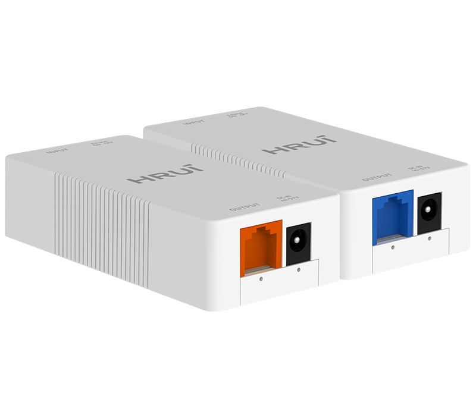
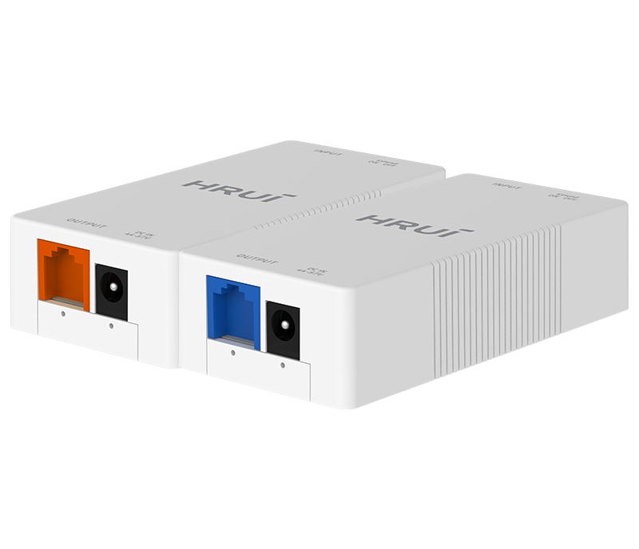
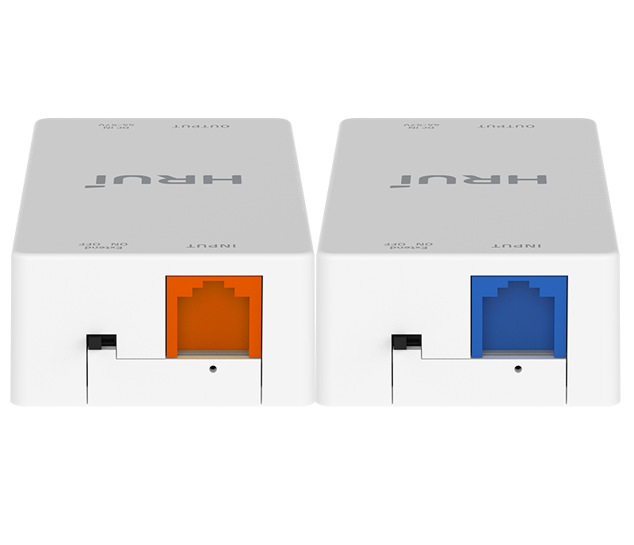
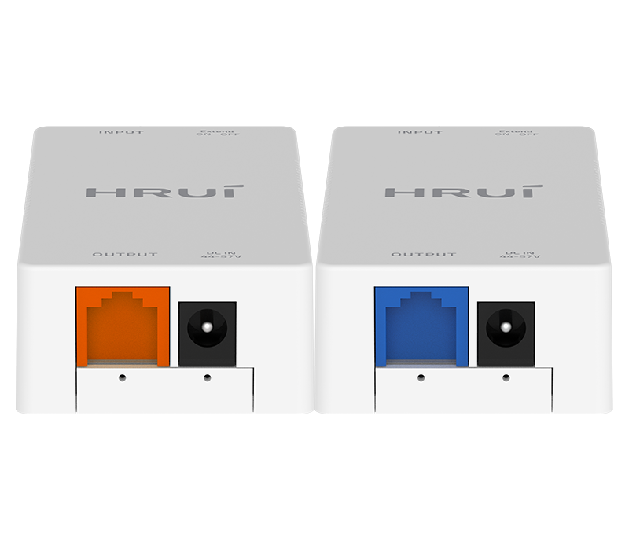

# HR-PE08-SV+ & HR-PE08-IPC+

> 来源：<https://www.hruitech.com/poe-accessory/156.html>（抓取 2026-10-21T03:45:55Z；英文原文照录，中文仅为栏目名）  
> 官网描述：HRUI 100Mbps Ethernet PoE Extender | HR-PE08-SV+ HR-PE08-IPC  
> 类目：PoE Accessory（site id 156）  
> 接口：1 *100 Mbps PoE in port / 1 *100Mbps PoE out port；PoE 预算 30W；交换带宽 —；电源 —

**Brief:** The HR-PE08-SV+ and HR-PE08-IPC+ are advanced 100Mbps Ethernet PoE extenders designed to enhance your network connectivity and power solutions. These extenders allow for seamless data transmission and power delivery over long distances, making them ideal for expanding your network infrastructure, especially in remote locations where power outlets may be limited. With robust connectivity features and compliance with industry standards, these extenders offer a reliable solution for both home and industrial applications.

## 产品图





## Datasheet
- [HR_PE08_SV_HR_PE08_IPC.pdf](https://www.hruitech.com/web/userfiles/productfile/HR_PE08_SV_HR_PE08_IPC.pdf) （本地：`data/hrui_site_raw/downloads/HR_PE08_SV_HR_PE08_IPC.pdf`；文本：`data/hrui_site_raw/datasheet_text/HR_PE08_SV_HR_PE08_IPC.txt`）

## Feature and Benefits（原文）
```
The HR-PE08-SV+ and HR-PE08-IPC+ are advanced 100Mbps Ethernet PoE extenders designed to enhance your network connectivity and power solutions. These extenders allow for seamless data transmission and power delivery over long distances, making them ideal for expanding your network infrastructure, especially in remote locations where power outlets may be limited. With robust connectivity features and compliance with industry standards, these extenders offer a reliable solution for both home and industrial applications.
Product Features:
Dual Ports:
1 x 100Mbps PoE Input Port and 1 x 100Mbps PoE Output Port for versatile connectivity options.
Standards Compliance:
Adheres to IEEE 802.3, IEEE 802.3u, and IEEE 802.3x standards, ensuring compatibility with a wide range of network devices.
Power Supply Support:
Fully compatible with the IEEE 802.3af/at power supply standards, allowing you to power PoE-capable devices directly through the Ethernet cable.
Extended Transmission Range:
Capable of extending transmission distances up to 800 meters, perfect for large installations or challenging layouts.
Network and PoE Expansion:
Facilitates both network and PoE expansion, significantly increasing your network’s scalability and flexibility.
The HRUI 100Mbps Ethernet PoE Extender greatly improves network performance by expanding both network and Power over Ethernet (PoE) capabilities. Featuring support for 100Mbps PoE input and output ports, this device ensures stable and efficient network connections. It adheres to IEEE standards, including IEEE 802.3af and IEEE 802.3at, providing a safe and reliable power supply for a variety of devices.
Additionally, this PoE extender can transmit signals up to 800 meters, making it an excellent choice for connecting devices at a distance. Whether in office settings, surveillance systems, or smart city projects, the HRUI Gigabit Ethernet PoE Extender meets the requirements for long-range network transmission, offering users flexible and convenient options for network setup. By utilizing this device, users can easily power and send data to remote devices without the need for extra power cables, resulting in cost savings and enhanced installation efficiency.
PRODUCT FEATURES
• IEEE 802.3af/at
The extender is compatible with IEEE802.af/at PoE devices, making it a versatile solution for PoE cameras, PoE switches, wireless access points, and more.
• Super Long Range Transmission Distance
The PoE extender features a simple one-key activation for extend mode, which allows for an increased distance limit from 100 meters to 800 meters, offering a total PoE+ network extension of 1000 meters.
• 4KV Surge Protection
• Flexible and Convenient Installation
Support 4KV surge protection to ensure long-lasting performance.
Support desktop/wall mounting.
• Compact Size
• Plug and Play
The PoE extender features a compact design, saving installation space.
The PoE extender is designed for easy installation with a plug-and-play design, which requires no software or configuration.
```

## Parameter（规格表逐行）
| 项 | 值 |
|---|---|
| • 4KV Surge Protection | • Flexible and Convenient Installation |
| Support 4KV surge protection to ensure long-lasting performance. | Support desktop/wall mounting. |
| • Compact Size | • Plug and Play |
| The PoE extender features a compact design, saving installation space. | The PoE extender is designed for easy installation with a plug-and-play design, which requires no software or configuration. |
| Description | Specification |
| Model | HR-PE08-SV+HR-PE08-IPC+ |
| Interface | 1 *100 Mbps PoE in port |
| Interface | 1 *100Mbps PoE out port |
| Port Standard | IEEE802.3 (Ethernet) |
| Port Standard | IEEE802.3u (Fast Ethernet) |
| Port Standard | IEEE802.3x (Flow Control) |
| Switching Capacity | 0.4Gbps |
| Packet Forwarding Rate | 0.297Mpps |
| MAC Address Table | 2K |
| Transmission Method | Store and Forward |
| PoE Standard | IEEE802.3af （15.4W） |
| PoE Standard | IEEE802.3at （30W） |
| PoE Port Output Voltage | DC 44-57V |
| PoE Port | Port PoE power output <30W |
| PoE Power Budget | 30W |
| Structure Information | Product Dimensions :100*49*25mm |
| Structure Information | Packaging Dimensions : 102*50*27mm |
| Structure Information | Product Net Weight:0.060KG |
| Structure Information | Product Gross Weight:0.065KG |
| Packing Information | Carton Dimensions :430*295*275mm |
| Packing Information | Packing Quantity: 200PCS |
| Packing Information | Packing Weight: 14KG |
| Package Contents | Extender 1pcs,manual 1pcs，certificate of qualification 1pcs |
| Installation | Desktop |
| Surge Protection | Port Surge: common mode 4KV, differential mode 2KV Electronic ESD: air 8KV |
| Operating Temperature | 0~40°C |
| Storage Temperature | -40 °C to 70 °C |
| Operation Humidity | 10%~90%，non condensing |
| Storage Humidity | 5%~95%，non condensing |
| Extend Button | ON: Normal mode, transmission distance is within 100 meters |
| Extend Button | Extend: Link extension mode, PoE power supply and data transmission distance can be extended to 800 meters, transmission speed is 10Mbps |
| Port Led | On:Link normal |
| Port Led | Off: Link blocked |
| Port Led | Blinking: Data transmitting |

## Product structure / Application topology（图）
- https://www.hruitech.com/web/userfiles/image/20241223/1734945892661363.png
- https://www.hruitech.com/web/userfiles/product/productdetail/HR_PE08_SV_HR_PE08_IPC/top8.jpg
