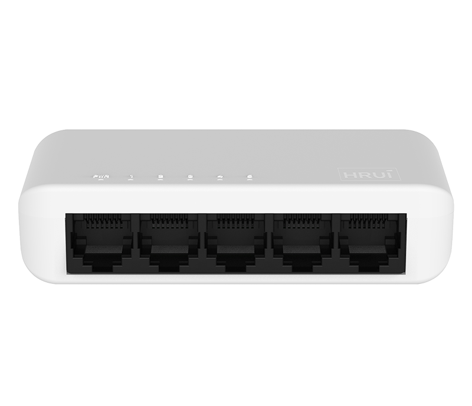
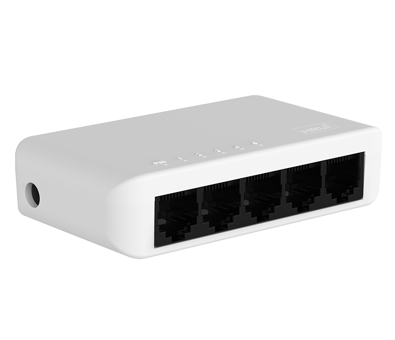
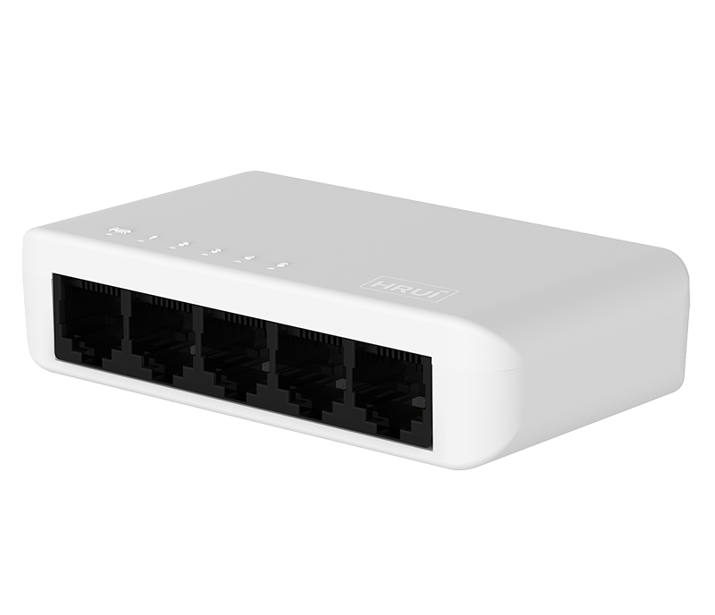

# HR-SWG0050+

> 来源：<https://www.hruitech.com/ethernet-switch/142.html>（抓取 2026-10-21T04:36:00Z；英文原文照录，中文仅为栏目名）  
> 官网描述：5-Port 10/100/1000T Ethernet Switch   
> 类目：Ethernet Switch（site id 142）  
> 接口：5 *1000Mbps RJ45 ports；PoE 预算 —；交换带宽 —；电源 AC 100-240V , 50/60Hz / DC 5V 1A

**Brief:** Full Gigabit intelligent plastic Ethernet switch, with 5*Gigabit RJ45 ports, bandwidth 10Gbps, suitable for -10~50℃ wide temperature environment.

## 产品图





## Datasheet
- [HR_SW0050-2B.pdf](https://www.hruitech.com/web/userfiles/productfile/HR_SW0050-2B.pdf) （本地：`data/hrui_site_raw/datasheets/HR_SW0050-2B.pdf`；文本：`data/hrui_site_raw/datasheet_text/HR_SW0050-2B.txt`）

## Feature and Benefits（原文）
```
HR-SWG0050+, a high-performance Ethernet switch designed for seamless connectivity and exceptional reliability. This full Gigabit switch features five 1000Mbps RJ45 ports, providing a combined bandwidth of up to 10Gbps. Built to operate efficiently in a wide temperature range of -10 to 50°C, this switch is perfect for both home and office networking needs.
With its exceptional performance and advanced features, the HR-SWG0050+ is the perfect solution for home offices, small businesses, and any environment in need of a reliable Gigabit Ethernet switch.
Product Features:
5 Gigabit RJ45 Ports:
Each port supports speeds of up to 1000Mbps for lightning-fast data transfer.
Standards Compliance:
Fully compliant with IEEE802.3, IEEE802.3u, IEEE802.3az, and IEEE802.3ab standards for optimal interoperability and performance.
Adaptive Ports:
Each RJ45 port supports adaptive speeds of 100Mbps and 1000Mbps, providing versatility for different network requirements.
Auto MDI/MDIX Support:
Automatically detects and configures the connection type, simplifying installation and reducing configuration errors.
Integrated Status Monitoring:
Integrated indicator lights provide real-time monitoring of the operating status, assisting in quick fault analysis and troubleshooting.
Efficient Flow Control:
IEEE802.3x standard for full duplex flow control and Backpressure standard for half duplex, enhancing data transmission reliability.
```

## Parameter（规格表逐行）
| 项 | 值 |
|---|---|
| Description | Specification |
| Model | HR-SWG0050+ |
| Interface | 5 *1000Mbps RJ45 ports |
| Port Standard | IEEE802.3 (Ethernet) |
| Port Standard | IEEE802.3u (Fast Ethernet) |
| Port Standard | IEEE802.3x (Flow Control) |
| Port Standard | IEEE802.3ab (Gigabit Ethernet) |
| Port Standard | IEEE802.3az(Energy Efficient Ethernet) |
| Switching Capacity | 10Gbps |
| Packet Forwarding Rate | 7.44Mpps |
| Packet Buffer | 384Kbyte |
| MAC Address Table | 2K |
| Transmission Method | Store and Forward |
| Power Supply | AC 100-240V , 50/60Hz |
| Power Supply | DC 5V 1A |
| Mainboard Power Consumption | 2.1W |
| Structure Information | Product Dimensions :92*51*21.5mm |
| Structure Information | Packaging Dimensions: 93*82*51mm |
| Structure Information | Product Net Weight: 0.062Kg |
| Structure Information | Product Gross Weight: 0.132Kg |
| Packing Information | Carton Dimensions: 435*280*395mm |
| Packing Information | Packing Quantity: 100PCS |
| Packing Information | Packing Weight: 14.2KG |
| Package Contents | Switch 1pcs, Power adapter 1pcs, manual 1pcs，certificate of qualification 1pcs |
| Fan Quantity | 0 |
| Installation | Desktop |
| Surge Protection | / |
| Operating Temperature | 0~40°C |
| Storage Temperature | -40 °C to 70 °C |
| Operation Humidity | 10%~90%，non condensing |
| Storage Humidity | 5%~95%，non condensing |
| PWR | On: Powered on |
| PWR | Off: Powered off |
| 1-5 port | On:Link normal |
| 1-5 port | Off: Link blocked |
| 1-5 port | Blinking: Data transmitting |

## Product structure / Application topology（图）
- https://www.hruitech.com/web/userfiles/image/20241230/1735521673843142.png
