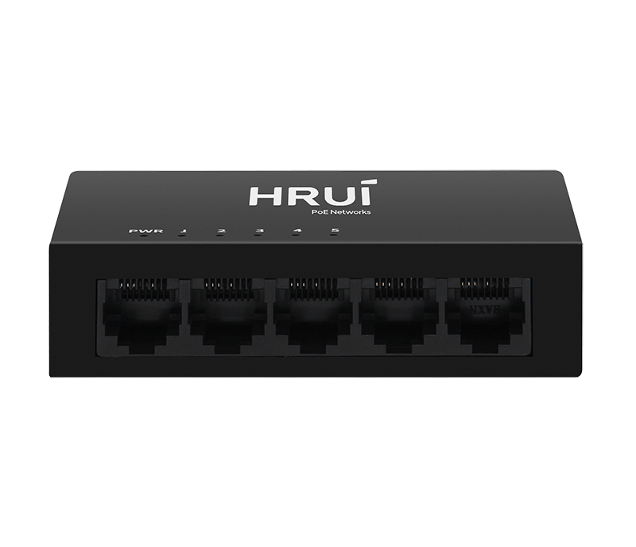
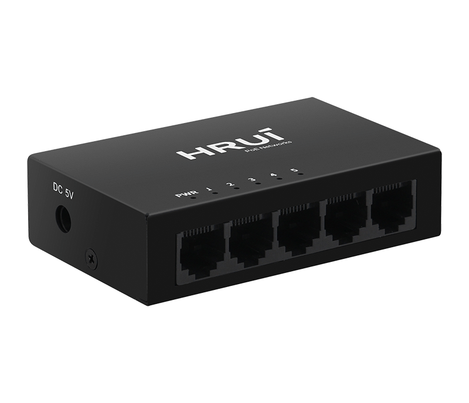
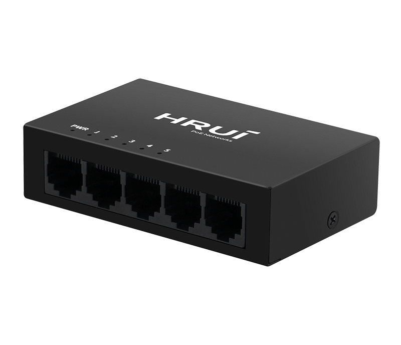
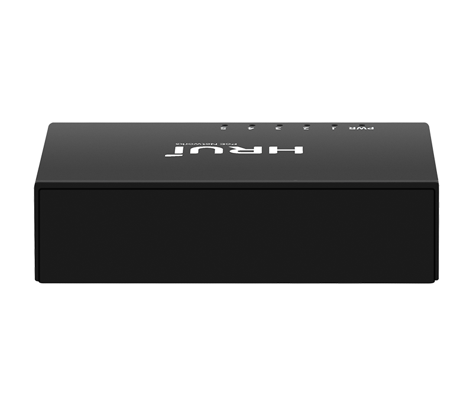

# HR-SWG0050-M

> 来源：<https://www.hruitech.com/ethernet-switch/133.html>（抓取 2026-10-21T04:36:01Z；英文原文照录，中文仅为栏目名）  
> 官网描述：5-Port 10/100/1000T Ethernet Switch   
> 类目：Ethernet Switch（site id 133）  
> 接口：5 *1000Mbps RJ45 ports；PoE 预算 —；交换带宽 —；电源 AC 100-240V , 50/60Hz / DC 5V 1A

**Brief:** The 5-port Gigabit intelligent Ethernet switch adopts high-quality and high-speed network ICs, and this product completely solves the problem of noise of small switches in the office environment through the fanless mute design. This switch has 5 Gigabit RJ45 ports, can provide seamless connection for 10/100/1000M Ethernet, the product can be widely used in Security network video surveillance, hotel, campus, small and medium-sized enterprise network engineering and other occasions.

## 产品图





## Datasheet
- [HR_SWG0050_M.pdf](https://www.hruitech.com/web/userfiles/productfile/HR_SWG0050_M.pdf) （本地：`data/hrui_site_raw/datasheets/HR_SWG0050_M.pdf`；文本：`data/hrui_site_raw/datasheet_text/HR_SWG0050_M.txt`）

## Feature and Benefits（原文）
```
The 5-Port Gigabit Intelligent Ethernet Switch is designed with premium, high-speed network integrated circuits (ICs), ensuring optimal performance. Its innovative fanless mute design effectively eliminates the noise commonly associated with small switches, making it an ideal choice for office environments.
Equipped with five Gigabit RJ45 ports, this switch provides seamless connectivity for 10/100/1000M Ethernet, enabling efficient data transfer. It is exceptionally versatile, making it suitable for various applications, including security network video surveillance, hospitality settings, educational campuses, and small to medium-sized enterprise network deployments. Enjoy reliable connectivity and a quieter workspace with this advanced Ethernet switch.
Product Features:
5 x 1000Mbps RJ45 Ports:
Experience high-speed data transfer across multiple devices.
Compliance with IEEE Standards:
Fully compliant with IEEE802.3, IEEE802.3u, IEEE802.3az, and IEEE802.3ab standards for optimal compatibility and performance.
Adaptive RJ45 Ports:
Each port supports adaptive speeds of 100/1000Mbps for flexible connectivity options.
Automatic Port Flipping:
Simplify your setup with Auto MDI/MDIX, which detects and optimizes the connection automatically.
Panel Indicator Lights:
Easily monitor the working status of each port, assisting in real-time fault analysis.
Advanced Flow Control:
Incorporates IEEE802.3x standard for full duplex and Backpressure standard for half duplex, ensuring efficient data handling and reduced packet loss.
```

## Parameter（规格表逐行）
| 项 | 值 |
|---|---|
| Description | Specification |
| Model | HR-SWG0050-M |
| Interface | 5 *1000Mbps RJ45 ports |
| Port Standard | IEEE802.3 (Ethernet) |
| Port Standard | IEEE802.3u (Fast Ethernet) |
| Port Standard | IEEE802.3x (Flow Control) |
| Port Standard | IEEE802.3ab (Gigabit Ethernet) |
| Port Standard | IEEE802.3az(Energy Efficient Ethernet) |
| Switching Capacity | 10Gbps |
| Packet Forwarding Rate | 7.44Mpps |
| Packet Buffer | 3Mbit |
| MAC Address Table | 2K |
| Transmission Method | Store and Forward |
| Power Supply | AC 100-240V , 50/60Hz |
| Power Supply | DC 5V 1A |
| Mainboard Power Consumption | 2.1W |
| Structure Information | Product Dimensions: 87*54*23mm |
| Structure Information | Packaging Dimensions: 90*88*58mm |
| Structure Information | Product Net Weight: 0.13Kg |
| Structure Information | Product Gross Weight: 0.20Kg |
| Packing Information | Carton Dimensions: 470*320*380mm |
| Packing Information | Packing Quantity: 100PCS |
| Packing Information | Packing Weight: 21KG |
| Package Contents | Switch 1pcs, Power adapter 1pcs, manual 1pcs，certificate of qualification 1pcs |
| Fan Quantity | 0 |
| Installation | desktop |
| Surge Protection | Surge protection: common mode 2KV, differential mode 1KV (Class C); Electrostatic ESD: air 4KV, contact 3KV (Class C) |
| Operating Temperature | 0~40°C |
| Storage Temperature | -40 °C to 70 °C |
| Operation Humidity | 10%~90%，non condensing |
| Storage Humidity | 5%~95%，non condensing |
| PWR | On: Powered on |
| PWR | Off: Powered off |
| 1-5 port | On: Link normal |
| 1-5 port | Off: Link blocked |
| 1-5 port | Blinking: Data transmitting |

## Product structure / Application topology（图）
- https://www.hruitech.com/web/userfiles/image/20241230/1735523378903480.png
