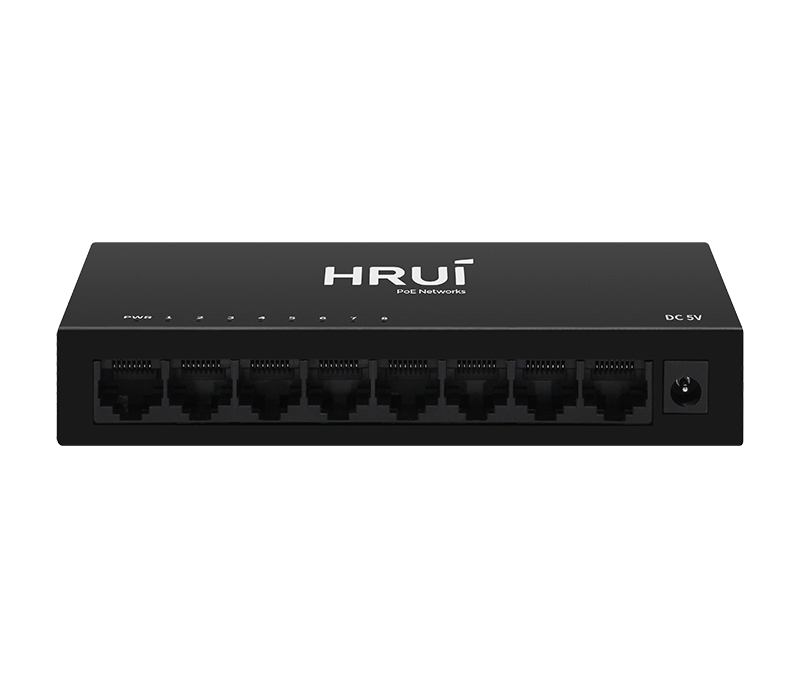
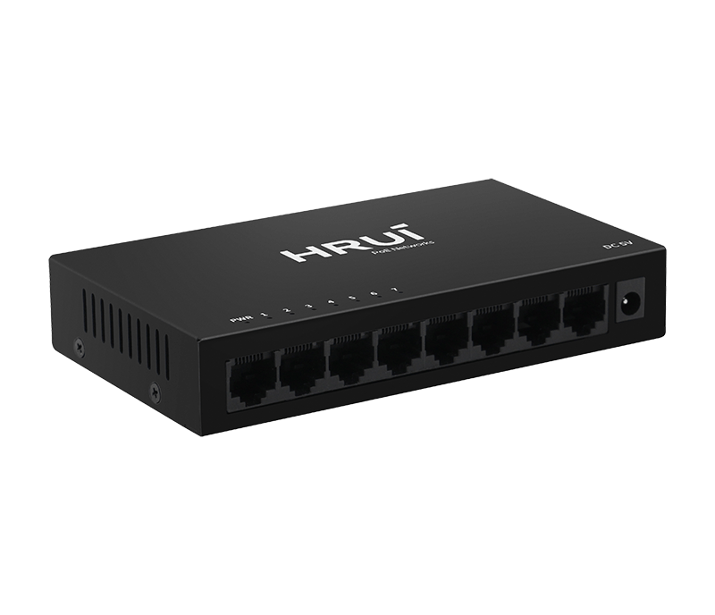
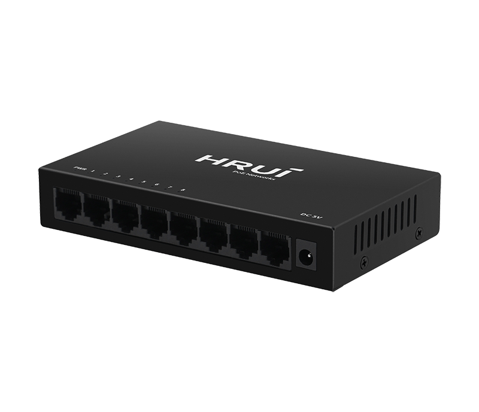
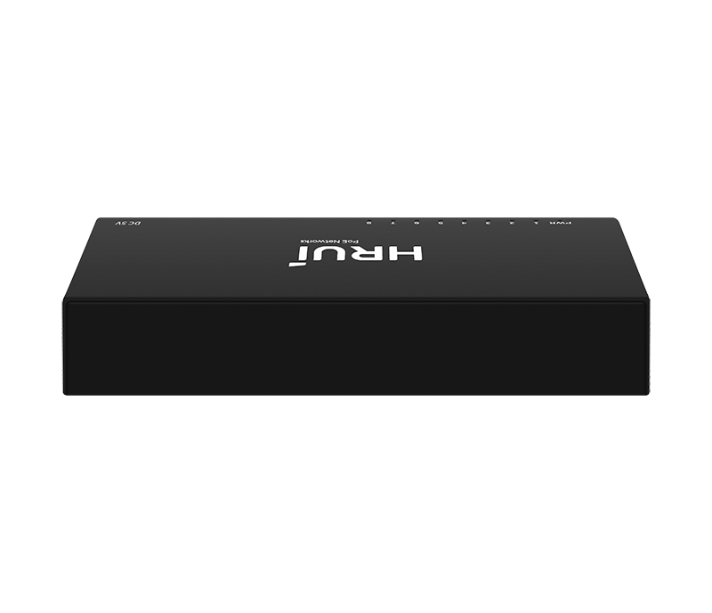

# HR-SWG0080

> 来源：<https://www.hruitech.com/ethernet-switch/134.html>（抓取 2026-10-21T04:35:59Z；英文原文照录，中文仅为栏目名）  
> 官网描述：8-Port 10/100/1000T Ethernet Switch  
> 类目：Ethernet Switch（site id 134）  
> 接口：8 *1000Mbps RJ45 ports；PoE 预算 —；交换带宽 —；电源 AC 100-240V , 50/60Hz / DC 5V 1A

**Brief:** The 8-port Gigabit intelligent Ethernet switch adopts high-quality and high-speed network ICs, and this product completely solves the problem of noise of small switches in the office environment through the fanless mute design. This switch has 8 Gigabit RJ45 ports, can provide seamless connection for 10/100/1000M Ethernet, the product can be widely used in Security network video surveillance, hotel, campus, small and medium-sized enterprise network engineering and other occasions.

## 产品图





## Datasheet
- [HR_SWG0080.pdf](https://www.hruitech.com/web/userfiles/productfile/HR_SWG0080.pdf) （本地：`data/hrui_site_raw/datasheets/HR_SWG0080.pdf`；文本：`data/hrui_site_raw/datasheet_text/HR_SWG0080.txt`）

## Feature and Benefits（原文）
```
HRUI advanced 8-Port Gigabit Intelligent Ethernet Switch, designed with top-tier performance and cutting-edge technology. This high-speed switch utilizes premium network ICs to deliver unparalleled connectivity while completely eliminating the noise commonly associated with smaller switches, thanks to its innovative fanless, silent operation.
Equipped with 8 Gigabit RJ45 ports, this versatile switch ensures a seamless connection across various Ethernet speeds—10, 100, and 1000 Mbps. Its robust capabilities make it an ideal solution for a wide range of applications, including security network video surveillance, hotel connectivity, campus networks, and small to medium-sized enterprise networking.
Product Features:
8 x 1000 Mbps RJ45 Ports:
Experience lightning-fast data transfers and reliable connections.
Standards Compliance:
Fully compliant with IEEE 802.3, IEEE 802.3u, IEEE 802.3az, and IEEE 802.3ab standards to guarantee compatibility across different devices.
Adaptive Port Support:
Each RJ45 port automatically adjusts to 100 or 1000 Mbps speeds, ensuring optimal performance without manual intervention.
Auto MDI/MDIX:
Enjoy hassle-free installation and connectivity with support for automatic port flipping, eliminating crossover cables.
Status Monitoring:
Panel indicator lights provide real-time insights into the working status of the switch, aiding in efficient fault diagnosis.
Flow Control:
Incorporates IEEE 802.3x flow control for full duplex and Backpressure standard for half-duplex transmission, maintaining data integrity and network stability.
```

## Parameter（规格表逐行）
| 项 | 值 |
|---|---|
| Description | Specification |
| Model | HR-SWG0080 |
| Interface | 8 *1000Mbps RJ45 ports |
| Port Standard | IEEE802.3 (Ethernet) |
| Port Standard | IEEE802.3u (Fast Ethernet) |
| Port Standard | IEEE802.3x (Flow Control) |
| Port Standard | IEEE802.3ab (Gigabit Ethernet) |
| Port Standard | IEEE802.3az(Energy Efficient Ethernet) |
| Switching Capacity | 16Gbps |
| Packet Forwarding Rate | 11.9Mpps |
| Packet Buffer | 4Mbit |
| MAC Address Table | 8K |
| Transmission Method | Store and Forward |
| Power Supply | AC 100-240V , 50/60Hz |
| Power Supply | DC 5V 1A |
| Mainboard Power Consumption | 3.77W |
| Structure Information | Product Dimensions :138*78*25mm |
| Structure Information | Packaging Dimensions :175*120*63mm |
| Structure Information | Product Net Weight: 0.24Kg |
| Structure Information | Product Gross Weight:0.37Kg |
| Packing Information | Carton Dimensions :520*335*380mm |
| Packing Information | Packing Quantity: 40PCS |
| Packing Information | Packing Weight: 15.8KG |
| Package Contents | Switch 1pcs, Power adapter 1pcs, manual 1pcs，certificate of qualification 1pcs |
| Fan Quantity | 0 |
| Installation | desktop |
| Surge Protection | Surge protection: common mode 2KV, differential mode 1KV (Class A); Electrostatic ESD: air 4KV, contact 3KV (Class C) |
| Operating Temperature | 0~40°C |
| Storage Temperature | -40 °C to 70 °C |
| Operation Humidity | 10%~90%，non condensing |
| Storage Humidity | 5%~95%，non condensing |
| PWR | On: Powered on |
| PWR | Off: Powered off |
| 1-8 port | On:Link normal |
| 1-8 port | Off: Link blocked |
| 1-8 port | Blinking: Data transmitting |

## Product structure / Application topology（图）
- https://www.hruitech.com/web/userfiles/image/20241230/1735523275152390.png
