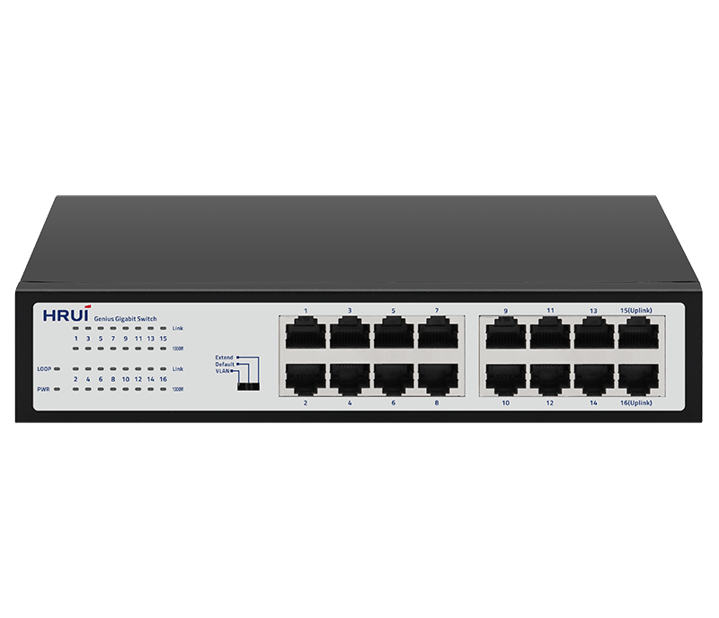
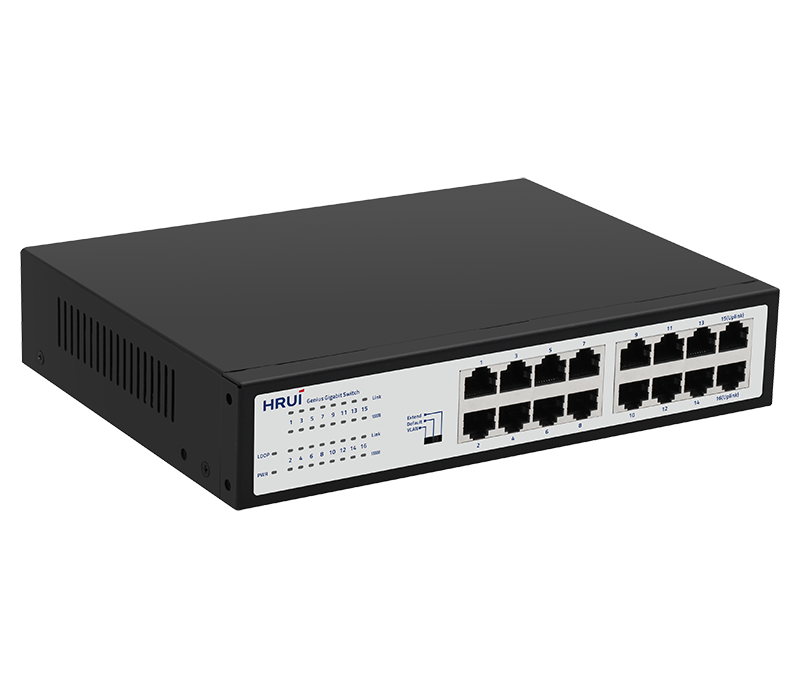
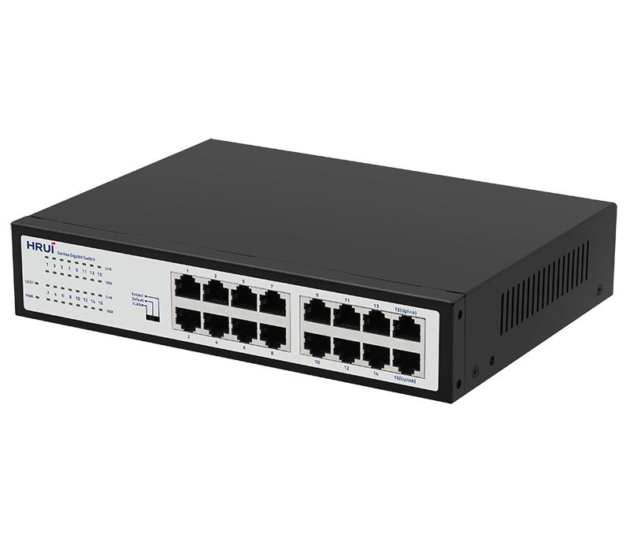
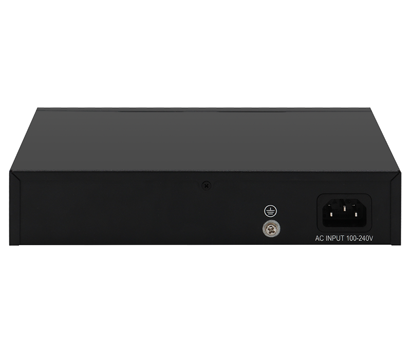

# HR-SWG10160D-M

> 来源：<https://www.hruitech.com/ethernet-switch/275.html>（抓取 2026-10-21T04:35:53Z；英文原文照录，中文仅为栏目名）  
> 官网描述：16-Port 10/100/1000T Ethernet Switch   
> 类目：Ethernet Switch（site id 275）  
> 接口：16 *1G RJ45 ports；PoE 预算 —；交换带宽 —；电源 AC 100-240V , 50/60Hz / DC 12V 1A

**Brief:** Enhance your network performance with the HR-SWG10160D-M 16-Port Gigabit Ethernet Switch. Designed for seamless connectivity and superior data transfer rates, this robust switch is perfect for both small and medium-sized businesses, as well as home networks. With its advanced features and user-friendly design, you can ensure efficient network management and optimal usage of your bandwidth.

## 产品图





## Datasheet
- [HR_SWG10160D_M.pdf](https://www.hruitech.com/web/userfiles/productfile/HR_SWG10160D_M.pdf) （本地：`data/hrui_site_raw/datasheets/HR_SWG10160D_M.pdf`；文本：`data/hrui_site_raw/datasheet_text/HR_SWG10160D_M.txt`）

## Feature and Benefits（原文）
```
Enhance your network performance with the HR-SWG10160D-M 16-Port Gigabit Ethernet Switch. Designed for seamless connectivity and superior data transfer rates, this robust switch is perfect for both small and medium-sized businesses, as well as home networks. With its advanced features and user-friendly design, you can ensure efficient network management and optimal usage of your bandwidth.
Product Features:
16 Gigabit RJ45 Ports:
Equipped with 16 high-speed 1G RJ45 ports for a robust and scalable network solution.
Industry Standards Compliance:
Fully compliant with IEEE802.3, IEEE802.3u, and IEEE802.3ab standards to ensure compatibility and reliability.
Port Adaptation:
Each RJ45 port supports automatic adaptation to 10M, 100M, and 1G speeds, ensuring optimal performance for all connected devices.
Auto MDI/MDIX Technology:
Automatically detects and configures the appropriate cable type, eliminating the need for manual crossover cables.
LED Status Indicators:
Convenient panel LED indicators provide real-time monitoring of working status, simplifying fault diagnosis and management.
Multiple Operating Modes:
Supports VLAN, Default, and Extend modes for versatile networking options tailored to your specific needs.
Advanced Flow Control:
Adopts IEEE802.3x standard for full-duplex flow control and Backpressure standard for half-duplex, ensuring a stable data transfer environment.
Quality of Service (QoS):
Ports 1-8 are equipped with QoS data priority support, optimizing network performance for critical applications.
Loop Alarm Feature:
Integrated loop alarm functionality helps detect and alert users of loop issues, enhancing network reliability.
```

## Parameter（规格表逐行）
| 项 | 值 |
|---|---|
| Description | Specification |
| Model | HR-SWG10160D-M |
| Interface | 16 *1G RJ45 ports |
| Port Standard | IEEE802.3 (Ethernet) |
| Port Standard | IEEE802.3u (Fast Ethernet) |
| Port Standard | IEEE802.3ab (Gigabit Ethernet) |
| Port Standard | IEEE802.3x (Flow Control) |
| Bandwidth | 32Gbps |
| Packet Forwarding Rate | 23.8Mpps |
| Packet Buffer | 4.1Mbit |
| MAC Address Table | 8K |
| Transmission Method | Store and Forward |
| Power Supply | AC 100-240V , 50/60Hz |
| Power Supply | DC 12V 1A |
| Mainboard Power Consumption | 6.78W |
| Structure Information | Product Dimensions :220*161*44.5mm |
| Structure Information | Packaging Dimensions :315*215*85mm |
| Structure Information | Product Net Weight:0.90KG |
| Structure Information | Product Gross Weight:1.42KG (with hanging ears) 1.24KG (without hanging ears) |
| Packing Information | Carton Dimensions :445*445*335mm |
| Packing Information | Packing Quantity: 10PCS |
| Packing Information | Packing Weight: 15.2KG (with hanging ears) 13.4KG (without hanging ears) |
| Package Contents | Switch 1pcs, power cord 1pcs, manual 1pcs,certificate of qualification 1pcs |
| Fan Quantity | 0 |
| Installation | Desktop |
| Surge Protection | Port Surge: Common mode 4KV, differential mode 2KV |
| Surge Protection | Electrostatic ESD: Air 8KV, Contact 6KV |
| Operating Temperature | 0~40°C |
| Storage Temperature | -40 °C to 70 °C |
| Operation Humidity | 10%~90%,non condensing |
| Storage Humidity | 5%~95%,non condensing |
| PWR LED | Green LED On: Powered on |
| PWR LED | Green LED Off: Powered off |
| Loop LED | Green LED On:Closed loop |
| Loop LED | Green LED Off: Not looped |
| Link LED | Green LED On:10M/100M link normal |
| Link LED | Green LED Off: Link blocked |
| Link LED | Flashing: Data transmitting |
| 1000M LED | Green LED On:1G Link normal |
| 1000M LED | Green LED Off:10/100M Link normal |
| 1000M LED | Flashing: Data transmitting |
| VLAN/Default/Extend Modes Buttons | VLAN (port isolation): 1-14 ports are isolated from each other and all communicate with 15-16 ports; |
| VLAN/Default/Extend Modes Buttons | Default (default mode): All ports communicate with each other; |
| VLAN/Default/Extend Modes Buttons | Extend (monitoring mode): 1-14 ports support 100Mbps speed reduction negotiation, support 250 meters in 10Mbps mode, and 15/16 ports serve as aggregation; |

## Product structure / Application topology（图）
- https://www.hruitech.com/web/userfiles/image/20250208/1738984341528173.png
