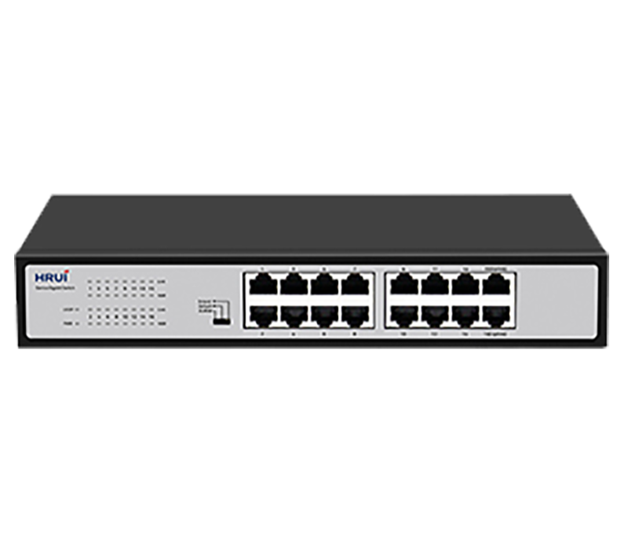
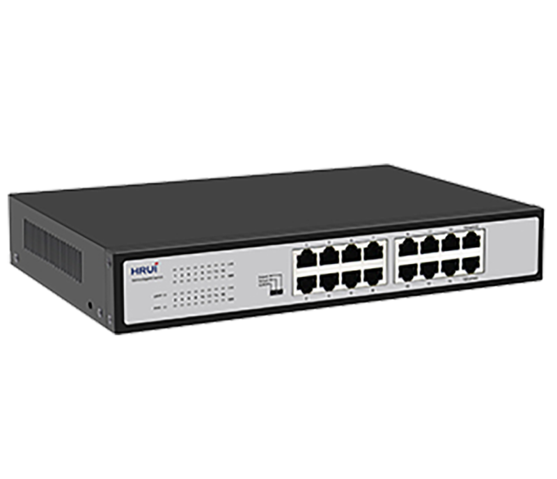
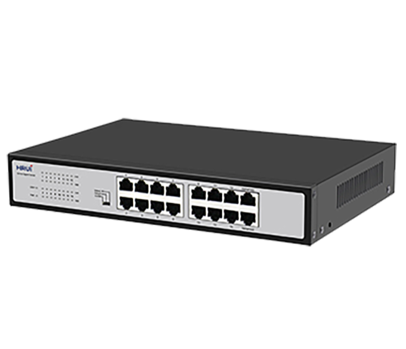
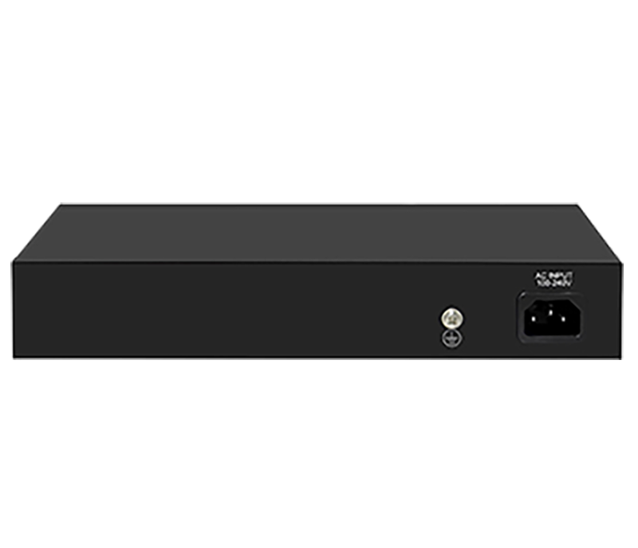

# HR-SWG10160D

> 来源：<https://www.hruitech.com/ethernet-switch/189.html>（抓取 2026-10-21T04:35:52Z；英文原文照录，中文仅为栏目名）  
> 官网描述：16-Port 10/100/1000T Ethernet Switch   
> 类目：Ethernet Switch（site id 189）  
> 接口：16 *1G RJ45 ports；PoE 预算 —；交换带宽 —；电源 AC 100-240V , 50/60Hz / DC 12V 2A

**Brief:** Full Gigabit intelligent Ethernet switch, with 16*Gigabit RJ45 ports, bandwidth 32Gbps, surpport port isolation and 250m transmission, surpport QoS data priority and loop alarm, suitable for -10~50℃ wide temperature environment

## 产品图





## Datasheet
- [HR_SWG10160D.pdf](https://www.hruitech.com/web/userfiles/productfile/HR_SWG10160D.pdf) （本地：`data/hrui_site_raw/datasheets/HR_SWG10160D.pdf`；文本：`data/hrui_site_raw/datasheet_text/HR_SWG10160D.txt`）

## Feature and Benefits（原文）
```
The HR-SWG10160D is a high-performance, Full Gigabit intelligent Ethernet switch featuring 16 Gigabit RJ45 ports. With a robust bandwidth of 32 Gbps, this switch is engineered for optimal network performance. It supports advanced features such as port isolation and a remarkable 250-meter transmission range, making it ideal for various applications. Designed to operate effectively in a wide temperature range of -10°C to 50°C, it ensures reliable connectivity in diverse environments. The switch also includes Quality of Service (QoS) for data prioritization and a loop alarm feature to enhance network reliability.
Product Features:
16 Gigabit RJ45 Ports:
Offers high-speed connectivity for multiple devices.
Standards Compliance:
Fully adheres to IEEE802.3, IEEE802.3u, and IEEE802.3ab standards for reliable performance.
Dynamic Adaptability:
Each RJ45 port supports automatic adaptation to 10/100/1000Mbps speed.
Auto MDI/MDIX:
Automatic port flipping for simplified connections.
Status Monitoring:
Easy-to-read panel LEDs provide real-time monitoring of operational status and aid in quick fault diagnosis.
Multiple Operating Modes:
Supports VLAN, Default, and Extended modes for flexible network management.
Flow Control Methods:
Adopts IEEE802.3x standard for full-duplex and Backpressure standard for half-duplex flow control, ensuring optimal data traffic management.
QoS Data Prioritization:
Ports 1-8 support QoS, allowing for prioritization of critical data traffic to enhance overall network performance.
Loop Alarm Functionality:
Built-in loop alarm feature to quickly identify and resolve network loops, ensuring uninterrupted service.
```

## Parameter（规格表逐行）
| 项 | 值 |
|---|---|
| Description | Specification |
| Model | HR-SWG10160D |
| Interface | 16 *1G RJ45 ports |
| Port Standard | IEEE802.3 (Ethernet) |
| Port Standard | IEEE802.3u (Fast Ethernet) |
| Port Standard | IEEE802.3ab (Gigabit Ethernet) |
| Port Standard | IEEE802.3x (Flow Control) |
| Bandwidth | 32Gbps |
| Packet Forwarding Rate | 23.8Mpps |
| Packet Buffer | 4.1Mbit |
| MAC Address Table | 8K |
| Transmission Method | Store and Forward |
| Power Supply | AC 100-240V , 50/60Hz |
| Power Supply | DC 12V 2A |
| Mainboard Power Consumption | 6.78W |
| Structure Information | Product Dimensions :270*180*45mm |
| Structure Information | Packaging Dimensions :312*262*84mm |
| Structure Information | Product Net Weight:1.0KG |
| Structure Information | Product Gross Weight:1.5KG |
| Packing Information | Carton Dimensions :540*435*332mm |
| Packing Information | Packing Quantity: 10PCS |
| Packing Information | Packing Weight: 16.5KG |
| Package Contents | Switch 1pcs, power cord 1pcs, manual 1pcs,certificate of qualification 1pcs |
| Fan Quantity | 0 |
| Installation | Desktop |
| Surge Protection | Port Surge: Common mode 4KV, differential mode 2KV |
| Surge Protection | Electrostatic ESD: Air 8KV, Contact 6KV |
| Operating Temperature | 0~40°C |
| Storage Temperature | -40 °C to 70 °C |
| Operation Humidity | 10%~90%,non condensing |
| Storage Humidity | 5%~95%,non condensing |
| PWR LED | Green LED On: Powered on |
| PWR LED | Green LED Off: Powered off |
| Loop LED | Green LED On:Closed loop |
| Loop LED | Green LED Off: Not looped |
| Link LED | Green LED On:Link normal |
| Link LED | Green LED Off: Link blocked |
| Link LED | Flashing: Data transmitting |
| 1000M LED | Green LED On:1G Link normal |
| 1000M LED | Green LED Off:10/100M Link normal |
| 1000M LED | Flashing: Data transmitting |
| VLAN/Default/Extend Modes Buttons | VLAN (port isolation): 1-14 ports are isolated from each other and all communicate with 15-16 ports; |
| VLAN/Default/Extend Modes Buttons | Default (default mode): All ports communicate with each other; |
| VLAN/Default/Extend Modes Buttons | Extend (monitoring mode): 1-14 ports support 100Mbps speed reduction negotiation, support 250 meters in 10Mbps mode, and 15/16 ports serve as aggregation; |

## Product structure / Application topology（图）
- https://www.hruitech.com/web/userfiles/image/20241227/1735293582567906.png
