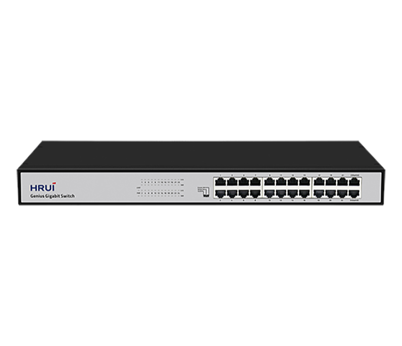
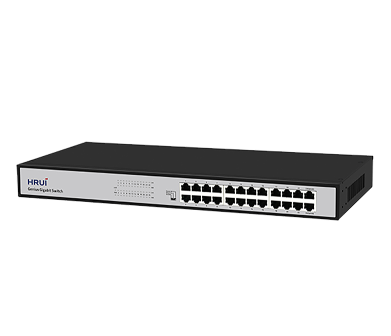
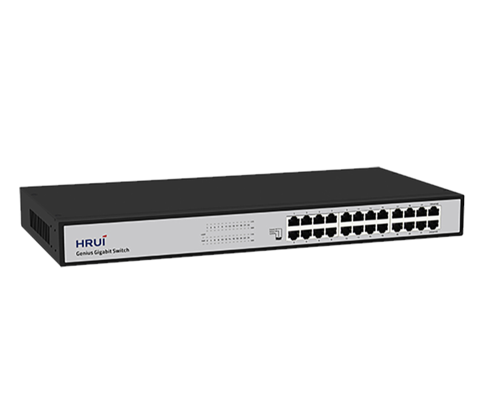
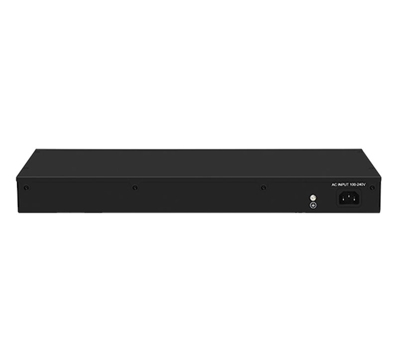

# HR-SWG10240

> 来源：<https://www.hruitech.com/ethernet-switch/192.html>（抓取 2026-10-21T04:35:47Z；英文原文照录，中文仅为栏目名）  
> 官网描述：24-Port 10/100/1000T Ethemet Switch   
> 类目：Ethernet Switch（site id 192）  
> 接口：24 *1G RJ45 ports；PoE 预算 —；交换带宽 —；电源 AC 100-240V , 50/60Hz / DC 12V 2A

**Brief:** Full Gigabit intelligent Ethernet switch, with 24*Gigabit RJ45 ports, bandwidth 48Gbps, surpport port isolation and 250m transmission, surpport QoS data priority and loop alarm, suitable for -10~50℃ wide temperature environment, 1U rack-mounted

## 产品图





## Datasheet
- [HR_SWG10240.pdf](https://www.hruitech.com/web/userfiles/productfile/HR_SWG10240.pdf) （本地：`data/hrui_site_raw/datasheets/HR_SWG10240.pdf`；文本：`data/hrui_site_raw/datasheet_text/HR_SWG10240.txt`）

## Feature and Benefits（原文）
```
The HR-SWG10240 is a high-performance, full gigabit intelligent Ethernet switch designed to meet the demands of modern networking environments. Featuring 24 Gigabit RJ45 ports, this switch offers an impressive bandwidth of 48 Gbps, ensuring smooth and efficient data transmission. It supports port isolation and boasts a transmission distance of up to 250 meters, making it ideal for a variety of applications. With Quality of Service (QoS) for data prioritization and loop alarm capabilities, this switch guarantees reliable and optimized network performance. It operates effectively in a wide temperature range of -10°C to 50°C and is designed for 1U rack-mounted installation.
Product Features:
24 Gigabit RJ45 Ports:
Equipped with 24 1G RJ45 ports for high-speed connectivity.
Standards Compliance:
Fully complies with IEEE802.3, IEEE802.3u, and IEEE802.3ab standards for enhanced interoperability.
Dynamic Adaptability:
Each RJ45 port supports automatic adaptation to 10/100/1000Mbps speed.
Auto MDI/MDIX:
Automatic port flipping for simplified connections.
Status Monitoring:
Easy-to-read panel LEDs provide real-time monitoring of operational status and aid in quick fault diagnosis.
Versatile VLAN Support:
Supports VLAN (Virtual Local Area Network) configurations in Default and Extend modes for efficient network segmentation.
Flow Control Methods:
Adopts IEEE802.3x standard for full-duplex and Backpressure standard for half-duplex flow control, ensuring optimal data traffic management.
QoS Data Prioritization:
Ports 1-8 support QoS, allowing for prioritization of critical data traffic to enhance overall network performance.
Loop Alarm Functionality:
Built-in loop alarm feature to quickly identify and resolve network loops, ensuring uninterrupted service.
```

## Parameter（规格表逐行）
| 项 | 值 |
|---|---|
| Description | Specification |
| Model | HR-SWG10240 |
| Interface | 24 *1G RJ45 ports |
| Port Standard | IEEE802.3 (Ethernet) |
| Port Standard | IEEE802.3u (Fast Ethernet) |
| Port Standard | IEEE802.3ab (Gigabit Ethernet) |
| Port Standard | IEEE802.3x (Flow Control) |
| Bandwidth | 48Gbps |
| Packet Forwarding Rate | 35.71Mpps |
| Packet Buffer | 4.1Mbit |
| MAC Address Table | 8K |
| Transmission Method | Store and Forward |
| Power Supply | AC 100-240V , 50/60Hz |
| Power Supply | DC 12V 2A |
| Mainboard Power Consumption | 15W |
| Structure Information | Product Dimensions :440*204*44mm |
| Structure Information | Packaging Dimensions :500*290*85mm |
| Structure Information | Product Net Weight:2.2KG |
| Structure Information | Product Gross Weight:2.7KG |
| Packing Information | Carton Dimensions :520*445*310mm |
| Packing Information | Packing Quantity: 5PCS |
| Packing Information | Packing Weight: 14.5KG |
| Package Contents | Switch 1pcs, power cord 1pcs, manual 1pcs,certificate of qualification 1pcs |
| Fan Quantity | 0 |
| Installation | Desktop,rack-mounting |
| Surge Protection | Port Surge: Air 8KV, contact mode 6KV(Class B) |
| Operating Temperature | 0~40°C |
| Storage Temperature | -40 °C to 70 °C |
| Operation Humidity | 10%~90%,non condensing |
| Storage Humidity | 5%~95%,non condensing |
| PWR LED | Red LED On: Powered on |
| PWR LED | Red LED Off: Powered off |
| Loop LED | Red LED On:Closed loop |
| Loop LED | Red LED Off: Not looped |
| Link LED | Green LED On:Link normal |
| Link LED | Green LED Off: Link blocked |
| Link LED | Flashing: Data transmitting |
| 1000M LED | Green LED On:1G Link normal |
| 1000M LED | Green LED Off:10/100M Link normal |
| 1000M LED | Flashing: Data transmitting |
| VLAN/Default/Extend Modes Buttons | VLAN (port isolation): 1-22 ports are isolated from each other and all communicate with 23-24 ports; |
| VLAN/Default/Extend Modes Buttons | Default (default mode): All ports communicate with each other; |
| VLAN/Default/Extend Modes Buttons | Extend (Extend mode): 1-22 ports support 100Mbps speed reduction negotiation, support 250 meters in 10Mbps mode, and 23-24 ports serve as aggregation; |

## Product structure / Application topology（图）
- https://www.hruitech.com/web/userfiles/image/20241227/1735292820376825.png
