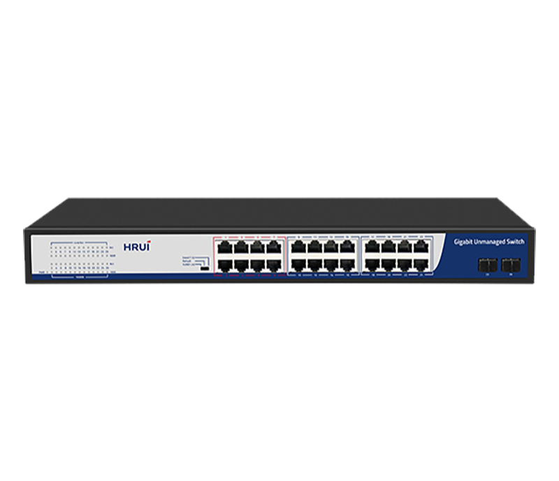
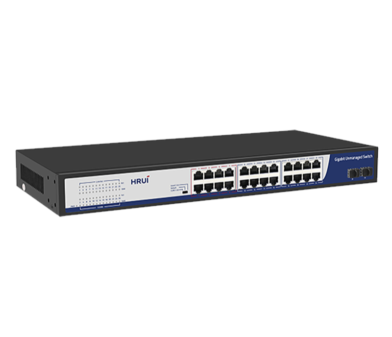
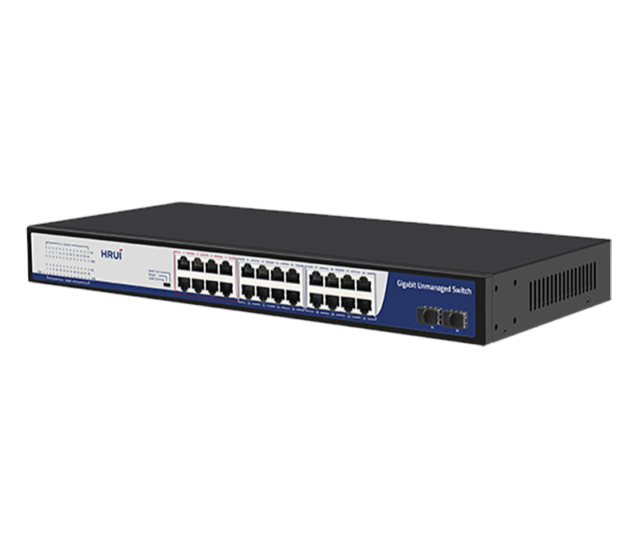
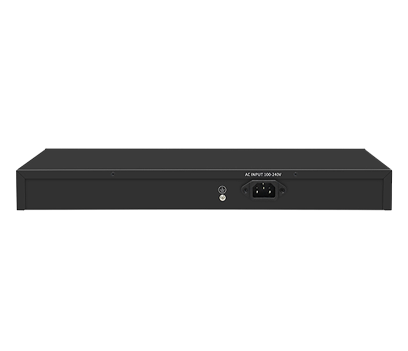

# HR-SWG10242S

> 来源：<https://www.hruitech.com/ethernet-switch/193.html>（抓取 2026-10-21T04:35:47Z；英文原文照录，中文仅为栏目名）  
> 官网描述：24-Port 10/100/1000T + 2-Port 1G SFP Ethernet Switch   
> 类目：Ethernet Switch（site id 193）  
> 接口：24 *1G RJ45 ports / 2 * 1G SFP ports；PoE 预算 —；交换带宽 —；电源 AC 100-240V , 50/60Hz / DC 12V 2A

**Brief:** Full Gigabit intelligent Ethernet switch, with 24*Gigabit RJ45 ports + 2*Gigabit SFP ports, bandwidth 52Gbps, surpport port isolation and 250m transmission, surpport QoS data priority, Surge 2KV, suitable for -10~50℃ wide temperature environment

## 产品图





## Datasheet
- [HR_SWG10242S.pdf](https://www.hruitech.com/web/userfiles/productfile/HR_SWG10242S.pdf) （本地：`data/hrui_site_raw/datasheets/HR_SWG10242S.pdf`；文本：`data/hrui_site_raw/datasheet_text/HR_SWG10242S.txt`）

## Feature and Benefits（原文）
```
The HR-SWG10242S is a high-performance, full Gigabit intelligent Ethernet switch designed to meet the demands of modern networking environments. Featuring 24 Gigabit RJ45 ports and 2 Gigabit SFP ports, this switch offers robust bandwidth of up to 52 Gbps. It supports advanced networking features such as port isolation and boasts an impressive 250m transmission range. With Quality of Service (QoS) capabilities for prioritizing data packets, along with a surge protection rating of 2KV, it is built to operate in a wide temperature range of -10°C to 50°C, making it ideal for various environmental conditions.
Product Features:
Comprehensive Port Configuration:
24 x 1G RJ45 ports + 2 x 1G SFP optical ports.
Standards Compliance:
Supports IEEE 802.3, IEEE 802.3u, IEEE 802.3x, IEEE 802.3ab, and IEEE 802.3z protocols
Dynamic Adaptability:
Each RJ45 port supports automatic adaptation to 10/100/1000Mbps speed.
Auto MDI/MDIX:
Automatic port flipping for simplified connections.
Status Monitoring:
Indicator lights on the panel provide real-time monitoring of operational status and facilitate quick fault diagnosis.
Quality of Service (QoS):
Configurable QoS with 1-8 port priority settings enables efficient traffic management.
Versatile Oaperating Modes:
Supports VLAN, Default, and Extend modes for flexible network configurations.
```

## Parameter（规格表逐行）
| 项 | 值 |
|---|---|
| Description | Specification |
| Model | HR-SWG10242S |
| Interface | 24 *1G RJ45 ports |
| Interface | 2 * 1G SFP ports |
| Port Standard | IEEE 802.3: Ethernet Media Access Control (MAC) Protocol |
| Port Standard | IEEE 802.3i: 10BASE-T Ethernet |
| Port Standard | IEEE 802.3u: 100BASE-TX Fast Ethernet |
| Port Standard | IEEE 802.3ab: 1000BASE-T Gigabit Ethernet |
| Port Standard | IEEE 802.3z: 1000BASE-X Gigabit Ethernet (Fiber optic) |
| Port Standard | IEEE 802.3x: Flow Control |
| Bandwidth | 52 Gbps |
| Packet Forwarding Rate | 38.68Mpps |
| Packet Buffer | 4.1Mbit |
| MAC Address Table | 8K |
| Transmission Method | Store and Forward |
| Power Supply | AC 100-240V , 50/60Hz |
| Power Supply | DC 12V 2A |
| Mainboard Power Consumption | 16W |
| Structure Information | Product Dimensions :440*204*44mm |
| Structure Information | Packaging Dimensions :500*290*85mm |
| Structure Information | Product Net Weight:2.36KG |
| Structure Information | Product Gross Weight:2.93KG |
| Packing Information | Carton Dimensions :520*445*310mm |
| Packing Information | Packing Quantity: 5PCS |
| Packing Information | Packing Weight:15.6KG |
| Package Contents | Switch 1pcs, power cord 1pcs, manual 1pcs,certificate of qualification 1pcs |
| Fan Quantity | 0 |
| Installation | Desktop,rack-mounting |
| Surge Protection | Surge protection: common mode 4KV (Class B); |
| Surge Protection | Electrostatic ESD: Air 8KV, Contact 6KV (Class C) |
| Operating Temperature | 0~40°C |
| Storage Temperature | -40 °C to 70 °C |
| Operation Humidity | 10%~90%,non condensing |
| Storage Humidity | 5%~95%,non condensing |
| PWR LED | Green LED On: Powered on |
| PWR LED | Green LED Off: Powered off |
| ACT LED | Green LED On:Link normal |
| ACT LED | Green LED Off: Link blocked |
| ACT LED | Flashing: Data transmitting |
| 1000M LED | Green LED On:1G Link normal |
| 1000M LED | Green LED Off:10M/100M Link normal |
| 1000M LED | Flashing: Data transmitting |
| VLAN/Default/Extend Modes Buttons | VLAN (port isolation): 1-24 ports are isolated from each other and all communicate with 25-26 ports; |
| VLAN/Default/Extend Modes Buttons | Default (default mode): All ports communicate with each other; |
| VLAN/Default/Extend Modes Buttons | Extend (monitoring mode): 17-24 ports support 250 meters in 10Mbps mode |

## Product structure / Application topology（图）
- https://www.hruitech.com/web/userfiles/image/20241227/1735292379901145.png
