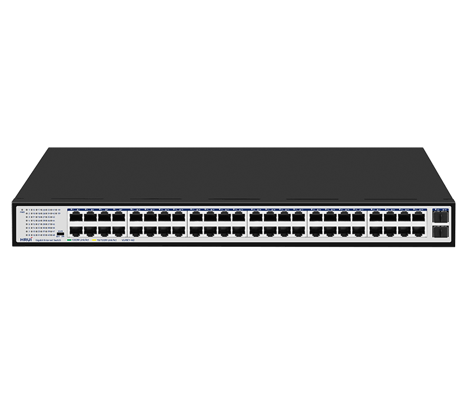
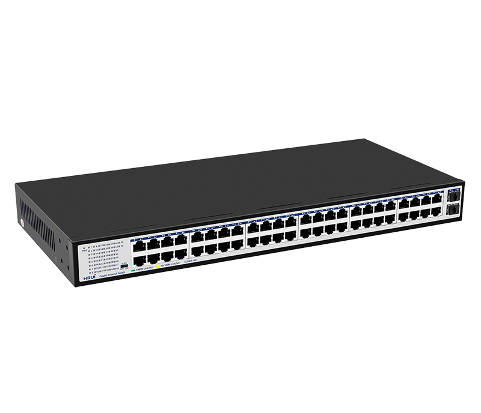
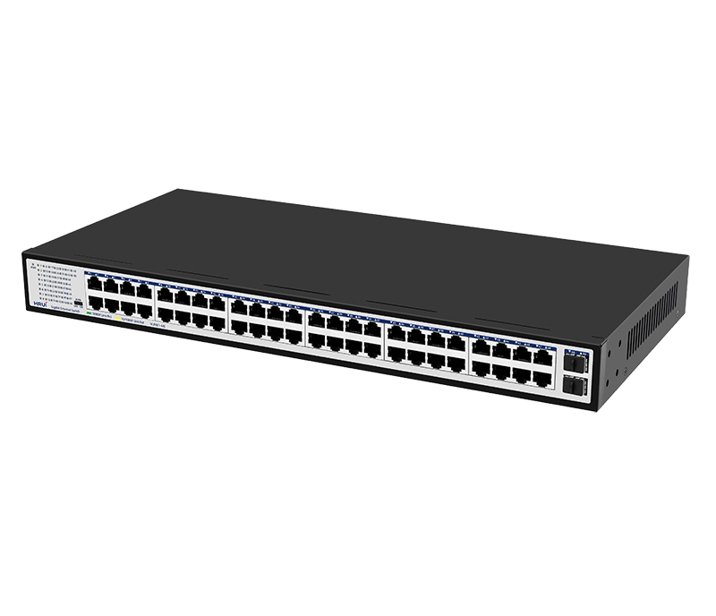
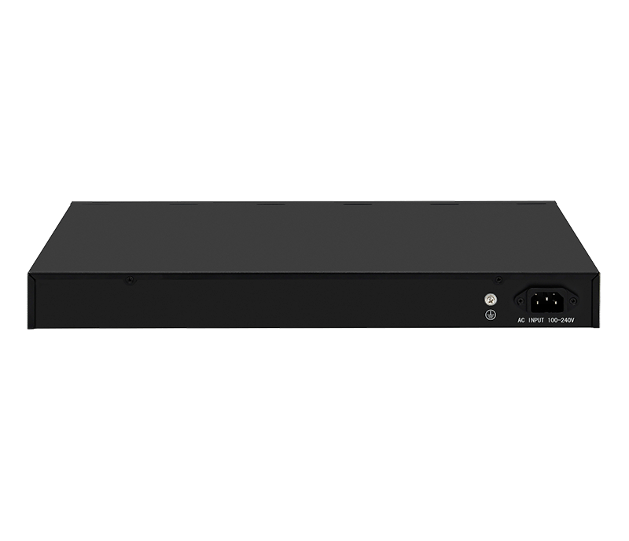

# HR-SWG10482S

> 来源：<https://www.hruitech.com/ethernet-switch/137.html>（抓取 2026-10-21T04:35:46Z；英文原文照录，中文仅为栏目名）  
> 官网描述：48-Port 10/100/1000T + 2-Port 1G SFP Ethernet Switch   
> 类目：Ethernet Switch（site id 137）  
> 接口：48-Port 10/100/1000T + 2-Port 1G SFP Ethernet Switch ；PoE 预算 —；交换带宽 —；电源 —

**Brief:** 50 Port Gigabit Ethernet switch, provide 48* 10/100/1000M adaptive Ethernet ports+2* Gigabit SFP ports. Adopting high-quality and high-speed network ICS, this product thoroughly solves the problem of high noise when deploying small switches in office environments through a fan free silent design. This switch has 48* 10/100/1000M RJ45 ports and can provide seamless connection for 10/100/1000M Ethernet. It supports two working modes and is easy to manage and maintain with intelligent one click dialing. The product can be widely used in security network video monitoring, hotels, campuses, small and medium-sized enterprise network engineering, and other occasions.

## 产品图





## Datasheet
- [HR_SWG10482S.pdf](https://www.hruitech.com/web/userfiles/productfile/HR_SWG10482S.pdf) （本地：`data/hrui_site_raw/datasheets/HR_SWG10482S.pdf`；文本：`data/hrui_site_raw/datasheet_text/HR_SWG10482S.txt`）

## Feature and Benefits（原文）
```
HR-SWG10482S, a high-performance 50-port Gigabit Ethernet switch designed to meet the demands of modern networking environments. This switch features 48 adaptive 10/100/1000Mbps Ethernet RJ45 ports and 2 Gigabit SFP ports, ensuring seamless integration with various devices and network configurations.
Engineered with top-notch, high-speed network integrated circuit solutions, the HR-SWG10482S effectively addresses issues of noise often encountered with smaller switches in office settings, thanks to its innovative fan-free design, providing a silent yet powerful performance.
The switch's RJ45 ports support a versatile range of connection speeds, making it an ideal choice for network infrastructure in security video monitoring, hospitality settings, educational campuses, and small to medium-sized enterprises. Its user-friendly configuration, including two operational modes and intelligent one-click dialing for easy management, makes it a versatile tool for any networking professional.
Product Features:
Port Configuration:
48 Gigabit RJ45 ports + 2 Gigabit SFP optical ports.
Standards Compliance:
Fully compliant with IEEE 802.3, IEEE 802.3u, and IEEE 802.3ab standards.
Adaptive Ports:
Each RJ45 port supports automatic adaptation to 10/100/1000Mbps speed.
Auto MDI/MDIX:
Automatic port flipping for simplified connections.
Status Monitoring:
Indicator lights on the panel provide real-time monitoring of operational status and facilitate quick fault diagnosis.
VLAN Configuration:
Features a dial switch for easy VLAN mode setting.
Flow Control:
Adheres to IEEE 802.3x standard for full duplex and backpressure standard for half duplex operation.
Loop Alarm:
Integrated loop alarm system to enhance network reliability.
```

## Parameter（规格表逐行）
| 项 | 值 |
|---|---|
| **Hardware Features & Performance** | |
| Model | HR-SWG10482S |
| General | Interface / 48 *Gigabit RJ45 ports |
| General | Interface / 2* Gigabit SFP optical ports |
| General | Port Standard / IEEE 802.3: Ethernet Media Access Control (MAC) Protocol |
| General | Port Standard / IEEE 802.3i: 10BASE-T Ethernet |
| General | Port Standard / IEEE 802.3u: 100BASE-TX Fast Ethernet |
| General | Port Standard / IEEE 802.3ab: 1000BASE-T Gigabit Ethernet |
| General | Port Standard / IEEE 802.3z: 1000BASE-X Gigabit Ethernet (Fiber optic) |
| General | Port Standard / IEEE 802.3x: Flow Control |
| Performance | Switching Capacity / 100Gbps |
| Performance | Packet Forwarding Rate / 74.4Mpps |
| Performance | Packet Buffer / 12Mbit |
| Performance | MAC Address Table / 16K |
| Performance | Transmission Method / Store and Forward |
| Physical | Power Supply / AC 100-240V , 50/60Hz |
| Physical | Power Supply / DC 12V 2A |
| Physical | Mainboard Power Consumption / 33.99W |
| Physical | Structure Information / Product Dimensions :440*205*44mm |
| Physical | Structure Information / Packaging Dimensions :500*290*85mm |
| Physical | Structure Information / Product Net Weight:2.826KG |
| Physical | Structure Information / Product Gross Weight:3.371KG |
| Physical | Packing Information / Carton Dimensions :520*445*310mm |
| Physical | Packing Information / Packing Quantity: 5PCS |
| Physical | Packing Information / Packing Weight: 17.85KG |
| Physical | Packing List / Switch 1pcs, Power cord 1pcs, instruction manual 1pcs，certificate of qualification 1pcs |
| Physical | Fan Quantity / 0 |
| Physical | Installation / desktop |
| Environment | Surge Protection / Surge Protection Common mode 6KV, differential mode 2KV; |
| Environment | Surge Protection / ESD: Air 15KV, Contact 8KV (Class B) |
| Environment | Operating Temperature / 0~40°C |
| Environment | Storage Temperature / -40 °C to 70 °C |
| Environment | Operation Humidity / 10%~90%，non condensing |
| Environment | Storage Humidity / 5%~95%，non condensing |
| Buttons & Indicator Lights | PWR / On: Powered on |
| Buttons & Indicator Lights | PWR / Off: Powered off |
| Buttons & Indicator Lights | SYS / On: The system is normal |
| Buttons & Indicator Lights | SYS / Flashing: System startup in progress |
| Buttons & Indicator Lights | SYS / OFF: System not started |
| Buttons & Indicator Lights | Link / Green Light ON：1000Mbps Link normal |
| Buttons & Indicator Lights | Link / Yellow Light ON：10/100Mbps Link normal |
| Buttons & Indicator Lights | Link / Off: Link blocked |
| Buttons & Indicator Lights | Link / Flashing: Data transmitting |
| Buttons & Indicator Lights | VLAN Mode Button / ON: 1-46 ports are isolated from each other and all communicate with 47-50 ports; |
| Buttons & Indicator Lights | VLAN Mode Button / OFF: All ports communicate with each other; |

## Product structure / Application topology（图）
- https://www.hruitech.com/web/userfiles/image/20241230/1735520430992151.png
