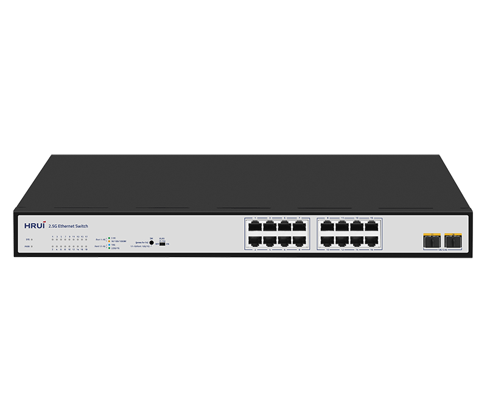
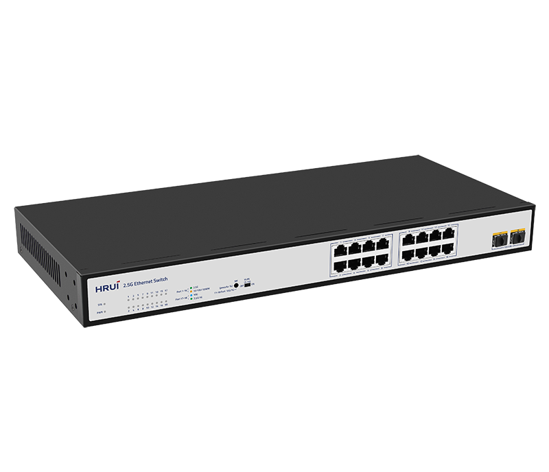
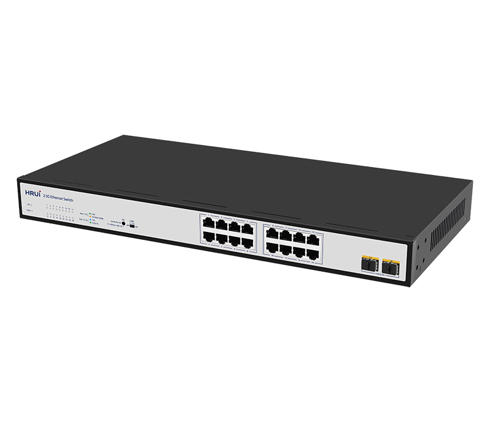
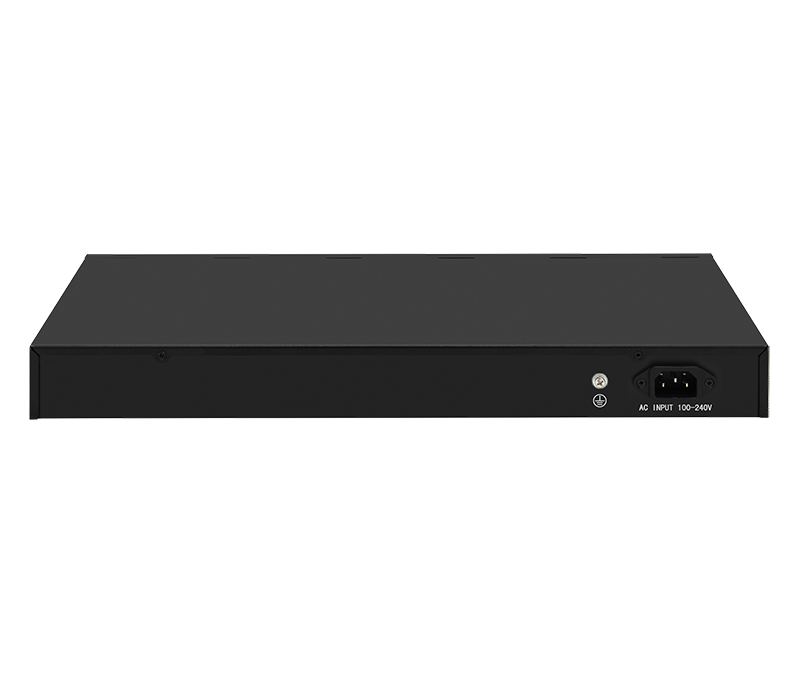

# HR-SWTG1216AS

> 来源：<https://www.hruitech.com/ethernet-switch/138.html>（抓取 2026-10-21T04:35:51Z；英文原文照录，中文仅为栏目名）  
> 官网描述：16-Port 10/100/1000/2500T + 2-Port 10G SFP+ Ethernet Switch   
> 类目：Ethernet Switch（site id 138）  
> 接口：16-Port 10/100/1000/2500T + 2-Port 10G SFP+ Ethernet Switch ；PoE 预算 —；交换带宽 —；电源 —

**Brief:** 18 Port 10G Uplink 2.5G Ethernet Switch, adopting a high-quality and high-speed network chip solution. This switch has 16* 100/1000/2500M RJ45 ports and 2* 10G SFP+ ports, providing seamless connection for 10/100/1000/2500M Ethernet, making it easy to manage and maintain. It can be widely used in security network video monitoring, hotels, campuses, small and medium-sized enterprise network engineering, and other occasions.

## 产品图





## Datasheet
- [HR_SWTG1216AS.pdf](https://www.hruitech.com/web/userfiles/productfile/HR_SWTG1216AS.pdf) （本地：`data/hrui_site_raw/datasheets/HR_SWTG1216AS.pdf`；文本：`data/hrui_site_raw/datasheet_text/HR_SWTG1216AS.txt`）

## Feature and Benefits（原文）
```
The HR-SWTG1216AS is a robust and efficient 18-Port Ethernet Switch designed to enhance your network infrastructure. Equipped with advanced high-speed network chip technology, this switch features 16 RJ45 ports capable of 100/1000/2500 Mbps and 2 SFP+ ports for 10G uplink. It ensures seamless connectivity for a variety of Ethernet standards, making it ideal for diverse applications such as security network video monitoring, hospitality environments, educational campuses, and small to medium-sized enterprise network setups. With its user-friendly management and maintenance capabilities, the HR-SWTG1216AS provides an excellent solution for optimizing network performance.
Product Features:
16 RJ45 Ports:
Supports 100/1000/2500 Mbps adaptive connections for flexible networking.
2 SFP+ Ports:
Provide 10G uplink options for high-speed data transfer.
IEEE Standards Compliance:
Fully compliant with IEEE 802.3, IEEE 802.3u, IEEE 802.3ab, IEEE 802.3bz, IEEE 802.3ae, and IEEE 802.3x standards to ensure compatibility and reliability.
Auto MDI/MDIX:
RJ45 ports support automatic MDI/MDIX for hassle-free setup without the need for crossover cables.
Status Monitoring:
Panel indicator lights allow for real-time status monitoring, simplifying fault diagnosis and network management.
Flow Control:
Employs IEEE 802.3x flow control for full-duplex communication and backpressure standard for half-duplex to optimize data flow and prevent packet loss.
```

## Parameter（规格表逐行）
| 项 | 值 |
|---|---|
| **Hardware Features & Performance** | |
| Model | HR-SWTG1216AS |
| General | Interface / 16 *100/1000/2500Mbps RJ45 ports |
| General | Interface / 2 *10G SFP+ optical ports |
| General | Port Standard / IEEE802.3 (Ethernet) |
| General | Port Standard / IEEE802.3u (Fast Ethernet) |
| General | Port Standard / IEEE802.3ab (Gigabit Ethernet) |
| General | Port Standard / IEEE 802.3bz (5G Ethernet) |
| General | Port Standard / IEEE 802.3z (Gigabit Ethernet) |
| General | Port Standard / IEEE 802.3ae (10 Gigabit Ethernet) |
| General | Port Standard / IEEE802.3x (Flow Control) |
| Performance | Switching Capacity / 120Gbps |
| Performance | Packet Forwarding Rate / 89.28Mpps |
| Performance | Packet Buffer / 12Mbit |
| Performance | MAC Address Table / 16K |
| Performance | Transmission Method / Store and Forward |
| Physical | Power Supply / AC 100-240V , 50/60Hz |
| Physical | Power Supply |
| Physical | Power Supply / DC 12V 4A |
| Physical | Mainboard Power Consumption / 21.5W |
| Physical | Structure Information / Product Dimensions :440*205*44mm |
| Physical | Structure Information / Packaging Dimensions :500*290*85mm |
| Physical | Structure Information / Product Net Weight:2.21KG |
| Physical | Structure Information / Product Gross Weight:2.72KG |
| Physical | Packing Information / Carton Dimensions :520*445*310mm |
| Physical | Packing Information / Packing Quantity: 5PCS |
| Physical | Packing Information / Packing Weight: 14.6KG |
| Physical | Packing List / Switch 1pcs, Power cord 1pcs, instruction manual 1pcs，certificate of qualification 1pcs |
| Physical | Fan Quantity / 0 |
| Physical | Installation / Desktop |
| Environment | Surge Protection / Surge protection: Common mode 6KV, differential mode 2KV (Class C); |
| Environment | Surge Protection / Electrostatic ESD: Air 8KV, Contact 6KV (Class C) |
| Environment | Operating Temperature / 0~40°C |
| Environment | Storage Temperature / -40 °C to 70 °C |
| Environment | Operation Humidity / 10%~90%，non condensing |
| Environment | Storage Humidity / 5%~95%，non condensing |
| Buttons & Indicator Lights | PWR / On: Powered on |
| Buttons & Indicator Lights | PWR / Off: Powered off |
| Buttons & Indicator Lights | 1-16 / Green led on: 2.5G link connection is normal |
| Buttons & Indicator Lights | 1-16 / Yellow led on: 10/100/1000M link connection is normal |
| Buttons & Indicator Lights | 1-16 / Flashing: Data transmission is normal |
| Buttons & Indicator Lights | 1-16 / OFF: Link blocked |
| Buttons & Indicator Lights | 17-18 / Blue led on: 10G link connection is normal |
| Buttons & Indicator Lights | 17-18 / Green led on: 2.5G link connection is normal |
| Buttons & Indicator Lights | 17-18 / Flashing: Data transmission is normal |
| Buttons & Indicator Lights | 17-18 / OFF: Link blocked |
| Buttons & Indicator Lights | SM / The default speed of the optical port is 10G/2.5G, and after long pressing for 10 seconds to switch, it becomes 10G/1G |
| Buttons & Indicator Lights | VLAN / ON: VLAN mode is enabled (ports 1-22 are isolated and communicate with the uplink port) |
| Buttons & Indicator Lights | VLAN / OFF: VLAN mode turned off (all ports communicate with each other) |

## Product structure / Application topology（图）
- https://www.hruitech.com/web/userfiles/image/20241230/1735522273405625.png
