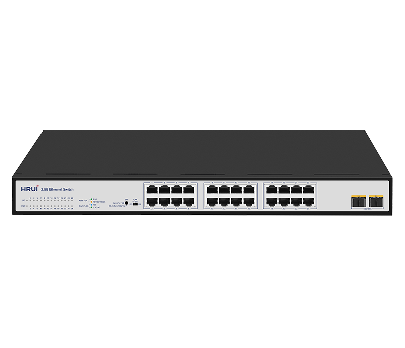
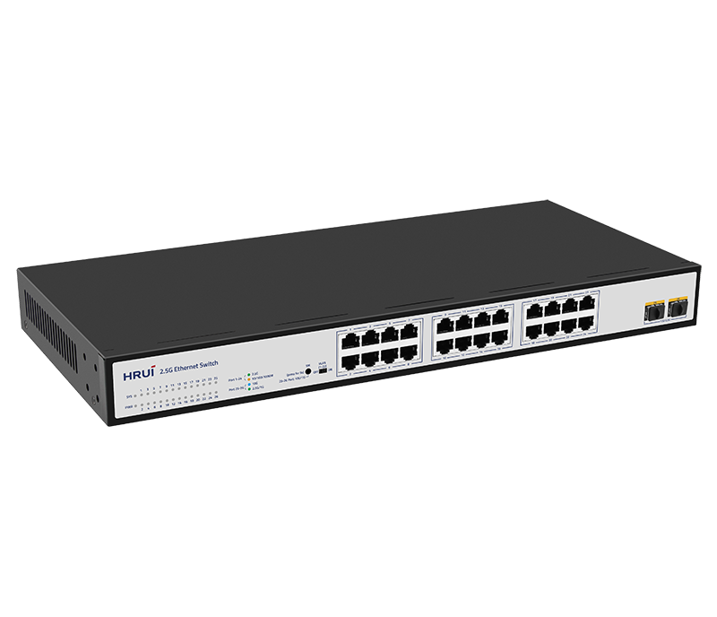
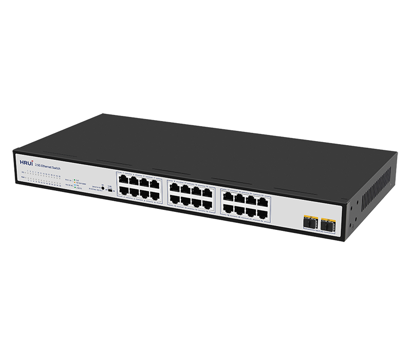
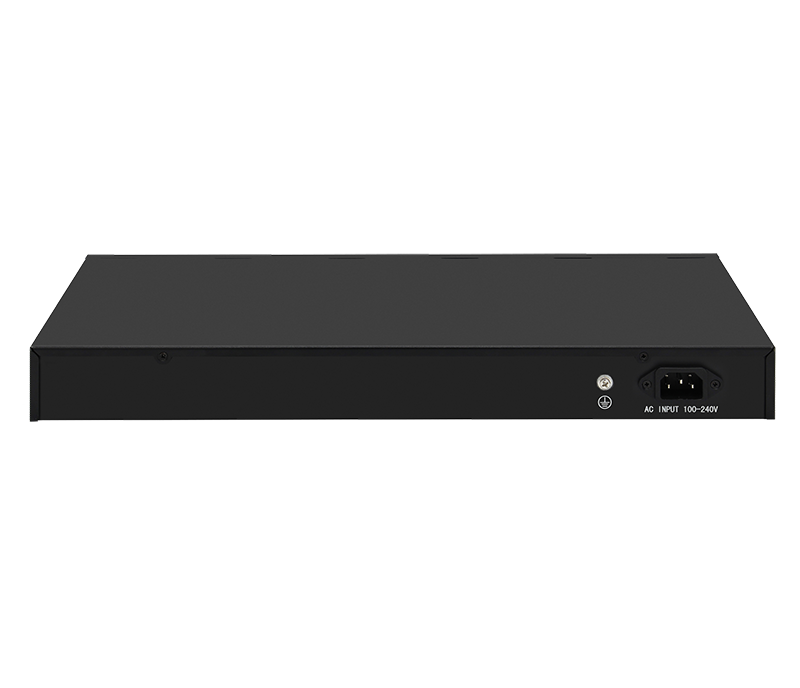

# HR-SWTG1224AS

> 来源：<https://www.hruitech.com/ethernet-switch/139.html>（抓取 2026-10-21T04:35:48Z；英文原文照录，中文仅为栏目名）  
> 官网描述：24-Port 10/100/1000/2500T + 2-Port 10G SFP+ Ethernet Switch  
> 类目：Ethernet Switch（site id 139）  
> 接口：24-Port 10/100/1000/2500T + 2-Port 10G SFP+ Ethernet Switch；PoE 预算 —；交换带宽 —；电源 —

**Brief:** 26 Port 10G Uplink 2.5G Ethernet Switch, using high quality and high speed network chip solution. This switch has 24* 100/1000/2500M RJ45 ports and 2* 10G SFP+ ports, providing seamless connection to 10/100/1000/2500M Ethernet for easy management and maintenance.

## 产品图





## Datasheet
- [HR_SWTG1224AS.pdf](https://www.hruitech.com/web/userfiles/productfile/HR_SWTG1224AS.pdf) （本地：`data/hrui_site_raw/datasheets/HR_SWTG1224AS.pdf`；文本：`data/hrui_site_raw/datasheet_text/HR_SWTG1224AS.txt`）

## Feature and Benefits（原文）
```
HR-SWTG1224AS, a cutting-edge 26-Port Ethernet switch designed for high-performance networking. This versatile switch is equipped with top-of-the-line, high-speed network chip solutions that ensure reliable and efficient data transmission.
With 24 RJ45 ports supporting speeds of 100M, 1G, and 2.5G, along with 2 10G SFP+ ports, the HR-SWTG1224AS allows for flexible connectivity to meet the demands of modern network environments. Whether you’re managing a data center, an enterprise network, or a small business setup, this switch simplifies your operations with user-friendly management and maintenance features.
Product Features:
24 RJ45 Ports:
Each port supports adaptive speeds of 100Mbps, 1Gbps, and 2.5Gbps for optimal performance without the need for manual configuration.
2 SFP+ Ports:
High-speed 10G SFP+ ports provide additional connectivity options for enhanced scalability.
Industry Compliance:
Fully compliant with IEEE standards including 802.3, 802.3u, 802.3ab, 802.3bz, 802.3ae, and 802.3x, ensuring compatibility with a wide range of devices and network setups.
Automatic Port Flipping:
Features Auto MDI/MDIX for straightforward setup, eliminating the need for cross-over cables.
Status Monitoring:
Panel indicator lights provide real-time insights into the working status of the switch, aiding in efficient fault diagnosis.
Flow Control:
Incorporates IEEE 802.3x flow control for full duplex and Backpressure standard for half-duplex transmission, maintaining data integrity and network stability.
```

## Parameter（规格表逐行）
| 项 | 值 |
|---|---|
| **Hardware Features & Performance** | |
| Model | HR-SWTG1224AS |
| General | Interface / 24 *100/1000/2500Mbps RJ45 ports |
| General | Interface / 2 *10G SFP+ optical ports |
| General | Port Standard / IEEE802.3 (Ethernet) |
| General | Port Standard / IEEE802.3u (Fast Ethernet) |
| General | Port Standard / IEEE802.3ab (Gigabit Ethernet) |
| General | Port Standard / IEEE 802.3bz (5G Ethernet) |
| General | Port Standard / IEEE 802.3z (Gigabit Ethernet) |
| General | Port Standard / IEEE 802.3ae (10 Gigabit Ethernet) |
| General | Port Standard / IEEE802.3x (Flow Control) |
| Performance | Switching Capacity / 160Gbps |
| Performance | Packet Forwarding Rate / 119.04Mpps |
| Performance | Packet Buffer / 12Mbit |
| Performance | MAC Address Table / 16K |
| Performance | Transmission Method / Store and Forward |
| Physical | Power Supply / AC 100-240V , 50/60Hz |
| Physical | Power Supply / DC 12V 4A |
| Physical | Mainboard Power Consumption / 27.9W |
| Physical | Structure Information / Product Dimensions :440*205*44mm |
| Physical | Structure Information / Packaging Dimensions :500*290*85mm |
| Physical | Structure Information / Product Net Weight:2.61KG |
| Physical | Structure Information / Product Gross Weight:3.12KG |
| Physical | Packing Information / Carton Dimensions :520*445*310mm |
| Physical | Packing Information / Packing Quantity: 5PCS |
| Physical | Packing Information / Packing Weight: 16.6KG |
| Physical | Packing List / Switch 1pcs, Power cord 1pcs, instruction manual 1pcs，certificate of qualification 1pcs |
| Physical | Fan Quantity / 0 |
| Physical | Installation / desktop |
| Environment | Surge Protection / Surge protection: Common mode 6KV, differential mode 2KV (Class C); |
| Environment | Surge Protection / Electrostatic ESD: Air 8KV, Contact 6KV (Class C) |
| Environment | Operating Temperature / 0~40°C |
| Environment | Storage Temperature / -40 °C to 70 °C |
| Environment | Operation Humidity / 10%~90%，non condensing |
| Environment | Storage Humidity / 5%~95%，non condensing |
| Buttons & Indicator Lights | PWR / On: Powered on |
| Buttons & Indicator Lights | PWR / Off: Powered off |
| Buttons & Indicator Lights | 1-24 / Green led on: 2.5G link connection is normal |
| Buttons & Indicator Lights | 1-24 / Yellow led on: 10/100/1000M link connection is normal |
| Buttons & Indicator Lights | 1-24 / Flashing: Data transmission is normal |
| Buttons & Indicator Lights | 1-24 / OFF: Link blocked |
| Buttons & Indicator Lights | 25-26 / Blue led on: 10G link connection is normal |
| Buttons & Indicator Lights | 25-26 / Green led on: 2.5G link connection is normal |
| Buttons & Indicator Lights | 25-26 / Flashing: Data transmission is normal |
| Buttons & Indicator Lights | 25-26 / OFF: Link blocked |
| Buttons & Indicator Lights | SM / The default speed of the optical port is 10G/2.5G, and after long pressing for 5 seconds to switch, it becomes 10G/1G |
| Buttons & Indicator Lights | VLAN / ON: VLAN mode is enabled (ports 1-22 are isolated and communicate with the uplink port) |
| Buttons & Indicator Lights | VLAN / OFF: VLAN mode turned off (all ports communicate with each other) |

## Product structure / Application topology（图）
- https://www.hruitech.com/web/userfiles/image/20241230/1735522121661585.png
