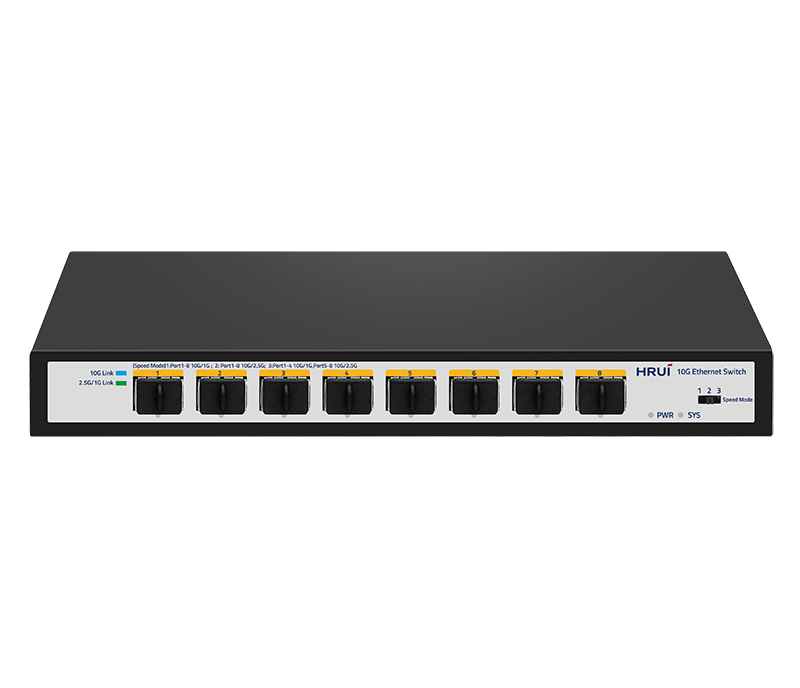
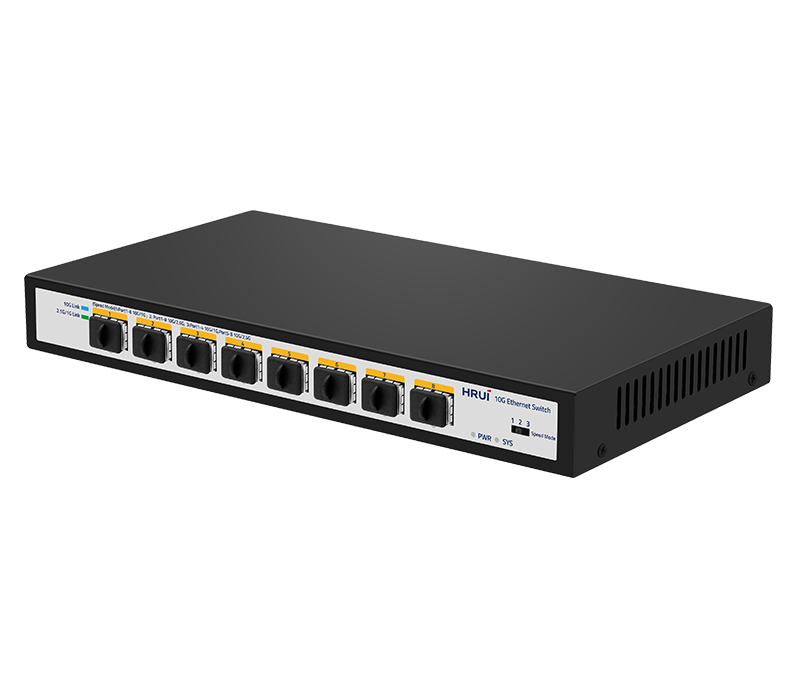
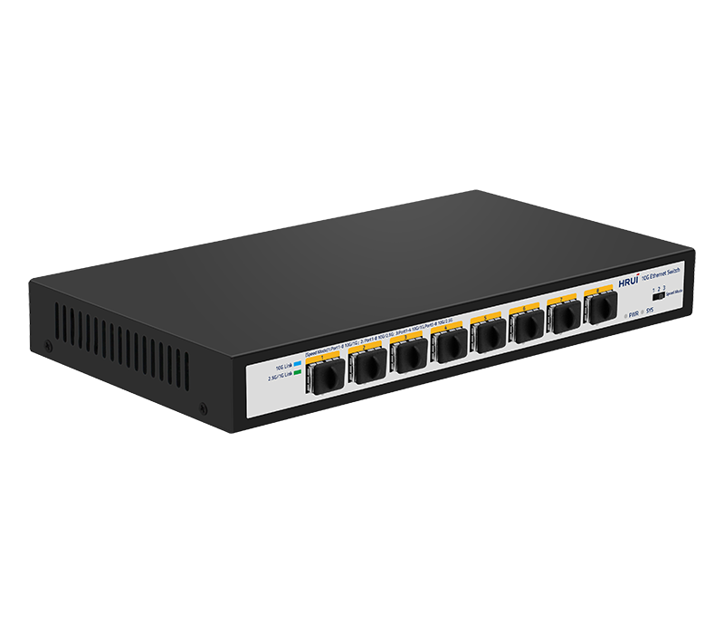
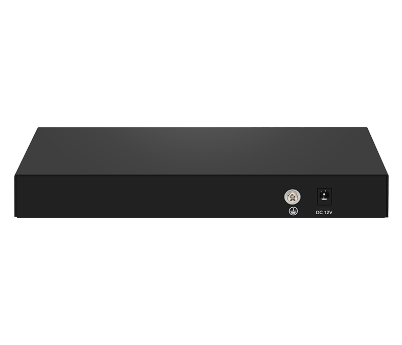

# HR-SWTG1C8F

> 来源：<https://www.hruitech.com/ethernet-switch/136.html>（抓取 2026-10-21T04:35:55Z；英文原文照录，中文仅为栏目名）  
> 官网描述：8-Port 10G SFP+ Ethernet Switch  
> 类目：Ethernet Switch（site id 136）  
> 接口：8-Port 10G SFP+ Ethernet Switch；PoE 预算 —；交换带宽 —；电源 —

**Brief:** This 8-port full 10G SFP+ Switch adopts a high-quality and high-speed network chip solution with a full 10G network interface and smooth line speed forwarding. It is configured with 8* 10G SFP+ ports, which supports 1.25G/2.5G/10G rates. It adopts a storage and forwarding mechanism, and internally integrates a high capacity cache to ensure that all ports can achieve 10G non-blocking line speed forwarding, and adopt to more emergency situations. With a sturdy and durable and high strength steel shell design, the efficient heat dissipation ensures stable operation of the product. The switch can be widely used in security network video monitoring, hotels, campuses, large and medium-sized enterprise network engineering, and other fields.

## 产品图





## Datasheet
- [HR_SWTG1216AS_eTF8U.pdf](https://www.hruitech.com/web/userfiles/productfile/HR_SWTG1216AS_eTF8U.pdf) （本地：`data/hrui_site_raw/datasheets/HR_SWTG1216AS_eTF8U.pdf`；文本：`data/hrui_site_raw/datasheet_text/HR_SWTG1216AS_eTF8U.txt`）

## Feature and Benefits（原文）
```
Enhanced 8-Port Full 10G SFP+ Switch
Experience lightning-fast connectivity with our advanced 8-port full 10G SFP+ Switch, engineered with a premium high-speed network chip that facilitates seamless data transfer and efficient line speed forwarding. This robust switch features 8 SFP+ ports, supporting versatile bandwidth options of 1.25G, 2.5G, and 10G, making it an ideal solution for various networking requirements.
The switch employs a sophisticated store-and-forward mechanism complemented by a high-capacity cache, enabling all ports to deliver consistent 10G non-blocking line speed, even under high-demand situations. Its durable construction features a high-strength steel shell for enhanced durability, while efficient heat dissipation ensures optimal performance stability.
Perfect for a wide range of applications, this switch is suitable for environments such as security network video monitoring, hotels, educational institutions, and large to medium-sized enterprise network infrastructures.
Product Features:
8 SFP+ Optical Ports:
Equipped with 8 high-speed SFP+ optical ports.
Multi-Standard Compatibility:
Complies with IEEE 802.3, IEEE 802.3u, IEEE 802.3ab, IEEE 802.3bz, IEEE 802.3ae, and IEEE 802.3x standards for broad interoperability.
Flexible Bandwidth Support:
Each SFP+ optical port accommodates 1.25G, 2.5G, and 10G transmission rates.
Automatic Port Flipping:
Supports automatic MDI/MDIX for simplified setup and connectivity.
Integrated Status Monitoring:
LED indicators on the panel provide real-time monitoring of operational status, aiding in easy fault diagnosis.
Efficient Flow Control:
Implements full-duplex flow control using the IEEE 802.3x standard, with half-duplex operation utilizing backpressure mechanisms for optimized data flow.
```

## Parameter（规格表逐行）
| 项 | 值 |
|---|---|
| **Hardware Features & Performance** | |
| Model | HR-SWTG1C8F |
| General | Interface / 8 * 10G SF P+optical port |
| General | Port Standard / IEEE802.3 (Ethernet) |
| General | Port Standard / IEEE802.3u (Fast Ethernet) |
| General | Port Standard / IEEE 802.3ab (Gigabit Ethernet) |
| General | Port Standard / IEEE 802.3z (Gigabit Ethernet Fiber Standard) |
| General | Port Standard / IEEE 802.3ae (10 Gigabit Ethernet) |
| General | Port Standard / IEEE802.3x (Flow Control) |
| Performance | Switching Capacity / 160Gbps |
| Performance | Packet Forwarding Rate / 119.04Mpps |
| Performance | Packet Buffer / 12Mbit |
| Performance | MAC Address Table / 16K |
| Performance | Transmission Method / Store and Forward |
| Physical | Power Supply / AC 100-240V, 50/60Hz |
| Physical | Power Supply / DC 12V 2A |
| Physical | Mainboard Power Consumption / 13.8W |
| Physical | Structure Information / Product Dimensions :220*126*28mm |
| Physical | Structure Information / Packaging Dimensions :259*228*60mm |
| Physical | Structure Information / Product Net Weight:0.62KG |
| Physical | Structure Information / Product Gross Weight:0.86KG |
| Physical | Packing Information / Carton Dimensions :535*320*480mm |
| Physical | Packing Information / Packing Quantity: 20PCS |
| Physical | Packing Information / Packing Weight: 18.2KG |
| Physical | Packing List / Switch 1pcs, power adapter 1pcs, instruction manual 1pcs，certificate of qualification 1pcs |
| Physical | Fan Quantity / 0 |
| Physical | Installation / desktop |
| Environment | Surge Protection / / |
| Environment | Operating Temperature / 0~40°C |
| Environment | Storage Temperature / -40 °C to 70 °C |
| Environment | Operation Humidity / 10%~90%，non condensing |
| Environment | Storage Humidity / 5%~95%，non condensing |
| Buttons & Indicator Lights | PWR / On: Powered on |
| Buttons & Indicator Lights | PWR / Off: Powered off |
| Buttons & Indicator Lights | SYS / Flashing: System startup in progress |
| Buttons & Indicator Lights | SYS / On: System startup completed |
| Buttons & Indicator Lights | SFP+ Led / Blue Led ON：10G Link normal |
| Buttons & Indicator Lights | SFP+ Led / Green Led ON：1000/2500Mbps Link normal |
| Buttons & Indicator Lights | SFP+ Led / Off: Link blocked |
| Buttons & Indicator Lights | SFP+ Led / Flashing: Data transmitting |
| Buttons & Indicator Lights | Speed Modes Buttons / 1: The speed of ports 1-8 is 10G/1G; |
| Buttons & Indicator Lights | Speed Modes Buttons / 2: The speed of ports 1-8 is 10G/2.5G; |
| Buttons & Indicator Lights | Speed Modes Buttons / 3: The speed of ports 1-4 is 10G/1G;The speed of ports 5-8 is 10G/2.5G; |

## Product structure / Application topology（图）
- https://www.hruitech.com/web/userfiles/image/20241230/1735522412444161.png
