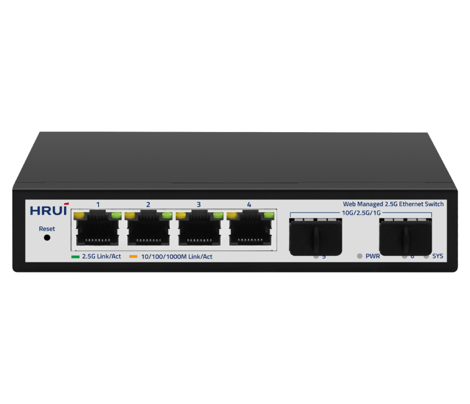
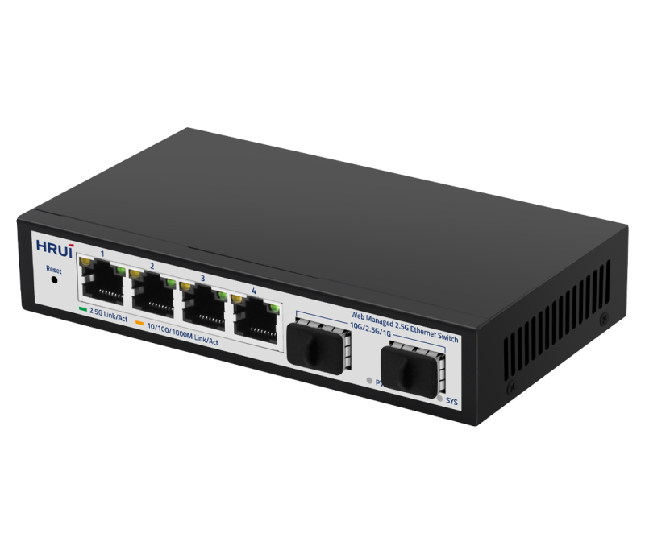
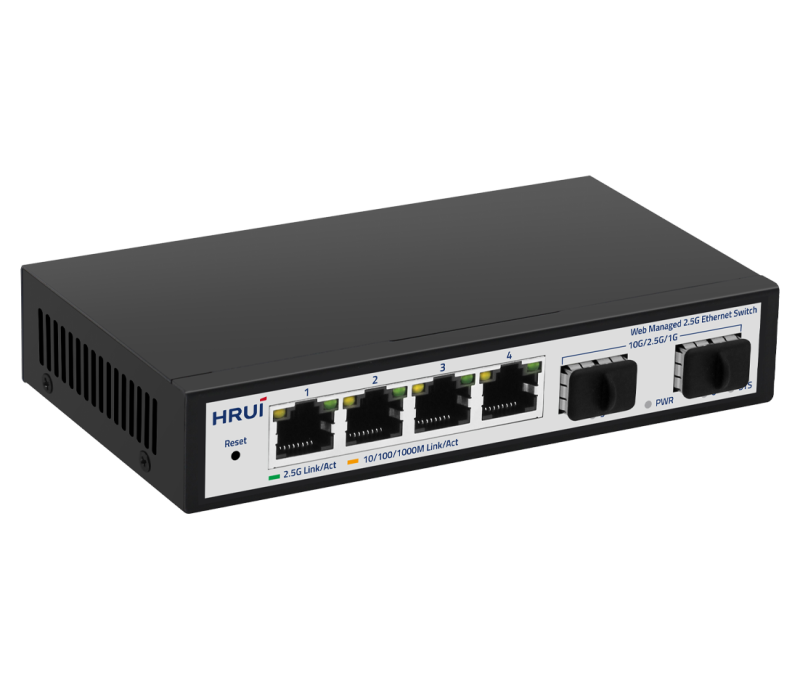
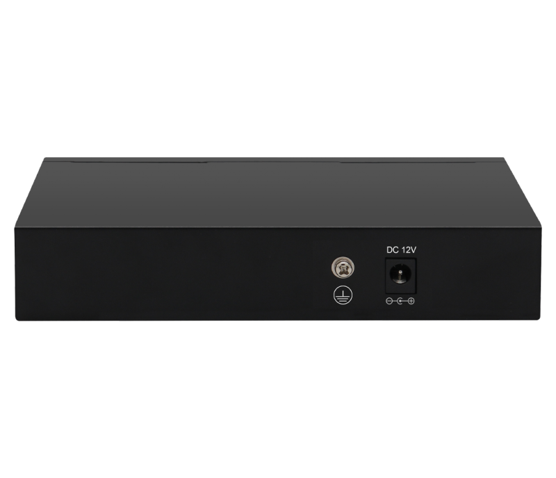

# HR-SWTGW224AS

> 来源：<https://www.hruitech.com/managed-switch/200.html>（抓取 2026-10-21T03:48:47Z；英文原文照录，中文仅为栏目名）  
> 官网描述：6 Port 10G uplink 2.5G Web Managed Ethernet switch | HRUI  
> 类目：Managed Switch（site id 200）  
> 接口：4 * 2.5G RJ45 ports / 2 * 10G SFP+ ports；PoE 预算 —；交换带宽 —；电源 AC 100-240V 50/60Hz / DC 12V 1A

**Brief:** 6 Port 10G Uplink 2.5G Web Managed Ethernet Switch, using high quality and high speed network chip solution. This switch has 4* 100/1000/2500M RJ45 ports and 2* 10G SFP+ ports, providing seamless connection to 10/100/1000/2500M Ethernet for easy management and maintenance. This switch can be widely used in security network video surveillance, hotels, campuses, and network engineering of small and medium-sized enterprises

## 产品图





## Datasheet
- [HR_SWTGW224AS.pdf](https://www.hruitech.com/web/userfiles/productfile/HR_SWTGW224AS.pdf) （本地：`data/hrui_site_raw/downloads/HR_SWTGW224AS.pdf`；文本：`data/hrui_site_raw/datasheet_text/HR_SWTGW224AS.txt`）

## Feature and Benefits（原文）
```
HR-SWTGW224AS, a state-of-the-art Ethernet switch featuring a 6-Port design with a robust 10G uplink and advanced 2.5G web management capabilities. Engineered with high-quality, high-speed network chip technology, this switch includes four 100/1000/2500M RJ45 ports and two 10G SFP+ ports. It offers seamless connectivity for 10/100/1000/2500M Ethernet environments, facilitating easy network management and maintenance. Ideal for a variety of applications including security network video surveillance, hospitality, educational institutions, and network engineering tasks for small to medium-sized enterprises.
Product Features:
Port Configuration:
4 x 2.5G RJ45 ports and 2 x 10G SFP+ ports for diverse connectivity options.
Standards Compliance:
Fully compliant with IEEE 802.3, 802.3u, 802.3ab, 802.3bz, 802.3z, 802.3ae, and 802.3x standards to ensure reliable performance.
Self-Adaptive Ethernet Ports:
Supports auto-sensing for 10M, 100M, 1G, and 2.5G speeds, allowing for seamless integration with existing networks.
Automatic Port Detection:
Features Auto MDI/MDIX capabilities, simplifying cable connections and eliminating the need for cross-over cables.
Status Monitoring:
Panel indicator LEDs provide real-time monitoring of operational status, aiding in quick fault analysis.
Flow Control:
Implements IEEE 802.3x standard for full duplex and backpressure for half duplex to optimize network performance.
Quality of Service (QoS):
Supports data priority settings for efficient bandwidth management.
```

## Parameter（规格表逐行）
| 项 | 值 |
|---|---|
| Description | Specification |
| Model | HR-SWTGW224AS |
| Interface | 4 * 2.5G RJ45 ports |
| Interface | 2 * 10G SFP+ ports |
| Port Standard | IEEE802.3 (Ethernet) |
| Port Standard | IEEE802.3u (Fast Ethernet) |
| Port Standard | IEEE802.3ab (Gigabit Ethernet) |
| Port Standard | IEEE802.3z (Gigabit Ethernet Fiber Standard) |
| Port Standard | IEEE802.3bz (2.5G Ethernet) |
| Port Standard | IEEE 802.3ae (10G Ethernet) |
| Port Standard | IEEE802.3x (Flow Control) |
| Bandwidth | 60Gbps |
| Packet Forwarding Rate | 44.64Mpps |
| Packet Buffer | 8Mbit |
| MAC Address Table | 4K |
| Jumbo Frame | 12K |
| VLAN | VLAN range 1-4094, maximum active VLAN is 31 |
| Transmission Method | Store and Forward |
| Power Supply | AC 100-240V 50/60Hz |
| Power Supply | DC 12V 1A |
| Mainboard Power Consumption | 5.92W |
| Structure Information | Product Dimensions :140*93*28mm |
| Structure Information | Packaging Dimensions :203*160*55mm |
| Structure Information | Product Net Weight: 0.33KG |
| Structure Information | Product Gross Weight: 0.46KG |
| Packing Information | Carton Dimensions :580*335*445mm |
| Packing Information | Packing Quantity: 40PCS |
| Packing Information | Packing Weight: 19.5KG |
| Package Contents | Switch 1pcs, ac adapter 1pcs, manual 1pcs,certificate of qualification 1pcs |
| Fan Quantity | 0 |
| Installation | Desktop |
| Surge Protection | Port Surge: common mode 4KV, differential mode 2KV (Class C); |
| Surge Protection | Electrostatic ESD: air 8KV, contact 6KV (Class C) |
| Operating Temperature | 0~40°C |
| Storage Temperature | -40 °C to 70 °C |
| Operation Humidity | 10%~90%，non condensing |
| Storage Humidity | 5%~95%，non condensing |
| PWR Green LED | On: Powered on |
| PWR Green LED | Off: Powered off |
| 1-4 | Green LED on: 2.5G link normal |
| 1-4 | Yellow LED on: 10M/100M/1G link normal |
| 1-4 | Off: Link blocked |
| 1-4 | Flashing: Data transmitting |
| 5-6 Green LED | On: 10G/1G link normal |
| 5-6 Green LED | Off: Link blocked |
| 5-6 Green LED | Flashing: Data transmitting |
| SYS Green LED | On: The system is normal |
| SYS Green LED | Flashing: System startup in progress |
| Reset | Long press for 6 seconds to restore factory settings |
| **Software Features** | |
| **L2 Function** | |
| Port | Port Switch configuration |
| Port | Port Speed configuration |
| Port | Port Duplex configuration |
| Port | Port Flow Control configuration |
| Port | EEE |
| Port | Jumbo Frame |
| Link Aggregation | Max. 4 members per group |
| Link Aggregation | Static Group |
| Link Aggregation | LACP |
| Link Aggregation | Up to 2 groups |
| Storm Control | Boardcast suppression |
| Storm Control | Unknown Multicast |
| Storm Control | Unknown Unicast |
| Port Mirroring | Support |
| Port Security | MAC Address Constraints |
| Port Isolation | Support |
| Port Rate-limit | Support |
| VLAN | Access/Trunk/Hybrid |
| VLAN | Congurable VID from 1 - 4094;Max. 31 static VLAN groups |
| MAC Address | Dynamic MAC Address |
| MAC Address | Static MAC address |
| Spanning Tree Protocol | STP/RSTP |
| Spanning Tree Protocol | Edge Port |
| Multicast | IGMP Snooping |
| Multicast | Router Port |
| Multicast | Static IGMP Join |
| Multicast | IGMP V1/V2 |
| QoS | Traffic classification, Supporting SP and WRR scheduling |
| QoS | Port Priority |
| QoS | Supports up to 8 queues per port |
| **Services** | |
| Access Protocol | HTTP |
| **Diagnostics** | |
| Port Statistics | Support |
| **Equipment Management** | |
| Manager Access | HTTP |
| Manager IP | Static Address |
| Manager IP | DHCP Client |
| User Management | Support |
| Firmware Management | Firmware upgrade |
| Configuration Management | Upload/Backup Configuration |
| Save | Support |
| Restart | Support |
| Factory Defaults | Support |
| **Standard Compliance** | |
| **IEEE 802.3x flow control and back pressure** | |
| **IEEE 802.1D Spanning Tree Protocol** | |
| **IEEE 802.1w Rapid Spanning Tree Protocol** | |
| **IEEE 802.1Q VLAN tagging** | |
| **RFC 768 UDP** | |
| **RFC 791 IP** | |
| **RFC 792 ICMP** | |
| **RFC 2068 HTTP** | |
| **RFC 1112 IGMP v1** | |
| **RFC 2236 IGMP v2** | |

## Product structure / Application topology（图）
- https://www.hruitech.com/web/userfiles/image/20250102/1735798179282419.png
