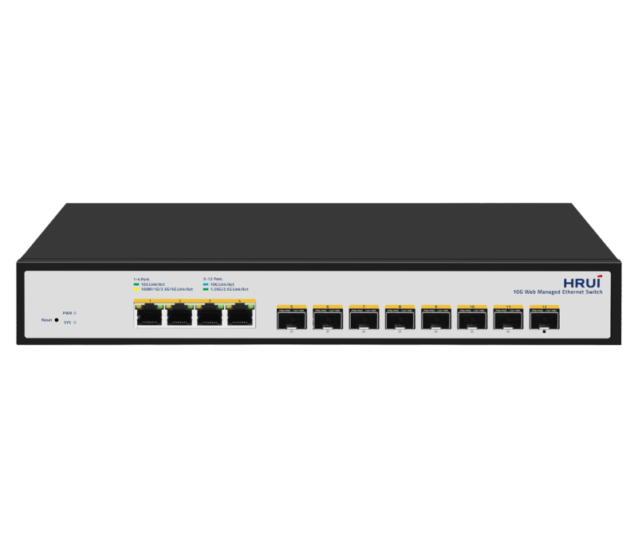
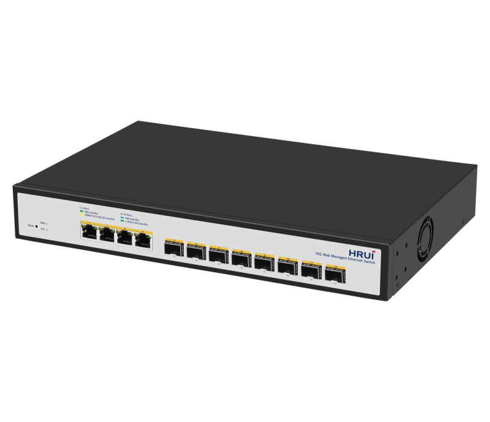
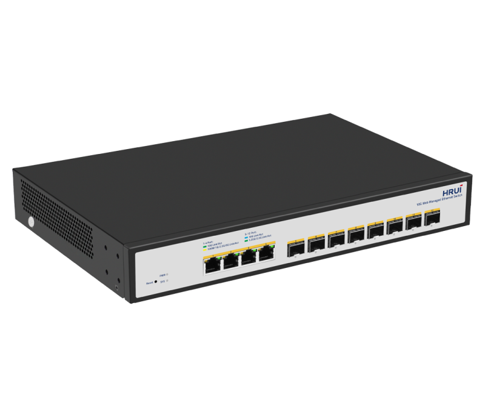
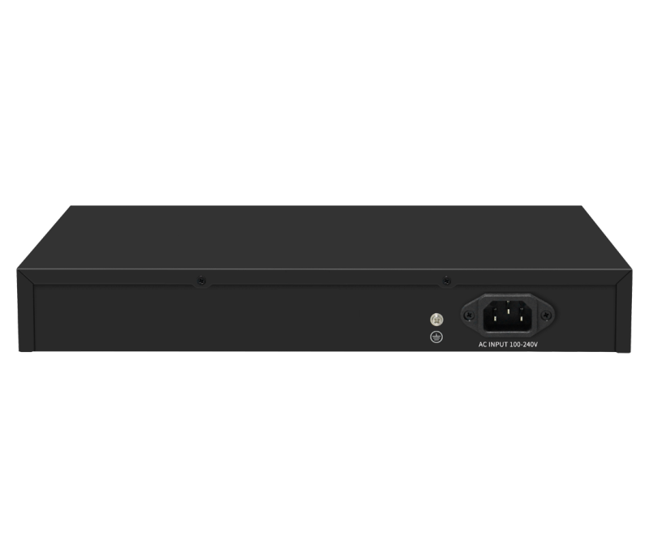

# HR-SWTGW2C48NS

> 来源：<https://www.hruitech.com/managed-switch/229.html>（抓取 2026-10-21T03:48:51Z；英文原文照录，中文仅为栏目名）  
> 官网描述：Layer3 4-Port 10GBASE-T and 8-Port 10G SFP+ Managed Switch  
> 类目：Managed Switch（site id 229）  
> 接口：4* 10G RJ45 ports / 8* 10G SFP+ ports；PoE 预算 —；交换带宽 —；电源 AC 100-240V 50/60Hz / DC 12V 4A

**Brief:** HRUI Web Managed 12-Port 10G Switch is a high-performance switch with 4 10G RJ-45 ports and 8 10G SFP+ ports, which is ideal for high-speed connectivity between WiFi 7 access points, storage servers, and other devices.

## 产品图





## Datasheet
- [HR_SWTGW2C48NS.pdf](https://www.hruitech.com/web/userfiles/productfile/HR_SWTGW2C48NS.pdf) （本地：`data/hrui_site_raw/datasheets/HR_SWTGW2C48NS.pdf`；文本：`data/hrui_site_raw/datasheet_text/HR_SWTGW2C48NS.txt`）

## Feature and Benefits（原文）
```
HRUI Web Managed 12-Port 10G Switch is a high-performance switch with 4 10G RJ-45 ports and 8 10G SFP+ ports, which is ideal for high-speed connectivity between WiFi 7 access points, storage servers, and other devices.
The product is easy to use, plug-and-play, and no configuration is required. Meanwhile, the product supports a cloud management function, which allows remote maintenance work with management platforms such as HRUI Cloud, making network management easier and smarter. Therefore, this switch is perfect for usage scenarios that require faster network speeds.
Why 10G Switch？
Fast Transfer
High Bandwidth
Improved Latency
Future Scalability
With 10G switch, data transfer speeds can be up to 10 times faster than traditional Gigabit switch that is limited to 1 Gbps, reducing latency and improving overall network performance.
As demand for bandwidth grows, 10G switches ensure a reliable and efficient network experience, particularly in data centers, cloud computing, and high-bandwidth applications, where increased traffic can be efficiently handled.
10G switches typically have lower latency than Gigabit switches. This advantage makes it ideal for real-time applications such as video conferencing, online gaming, and VoIP.
Scalable and adaptable, the system can expand to meet growing business needs, supporting various port types and numbers, with dynamic adjustment of device and configuration numbers.
• High-speed 10G Transmission
Provide 10G RJ-45 or SFP+ ports to provide high-speed network connectivity for NAS and access servers, supporting self-negotiation of 10G/5G/2.5G/1G/100M multiple port rates.
• High Switching Capacity for High-Load Applications
Enhances performance with increased concurrent connections, faster data transmission, and higher processing capacity, ideal for large-scale networks, ensuring smooth, high-speed, and stable data transmission.
• Smart Web Managed Feature to Optimize Your Network Efficiency
The product offers advanced software features, including VLAN, port mirroring, flow control, LACP, QoS, and DHCP Snooping, to cater to diverse network demands and enhance network security, reliability, and scalability.
• VLAN
VLAN enables network devices to be grouped by function, department, or region, and isolated into logical networks, enhancing network management flexibility, scalability, and security while simplifying administration and boosting efficiency.
• LACP
LACP enables connection to NAS/routers for link aggregation and rate stacking, while also ensuring network availability, reliability, and security through link failover, reducing the risk of network interruptions and data loss.
• QoS
Provide different QoS and prioritization for various types of traffic to ensure reliability and performance of critical services while reducing failure rates and network congestion.
• DHCP Snooping
Detecting and preventing rogue DHCP servers ensures network security by preventing attacks, ensuring unique IP addresses, and protecting against unauthorized access.
• SNMP
Support SNMP protocol for centralized management of network devices, compatible with various management platforms.
• Unified Management in the Cloud: Accessible, Scalable, and Efficient
Provide cloud-based management for remote equipment monitoring and control, simplifying detection, configuration, deployment, and maintenance to reduce costs and improve efficiency and reliability.
• Plug and Play
• Rock-solid Reliability
No configuration is required. Simply plug a device into the network. It automation begins.
Support 4KV surge protection against harsh environments.
```

## Parameter（规格表逐行）
| 项 | 值 |
|---|---|
| Fast Transfer | High Bandwidth / Improved Latency / Future Scalability |
| With 10G switch, data transfer speeds can be up to 10 times faster than traditional Gigabit switch that is limited to 1 Gbps, reducing latency and improving overall network performance. | As demand for bandwidth grows, 10G switches ensure a reliable and efficient network experience, particularly in data centers, cloud computing, and high-bandwidth applications, where increased traffic can be efficiently handled. / 10G switches typically have lower latency than Gigabit switches. This advantage makes it ideal for real-time applications such as video conferencing, online gaming, and VoIP. / Scalable and adaptable, the system can expand to meet growing business needs, supporting various port types and numbers, with dynamic adjustment of device and configuration numbers. |
|  | • High-speed 10G Transmission |
|  | Provide 10G RJ-45 or SFP+ ports to provide high-speed network connectivity for NAS and access servers, supporting self-negotiation of 10G/5G/2.5G/1G/100M multiple port rates. |
|  | • High Switching Capacity for High-Load Applications |
|  | Enhances performance with increased concurrent connections, faster data transmission, and higher processing capacity, ideal for large-scale networks, ensuring smooth, high-speed, and stable data transmission. |
|  | • Smart Web Managed Feature to Optimize Your Network Efficiency |
|  | The product offers advanced software features, including VLAN, port mirroring, flow control, LACP, QoS, and DHCP Snooping, to cater to diverse network demands and enhance network security, reliability, and scalability. |
|  | • VLAN |
|  | VLAN enables network devices to be grouped by function, department, or region, and isolated into logical networks, enhancing network management flexibility, scalability, and security while simplifying administration and boosting efficiency. |
|  | • LACP |
|  | LACP enables connection to NAS/routers for link aggregation and rate stacking, while also ensuring network availability, reliability, and security through link failover, reducing the risk of network interruptions and data loss. |
|  | • QoS |
|  | Provide different QoS and prioritization for various types of traffic to ensure reliability and performance of critical services while reducing failure rates and network congestion. |
|  | • DHCP Snooping |
|  | Detecting and preventing rogue DHCP servers ensures network security by preventing attacks, ensuring unique IP addresses, and protecting against unauthorized access. |
|  | • SNMP |
|  | Support SNMP protocol for centralized management of network devices, compatible with various management platforms. |
|  | • Unified Management in the Cloud: Accessible, Scalable, and Efficient |
|  | Provide cloud-based management for remote equipment monitoring and control, simplifying detection, configuration, deployment, and maintenance to reduce costs and improve efficiency and reliability. |
| • Plug and Play | • Rock-solid Reliability |
| No configuration is required. Simply plug a device into the network. It automation begins. | Support 4KV surge protection against harsh environments. |
| Description | Specification |
| Model | HR-SWTGW2C48NS |
| Interface | 4* 10G RJ45 ports |
| Interface | 8* 10G SFP+ ports |
| Port Standard | IEEE802.3 (Ethernet) |
| Port Standard | IEEE802.3u (Fast Ethernet) |
| Port Standard | IEEE802.3ab (Gigabit Ethernet) |
| Port Standard | IEEE 802.3bz (5G Ethernet) |
| Port Standard | IEEE 802.3z (Gigabit Ethernet) |
| Port Standard | IEEE 802.3ae (10G Ethernet) |
| Port Standard | IEEE802.3x (Flow Control) |
| Bandwidth | 240Gbps |
| Packet Forwarding Rate | 178.56Mpps |
| Packet Buffer | 16Mbit |
| MAC Address Table | 32K |
| VLAN | VLAN range 1-4094, maximum active VLAN is 4K |
| Jumbo Frame | 10K |
| Transmission Method | Store and Forward |
| Surge Protection | Port surge: common mode 4KV,differential mode 2KV. (Class A) |
| Surge Protection | Electrostatic ESD: Contact 6KV, air 8KV. (Class A) |
| Operating Temperature | 0~40°C |
| Storage Temperature | -40 °C to 70 °C |
| Operation Humidity | 10%~90%,non condensing |
| Storage Humidity | 5%~95%,non condensing |
| Power Supply | AC 100-240V 50/60Hz |
| Power Supply | DC 12V 4A |
| Mainboard Power Consumption | 45.83W |
| Structure Information | Product Dimensions :320*207*45mm |
| Structure Information | Packaging Dimensions :370*290*85mm |
| Structure Information | Product Net Weight: 1.59KG |
| Structure Information | Product Gross Weight:2.16KG |
| Packing Information | Carton Dimensions : 445*310*390mm |
| Packing Information | Packing Quantity: 5PCS |
| Packing Information | Packing Weight:11.54KG |
| Package Contents | Switch 1pcs, power cord 1pcs,manual 1pcs,certificate of qualification 1pcs |
| Fan Quantity | 1 |
| Installation | Desktop |
| PWR Green LED | On: Powered on |
| PWR Green LED | Off: Powered off |
| SYS Green LED | On: The system is normal |
| SYS Green LED | Flashing: System startup in progress |
| 1-4 | Green LED On: 10Gbps Link normal |
| 1-4 | Yellow LED On: 100M/1G/2.5G/5G Link normal |
| 1-4 | Off: Link blocked |
| 1-4 | Flashing: Data transmitting |
| 5-12 | Blue LED On: 10Gbps Link normal |
| 5-12 | Green LED On: 1.25G/2.5Gbps Link normal |
| 5-12 | Off: Link blocked |
| 5-12 | Flashing: Data transmitting |
| RESET | Long press for 6 seconds to restore factory settings |
| **Software Features** | |
| **L2 Function** | |
| Port | Port Switch configuration |
| Port | Port Description configuration |
| Port | Port Speed configuration |
| Port | Port Duplex configuration |
| Port | Port Flow Control configuration |
| Port | Jumbo Frame |
| Port | EEE |
| Link Aggregation | Supports load balance policy; Base on MAC and IP-MAC |
| Link Aggregation | Static and Dynamic Group |
| Link Aggregation | LACP |
| Link Aggregation | Up to 8 groups |
| Storm Control | Boardcast suppression |
| Storm Control | Unknown Multicast |
| Storm Control | Unknown Unicast |
| Port Mirroring | One to one monitor |
| Port Mirroring | Many to one monitor |
| Port Mirroring | Ingress/Egress/Both |
| Port Mirroring | Up to 4 session groups |
| Port Security | MAC Address Constraints |
| Port Security | Protect/Restrict/Shutdown |
| Port Isolation | Support |
| Port Rate-limit | Support |
| VLAN | Access/Trunk/Hybrid |
| VLAN | VLAN Tunnel (Q-in-Q Tunnel) |
| VLAN | VLAN range 1-4094, maximum active VLAN is 4K |
| MAC Address | Filtering MAC Address |
| MAC Address | Static MAC address |
| LLDP | LLDP |
| LLDP | LLDP MED |
| Spanning Tree Protocol | STP/RSTP |
| Spanning Tree Protocol | BPDU Filter |
| Spanning Tree Protocol | BPDU Guard |
| Spanning Tree Protocol | Edge Port |
| Multicast | IGMP Snooping |
| Multicast | Router Port |
| Multicast | Static IGMP Join |
| Multicast | IGMP V1/V2/V3 |
| QoS | Traffic classification, Supporting SP and WRR scheduling |
| QoS | Port Priority |
| QoS | 802.1P Priority |
| QoS | IP DSCP Priority |
| QoS | Priority Remarking |
| QoS | Supports up to 8 queues per port |
| ERPS | Main Ring |
| **Services** | |
| Access Protocol | HTTP |
| Access Protocol | Session Timeout |
| Security | DHCP Snooping |
| **Diagnostics** | |
| Copper Test | Support |
| Ping | Support |
| **Equipment Management** | |
| Manager Access | HTTP |
| Manager Access | SNMP |
| Manager IP | Static Address |
| Manager IP | Manager VLAN |
| Manager IP | DNS |
| Manager IP | DHCP Client |
| SNMP | V1/V2C |
| SNMP | Community |
| SNMP | Trap Host |
| SNMP MIB | RFC 1213 MIB-II |
| SNMP MIB | RFC 1643 Ethernet MIB |
| SNMP MIB | RFC 2863 Interface MIB |
| User Management | Support |
| Firmware Management | Firmware upgrade |
| Configuration Management | Upload/Backup Configuration |
| Save | Support |
| Restart | Support |
| Factory Defaults | Support |
| **Standard Compliance** | |
| **IEEE 802.3x flow control and back pressure** | |
| **IEEE 802.3ad port trunk with LACP** | |
| **IEEE 802.1D Spanning Tree Protocol** | |
| **IEEE 802.1w Rapid Spanning Tree Protocol** | |
| **IEEE 802.1p Class of Service** | |
| **IEEE 802.1Q VLAN tagging** | |
| **RFC 768 UDP** | |
| **RFC 793 TFTP** | |
| **RFC 791 IP** | |
| **RFC 792 ICMP** | |
| **RFC 2068 HTTP** | |
| **RFC 1112 IGMP v1** | |
| **RFC 2236 IGMP v2** | |
| **RFC 3376 IGMP v3** | |

## Product structure / Application topology（图）
- https://www.hruitech.com/web/userfiles/image/20241231/1735624342838406.png
- https://www.hruitech.com/web/userfiles/product/productdetail/HR_SWTGW2C48NS/HR-SWTGW2C48NS-top12.png
