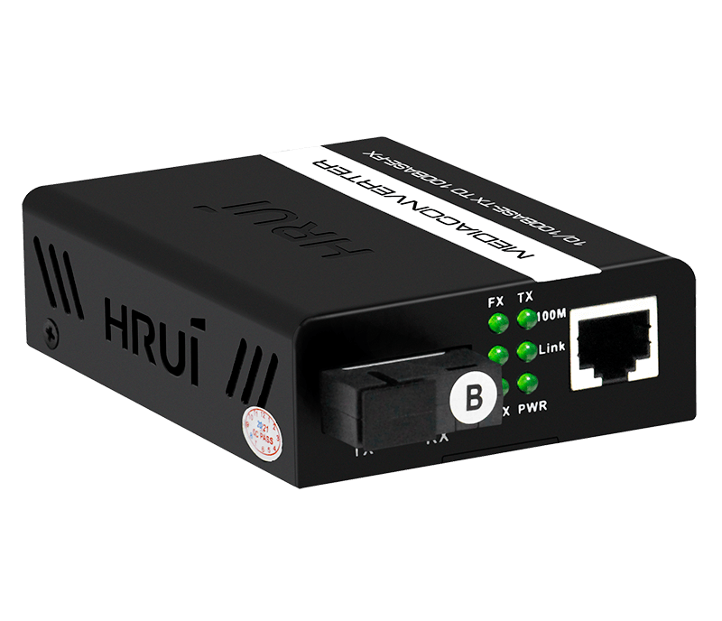
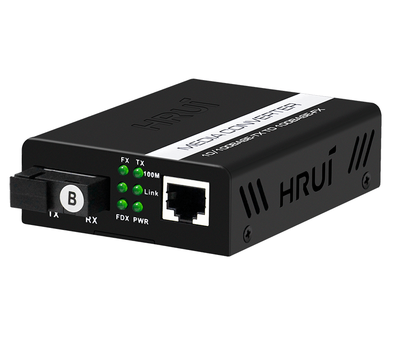
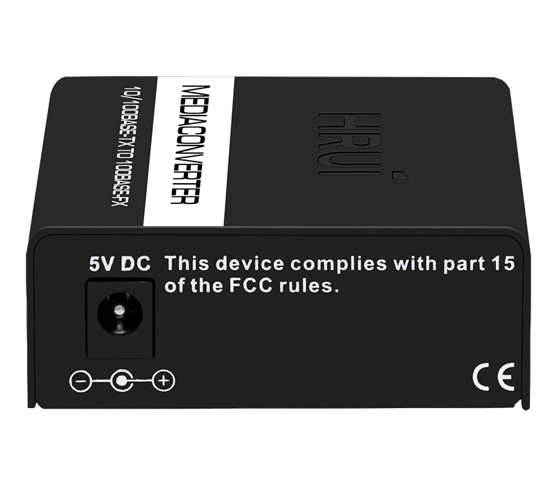
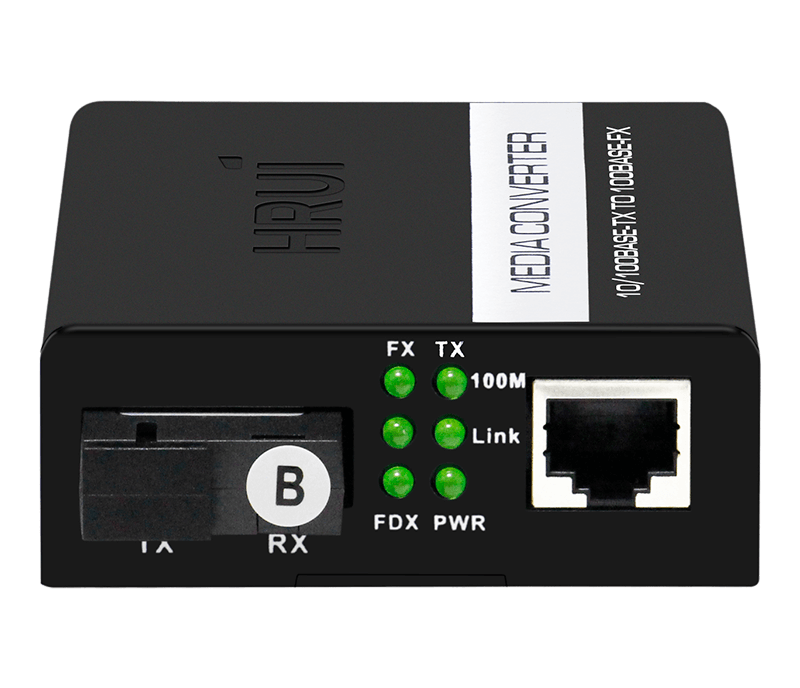
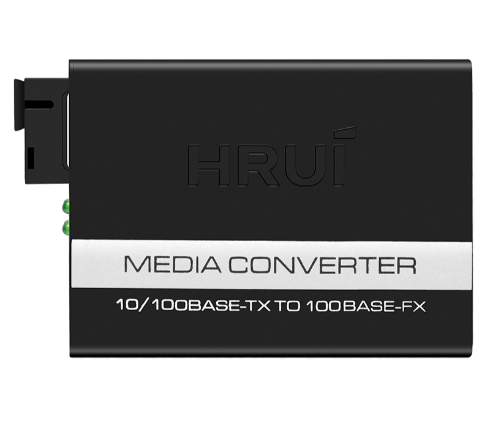

# HR100W-FE-25

> 来源：<https://www.hruitech.com/optical-fiber-converter/153.html>（抓取 2026-10-21T04:36:52Z；英文原文照录，中文仅为栏目名）  
> 官网描述：10/100M Single-mode Dual Fiber Media Converter HR100W-FE-25  
> 类目：Optical Fiber Converter（site id 153）  
> 接口：1×10/100M；PoE 预算 —；交换带宽 —；电源 —

**Brief:** 10/100M single-mode dual fiber media converter with 1* 10/100M RJ45 port + 1*10/100M uplink SC port, the default transmission distance is 25Km, external power supply. The media converter adopts international advanced chip and design to ensure the stability and practicability. With ultra-low transmission delay and line speed forwarding ability, it can realizes flexible Ethernet expansion even in harsh environment.

## 产品图






## Datasheet
- [HR100W-FE-25.pdf](https://www.hruitech.com/web/userfiles/productfile/HR100W-FE-25.pdf) （本地：`data/hrui_site_raw/datasheets/HR100W-FE-25.pdf`；文本：`data/hrui_site_raw/datasheet_text/HR100W-FE-25.txt`）

## Feature and Benefits（原文）
```
The HR100W-FE-25 is a cutting-edge 10/100M single-mode dual fiber media converter designed to enhance your network capabilities. Featuring one 10/100M RJ45 port and one 10/100M uplink SC port, this versatile device supports a default transmission distance of up to 25 km with an external power supply. Built with advanced international chips and superior design, the HR100W-FE-25 ensures exceptional stability and practicality. Its ultra-low transmission delay and efficient line speed forwarding capability enable seamless Ethernet expansion, even in challenging environments.
Product Features:
High-Efficiency Switching Core:
Equipped with a built-in switching core that effectively manages flow control and reduces broadcast packets, ensuring optimal performance.
Automatic Adaptation:
Automatically adapts to 10/100Mbps network environments, facilitating smooth and efficient network upgrades without manual configuration.
Full-Duplex & Half-Duplex Support:
Automatically negotiates transmission modes for greater flexibility.
Packet Handling:
Capable of handling packet sizes of 1536-1552 bytes, ensuring smoother monitoring and data transmission.
Comprehensive Power and Status Indicators:
Equipped with clear indicator lights for easy monitoring of working conditions.
Low Power Consumption:
Designed for low heat generation, ensuring long-term stable operation with enhanced network security.
Versatile Fiber Options:
Compatible with dual-fiber multimode, dual-fiber single-mode, single-fiber single-mode, and multiple fiber interface configurations.
```

## Parameter（规格表逐行）
| 项 | 值 |
|---|---|
| **Specification** | |
| **I/O Interface** | |
| Power | DC 5V |
| Ethernet | 1*10/100M RJ45 port |
| Ethernet | 1 *100M fiber port |
| **Performance** | |
| Switching Capacity | 0.4Gbps |
| Throughput | 0.2976Mpps |
| Packet Buffer | 448K |
| MAC Address | 1K |
| Jumbo Frame | 1552bytes |
| Transfer Mode | Store and forward |
| MTBF | 100000 hour |
| **Standard** | |
| Network protocol | IEEE802.3(10Base-T) |
| Network protocol | IEEE802.3u(100Base-TX/FX) |
| Network protocol | IEEE802.3x(Flow control) |
| Optical Characteristics | multi mode: 850/1310nm(0-2KM) |
| Optical Characteristics | Single mode: 1310/1550/1490nm(0-120KM) |
| Industry Standard | EMI: FCC Part 15 CISPR(EN55032) class A |
| Industry Standard | EMS: EN61000-4-2(ESD), EN61000-4-4(EFT) |
| Industry Standard | Shock: IEC 60068-2-27 |
| Industry Standard | Free Fall: IEC 60068-2-32 |
| Industry Standard | Vibration: IEC 60068-2-6 |
| Network Medium | 10Base-T: Cat3, 4, 5 or above UTP(≤100m) |
| Network Medium | 100Base-TX: Cat5 or above UTP(≤100m) |
| Optical Media | Multimode fiber: 50/125, 62.5/125, 100/140μm |
| Optical Media | Single mode fiber: 8/125, 8.7/125, 9/125, 10/125μm |
| **Certification** | |
| Safety Certificate | CE, FCC, RoHS |
| **Environment** | |
| Working Environment | Working Temperature: -10~50°C |
| Working Environment | Storage Temperature: -40~70°C |
| Working Environment | Working Humidity: 10%~90%，non-condensing |
| Working Environment | Storage Temperature: 5%~90%，non-condensing |
| Working Environment | Working Height: Maximum10,000 feet |
| Working Environment | Storage heigh: Maximum 10,000 feet |
| **Mechanical** | |
| Structure Size | Product Size: 94*70*26mm |
| Structure Size | Package Size: 245*190*60mm |
| Structure Size | Product Net-Weight: 0.2*2kg |
| Structure Size | Product Gross-Weight: 0.7kg |
| Packing Info | MEAS: 620*400*510mm |
| Packing Info | Packing Qty: 40 Pairs |
| Packing Info | Packing weight: 29.5KG |
| Power Voltage | Adapter input voltage : AC 100-240 V |
| Power Voltage | Media Converter input voltage: DC 5V2A |
| Package List | Media Converter 2 pcs, Power Adapter 2 pcs, User manual 1 pcs, Qualification Card 1 pc |
| **Indication** | |
| LED Indicators | PWR(Power indicator) |
| LED Indicators | FDX(Network mode) |
| LED Indicators | FX Link(Optical data) |
| LED Indicators | TX Link(Network data) |
| LED Indicators | FX 100M(Optical Link) |
| LED Indicators | TX 100M(Network Link) |
| **Ordering Info** | |
| HR100W-FE-550 | 100M Fiber Media Converter Dual Fiber Multimode 550m TX/RX 850 |
| HR100W-FE-2 | 100M Fiber Media Converter Dual Fiber Multimode 2KM TX/RX 1310 |
| HR100W-FE-3-TR | 100M Fiber Media Converter Single Fiber Single-mode 3KM TX1310/RX1550 |
| HR100W-FE-25-TR | 100M Fiber Media Converter Single Fiber Single-mode 25KM TX1550/RX1310 |
