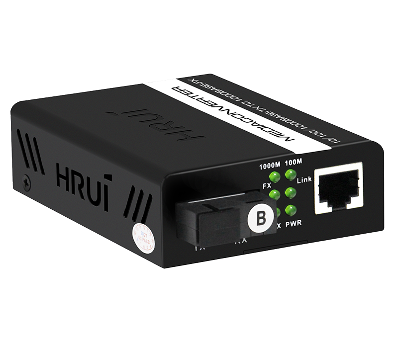
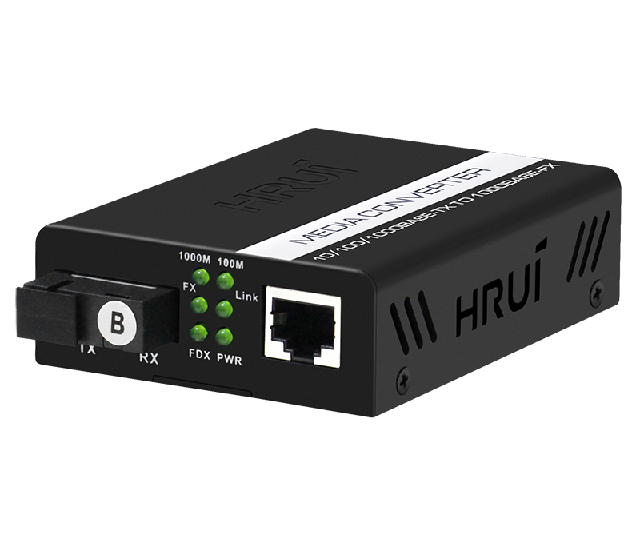
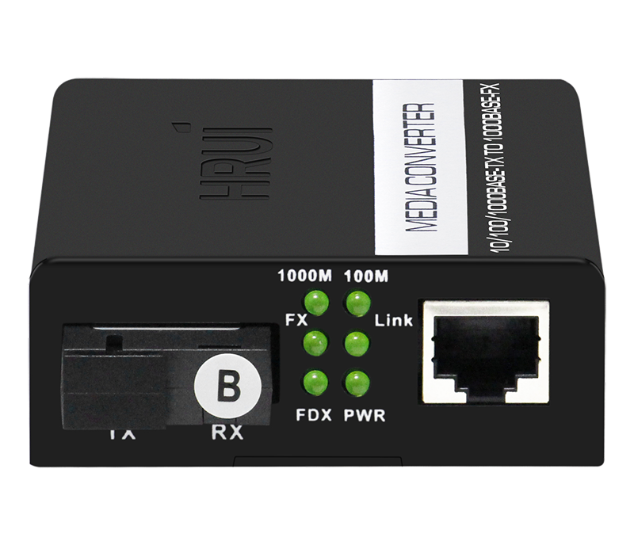
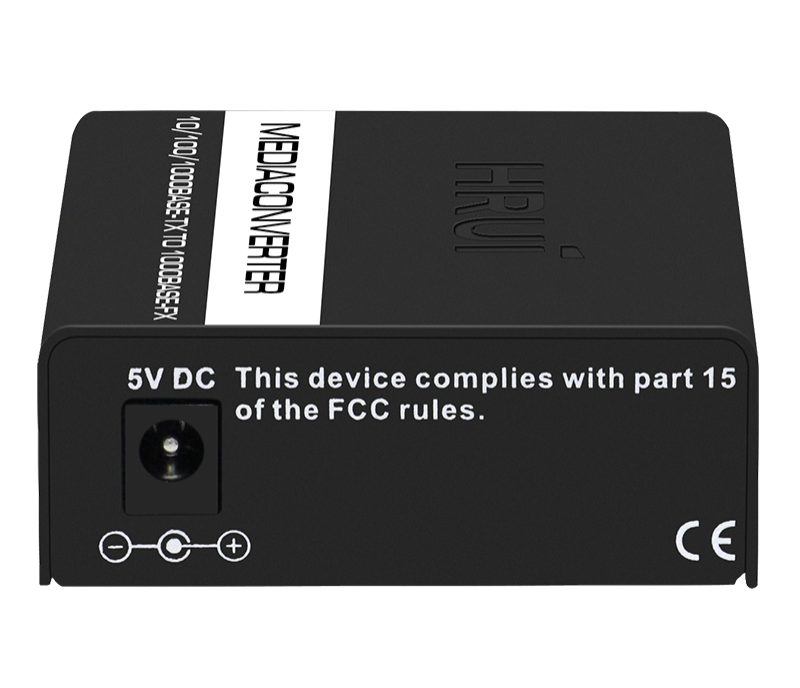
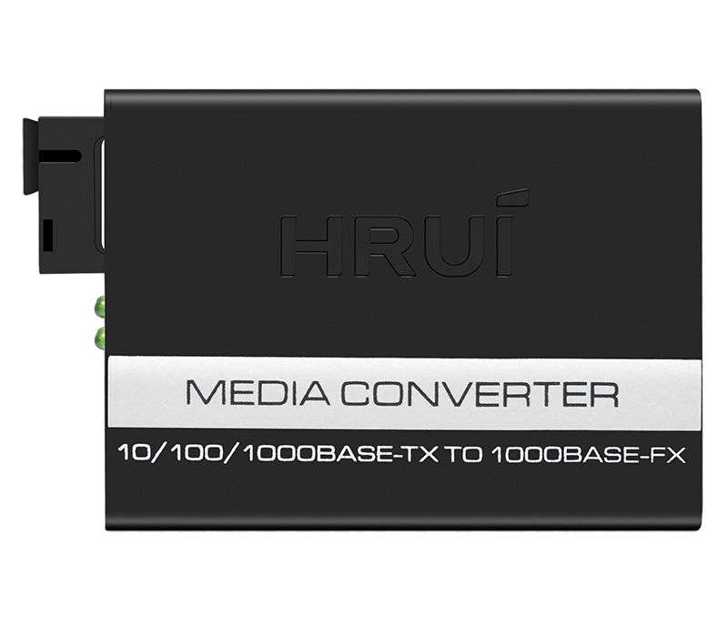

# HR100W-GE-3-TR

> 来源：<https://www.hruitech.com/optical-fiber-converter/152.html>（抓取 2026-10-21T04:36:53Z；英文原文照录，中文仅为栏目名）  
> 官网描述：Gigabit Single-mode Media Converter HR100W-GE-3-TR  
> 类目：Optical Fiber Converter（site id 152）  
> 接口：1×Gigabit；PoE 预算 —；交换带宽 —；电源 —

**Brief:** Gigabit single-mode single fiber media converter with 1* Gigabit RJ45 port + 1*Gigabit uplink SC port, the default transmission distance is 3Km, external power supply. The media converter adopts international advanced chip and design to ensure the stability and practicability. With ultra-low transmission delay and line speed forwarding ability, it can realizes flexible Ethernet expansion even in harsh environment.

## 产品图






## Datasheet
- [HR100W-GE-3-TR.pdf](https://www.hruitech.com/web/userfiles/productfile/HR100W-GE-3-TR.pdf) （本地：`data/hrui_site_raw/datasheets/HR100W-GE-3-TR.pdf`；文本：`data/hrui_site_raw/datasheet_text/HR100W-GE-3-TR.txt`）

## Feature and Benefits（原文）
```
HR100W-GE-3-TR, a cutting-edge Gigabit Single-Mode Single Fiber Media Converter designed to enhance your networking capabilities. This device features one Gigabit RJ45 port and one Gigabit SC uplink port, providing seamless connectivity with a default transmission range of up to 3 kilometers. Powered by an external supply, this media converter integrates advanced international chip technology and an optimized design to guarantee exceptional stability and reliability.
Key features include ultra-low transmission delay and high-speed forwarding capabilities, allowing for efficient Ethernet expansion even in challenging environments. Whether you're expanding your network infrastructure or establishing long-range connections, the HR100W-GE-3-TR is your ideal solution for robust and flexible networking. Experience increased performance and reliability with our state-of-the-art media converter.
Product Features:
High-Efficiency Switching Core:
Built-in technology to optimize flow control and minimize broadcast packets.
Automatic Adaptation:
Effortlessly accommodates 10/100/1000Mbps network environments, enabling hassle-free network upgrades.
Full-Duplex & Half-Duplex Support:
Automatically negotiates transmission modes for greater flexibility.
Packet Handling:
Supports packet sizes up to 9216 bytes, ensuring smooth monitoring and transmission.
Comprehensive Power and Status Indicators:
Equipped with clear indicator lights for easy monitoring of working conditions.
Low Power Consumption:
Designed for low heat generation, ensuring long-term stable operation with enhanced network security.
Versatile Fiber Options:
Compatible with dual-fiber multimode, dual-fiber single-mode, single-fiber single-mode, and multiple fiber interface configurations.
```

## Parameter（规格表逐行）
| 项 | 值 |
|---|---|
| **Specification** | |
| **I/O Interface** | |
| Power | DC 5V |
| Ethernet | 1*10/100/1000M RJ45 port |
| Ethernet | 1*1000M fiber port |
| **Performance** | |
| Switching Capacity | 4Gbps |
| Throughput | 2.976Mpps |
| Packet Buffer | 2K |
| MAC Address | 2K |
| Jumbo Frame | 9216bytes |
| Transfer Mode | Store and forward |
| MTBF | 100000 hour |
| **Standard** | |
| Network protocol | IEEE802.3(10Base-T) |
| Network protocol | IEEE802.3u(100Base-TX/FX) |
| Network protocol | IEEE802.3ab (1000Base-TX/FX) |
| Network protocol | IEEE802.3x(Flow control) |
| Optical Characteristics | multi mode: 850/1310nm(0-2KM) |
| Optical Characteristics | Single mode: 1310/1550/1490nm(0-120KM) |
| Industry Standard | EMI: FCC Part 15 CISPR(EN55032) class A |
| Industry Standard | EMS: EN61000-4-2(ESD), EN61000-4-4(EFT) |
| Industry Standard | Shock: IEC 60068-2-27 |
| Industry Standard | Free Fall: IEC 60068-2-32 |
| Industry Standard | Vibration: IEC 60068-2-6 |
| Network Medium | 10Base-T: Cat3, 4, 5 or above UTP(≤100m) |
| Network Medium | 100Base-TX: Cat5 or above UTP(≤100m) |
| Network Medium | 1000Base-TX: Cat5 or above UTP(≤100m) |
| Optical Media | Multimode fiber: 50/125, 62.5/125, 100/140μm |
| Optical Media | Single mode fiber: 8/125, 8.7/125, 9/125, 10/125μm |
| **Certification** | |
| Safety Certificate | CE, FCC, RoHS |
| **Environment** | |
| Working Environment | Working Temperature: -10~50°C |
| Working Environment | Storage Temperature: -40~70°C |
| Working Environment | Working Humidity: 10%~90%, non-condensing |
| Working Environment | Storage Temperature: 5%~90%, non-condensing |
| Working Environment | Working Height: Maximum 10,000 feet |
| Working Environment | Storage heigh: Maximum 10,000 feet |
| **Mechanical** | |
| Structure Size | Product Size: 94*70*26mm |
| Structure Size | Package Size: 245*190*60mm |
| Structure Size | Product Net-Weight: 0.20*2 kg |
| Structure Size | Product Gross-Weight: 0.70 kg |
| Packing Info | MEAS: 620*400*510mm |
| Packing Info | Packing Qty: 40 Pairs |
| Packing Info | Packing weight: 29.5KG |
| Power Voltage | Adapter input voltage : AC 100-240V |
| Power Voltage | Media Converter input voltage: DC 52V2A |
| Package List | Media Converter 2 pcs, Power Adapter 2 pcs, User manual 1 pcs, Qualification Card 1 pc |
| **Indication** | |
| LED Indicators | PWR(Power indicator) |
| LED Indicators | FDX(Network mode) |
| LED Indicators | 1000M(1000M Network Link) |
| LED Indicators | 100M(100M Network Link) |
| LED Indicators | FX(Optical Link&Act) |
| LED Indicators | Link(Network Link&Act) |
| **Ordering Info** | |
| HR900W-GE-550 | 1000M Fiber Media Converter-dual-fiber multimode 550m TX/RX 850 |
| HR900W-GE-2 | 1000M Fiber Media Converter-dual-fiber multimode 2KM TX/RX 1310 |
| HR900W-GE-3-T | 1000M Fiber Media Converter-single-fiber single mode 3KM TX1310/RX1550 |
| HR900W-GE-3-R | 1000M Fiber Media Converter-single-fiber single mode 3KM TX1550/RX1310 |
| HR900W-GE-25-T | 1000M Fiber Media Converter-single-fiber single mode 20KM TX1310/RX1550 |
| HR900W-GE-25-R | 1000M Fiber Media Converter-single-fiber single mode 20KM TX1550/RX1310 |
