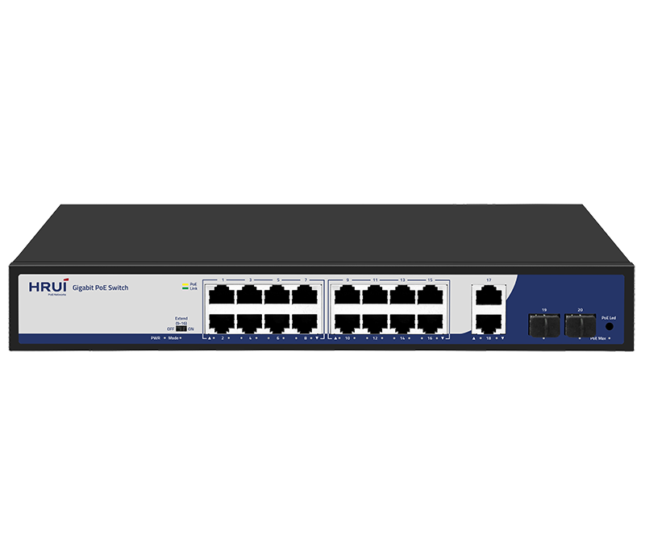
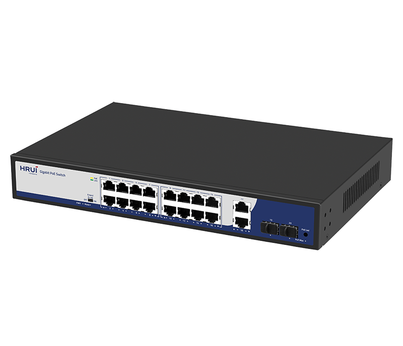
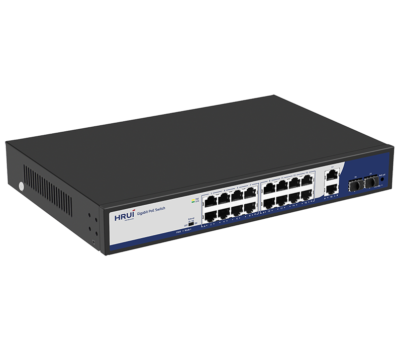
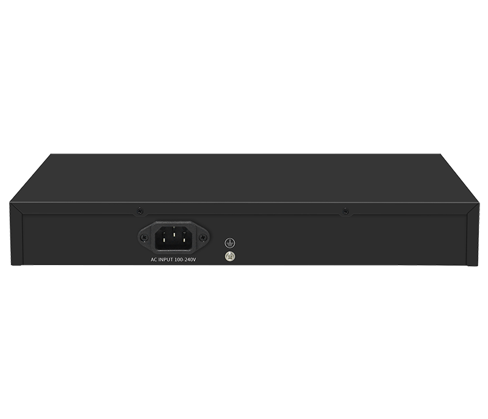

# HR200-AFG-1622S-200

> 来源：<https://www.hruitech.com/poe-switch/274.html>（抓取 2026-10-21T04:35:33Z；英文原文照录，中文仅为栏目名）  
> 官网描述：16-Port 10/100/1000T 802.3af/at PoE + 2-Port 10/100/1000T  + 2-Port Gigabit SFP Ethernet Switch (200 Watts)  
> 类目：PoE Switch（site id 274）  
> 接口：16* 1G PoE ports / 2 *1G RJ45 ports / 2 *1G SFP ports；PoE 预算 180W；交换带宽 —；电源 AC 100-240V 50/60Hz / DC 52V 3.84A

**Brief:** The HR200-AFG-1622S-200 is a reliable and high-performance 20-port Gigabit PoE (Power over Ethernet) switch designed to support a wide range of applications. With its advanced features and robust build, this switch is ideal for small to medium-sized businesses, schools, and industries looking for a scalable and efficient network solution.

## 产品图





## Datasheet
- [HR200_AFG_1622S_200.pdf](https://www.hruitech.com/web/userfiles/productfile/HR200_AFG_1622S_200.pdf) （本地：`data/hrui_site_raw/datasheets/HR200_AFG_1622S_200.pdf`；文本：`data/hrui_site_raw/datasheet_text/HR200_AFG_1622S_200.txt`）

## Feature and Benefits（原文）
```
The HR200-AFG-1622S-200 is a reliable and high-performance 20-port Gigabit PoE (Power over Ethernet) switch designed to support a wide range of applications. With its advanced features and robust build, this switch is ideal for small to medium-sized businesses, schools, and industries looking for a scalable and efficient network solution.
Product Features:
Port Configuration:
16x 1G PoE ports, 2x 1G RJ45 ports, and 2x 1G SFP ports.
Standard Compliance:
IEEE 802.3, IEEE 802.3u, IEEE 802.3ab, and IEEE 802.3x.
Port Adaptation:
RJ45 ports support 10M/100M/1G adaptation for seamless compatibility with various devices.
PoE Mode:
When in Extend mode, ports 9-16 automatically force 10Mbps to activate the PoE watchdog mode.
PoE Priority:
Supports priority-based power allocation to ensure critical devices receive stable power.
Flow Control:
IEEE 802.3x (Full Duplex) and Back Pressure (Half Duplex) for efficient network traffic management.
Panel Indicator LED:
Visualizes working status and aids in fault analysis for easy troubleshooting.
Extend Mode Support:
Allows for extended cable runs and flexible network configuration.
High-Powered Ports:
Supports up to 60W of power per port, making it ideal for powering devices that require high power, such as IP cameras.
```

## Parameter（规格表逐行）
| 项 | 值 |
|---|---|
| Description | Specification |
| Model | HR200-AFG-1622S-200 |
| Interface | 16* 1G PoE ports |
| Interface | 2 *1G RJ45 ports |
| Interface | 2 *1G SFP ports |
| Port Standard | IEEE802.3 (Ethernet) |
| Port Standard | IEEE802.3u (Fast Ethernet) |
| Port Standard | IEEE802.3ab (1000Mbps Ethernet) |
| Port Standard | IEEE802.3x (Flow Control) |
| Port Standard | IEEE 802.3z (1000Mbps Ethernet Fiber Standard) |
| Switching Capacity | 40 Gbps |
| Packet Forwarding Rate | 29.76Mpps |
| Packet Buffer | 3Mbit |
| MAC Address Table | 2K |
| Transmission Method | Store and Forward |
| PoE Standard | IEEE802.3af （15.4W） |
| PoE Standard | IEEE802.3at （30W） |
| PoE Port Output Voltage | DC 44-57V |
| PoE Ports | Port 2-16 PoE power output <30W(port1 support 60w) |
| PoE Power Budget | 180W |
| Power Supply | AC 100-240V 50/60Hz |
| Power Supply | DC 52V 3.84A |
| Mainboard Power Consumption | 20W |
| Structure Information | Product Dimensions :320*207*44mm |
| Structure Information | Packaging Dimensions : 370*290*85mm |
| Structure Information | Product Net Weight: 1.78KG |
| Structure Information | Product Gross Weight: 2.28KG |
| Packing Information | Carton Dimensions: 445*310*390mm |
| Packing Information | Packing Quantity: 5PCS |
| Packing Information | Packing Weight: 12.4KG |
| Package Contents | Switch 1pcs, power cord 1pcs, manual 1pcs,certificate of qualification 1pcs |
| Fan Quantity | 0 |
| Installation | Desktop,rack-mounted |
| Certification | CE, FCC, RoHS |
| Surge Protection | Surge protection: Common mode 4KV, differential mode 2KV (Class B); Electrostatic ESD: Air 8KV, Contact 6KV (Class C) |
| Surge Protection | Power supply: common mode 4KV, differential mode 2KV (Class B) |
| Operating Temperature | 0~40°C |
| Storage Temperature | -40 °C to 70 °C |
| Operation Humidity | 10%~90%，non condensing |
| Storage Humidity | 5%~95%，non condensing |
| PWR LED | Green LED On: Powered on |
| PWR LED | Green LED Off: Powered off |
| 1-20 Green LED | On: 10M/100M/1G Link normal |
| 1-20 Green LED | Off: Link blocked |
| 1-20 Green LED | Flashing: Data transmitting |
| 1-16 Yellow LED | On: PoE powered on |
| 1-16 Yellow LED | Off: PoE powered off |
| PoE Max Green LED | Off: Indicate that the PoE power usage is less than 90% |
| PoE Max Green LED | Flashing(Once per second): Indicate that the PoE power usage of 90% ≤ P ≤ 95% |
| PoE Max Green LED | On: Indicate that the PoE power is used at 95%<P<100% |
| Mode Light Green LED | Off: Extend off |
| Mode Light Green LED | Flashing: Extend on |
| PoE Led Buttons | Dual color light selection: default green (link data), switch yellow light (PoE) |
| Extend mode Button | OFF: All interfaces can communicate with each other, with an adaptive transmission rate of 10M/100/1000Mbps, and port PoE watchdog mode turned off; |
| Extend mode Button | ON: The 9-16 ports can extend the transmission distance by 250 meters, with a transmission rate of 10Mbps, and the PoE watchdog mode is enabLight on the port; |

## Product structure / Application topology（图）
- https://www.hruitech.com/web/userfiles/image/20250208/1738981362579651.png
