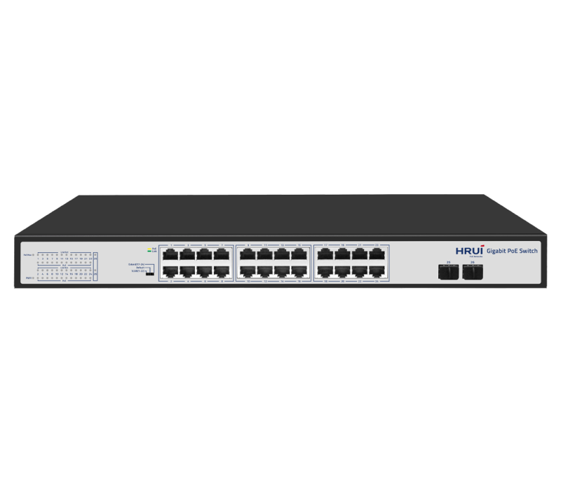
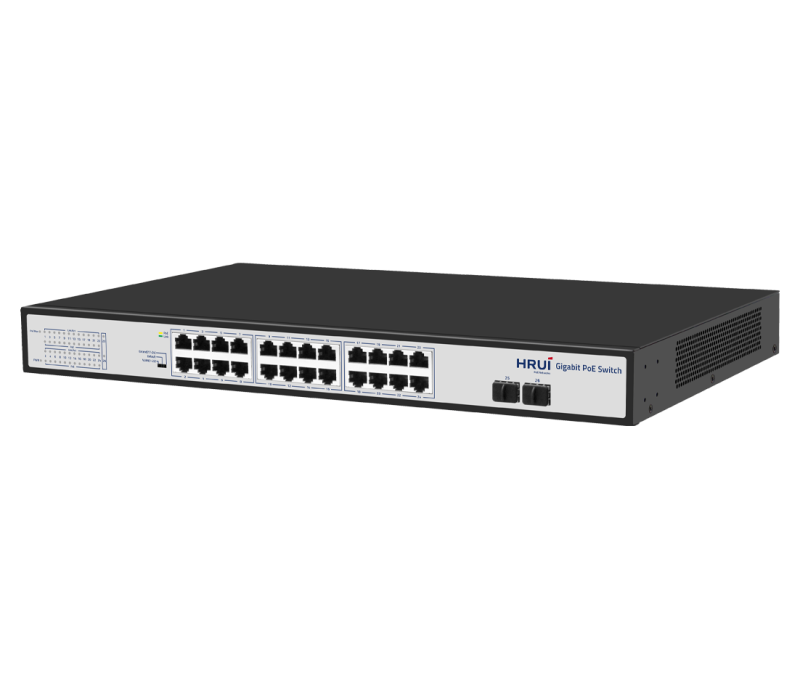
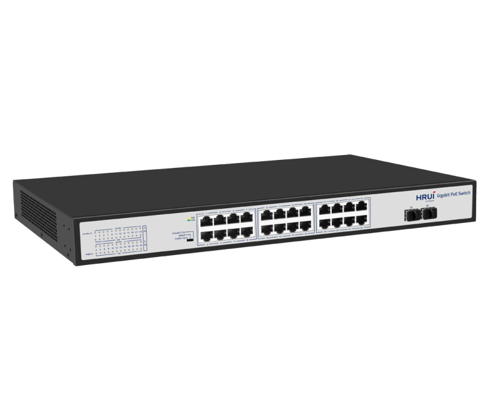
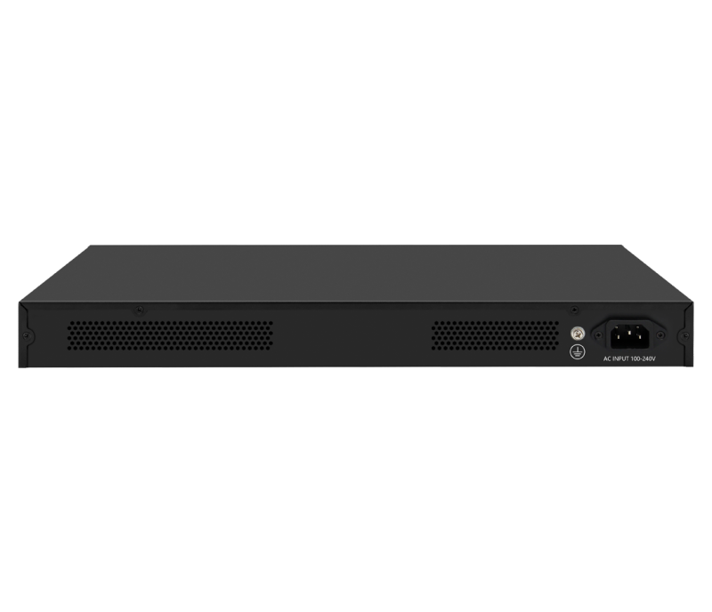

# HR200-AFG-242S-400

> 来源：<https://www.hruitech.com/poe-switch/211.html>（抓取 2026-10-21T04:35:34Z；英文原文照录，中文仅为栏目名）  
> 官网描述：24-Port 10/100/1000T 802.3af/at PoE + 2-Port Gigabit SFP Intelligent Ethernet Switch (400 Watts)  
> 类目：PoE Switch（site id 211）  
> 接口：24* 1G PoE ports / 2* 1G SFP ports；PoE 预算 380W；交换带宽 —；电源 AC 100-240V 50/60Hz / DC 52V 7.69A

**Brief:** Gigabit intelligent PoE switch, with 24*Gigabit PoE ports + 2*Gigabit uplink SFP ports, IEEE 802.3af/at standard, bandwidth 52Gbps, total power 400W, 1-8 ports support QoS, surpport port isolation and 250m transmission, suitable for -10~50℃ wide temperature environment, 1U rack-mounted

## 产品图





## Datasheet
- [HR200_AFG_242S_400.pdf](https://www.hruitech.com/web/userfiles/productfile/HR200_AFG_242S_400.pdf) （本地：`data/hrui_site_raw/datasheets/HR200_AFG_242S_400.pdf`；文本：`data/hrui_site_raw/datasheet_text/HR200_AFG_242S_400.txt`）

## Feature and Benefits（原文）
```
The HR200-AFG-242S-400 is a high-performance Gigabit Intelligent PoE Switch designed to meet the demanding needs of modern networking environments. Featuring 24 Gigabit PoE ports and 2 Gigabit uplink SFP ports, this switch adheres to IEEE 802.3af/at standards, providing superior connectivity and power delivery. With a robust bandwidth capacity of 52 Gbps and a total power output of 400W, it ensures efficient operation for connected devices. The switch offers enhanced features including Quality of Service (QoS) support on ports 1-8, port isolation capabilities, and 250m transmission distance, making it ideal for a wide range of applications. It is engineered to operate in a broad temperature range of -10°C to 50°C, and its 1U rack-mount design makes it a perfect fit for server rooms and network closets.
Product Features:
24 Gigabit PoE Ports + 2 Gigabit SFP Uplink Ports:
Ideal for connecting multiple devices while providing power through Ethernet.
Standards Compliance:
Supports IEEE802.3, IEEE802.3u, IEEE802.3x, IEEE802.3ab, and IEEE802.3z for seamless integration into your network.
Power Over Ethernet Compatibility:
Fully compatible with IEEE802.3at (30W) and IEEE802.3af (15.4W) standards to support a variety of powered devices.
Adaptive RJ45 Ports:
Automatically adjusts to 10M, 100M, or 1G speeds and PoE functionality for flexible device connectivity.
Auto MDI/MDIX Support:
Automatic port flipping capability eliminates the need for crossover cables, simplifying setup.
Comprehensive Status Monitoring:
Features panel indicators to monitor operational status and facilitate quick fault diagnosis.
PoE Priority Management:
PoE priority is enabled by default, with a priority order from ports 1 to 24 for efficient power distribution.
Versatile Operating Modes:
Supports VLAN, Default, and Extend modes to adapt to various networking needs.
```

## Parameter（规格表逐行）
| 项 | 值 |
|---|---|
| Description | Specification |
| Model | HR200-AFG-242S-400 |
| Interface | 24* 1G PoE ports |
| Interface | 2* 1G SFP ports |
| Port Standard | IEEE802.3 (Ethernet) |
| Port Standard | IEEE802.3u (Fast Ethernet) |
| Port Standard | IEEE802.3ab (Gigabit Ethernet) |
| Port Standard | IEEE802.3z (Gigabit Ethernet Fiber) |
| Port Standard | IEEE802.3x (Flow Control) |
| Bandwidth | 52 Gbps |
| Packet Forwarding Rate | 38.7Mpps |
| Packet Buffer | 4.1Mbit |
| MAC Address Table | 8K |
| Transmission Method | Store and Forward |
| PoE Standard | IEEE802.3af (15.4W) |
| PoE Standard | IEEE802.3at (30W) |
| PoE Port Output Voltage | DC 44-57V |
| PoE Ports | Port 1-24 PoE power output <30W |
| PoE Power Budget | 380W |
| Power Supply | AC 100-240V 50/60Hz |
| Power Supply | DC 52V 7.69A |
| Mainboard Power Consumption | 15.75W |
| Structure Information | Product Dimensions :440*280*44mm |
| Structure Information | Packaging Dimensions: 500*365*85mm |
| Structure Information | Product Net Weight: 3.66KG |
| Structure Information | Product Gross Weight: 4.95KG |
| Packing Information | Carton Dimensions: 520*445*385mm |
| Packing Information | Packing Quantity: 5PCS |
| Packing Information | Packing Weight: 25.75KG |
| Package Contents | Switch 1pcs, power cord 1pcs, manual 1pcs,certificate of qualification 1pcs |
| Fan Quantity | 0 |
| Installation | Desktop,Rack-mounting |
| Certification | CE,FCC,RoHS |
| Surge Protection | Port Surge: common mode 4KV, differential mode 2KV (Class C) |
| Surge Protection | Electrostatic ESD: Air 8KV, Contact 6KV (Class C) |
| Operating Temperature | 0~40°C |
| Storage Temperature | -40 °C to 70 °C |
| Operation Humidity | 10%~90%,non condensing |
| Storage Humidity | 5%~95%,non condensing |
| PWR Green LED | On: Powered on |
| PWR Green LED | Off: Powered off |
| 1-26 Green LED | On:10M/100M/1G Link normal |
| 1-26 Green LED | Off: Link blocked |
| 1-26 Green LED | Flashing: Data transmitting |
| 1-24 Yellow LED (PoE) | On: PoE powered on |
| 1-24 Yellow LED (PoE) | Off: PoE powered off |
| PoE Max Green LED | Off: Indicate that the PoE power usage is less than 90% |
| PoE Max Green LED | Flashing(Once per second): Indicate that the PoE power usage of 90% ≤ P ≤ 95% |
| PoE Max Green LED | On: Indicate that the PoE power is used at 95%<P<100% |
| VLAN/Default/Extend Modes Buttons | VLAN: Isolation mode, 1-24 ports isolated from each other, communicating with 25-26 ports |
| VLAN/Default/Extend Modes Buttons | Default: Normal mode, all interfaces can communicate with each other, transmission distance is within 100 meters, transmission rate is 10M/100M/1G adaptive |
| VLAN/Default/Extend Modes Buttons | Extend: Link extension mode,17-24port PoE power supply and data transmission distance can be extended to 250 meters, transmission speed is 10Mbps |

## Product structure / Application topology（图）
- https://www.hruitech.com/web/userfiles/image/20241224/1735010544969673.png
