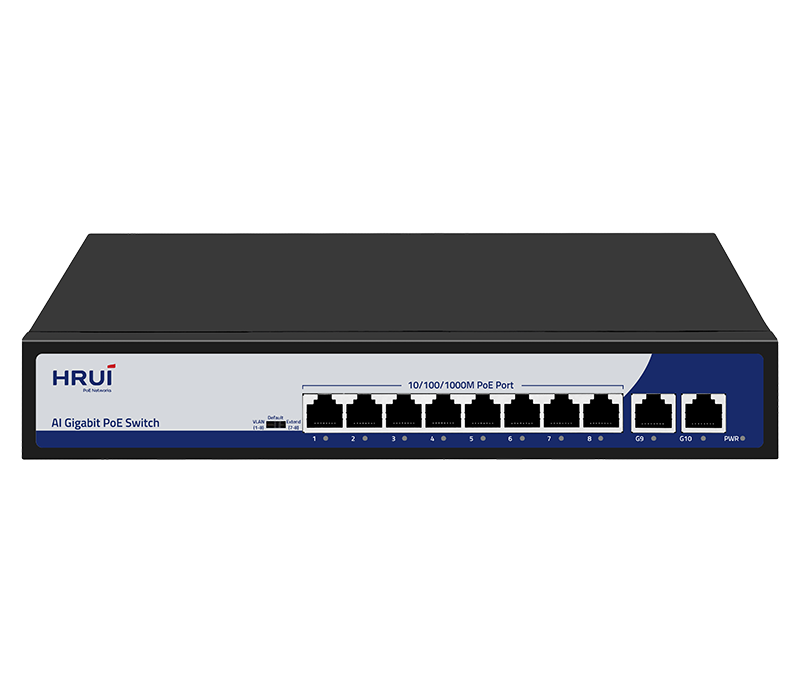
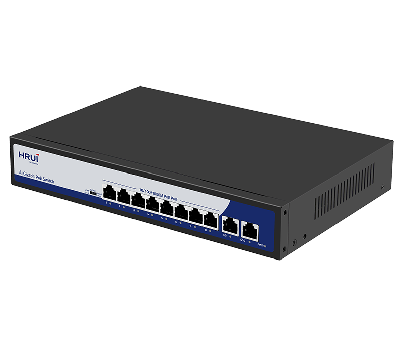
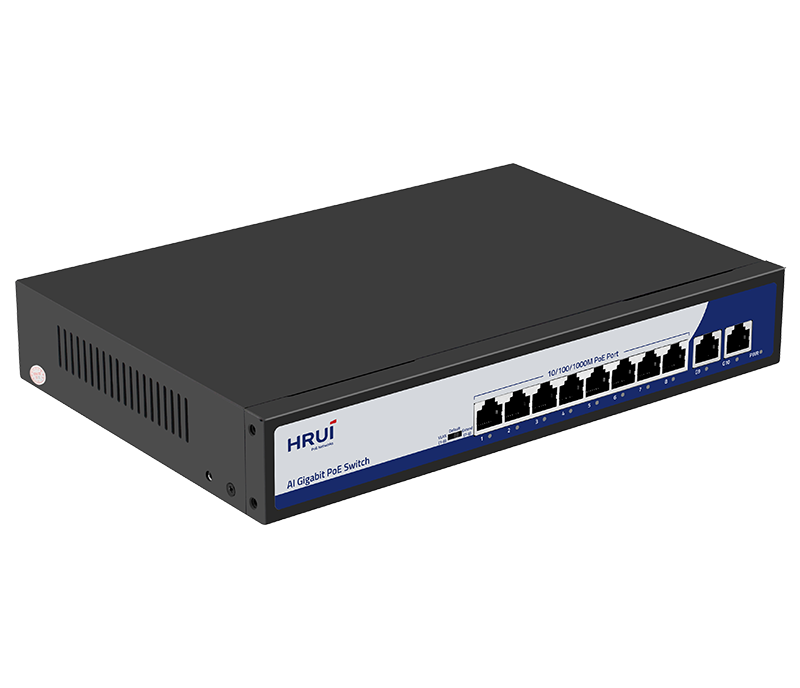
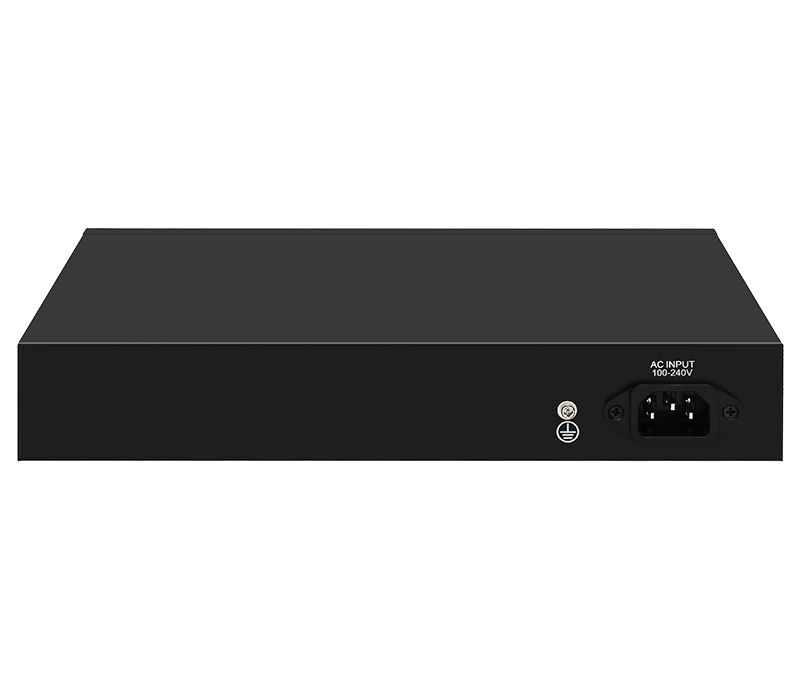

# HR200-AFG-82N-150

> 来源：<https://www.hruitech.com/poe-switch/277.html>（抓取 2026-10-21T04:35:32Z；英文原文照录，中文仅为栏目名）  
> 官网描述：8-Port 10/100/1000T 802.3af/at PoE + 2-Port 10/100/1000T Ethernet Switch (150 Watts)  
> 类目：PoE Switch（site id 277）  
> 接口：8 *1G PoE ports / 2 *1G uplink RJ45 ports；PoE 预算 140W；交换带宽 —；电源 AC 100-240V 50/60Hz / DC 52V 2.88A

**Brief:** The HR200-AFG-82N-150 is a high-performance 10-Port Gigabit PoE Switch designed to enhance your network solutions. With its robust features, it provides flexible power options and seamless connectivity for various devices, making it ideal for both small businesses and extensive enterprise networks. This switch ensures reliable data transmission and power delivery across multiple devices while adhering to industry standards.

## 产品图





## Datasheet
- [HR200_AFG_82N_150.pdf](https://www.hruitech.com/web/userfiles/productfile/HR200_AFG_82N_150.pdf) （本地：`data/hrui_site_raw/datasheets/HR200_AFG_82N_150.pdf`；文本：`data/hrui_site_raw/datasheet_text/HR200_AFG_82N_150.txt`）

## Feature and Benefits（原文）
```
The HR200-AFG-82N-150 is a high-performance 10-Port Gigabit PoE Switch designed to enhance your network solutions. With its robust features, it provides flexible power options and seamless connectivity for various devices, making it ideal for both small businesses and extensive enterprise networks. This switch ensures reliable data transmission and power delivery across multiple devices while adhering to industry standards.
Product Features:
8 Gigabit PoE Ports + 2 Gigabit RJ45 Ports:
Experience high-speed connectivity with 8 Power over Ethernet (PoE) ports and 2 additional standard Ethernet ports for versatile integration.
Industry Standards Compliance:
Complies with IEEE 802.3, IEEE 802.3u, IEEE 802.3ab, and IEEE 802.3x standards, ensuring compatibility and performance reliability.
Port Adaptation:
Each RJ45 port supports automatic adaptation to 10M, 100M, and 1G speeds, ensuring optimal performance for all connected devices.
Intelligent PoE Management:
Automatically activates PoE watchdog in VLAN and Extend modes, providing efficient power management for connected devices.
Flow Control:
Supports full duplex flow control using the IEEE 802.3x standard, while half duplex employs Back Pressure standards for optimized data transmission.
High Power Output:
Port 1 is capable of delivering up to 60W of power, enabling the connection of high-demand PoE devices.
Status Monitoring:
The panel indicator LEDs provide real-time monitoring of the working status and facilitate easy fault analysis.
Versatile Operating Modes:
Supports VLAN, Default, and Extend modes, allowing for tailored configurations to fit various network scenarios.
Configurable PoE Priority:
Prioritize PoE allocation with configurable settings for ports 1-8, ensuring critical devices remain powered.
```

## Parameter（规格表逐行）
| 项 | 值 |
|---|---|
| Description | Specification |
| Model | HR200-AFG-82N-150 |
| Interface | 8 *1G PoE ports |
| Interface | 2 *1G uplink RJ45 ports |
| Port Standard | IEEE802.3 (Ethernet) |
| Port Standard | IEEE802.3u (Fast Ethernet) |
| Port Standard | IEEE802.3ab (Gigabit Ethernet) |
| Port Standard | IEEE802.3x (Flow Control) |
| Bandwidth | 20 Gbps |
| Packet Forwarding Rate | 14.88Mpps |
| Packet Buffer | 1Mbit |
| MAC Address Table | 2K |
| Transmission Method | Store and Forward |
| PoE Standard | IEEE802.3af (15.4W) |
| PoE Standard | IEEE802.3at (30W) |
| PoE Port Output Voltage | DC 44-57V |
| PoE Ports | Port 1 PoE power output <60W |
| PoE Ports | Port 2-8 PoE power output <30W |
| PoE Power Budget | 140W |
| Power Supply | AC 100-240V 50/60Hz |
| Power Supply | DC 52V 2.88A |
| Mainboard Power Consumption | 6.5W |
| Structure Information | Product Dimensions :268*181*44mm |
| Structure Information | Packaging Dimensions : 316*285*71mm |
| Structure Information | Product Net Weight: KG |
| Structure Information | Product Gross Weight:KG |
| Packing Information | Carton Dimensions :378*335*305mm |
| Packing Information | Packing Quantity: 5PCS |
| Packing Information | Packing Weight: KG |
| Package Contents | Switch 1pcs, power cord 1pcs, manual 1pcs,certificate of qualification 1pcs |
| Fan Quantity | 0 |
| Installation | Desktop |
| Certification | CE, FCC, RoHS |
| Surge Protection | Port Surge: common mode 4KV, differential mode 2KV (Class C); Electrostatic ESD: Air 8KV, Contact 6KV (Class C) |
| Operating Temperature | 0~40°C |
| Storage Temperature | -40 °C to 70 °C |
| Operation Humidity | 10%~90%，non condensing |
| Storage Humidity | 5%~95%，non condensing |
| PWR Green LED | On: Powered on |
| PWR Green LED | Off: Powered off |
| 1-10 Green LED | On:10M/100M/1G Link normal |
| 1-10 Green LED | Off: Link blocked |
| 1-10 Green LED | Flashing: Data transmitting |
| VLAN/Default/Extend Modes Buttons | VLAN: Isolation mode, 1-8 ports isolated from each other, communicating with 9-10 ports, port PoE watchdog mode enabled |
| VLAN/Default/Extend Modes Buttons | Default: Normal mode, all interfaces can communicate with each other, transmission distance is within 100 meters, transmission rate is 10M/100M/1G adaptive, port PoE watchdog mode is turned off |
| VLAN/Default/Extend Modes Buttons | Extend: Link extension mode, 7-8 port PoE power supply and data transmission distance can be extended to 250 meters, transmission speed is 10Mbps, port PoE watchdog mode is enabled |

## Product structure / Application topology（图）
- https://www.hruitech.com/web/userfiles/image/20250208/1738986576435049.png
