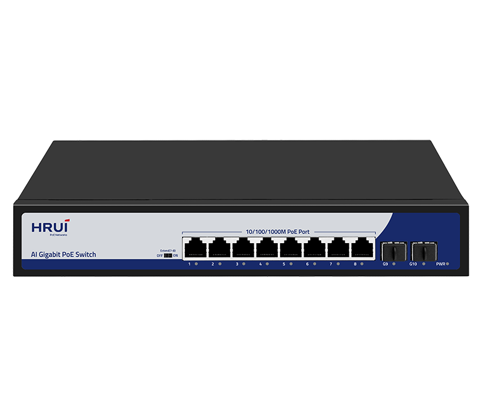
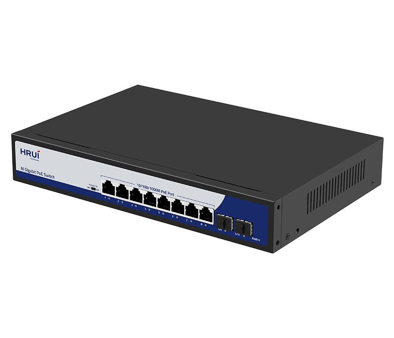
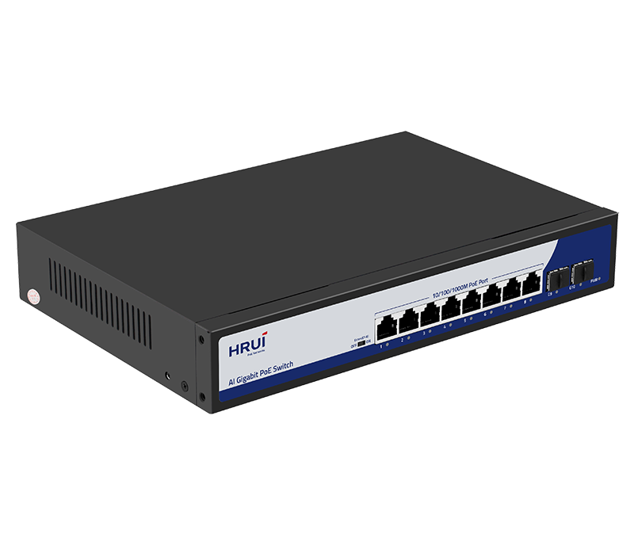
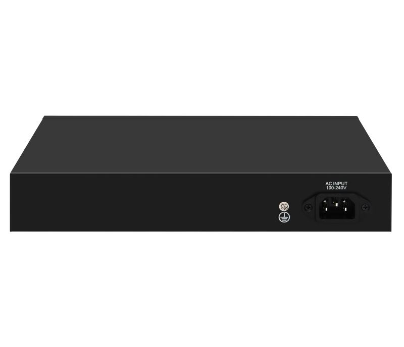

# HR200-AFG-82NS-150

> 来源：<https://www.hruitech.com/poe-switch/273.html>（抓取 2026-10-21T04:35:31Z；英文原文照录，中文仅为栏目名）  
> 官网描述：8-Port 10/100/1000T 802.3af/at PoE + 2-Port Gigabit SFP Ethernet Switch(150 Watts)  
> 类目：PoE Switch（site id 273）  
> 接口：8* 1G PoE ports / 2 *1G uplink SFP ports；PoE 预算 140W；交换带宽 —；电源 AC 100-240V 50/60Hz / DC 52V 2.88A

**Brief:** HR200-AFG-82NS-150, a robust 10-Port Gigabit PoE Switch designed to effortlessly power and manage your network devices. This switch features eight 1G PoE ports and two 1G SFP ports, making it ideal for a wide range of applications, from small offices to industrial settings. Equipped with advanced compliance to IEEE standards, superior power management, and diagnostic capabilities, the HR200-AFG-82NS is your reliable solution for seamless connectivity and power delivery.

## 产品图





## Datasheet
- [HR200_AFG_82NS_150.pdf](https://www.hruitech.com/web/userfiles/productfile/HR200_AFG_82NS_150.pdf) （本地：`data/hrui_site_raw/datasheets/HR200_AFG_82NS_150.pdf`；文本：`data/hrui_site_raw/datasheet_text/HR200_AFG_82NS_150.txt`）

## Feature and Benefits（原文）
```
HR200-AFG-82NS-150, a robust 10-Port Gigabit PoE Switch designed to effortlessly power and manage your network devices. This switch features eight 1G PoE ports and two 1G SFP ports, making it ideal for a wide range of applications, from small offices to industrial settings. Equipped with advanced compliance to IEEE standards, superior power management, and diagnostic capabilities, the HR200-AFG-82NS-150 is your reliable solution for seamless connectivity and power delivery.
Product Features:
8 Gigabit PoE Ports + 2 Gigabit SFP Ports:
Provides flexible connectivity options for your devices, ensuring high-speed data transfer and power delivery.
Standard Compliance:
Fully adheres to IEEE 802.3, IEEE 802.3ab, IEEE 802.3u, and IEEE 802.3x standards for guaranteed performance and interoperability.
Adaptive RJ45 Ports:
Each RJ45 port supports automatic adaptation for data speeds of 10M, 100M, or 1G, enabling compatibility with various devices.
Automatic PoE Watchdog Mode:
In Extend mode, the PoE ports automatically activate watchdog functionality to ensure stable operation and minimize outages.
Configurable PoE Priority:
Default-enabled PoE priority ensures reliable power distribution, with priority levels set from ports 1 to 8.
Flow Control Mechanism:
Full duplex operations leverage the IEEE 802.3x standard, while back pressure is utilized for half duplex, ensuring optimal network performance.
Comprehensive Status Monitoring:
The LED indicators on the panel provide real-time monitoring of working statuses and aid in quick fault detection and analysis.
Versatile Operational Modes:
Support for VLAN, Default, and Extend modes allows for tailored network configurations that meet your specific needs.
High Power Output:
Port 1 delivers an impressive 60W of PoE power, perfect for high-demand devices.
```

## Parameter（规格表逐行）
| 项 | 值 |
|---|---|
| Description | Specification |
| Model | HR200-AFG-82NS-150 |
| Interface | 8* 1G PoE ports |
| Interface | 2 *1G uplink SFP ports |
| Port Standard | IEEE802.3 (Ethernet) |
| Port Standard | IEEE802.3u (Fast Ethernet) |
| Port Standard | IEEE802.3ab (Gigabit Ethernet) |
| Port Standard | IEEE802.3x (Flow Control) |
| Bandwidth | 20Gbps |
| Packet Forwarding Rate | 14.88Mpps |
| Packet Buffer | 1Mbit |
| MAC Address Table | 2K |
| Transmission Method | Store and Forward |
| PoE Standard | IEEE802.3af (15.4W) |
| PoE Standard | IEEE802.3at (30W) |
| PoE Port Output Voltage | DC 44-57V |
| PoE Ports | Port 1 PoE power output <60W |
| PoE Ports | Port 2-8 PoE power output <30W |
| PoE Power Budget | 140W |
| Power Supply | AC 100-240V 50/60Hz |
| Power Supply | DC 52V 2.88A |
| Mainboard Power Consumption | 6.7W |
| Structure Information | Product Dimensions :268*181*44mm |
| Structure Information | Packaging Dimensions : 316*285*71mm |
| Structure Information | Product Net Weight: KG |
| Structure Information | Product Gross Weight:KG |
| Packing Information | Carton Dimensions :378*335*305mm |
| Packing Information | Packing Quantity: 5PCS |
| Packing Information | Packing Weight: KG |
| Package Contents | Switch 1pcs, power cord 1pcs, manual 1pcs,certificate of qualification 1pcs |
| Fan Quantity | 0 |
| Installation | Desktop |
| Certification | CE,FCC,RoHS |
| Surge Protection | Port Surge: common mode 4KV, differential mode 2KV (Class C) |
| Surge Protection | Electrostatic ESD: Air 8KV, Contact 6KV (Class C) |
| Operating Temperature | 0~40°C |
| Storage Temperature | -40 °C to 70 °C |
| Operation Humidity | 10%~90%,non condensing |
| Storage Humidity | 5%~95%,non condensing |
| PWR Green LED | On: Powered on |
| PWR Green LED | Off: Powered off |
| 1-10 Green LED | On:10M/100M/1G Link normal |
| 1-10 Green LED | Off: Link blocked |
| 1-10 Green LED | Flashing: Data transmitting |
| Extend Mode Button | OFF: Normal mode, 1-10 ports can communicate with each other, transmission distance is within 100 meters, transmission rate is 10M/100M/1G adaptive, and port PoE watchdog mode turned off; |
| Extend Mode Button | ON: Link extension mode, 7-8 ports data transmission distance can be extended to 250 meters, transmission speed is 10Mbps,and enable PoE watchdog mode on ports; |

## Product structure / Application topology（图）
- https://www.hruitech.com/web/userfiles/image/20250208/1738979978541010.png
