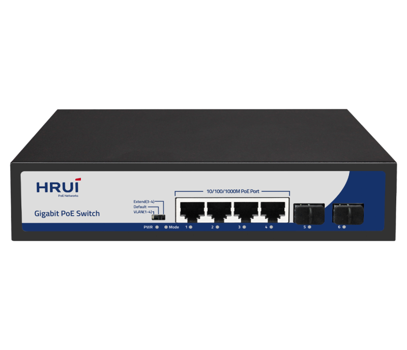
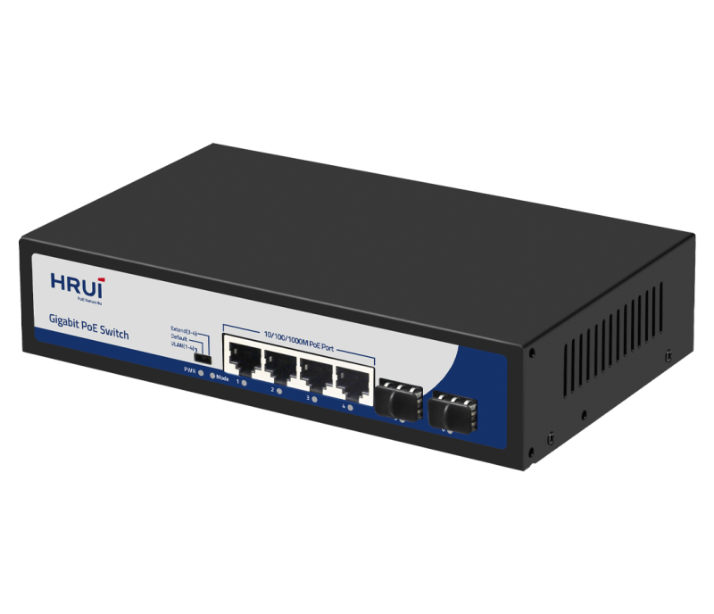
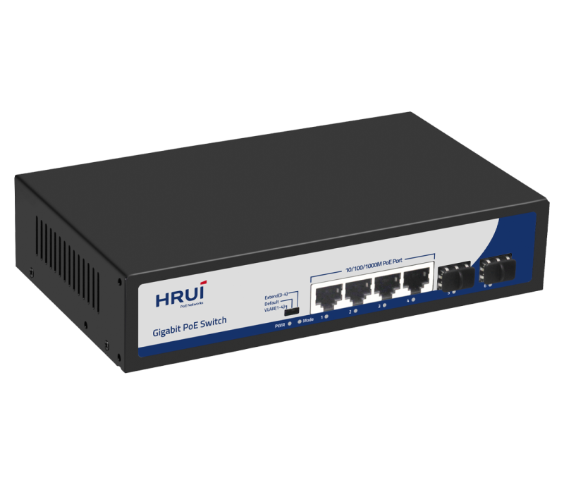
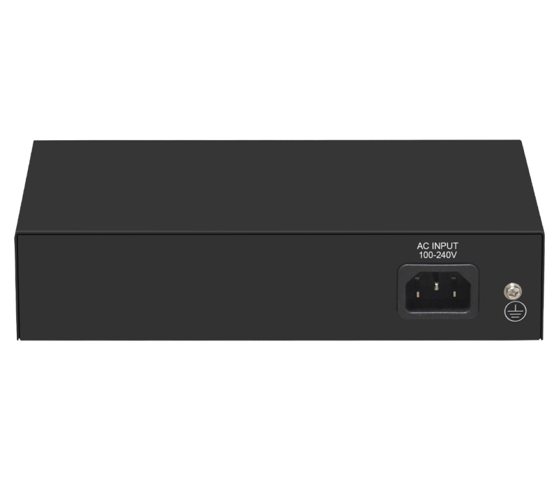

# HR200-AXG-42NS-100

> 来源：<https://www.hruitech.com/poe-switch/220.html>（抓取 2026-10-21T04:35:28Z；英文原文照录，中文仅为栏目名）  
> 官网描述：4-Port 10/100/1000T 802.3af/at PoE + 2-Port Gigabit SFP Ethernet Switch(100 Watts)  
> 类目：PoE Switch（site id 220）  
> 接口：4* 1G PoE ports / 2 *1G SFP ports；PoE 预算 90W；交换带宽 —；电源 AC 100-240V 50/60Hz / DC 52V 1.92A

**Brief:** Gigabit intelligent PoE switch, with 4*Gigabit PoE ports + 2*Gigabit uplink SFP ports, IEEE 802.3af/at standard, bandwidth 12Gbps, total power 120W, port-1 supports 60W power supply, surpport port isolation and 250m transmission, suitable for -10~50℃ wide temperature environment

## 产品图





## Datasheet
- [HR200_AXG_42NS_vPUhj.pdf](https://www.hruitech.com/web/userfiles/productfile/HR200_AXG_42NS_vPUhj.pdf) （本地：`data/hrui_site_raw/datasheets/HR200_AXG_42NS_vPUhj.pdf`；文本：`data/hrui_site_raw/datasheet_text/HR200_AXG_42NS_vPUhj.txt`）

## Feature and Benefits（原文）
```
HR200-AXG-42NS-100, a cutting-edge Gigabit Intelligent Power over Ethernet (PoE) Switch designed to efficiently support your networking needs. Featuring 4 Gigabit PoE ports and 2 Gigabit uplink SFP ports, this switch is compliant with IEEE 802.3af/at standards, ensuring reliable and high-performance power supply to connected devices. With a robust bandwidth of 12Gbps and a total power output of 120W, this switch is ideal for powering multiple devices while maintaining exceptional data transmission speeds. Port 1 offers a powerful 60W power supply, while its advanced features include port isolation and an impressive 250m transmission range, making it perfect for a variety of applications in a wide temperature range of -10°C to 50°C.
Product Features:
Port Configuration:
4 Gigabit PoE ports for device connectivity and 2 Gigabit SFP uplink ports for flexible networking options.
Standards Compliance:
Designed in accordance with IEEE 802.3, IEEE 802.3u, IEEE 802.3ab, IEEE 802.3z, and IEEE 802.3x standards for reliable performance.
Flexible Connectivity:
RJ45 ports support 10M, 100M, and 1G auto-negotiation for versatility.
Flow Control:
Supports Full Duplex (IEEE 802.3x) and Half Duplex (Back Pressure) flow control methods.
Auto MDI/MDIX Support:
Automatic port flipping capability eliminates the need for crossover cables, simplifying setup.
Advanced Mechanism:
Utilizes a storage and forwarding exchange mechanism for efficient data handling.
Status Monitoring:
The panel features LED indicators that monitor operational status and help with fault diagnosis.
Flexible Modes:
Supports VLAN, Default, and Extend modes for customized network management.
Power Output:
Delivers up to 60W of PoE power from Port 1, ideal for power-hungry devices.
```

## Parameter（规格表逐行）
| 项 | 值 |
|---|---|
| Description | Specification |
| Model | HR200-AXG-42NS |
| Interface | 4* 1G PoE ports |
| Interface | 2 *1G SFP ports |
| Port Standard | IEEE802.3 (Ethernet) |
| Port Standard | IEEE802.3u (Fast Ethernet) |
| Port Standard | IEEE802.3ab (Gigabit Ethernet) |
| Port Standard | IEEE 802.3z (Gigabit Ethernet Fiber Standard) |
| Port Standard | IEEE802.3x (Flow Control) |
| Bandwidth | 12 Gbps |
| Packet Forwarding Rate | 8.928Mpps |
| Packet Buffer | 1Mbit |
| MAC Address Table | 2K |
| Transmission Method | Store and Forward |
| PoE Standard | IEEE802.3af (15.4W) |
| PoE Standard | IEEE802.3at (30W) |
| PoE Port Output Voltage | DC 44-57V |
| PoE Ports | Port 1 PoE power output <60W |
| PoE Ports | Port 2-4 PoE power output <30W |
| PoE Power Budget | 90W |
| Power Supply | AC 100-240V 50/60Hz |
| Power Supply | DC 52V 1.92A |
| Mainboard Power Consumption | 3.79W |
| Structure Information | Product Dimensions :200*118*44mm |
| Structure Information | Packaging Dimensions : 245*190*60mm |
| Structure Information | Product Net Weight: 0.67Kg |
| Structure Information | Product Gross Weight:0.97Kg |
| Packing Information | Carton Dimensions :520*320*400mm |
| Packing Information | Packing Quantity: 20PCS |
| Packing Information | Packing Weight: 20.4KG |
| Package Contents | Switch 1pcs, power cord 1pcs, manual 1pcs,certificate of qualification 1pcs |
| Fan Quantity | 0 |
| Installation | Desktop |
| Certification | CE,FCC,RoHS |
| Surge Protection | Port protection: common mode 4KV, differential mode 2KV ; Electrostatic ESD: Air 8KV, Contact 6KV (Class B) |
| Operating Temperature | 0~40°C |
| Storage Temperature | -40 °C to 70 °C |
| Operation Humidity | 10%~90%,non condensing |
| Storage Humidity | 5%~95%,non condensing |
| PWR Green LED | On: Powered on |
| PWR Green LED | Off: Powered off |
| Mode Green LED | On:VLAN |
| Mode Green LED | Flashing:Extend |
| Mode Green LED | Off:Default |
| 1-6 Green LED | On: 10M/100M/1G Link normal |
| 1-6 Green LED | Off: Link blocked |
| 1-6 Green LED | Flashing: Data transmitting |
| VLAN/Default/Extend Modes Buttons | VLAN: Isolation mode, 1-4 ports isolated from each other, communicating with 5-6 ports, port PoE watchdog mode is enabled |
| VLAN/Default/Extend Modes Buttons | Default: Normal mode, all interfaces can communicate with each other, transmission distance is within 100 meters, transmission rate is 10M/100M/1G adaptive,port PoE watchdog mode is turned off |
| VLAN/Default/Extend Modes Buttons | Extend: Link extension mode, 3-4 port PoE power supply and data transmission distance can be extended to 250 meters, transmission speed is 10Mbps, port PoE watchdog mode is enabled |

## Product structure / Application topology（图）
- https://www.hruitech.com/web/userfiles/image/20241225/1735093355287113.png
