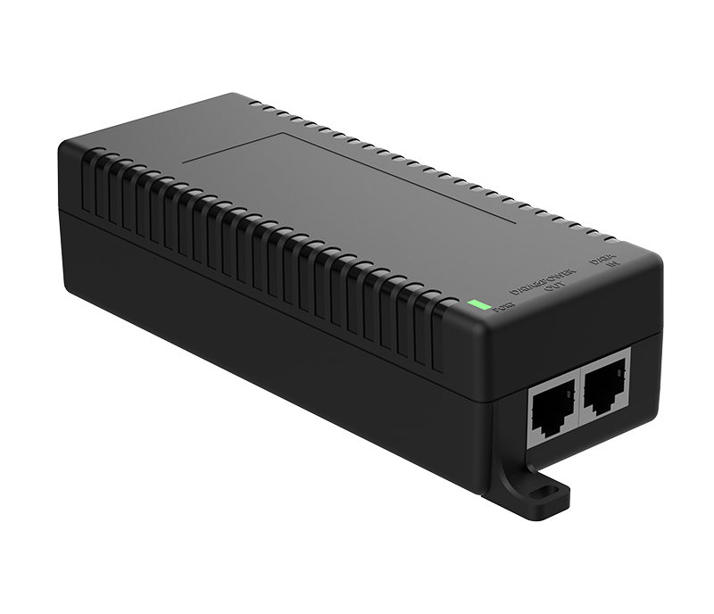
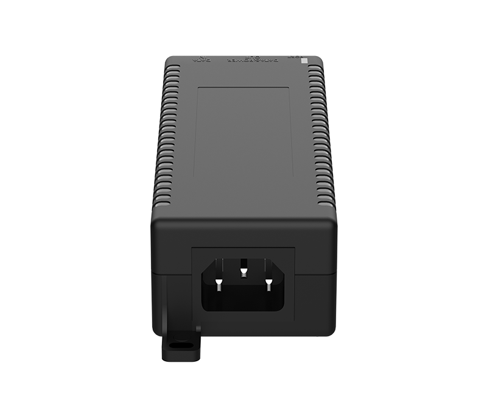
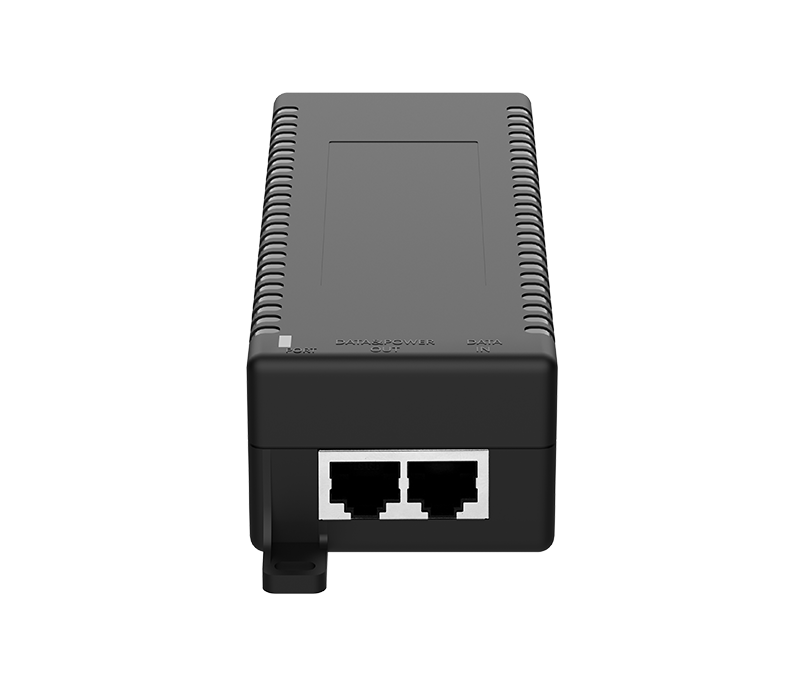
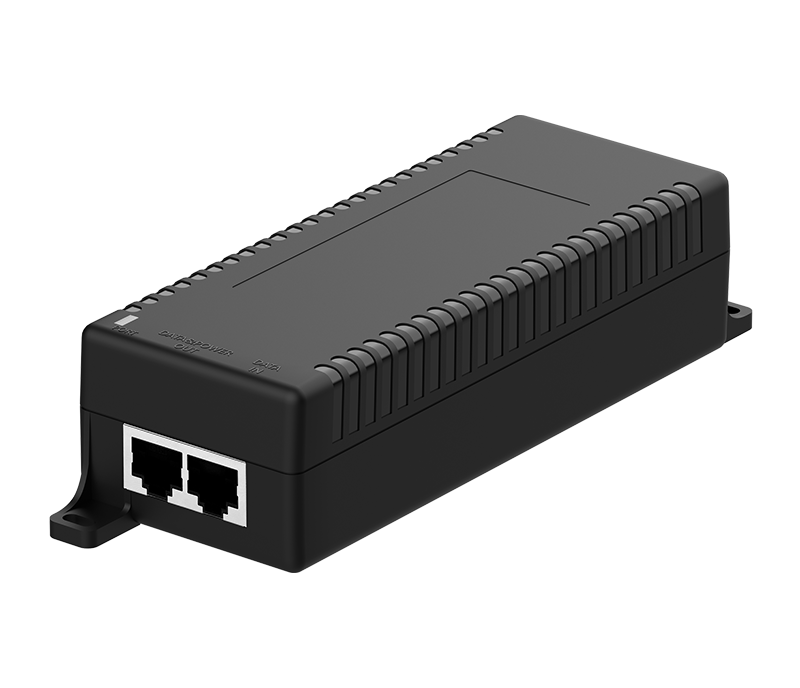
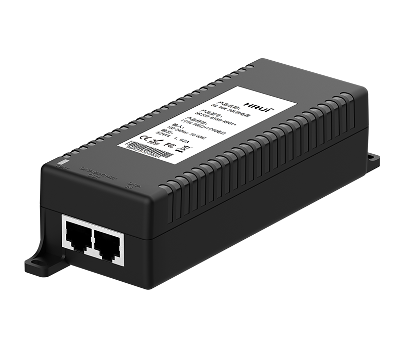

# HR200-BTG5-N901

> 来源：<https://www.hruitech.com/poe-accessory/321.html>（抓取 2026-10-21T03:46:07Z；英文原文照录，中文仅为栏目名）  
> 官网描述：HR200-BTG5-N901   
> 类目：PoE Accessory（site id 321）  
> 接口：1*5Gbps PoE out Port / 1*5Gbps Data in Port；PoE 预算 —；交换带宽 —；电源 AC 100-240V 50/60Hz / DC 52V 1.92A

**Brief:** 5G IEEE 802.3af/at/bt PoE injector, 1*AC power port + 1*5G Ethernet Port + 1*5G PoE port, 90W maximum PoE power output, support 10/100/1000M/2.5G/5G self-adaption, working temperature range 0°C~+40°C, surge & ESD protection, PoE port common mode 6KV differential mode 2KV, ESD contact 6KV air 8KV

## 产品图






## Datasheet
- [HR200-BTG5-N901-2B-28EN-29.pdf](https://www.hruitech.com/web/userfiles/productfile/HR200-BTG5-N901-2B-28EN-29.pdf) （本地：`data/hrui_site_raw/downloads/HR200-BTG5-N901-2B-28EN-29.pdf`；文本：`data/hrui_site_raw/datasheet_text/HR200-BTG5-N901-2B-28EN-29.txt`）

## Feature and Benefits（原文）
```
The HR200-BTG5-N901 is a high-performance 5G PoE injector designed to deliver stable power and high-speed data transmission for bandwidth-intensive network devices. With up to 90W PoE output, it ensures reliable operation for high-power applications in demanding network environments.Its compact design supports both desktop and wall-mounted installation, making it an ideal solution for deploying high-speed PoE devices such as WiFi 6 access points, PTZ HD cameras, digital signage, and industrial terminals.
Product Features:
High-Speed Connectivity:
Equipped with 1 x 5G PoE power supply port and 1 x 5G RJ45 data port, ensuring high-speed data transmission while supplying power simultaneously.
Adaptive Speed:
Ethernet Ports support 10M/100M/1G/2.5G/5Gbps self-adaptive.
Standards Compatibility:
Fully compatible with industry standards IEEE802.3af (15.4W), IEEE802.3at (30W), and IEEE802.3bt (90W), allowing for flexibility in powering a wide range of devices.
Wide Input Voltage Range:
Supports an input voltage range of AC 100-240V, making it suitable for global use without the need for voltage converters.
High Protection Performance:
Port surge protection (differential mode 2KV, common mode 6KV); ESD electrostatic discharge protection (contact 6KV, air 8KV)
Durable Construction:
Housed in a high-quality metal casing, the injector is designed for durability and enhanced thermal management.
Environmental Resistance:
With an IP20 protection level, the device is safeguarded against dust and requires minimal maintenance, making it perfect for various environments.
Versatile Operating Conditions:
Operates effectively in a temperature range of 0 to 40 °C, ensuring reliability in diverse outdoor and indoor environments.
Flexible Installation:
Supports desktop or wall mounting for easy deployment.
```

## Parameter（规格表逐行）
| 项 | 值 |
|---|---|
| Description | Specification |
| Model | HR200-BTG5-N901+ |
| Interface | 1*5Gbps PoE out Port |
| Interface | 1*5Gbps Data in Port |
| Port Standard | IEEE802.3 (Ethernet) |
| Port Standard | IEEE802.3u (Fast Ethernet) |
| Port Standard | IEEE802.3ab (Gigabit Ethernet) |
| Port Standard | IEEE802.3x (Flow Control) |
| PoE Standard | 15.4 W (IEEE 802.3af) |
| PoE Standard | 30 W (IEEE 802.3at) |
| PoE Standard | 90 W (IEEE 802.3bt) |
| PoE Port Output Voltage | DC 44-57V |
| Power Supply | AC 100-240V 50/60Hz |
| Power Supply | DC 52V 1.92A |
| PoE port | Port PoE power output<90W |
| Structure Information | Product Dimensions: 166*56.5*39.2mm |
| Structure Information | Packaging Dimensions: 203*160*55mm |
| Structure Information | Product Net Weight: 0.2KG |
| Structure Information | Product Gross Weight: 0.4KG |
| Packing Information | Carton Dimensions: 580*335*445mm |
| Packing Information | Packing Quantity: 40PCS |
| Packing Information | Packing Weight: 17KG |
| Package Contents | Injector 1pcs, Manual 1pcs, Certificate of Inspection 1pcs |
| Certification | CE, FCC, RoHS |
| Installation | Wall Mounting |
| Operating Temperature | 0~40°C |
| Storage Temperature | -40~85°C |
| Operation Humidity | 5%~90%, non condensing |
| Storage Humidity | 5%~95%, non condensing |
| Port Led | Green：Power on |
| Port Led | Red：PoE on |
| Port Led | Off：Power off |
| Surge protection | Port surge: Common mode 6KV, Differential mode 2KV |
| Surge protection | Electrostatic ESD 6KV, Air 8KV |
| Surge protection | Power Supply: Common mode 6KV, Differential mode 2KV |

## Product structure / Application topology（图）
- https://www.hruitech.com/web/userfiles/image/20260325/1774428853228872.png
