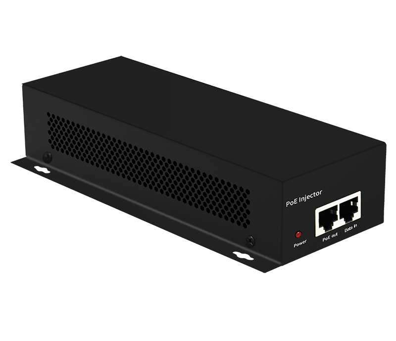
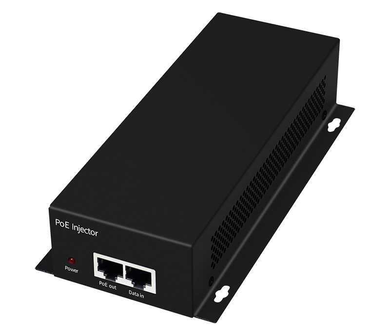
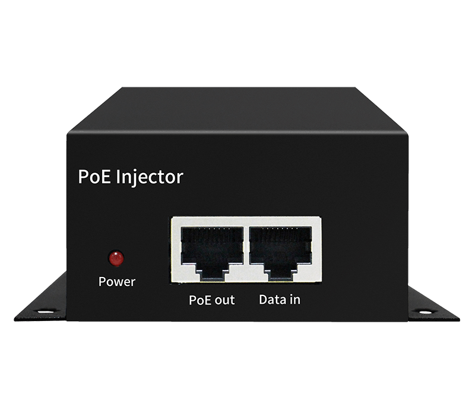
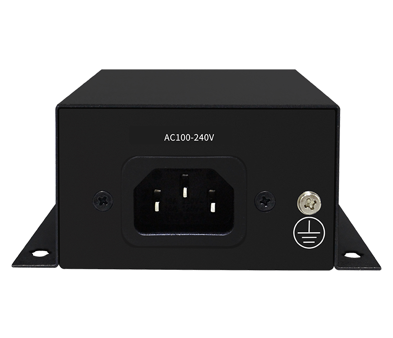

# HR200-BTTG-N601

> 来源：<https://www.hruitech.com/poe-accessory/159.html>（抓取 2026-10-21T03:45:56Z；英文原文照录，中文仅为栏目名）  
> 官网描述：HRUI 60W 10G PoE Injector | HR200-BTTG-N601  
> 类目：PoE Accessory（site id 159）  
> 接口：1* 10G PoE Port / 1* 10G RJ45 Port；PoE 预算 —；交换带宽 —；电源 AC 100-240V 50/60Hz / DC 52V 1.15A

**Brief:** The HR200-BTTG-N601 is a state-of-the-art 60W PoE injector, designed to meet the demanding needs of modern network infrastructure. This powerful device seamlessly integrates power and data supply over a single cable, providing an efficient and reliable solution for powering devices such as IP cameras, Wi-Fi access points, and VoIP phones in high-performance environments. With its robust build and versatile compatibility, the HR200-BTTG-N601 is the ideal choice for both enterprise and home applications.

## 产品图





## Datasheet
- [HR200_BTTG_N601.pdf](https://www.hruitech.com/web/userfiles/productfile/HR200_BTTG_N601.pdf) （本地：`data/hrui_site_raw/downloads/HR200_BTTG_N601.pdf`；文本：`data/hrui_site_raw/datasheet_text/HR200_BTTG_N601.txt`）

## Feature and Benefits（原文）
```
The HR200-BTTG-N601 is a state-of-the-art 60W PoE injector, designed to meet the demanding needs of modern network infrastructure. This powerful device seamlessly integrates power and data supply over a single cable, providing an efficient and reliable solution for powering devices such as IP cameras, Wi-Fi access points, and VoIP phones in high-performance environments. With its robust build and versatile compatibility, the HR200-BTTG-N601 is the ideal choice for both enterprise and home applications.
Product Features:
Dual Connectivity:
Equipped with 1 x 10G PoE power supply port and 1 x 10G RJ45 data port, ensuring high-speed data transmission while supplying power simultaneously.
Standards Compliance:
Fully compatible with industry standards IEEE802.3af (15.4W), IEEE802.3at (30W), and IEEE802.3bt (60W), allowing for flexibility in powering a wide range of devices.
Wide Input Voltage Range:
Supports an input voltage range of AC 100-240V, making it suitable for global use without the need for voltage converters.
Durable Construction:
Housed in a high-quality metal casing, the injector is designed for durability and enhanced thermal management.
Environmental Resistance:
With an IP20 protection level, the device is safeguarded against dust and requires minimal maintenance, making it perfect for various environments.
Versatile Operating Conditions:
Operates effectively in a temperature range of -20 to 50 °C, ensuring reliability in diverse outdoor and indoor environments.
The HRUI 60/90W 10G PoE Injectors provide efficient power solutions for high-speed applications, supporting advanced technologies like Wi-Fi 6 and 7. Each injector includes one 10-Gigabit PoE port and one 10-Gigabit network port, compatible with IEEE802.3af, IEEE802.3at, and IEEE802.3bt standards for versatile power distribution.
The HRUI 60/90W 10G PoE Injectors feature a durable metal casing, support an AC input of 100-240V, and have an IP20 rating for reliable operation in temperatures from -20 to 50°C. Their plug-and-play design allows for easy deployment, making them ideal for both enterprise networks and home Wi-Fi coverage, providing stable power to ensure efficient equipment performance.
10G Transmission
With 10 Gigabit PoE and network ports, it offers high-speed data transmission, ideal for high-traffic and high-performance network environments.
IEEE 802.3af/at/bt PoE Standard
Supports various PoE standards with a maximum power supply of 60W/90W BT PoE, ideal for Wi-Fi 6 and Wi-Fi 7 technologies.
Sturdy and Durable Design
Durable metal casing with IP20 protection, supports 6kV surge and 8kV ESD protection, suitable for -20 to 50℃ environments.
Flexible Installation
Supports wall and desktop installation, flexible and convenient.
Plug and Play, No Configuration Needed
Supports adaptive port speed, plug and play, no separate configuration required, saving time, easy to use.
SPECIFICATIONS
Port Rate: 1*10G 60W PoE + 1*10G RJ-45
PoE Standard: IEEE 802.3af/at/bt
Max PoE Output: 60W
Surge Protection: 6KV
Working Temperature: -20℃～50℃
Port Rate: 1*10G 90W PoE + 1*10G RJ-45
PoE Standard: IEEE 802.3af/at/bt
Max PoE Output: 90W
Surge Protection: 6KV
Working Temperature: -20℃～50℃
```

## Parameter（规格表逐行）
| 项 | 值 |
|---|---|
| Port Rate: 1*10G 60W PoE + 1*10G RJ-45 PoE Standard: IEEE 802.3af/at/bt Max PoE Output: 60W Surge Protection: 6KV Working Temperature: -20℃～50℃ | Port Rate: 1*10G 90W PoE + 1*10G RJ-45 PoE Standard: IEEE 802.3af/at/bt Max PoE Output: 90W Surge Protection: 6KV Working Temperature: -20℃～50℃ |
| Description | Specification |
| Model | HR200-BTTG-N601 |
| Interface | 1* 10G PoE Port |
| Interface | 1* 10G RJ45 Port |
| Port Standard | IEEE802.3 (Ethernet) |
| Port Standard | IEEE802.3u (Fast Ethernet) |
| Port Standard | IEEE802.3ab (1000Mbps Ethernet) |
| Port Standard | IEEE802.3ae (10G Ethernet) |
| Port Standard | IEEE802.3x (Flow Control) |
| PoE Standard | 15.4 W (IEEE 802.3af) |
| PoE Standard | 30 W (IEEE 802.3at) |
| PoE Standard | 60 W (IEEE 802.3bt) |
| PoE Port Output Voltage | DC 44-57V |
| Power Supply | AC 100-240V 50/60Hz |
| Power Supply | DC 52V 1.15A |
| PoE port | Port PoE power output<60W |
| Structure Information | Product Dimensions :187* 95*40 mm |
| Structure Information | Packaging Dimensions : 245*190*60mm |
| Structure Information | Product Net Weight: 0.486KG |
| Structure Information | Product Gross Weight:0.712KG |
| Packing Information | Carton Dimensions :520*320*400mm |
| Packing Information | Packing Quantity: 20PCS |
| Packing Information | Packing Weight: 15.24KG |
| Package Content | Injector 1pcs, manual 1pcs，certificate of qualification 1pcs |
| Certification | CE, FCC, RoHS |
| Installation | Wall Mounting |
| Operating Temperature | -20～50℃ |
| Storage Temperature | -40～85℃ |
| Operation Humidity | 5%~90%，non condensing |
| Storage Humidity | 5%~95%，non condensing |
| PWR | On: Powered on |
| PWR | Off: Powered off |
| Surge protection | Port surge: differential mode 2KV, common mode 6KV; |
| Surge protection | Electrostatic ESD 6KV, air 8KV |

## Product structure / Application topology（图）
- https://www.hruitech.com/web/userfiles/image/20241223/1734944541418888.png
- https://www.hruitech.com/web/userfiles/product/productdetail/HR200_BTTG_N901/top7.jpg
